# Contest an Ore outpost and return the former owner’s disc with separate remote controllers

Ordinary remote invite/claim/unique Basic factions/Ready/Begin; two real identities for contest or four for first-turn bonus/specialty choices. Seed fixed only at Begin (002 contest/specialty;004 bonuses); command identities disjoint. No injected game state or future deck read.

## 1. Arrive through the actual production interface

Viewpoint: **Ada · separate host controller**.

| phone · 393 × 852 | desktop · 1440 × 1000 |
| --- | --- |
|  |  |

- [x] Arrive through the actual production interface
- [x] Actual canonical effects and acknowledgement settle.
- [x] Public topology retains physical separation.
- [x] The viewport fits without page scrolling.

## 2. Choose physical tabletop or separate-controller remote play

Viewpoint: **Ada · separate host controller**.

| phone · 393 × 852 | desktop · 1440 × 1000 |
| --- | --- |
|  |  |

- [x] Choose physical tabletop or separate-controller remote play
- [x] Actual canonical effects and acknowledgement settle.
- [x] Public topology retains physical separation.
- [x] The viewport fits without page scrolling.

## 3. Open the ordinary remote host form

Viewpoint: **Ada · separate host controller**.

| phone · 393 × 852 | desktop · 1440 × 1000 |
| --- | --- |
|  |  |

- [x] Open the ordinary remote host form
- [x] Actual canonical effects and acknowledgement settle.
- [x] Public topology retains physical separation.
- [x] The viewport fits without page scrolling.

## 4. Enter Ada’s host name

Viewpoint: **Ada · separate host controller**.

| phone · 393 × 852 | desktop · 1440 × 1000 |
| --- | --- |
|  |  |

- [x] Enter Ada’s host name
- [x] Actual canonical effects and acknowledgement settle.
- [x] Public topology retains physical separation.
- [x] The viewport fits without page scrolling.

## 5. The host receives the real public invitation

Viewpoint: **Ada · separate host controller**.

| phone · 393 × 852 | desktop · 1440 × 1000 |
| --- | --- |
| [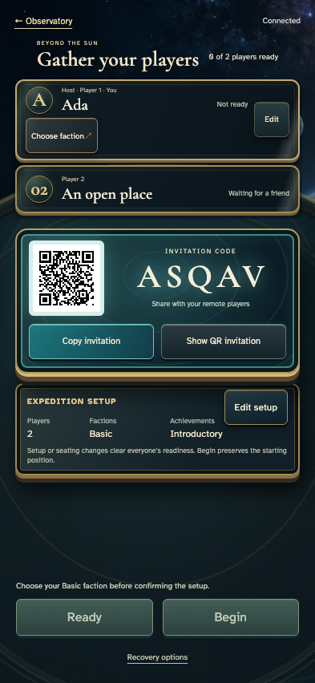](../../screenshots/contest-an-ore-outpost-and-return-the-former-owner-s-disc-with-separate-remote-controllers/004-host-room-phone-darwin.png) | [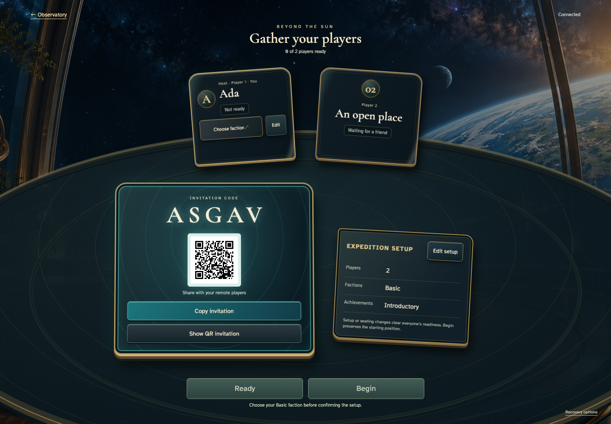](../../screenshots/contest-an-ore-outpost-and-return-the-former-owner-s-disc-with-separate-remote-controllers/004-host-room-desktop-darwin.png) |

- [x] The host receives the real public invitation
- [x] Actual canonical effects and acknowledgement settle.
- [x] Public topology retains physical separation.
- [x] The viewport fits without page scrolling.

## 6. An independent controller previews the invitation

Viewpoint: **Bora · separate guest controller**.

| phone · 1440 × 1000 | desktop · 393 × 852 |
| --- | --- |
|  | [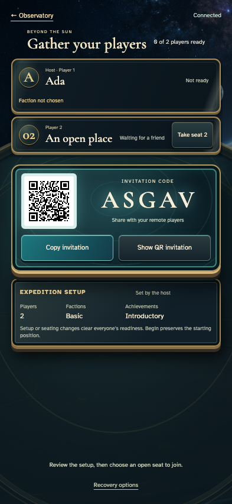](../../screenshots/contest-an-ore-outpost-and-return-the-former-owner-s-disc-with-separate-remote-controllers/005-guest-1-preview-desktop-darwin.png) |

- [x] An independent controller previews the invitation
- [x] Actual canonical effects and acknowledgement settle.
- [x] Public topology retains physical separation.
- [x] The viewport fits without page scrolling.

## 7. Claim an open remote seat through its own dialog

Viewpoint: **Bora · separate guest controller**.

| phone · 1440 × 1000 | desktop · 393 × 852 |
| --- | --- |
| [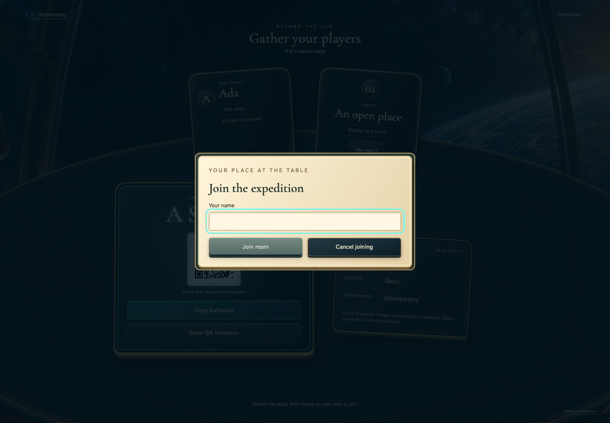](../../screenshots/contest-an-ore-outpost-and-return-the-former-owner-s-disc-with-separate-remote-controllers/006-guest-1-name-form-phone-darwin.png) |  |

- [x] Claim an open remote seat through its own dialog
- [x] Actual canonical effects and acknowledgement settle.
- [x] Public topology retains physical separation.
- [x] The viewport fits without page scrolling.

## 8. Enter the guest name

Viewpoint: **Bora · separate guest controller**.

| phone · 1440 × 1000 | desktop · 393 × 852 |
| --- | --- |
| [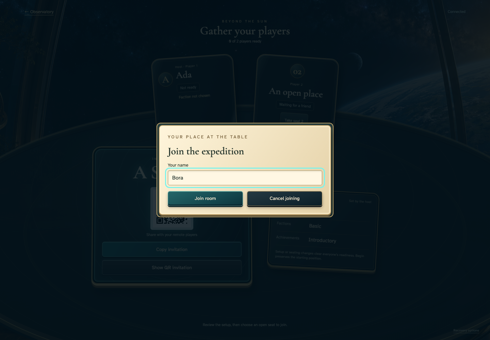](../../screenshots/contest-an-ore-outpost-and-return-the-former-owner-s-disc-with-separate-remote-controllers/007-guest-1-name-phone-darwin.png) |  |

- [x] Enter the guest name
- [x] Actual canonical effects and acknowledgement settle.
- [x] Public topology retains physical separation.
- [x] The viewport fits without page scrolling.

## 9. Persist this controller’s own seat

Viewpoint: **Bora · separate guest controller**.

| phone · 1440 × 1000 | desktop · 393 × 852 |
| --- | --- |
| [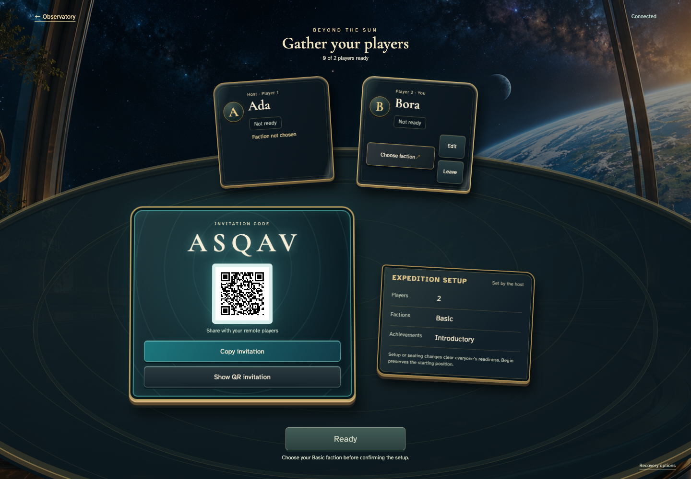](../../screenshots/contest-an-ore-outpost-and-return-the-former-owner-s-disc-with-separate-remote-controllers/008-guest-1-joined-phone-darwin.png) | [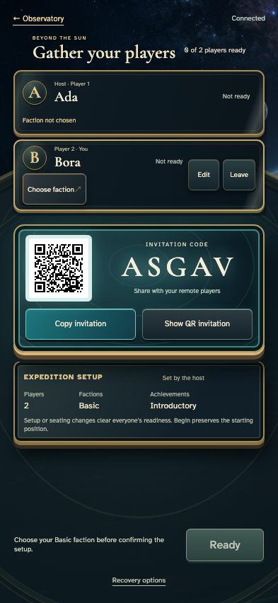](../../screenshots/contest-an-ore-outpost-and-return-the-former-owner-s-disc-with-separate-remote-controllers/008-guest-1-joined-desktop-darwin.png) |

- [x] Persist this controller’s own seat
- [x] Actual canonical effects and acknowledgement settle.
- [x] Public topology retains physical separation.
- [x] The viewport fits without page scrolling.

## 10. Choose a legal unique Basic faction

Viewpoint: **Ada · separate host controller**.

| phone · 393 × 852 | desktop · 1440 × 1000 |
| --- | --- |
|  |  |

- [x] Choose a legal unique Basic faction
- [x] Actual canonical effects and acknowledgement settle.
- [x] Public topology retains physical separation.
- [x] The viewport fits without page scrolling.

## 11. Ada chooses Nishida-Østergaard Corporation

Viewpoint: **Ada · separate host controller**.

| phone · 393 × 852 | desktop · 1440 × 1000 |
| --- | --- |
| [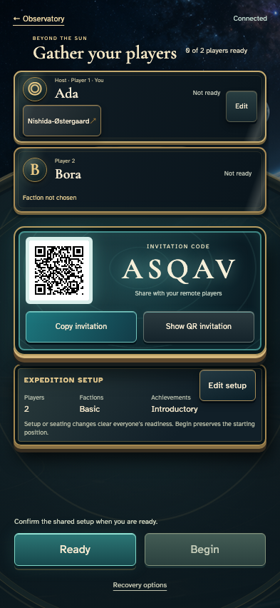](../../screenshots/contest-an-ore-outpost-and-return-the-former-owner-s-disc-with-separate-remote-controllers/010-faction-0-selected-phone-darwin.png) |  |

- [x] Ada chooses Nishida-Østergaard Corporation
- [x] Actual canonical effects and acknowledgement settle.
- [x] Public topology retains physical separation.
- [x] The viewport fits without page scrolling.

## 12. Choose a legal unique Basic faction

Viewpoint: **Bora · separate guest controller**.

| phone · 1440 × 1000 | desktop · 393 × 852 |
| --- | --- |
|  |  |

- [x] Choose a legal unique Basic faction
- [x] Actual canonical effects and acknowledgement settle.
- [x] Public topology retains physical separation.
- [x] The viewport fits without page scrolling.

## 13. Bora chooses The Zheng-Yi Brotherhood

Viewpoint: **Bora · separate guest controller**.

| phone · 1440 × 1000 | desktop · 393 × 852 |
| --- | --- |
|  | [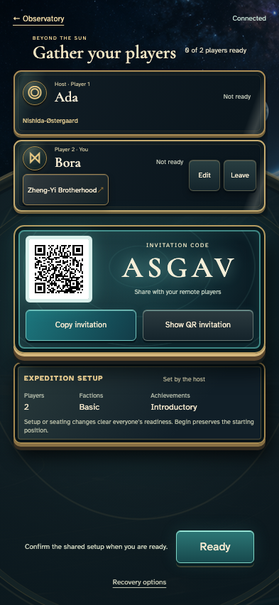](../../screenshots/contest-an-ore-outpost-and-return-the-former-owner-s-disc-with-separate-remote-controllers/012-faction-1-selected-desktop-darwin.png) |

- [x] Bora chooses The Zheng-Yi Brotherhood
- [x] Actual canonical effects and acknowledgement settle.
- [x] Public topology retains physical separation.
- [x] The viewport fits without page scrolling.

## 14. Ada acknowledges the current shared configuration

Viewpoint: **Ada · separate host controller**.

| phone · 393 × 852 | desktop · 1440 × 1000 |
| --- | --- |
| [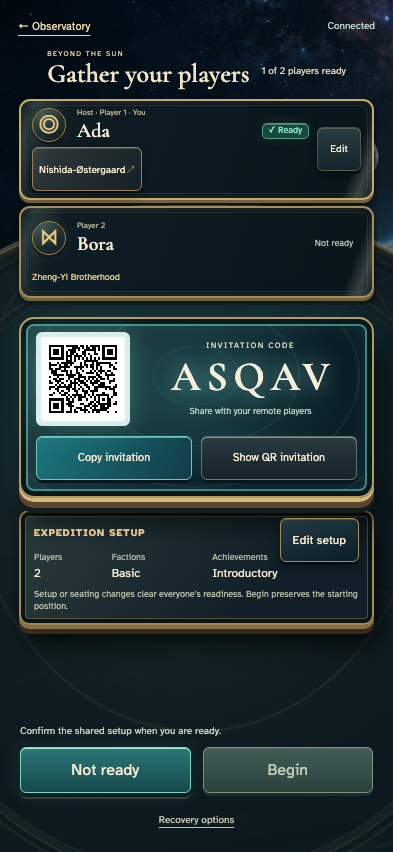](../../screenshots/contest-an-ore-outpost-and-return-the-former-owner-s-disc-with-separate-remote-controllers/013-ready-0-phone-darwin.png) | [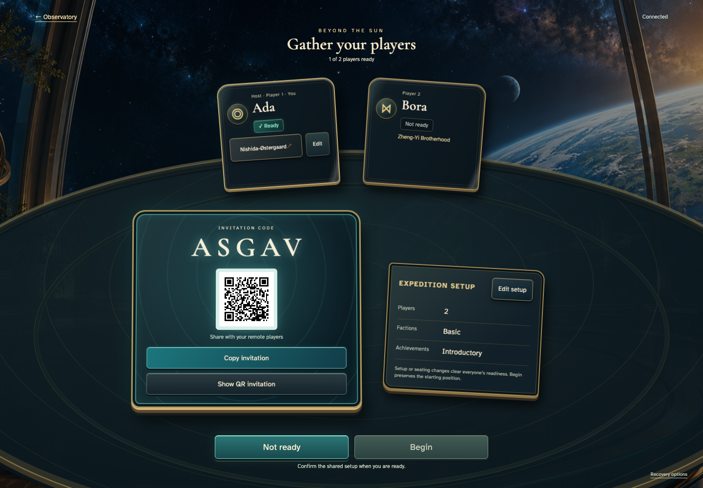](../../screenshots/contest-an-ore-outpost-and-return-the-former-owner-s-disc-with-separate-remote-controllers/013-ready-0-desktop-darwin.png) |

- [x] Ada acknowledges the current shared configuration
- [x] Actual canonical effects and acknowledgement settle.
- [x] Public topology retains physical separation.
- [x] The viewport fits without page scrolling.

## 15. Bora acknowledges the current shared configuration

Viewpoint: **Bora · separate guest controller**.

| phone · 1440 × 1000 | desktop · 393 × 852 |
| --- | --- |
| [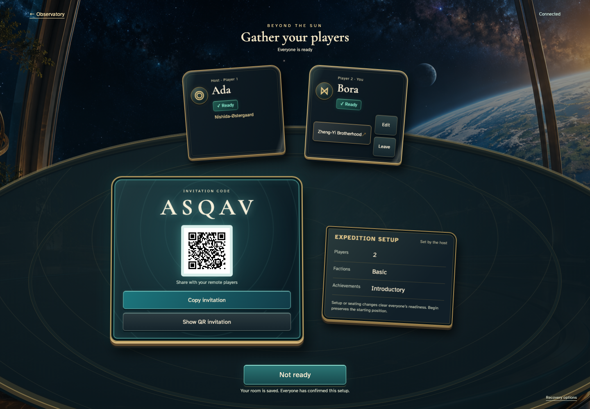](../../screenshots/contest-an-ore-outpost-and-return-the-former-owner-s-disc-with-separate-remote-controllers/014-ready-1-phone-darwin.png) | [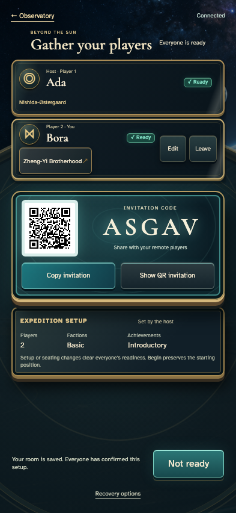](../../screenshots/contest-an-ore-outpost-and-return-the-former-owner-s-disc-with-separate-remote-controllers/014-ready-1-desktop-darwin.png) |

- [x] Bora acknowledges the current shared configuration
- [x] Actual canonical effects and acknowledgement settle.
- [x] Public topology retains physical separation.
- [x] The viewport fits without page scrolling.

## 16. Begin the immutable Basic game through normal UI

Viewpoint: **Ada · separate host controller**.

| phone · 393 × 852 | desktop · 1440 × 1000 |
| --- | --- |
|  |  |

- [x] Begin the immutable Basic game through normal UI
- [x] Actual canonical effects and acknowledgement settle.
- [x] Public topology retains physical separation.
- [x] The viewport fits without page scrolling.

## 17. Ada opens the real Action instrument

Viewpoint: **Ada · separate host controller**.

| phone · 393 × 852 | desktop · 1440 × 1000 |
| --- | --- |
|  |  |

- [x] Ada opens the real Action instrument
- [x] Actual canonical effects and acknowledgement settle.
- [x] Public topology retains physical separation.
- [x] The viewport fits without page scrolling.

## 18. Ada chooses Basic build and jump

Viewpoint: **Ada · separate host controller**.

| phone · 393 × 852 | desktop · 1440 × 1000 |
| --- | --- |
| [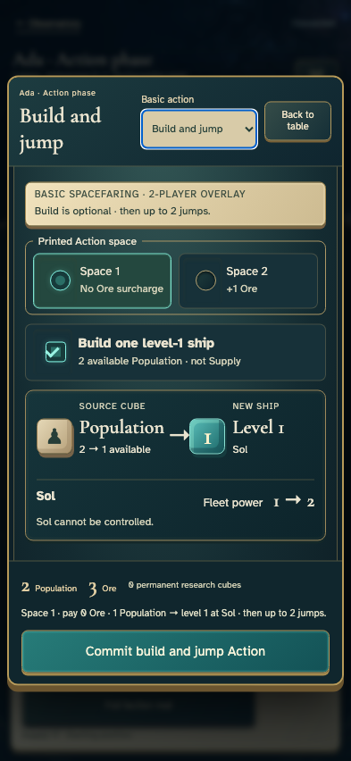](../../screenshots/contest-an-ore-outpost-and-return-the-former-owner-s-disc-with-separate-remote-controllers/017-ada-build-kind-phone-darwin.png) |  |

- [x] Ada chooses Basic build and jump
- [x] Actual canonical effects and acknowledgement settle.
- [x] Public topology retains physical separation.
- [x] The viewport fits without page scrolling.

## 19. Commit the actual Population conversion and printed space cost before optional movement

Viewpoint: **Ada · separate host controller**.

| phone · 393 × 852 | desktop · 1440 × 1000 |
| --- | --- |
|  |  |

- [x] Commit the actual Population conversion and printed space cost before optional movement
- [x] Actual canonical effects and acknowledgement settle.
- [x] Public topology retains physical separation.
- [x] The viewport fits without page scrolling.

## 20. Read the complete public map before choosing a connected route

Viewpoint: **Ada · separate host controller**.

| phone · 393 × 852 | desktop · 1440 × 1000 |
| --- | --- |
|  |  |

- [x] Read the complete public map before choosing a connected route
- [x] Actual canonical effects and acknowledgement settle.
- [x] Public topology retains physical separation.
- [x] The viewport fits without page scrolling.

## 21. Read the actual connected destinations in this interface

Viewpoint: **Ada · separate host controller**.

| phone · 393 × 852 | desktop · 1440 × 1000 |
| --- | --- |
|  |  |

- [x] Read the actual connected destinations in this interface
- [x] Actual canonical effects and acknowledgement settle.
- [x] Public topology retains physical separation.
- [x] The viewport fits without page scrolling.

## 22. Choose a real owned ship for this unpaid route

Viewpoint: **Ada · separate host controller**.

| phone · 393 × 852 | desktop · 1440 × 1000 |
| --- | --- |
|  |  |

- [x] Choose a real owned ship for this unpaid route
- [x] Actual canonical effects and acknowledgement settle.
- [x] Public topology retains physical separation.
- [x] The viewport fits without page scrolling.

## 23. Plan Sirius as an endpoint; nothing moves yet

Viewpoint: **Ada · separate host controller**.

| phone · 393 × 852 | desktop · 1440 × 1000 |
| --- | --- |
| [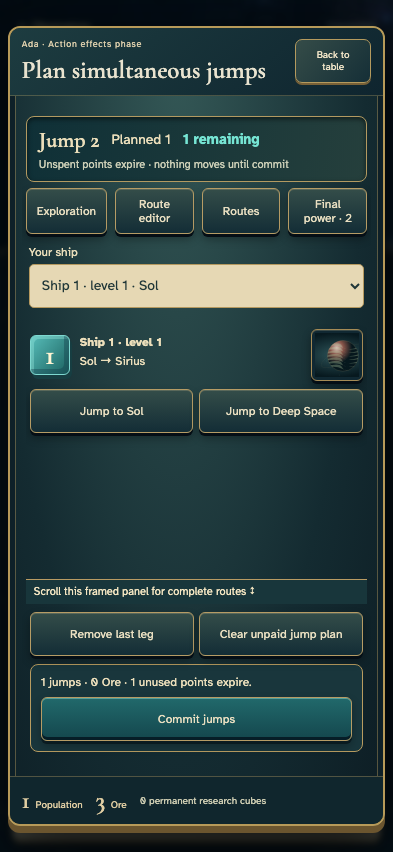](../../screenshots/contest-an-ore-outpost-and-return-the-former-owner-s-disc-with-separate-remote-controllers/022-ada-first-endpoint-phone-darwin.png) |  |

- [x] Plan Sirius as an endpoint; nothing moves yet
- [x] Actual canonical effects and acknowledgement settle.
- [x] Public topology retains physical separation.
- [x] The viewport fits without page scrolling.

## 24. Choose a real owned ship for this unpaid route

Viewpoint: **Ada · separate host controller**.

| phone · 393 × 852 | desktop · 1440 × 1000 |
| --- | --- |
| [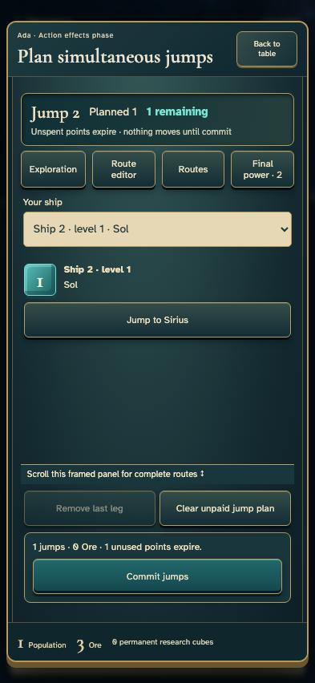](../../screenshots/contest-an-ore-outpost-and-return-the-former-owner-s-disc-with-separate-remote-controllers/023-ada-second-ship-phone-darwin.png) |  |

- [x] Choose a real owned ship for this unpaid route
- [x] Actual canonical effects and acknowledgement settle.
- [x] Public topology retains physical separation.
- [x] The viewport fits without page scrolling.

## 25. Plan Sirius as an endpoint; nothing moves yet

Viewpoint: **Ada · separate host controller**.

| phone · 393 × 852 | desktop · 1440 × 1000 |
| --- | --- |
| [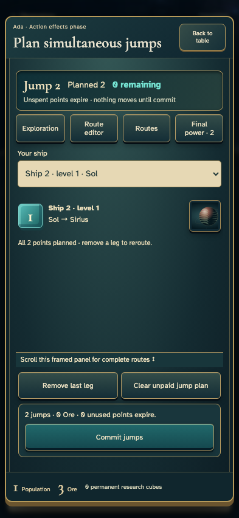](../../screenshots/contest-an-ore-outpost-and-return-the-former-owner-s-disc-with-separate-remote-controllers/024-ada-second-endpoint-phone-darwin.png) |  |

- [x] Plan Sirius as an endpoint; nothing moves yet
- [x] Actual canonical effects and acknowledgement settle.
- [x] Public topology retains physical separation.
- [x] The viewport fits without page scrolling.

## 26. Resolve both endpoints and claim the Ore outpost once

Viewpoint: **Ada · separate host controller**.

| phone · 393 × 852 | desktop · 1440 × 1000 |
| --- | --- |
|  |  |

- [x] Resolve both endpoints and claim the Ore outpost once
- [x] Actual canonical effects and acknowledgement settle.
- [x] Public topology retains physical separation.
- [x] The viewport fits without page scrolling.

## 27. Ada chooses ordinary Ore production and hands off

Viewpoint: **Ada · separate host controller**.

| phone · 393 × 852 | desktop · 1440 × 1000 |
| --- | --- |
| [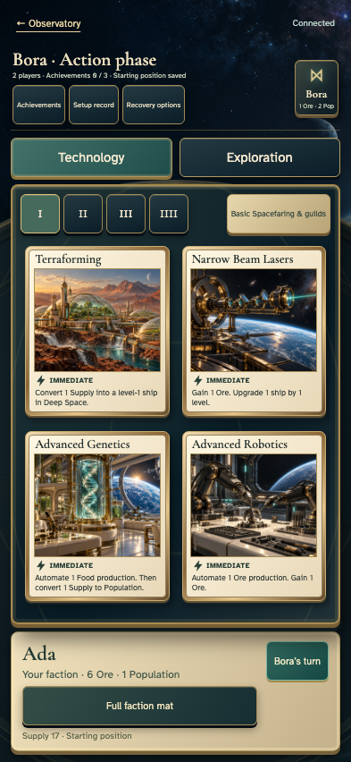](../../screenshots/contest-an-ore-outpost-and-return-the-former-owner-s-disc-with-separate-remote-controllers/026-ada-claim-handoff-phone-darwin.png) |  |

- [x] Ada chooses ordinary Ore production and hands off
- [x] Actual canonical effects and acknowledgement settle.
- [x] Public topology retains physical separation.
- [x] The viewport fits without page scrolling.

## 28. The next distinct controller receives the saved Action phase

Viewpoint: **Bora · separate guest controller**.

| phone · 1440 × 1000 | desktop · 393 × 852 |
| --- | --- |
| [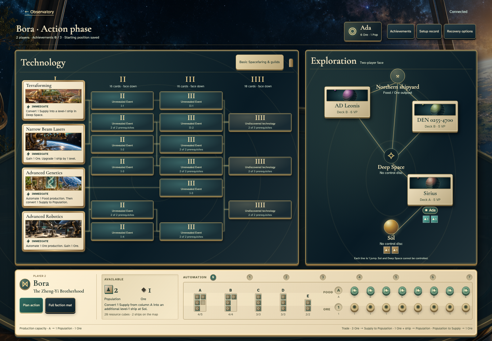](../../screenshots/contest-an-ore-outpost-and-return-the-former-owner-s-disc-with-separate-remote-controllers/027-ada-claim-next-phone-darwin.png) |  |

- [x] The next distinct controller receives the saved Action phase
- [x] Actual canonical effects and acknowledgement settle.
- [x] Public topology retains physical separation.
- [x] The viewport fits without page scrolling.

## 29. Bora opens the real Action instrument

Viewpoint: **Bora · separate guest controller**.

| phone · 1440 × 1000 | desktop · 393 × 852 |
| --- | --- |
|  |  |

- [x] Bora opens the real Action instrument
- [x] Actual canonical effects and acknowledgement settle.
- [x] Public topology retains physical separation.
- [x] The viewport fits without page scrolling.

## 30. Bora chooses Basic build and jump

Viewpoint: **Bora · separate guest controller**.

| phone · 1440 × 1000 | desktop · 393 × 852 |
| --- | --- |
| [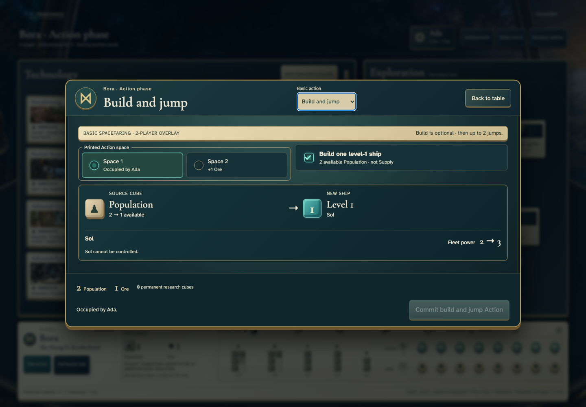](../../screenshots/contest-an-ore-outpost-and-return-the-former-owner-s-disc-with-separate-remote-controllers/029-bora-build-kind-phone-darwin.png) | [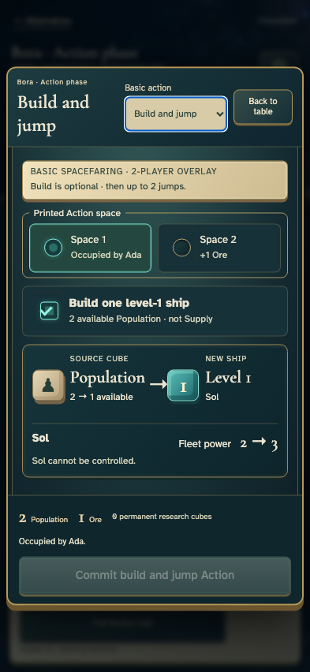](../../screenshots/contest-an-ore-outpost-and-return-the-former-owner-s-disc-with-separate-remote-controllers/029-bora-build-kind-desktop-darwin.png) |

- [x] Bora chooses Basic build and jump
- [x] Actual canonical effects and acknowledgement settle.
- [x] Public topology retains physical separation.
- [x] The viewport fits without page scrolling.

## 31. Choose the unoccupied second printed space with its real surcharge

Viewpoint: **Bora · separate guest controller**.

| phone · 1440 × 1000 | desktop · 393 × 852 |
| --- | --- |
| [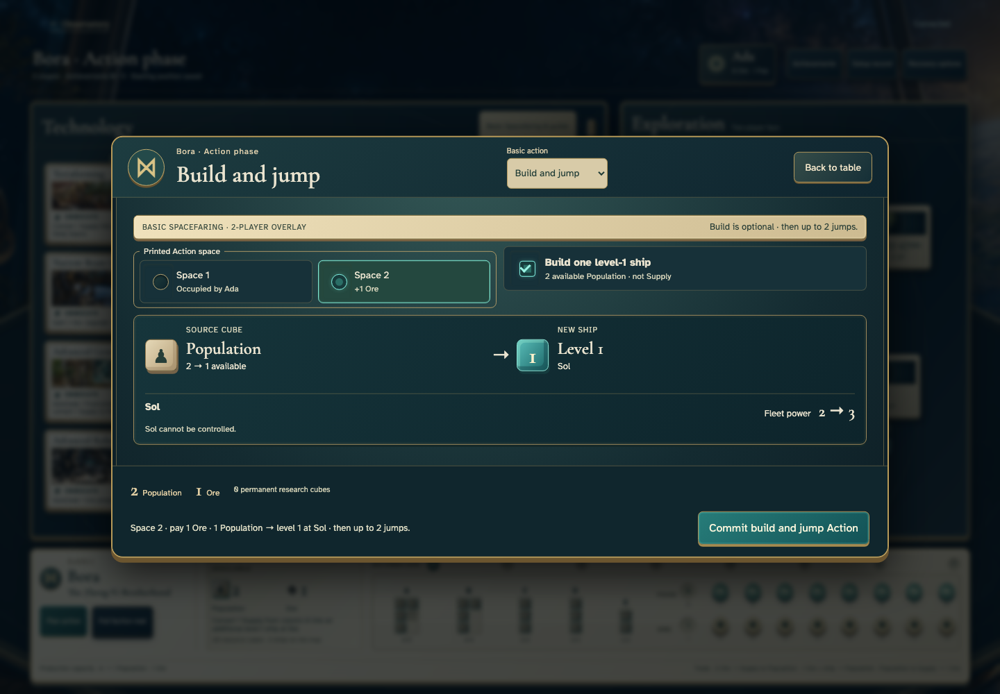](../../screenshots/contest-an-ore-outpost-and-return-the-former-owner-s-disc-with-separate-remote-controllers/030-bora-build-space-phone-darwin.png) | [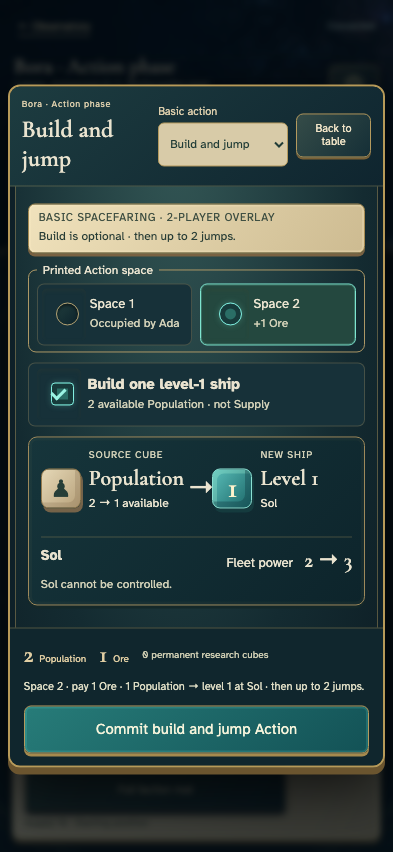](../../screenshots/contest-an-ore-outpost-and-return-the-former-owner-s-disc-with-separate-remote-controllers/030-bora-build-space-desktop-darwin.png) |

- [x] Choose the unoccupied second printed space with its real surcharge
- [x] Actual canonical effects and acknowledgement settle.
- [x] Public topology retains physical separation.
- [x] The viewport fits without page scrolling.

## 32. Commit the actual Population conversion and printed space cost before optional movement

Viewpoint: **Bora · separate guest controller**.

| phone · 1440 × 1000 | desktop · 393 × 852 |
| --- | --- |
| [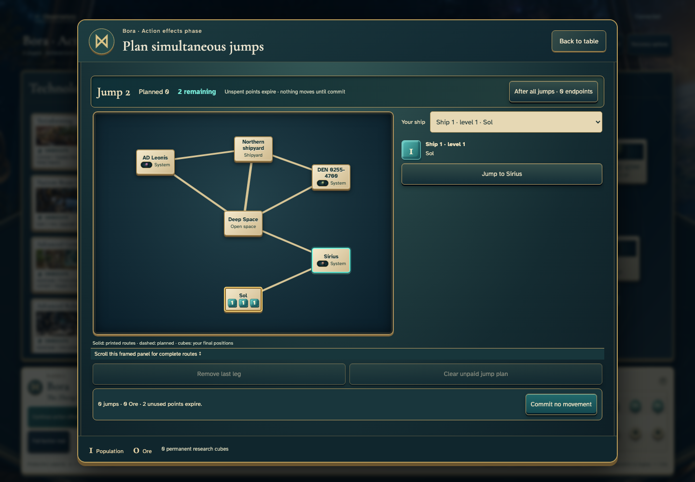](../../screenshots/contest-an-ore-outpost-and-return-the-former-owner-s-disc-with-separate-remote-controllers/031-bora-build-built-phone-darwin.png) |  |

- [x] Commit the actual Population conversion and printed space cost before optional movement
- [x] Actual canonical effects and acknowledgement settle.
- [x] Public topology retains physical separation.
- [x] The viewport fits without page scrolling.

## 33. Read the complete public map before choosing a connected route

Viewpoint: **Bora · separate guest controller**.

| phone · 1440 × 1000 | desktop · 393 × 852 |
| --- | --- |
|  | [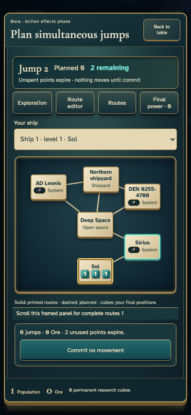](../../screenshots/contest-an-ore-outpost-and-return-the-former-owner-s-disc-with-separate-remote-controllers/032-bora-build-map-desktop-darwin.png) |

- [x] Read the complete public map before choosing a connected route
- [x] Actual canonical effects and acknowledgement settle.
- [x] Public topology retains physical separation.
- [x] The viewport fits without page scrolling.

## 34. Read the actual connected destinations in this interface

Viewpoint: **Bora · separate guest controller**.

| phone · 1440 × 1000 | desktop · 393 × 852 |
| --- | --- |
|  |  |

- [x] Read the actual connected destinations in this interface
- [x] Actual canonical effects and acknowledgement settle.
- [x] Public topology retains physical separation.
- [x] The viewport fits without page scrolling.

## 35. Choose a real owned ship for this unpaid route

Viewpoint: **Bora · separate guest controller**.

| phone · 1440 × 1000 | desktop · 393 × 852 |
| --- | --- |
|  |  |

- [x] Choose a real owned ship for this unpaid route
- [x] Actual canonical effects and acknowledgement settle.
- [x] Public topology retains physical separation.
- [x] The viewport fits without page scrolling.

## 36. Plan Sirius as an endpoint; nothing moves yet

Viewpoint: **Bora · separate guest controller**.

| phone · 1440 × 1000 | desktop · 393 × 852 |
| --- | --- |
| [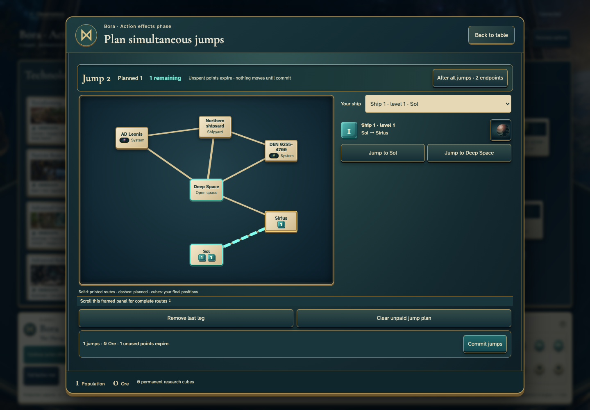](../../screenshots/contest-an-ore-outpost-and-return-the-former-owner-s-disc-with-separate-remote-controllers/035-bora-first-endpoint-phone-darwin.png) |  |

- [x] Plan Sirius as an endpoint; nothing moves yet
- [x] Actual canonical effects and acknowledgement settle.
- [x] Public topology retains physical separation.
- [x] The viewport fits without page scrolling.

## 37. Choose a real owned ship for this unpaid route

Viewpoint: **Bora · separate guest controller**.

| phone · 1440 × 1000 | desktop · 393 × 852 |
| --- | --- |
| [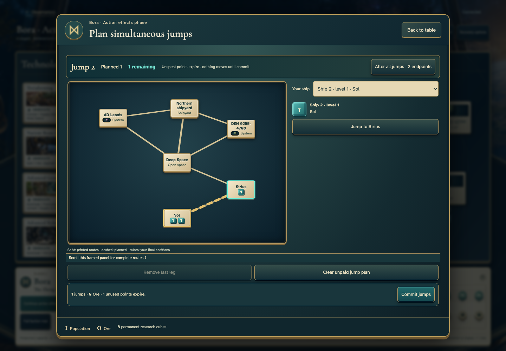](../../screenshots/contest-an-ore-outpost-and-return-the-former-owner-s-disc-with-separate-remote-controllers/036-bora-second-ship-phone-darwin.png) |  |

- [x] Choose a real owned ship for this unpaid route
- [x] Actual canonical effects and acknowledgement settle.
- [x] Public topology retains physical separation.
- [x] The viewport fits without page scrolling.

## 38. Plan Sirius as an endpoint; nothing moves yet

Viewpoint: **Bora · separate guest controller**.

| phone · 1440 × 1000 | desktop · 393 × 852 |
| --- | --- |
|  |  |

- [x] Plan Sirius as an endpoint; nothing moves yet
- [x] Actual canonical effects and acknowledgement settle.
- [x] Public topology retains physical separation.
- [x] The viewport fits without page scrolling.

## 39. An incoming tied fleet does not gain an outpost or repeat its bonus

Viewpoint: **Bora · separate guest controller**.

| phone · 1440 × 1000 | desktop · 393 × 852 |
| --- | --- |
| [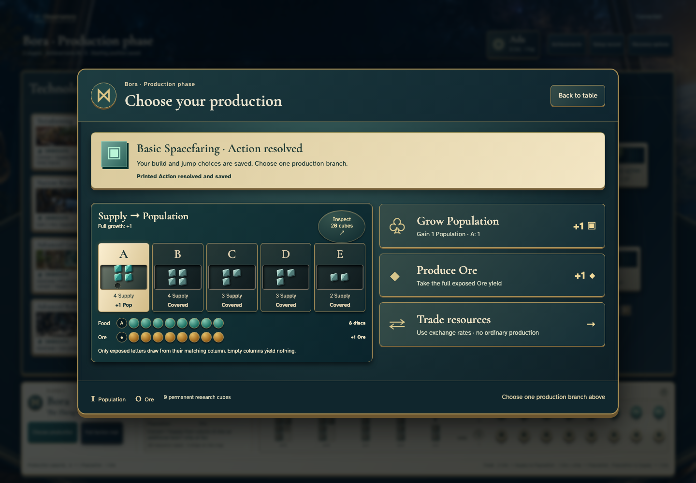](../../screenshots/contest-an-ore-outpost-and-return-the-former-owner-s-disc-with-separate-remote-controllers/038-incoming-tie-phone-darwin.png) | [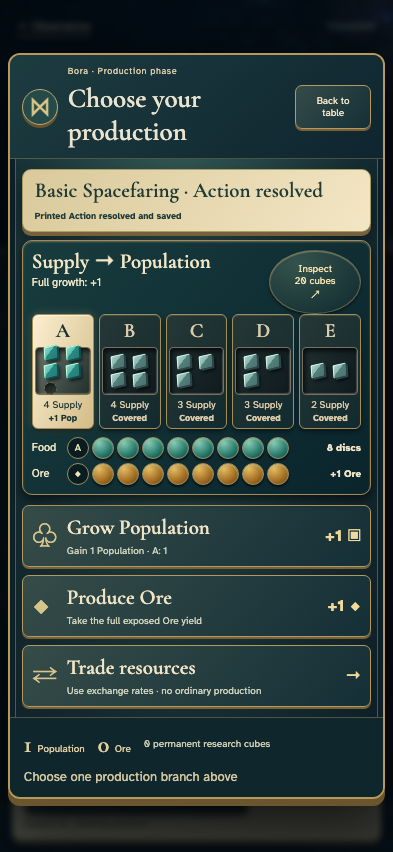](../../screenshots/contest-an-ore-outpost-and-return-the-former-owner-s-disc-with-separate-remote-controllers/038-incoming-tie-desktop-darwin.png) |

- [x] An incoming tied fleet does not gain an outpost or repeat its bonus
- [x] Actual canonical effects and acknowledgement settle.
- [x] Public topology retains physical separation.
- [x] The viewport fits without page scrolling.

## 40. Bora chooses ordinary Ore production and hands off

Viewpoint: **Bora · separate guest controller**.

| phone · 1440 × 1000 | desktop · 393 × 852 |
| --- | --- |
| [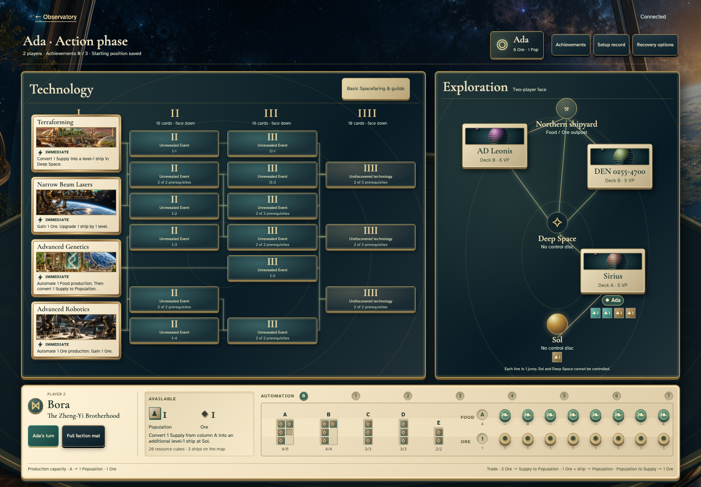](../../screenshots/contest-an-ore-outpost-and-return-the-former-owner-s-disc-with-separate-remote-controllers/039-bora-tie-handoff-phone-darwin.png) |  |

- [x] Bora chooses ordinary Ore production and hands off
- [x] Actual canonical effects and acknowledgement settle.
- [x] Public topology retains physical separation.
- [x] The viewport fits without page scrolling.

## 41. The next distinct controller receives the saved Action phase

Viewpoint: **Ada · separate host controller**.

| phone · 393 × 852 | desktop · 1440 × 1000 |
| --- | --- |
|  |  |

- [x] The next distinct controller receives the saved Action phase
- [x] Actual canonical effects and acknowledgement settle.
- [x] Public topology retains physical separation.
- [x] The viewport fits without page scrolling.

## 42. Ada inspects the actual production discs

Viewpoint: **Ada · separate host controller**.

| phone · 393 × 852 | desktop · 1440 × 1000 |
| --- | --- |
|  |  |

- [x] Ada inspects the actual production discs
- [x] Actual canonical effects and acknowledgement settle.
- [x] Public topology retains physical separation.
- [x] The viewport fits without page scrolling.

## 43. Open the reusable public fleet inspection

Viewpoint: **Ada · separate host controller**.

| phone · 393 × 852 | desktop · 1440 × 1000 |
| --- | --- |
|  |  |

- [x] Open the reusable public fleet inspection
- [x] Actual canonical effects and acknowledgement settle.
- [x] Public topology retains physical separation.
- [x] The viewport fits without page scrolling.

## 44. Read saved disc ownership separately from current summed fleet power

Viewpoint: **Ada · separate host controller**.

| phone · 393 × 852 | desktop · 1440 × 1000 |
| --- | --- |
| [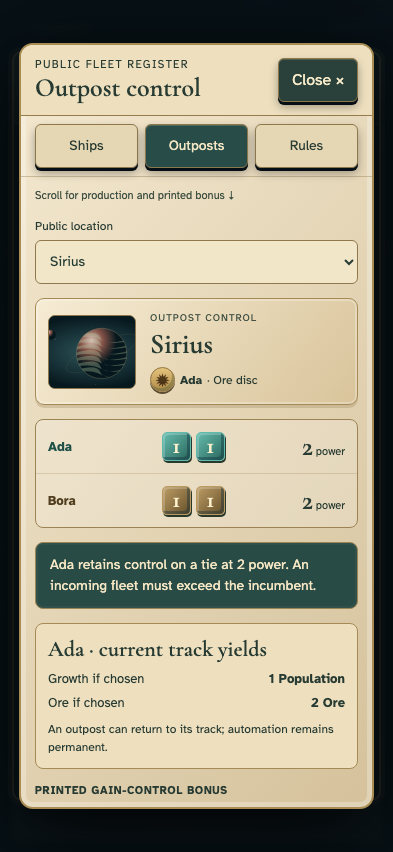](../../screenshots/contest-an-ore-outpost-and-return-the-former-owner-s-disc-with-separate-remote-controllers/043-tied-ada-outposts-phone-darwin.png) |  |

- [x] Read saved disc ownership separately from current summed fleet power
- [x] Actual canonical effects and acknowledgement settle.
- [x] Public topology retains physical separation.
- [x] The viewport fits without page scrolling.

## 45. Inspect every faction’s actual level sum and the incumbent’s disc

Viewpoint: **Ada · separate host controller**.

| phone · 393 × 852 | desktop · 1440 × 1000 |
| --- | --- |
|  |  |

- [x] Inspect every faction’s actual level sum and the incumbent’s disc
- [x] Actual canonical effects and acknowledgement settle.
- [x] Public topology retains physical separation.
- [x] The viewport fits without page scrolling.

## 46. Keyboard scroll reaches production, printed bonus and the inspection boundary

Viewpoint: **Ada · separate host controller**.

| phone · 393 × 852 | desktop · 1440 × 1000 |
| --- | --- |
| [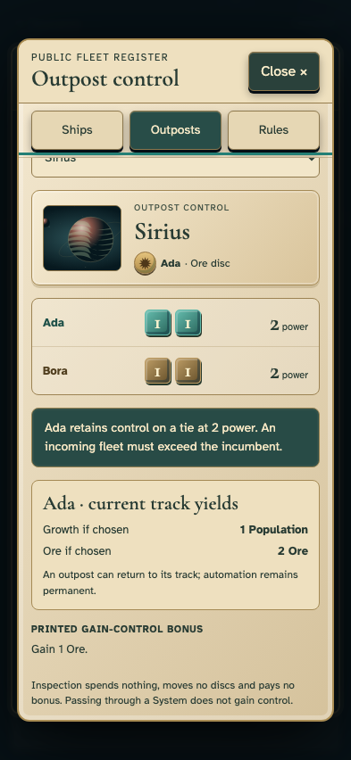](../../screenshots/contest-an-ore-outpost-and-return-the-former-owner-s-disc-with-separate-remote-controllers/045-tied-ada-scroll-phone-darwin.png) | [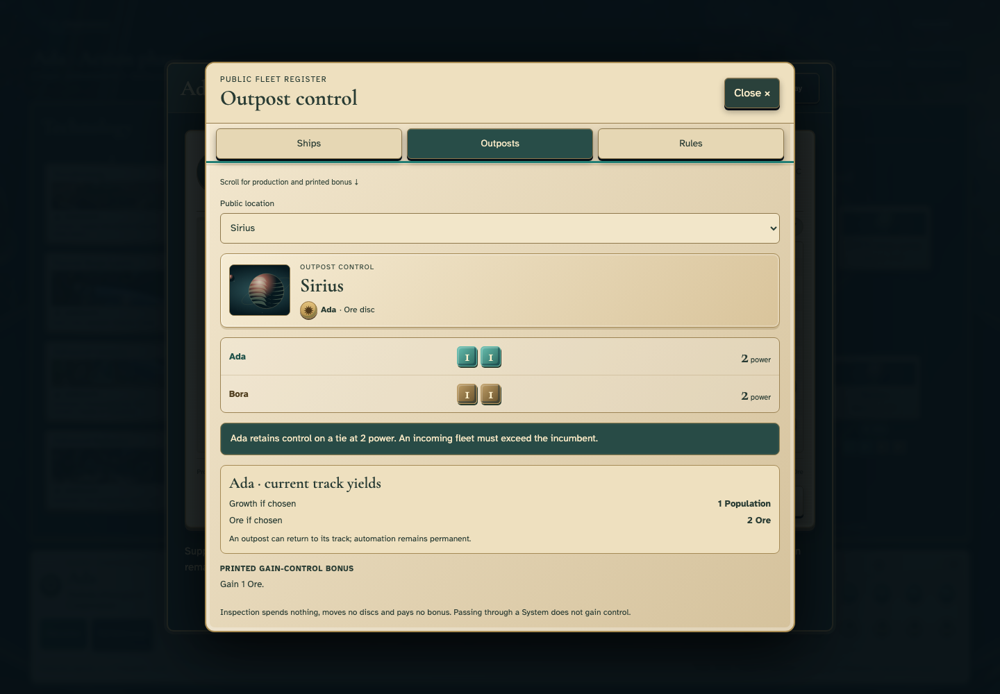](../../screenshots/contest-an-ore-outpost-and-return-the-former-owner-s-disc-with-separate-remote-controllers/045-tied-ada-scroll-desktop-darwin.png) |

- [x] Keyboard scroll reaches production, printed bonus and the inspection boundary
- [x] Actual canonical effects and acknowledgement settle.
- [x] Public topology retains physical separation.
- [x] The viewport fits without page scrolling.

## 47. Open the complete reusable fleet rules through semantic navigation

Viewpoint: **Ada · separate host controller**.

| phone · 393 × 852 | desktop · 1440 × 1000 |
| --- | --- |
|  |  |

- [x] Open the complete reusable fleet rules through semantic navigation
- [x] Actual canonical effects and acknowledgement settle.
- [x] Public topology retains physical separation.
- [x] The viewport fits without page scrolling.

## 48. Return to the real ship register without taking a turn

Viewpoint: **Ada · separate host controller**.

| phone · 393 × 852 | desktop · 1440 × 1000 |
| --- | --- |
|  | [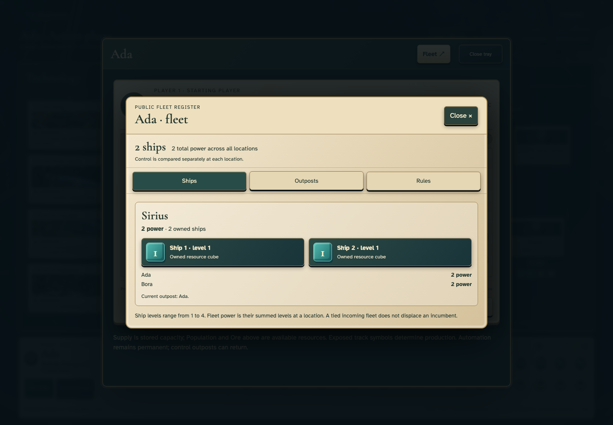](../../screenshots/contest-an-ore-outpost-and-return-the-former-owner-s-disc-with-separate-remote-controllers/047-tied-ada-fleet-ships-desktop-darwin.png) |

- [x] Return to the real ship register without taking a turn
- [x] Actual canonical effects and acknowledgement settle.
- [x] Public topology retains physical separation.
- [x] The viewport fits without page scrolling.

## 49. Escape restores the exact fleet opener without taking a turn

Viewpoint: **Ada · separate host controller**.

| phone · 393 × 852 | desktop · 1440 × 1000 |
| --- | --- |
| [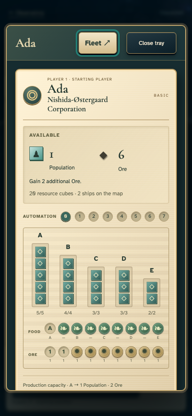](../../screenshots/contest-an-ore-outpost-and-return-the-former-owner-s-disc-with-separate-remote-controllers/048-tied-ada-focus-return-phone-darwin.png) | [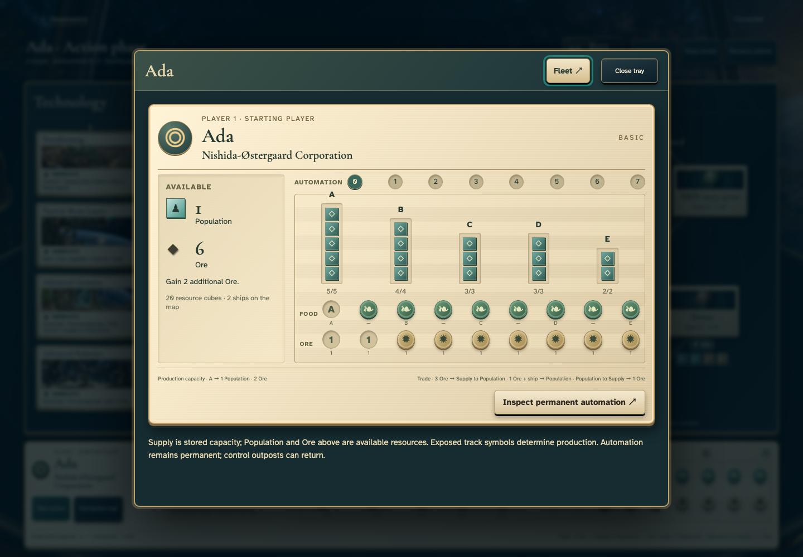](../../screenshots/contest-an-ore-outpost-and-return-the-former-owner-s-disc-with-separate-remote-controllers/048-tied-ada-focus-return-desktop-darwin.png) |

- [x] Escape restores the exact fleet opener without taking a turn
- [x] Actual canonical effects and acknowledgement settle.
- [x] Public topology retains physical separation.
- [x] The viewport fits without page scrolling.

## 50. Close the mat and restore its own opener

Viewpoint: **Ada · separate host controller**.

| phone · 393 × 852 | desktop · 1440 × 1000 |
| --- | --- |
|  | [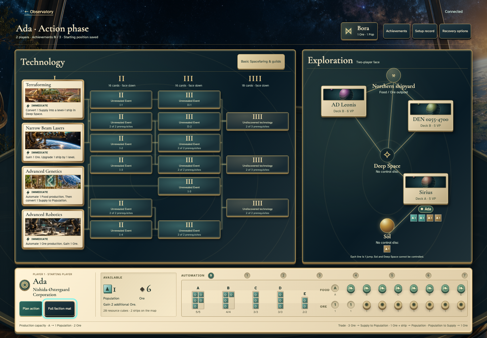](../../screenshots/contest-an-ore-outpost-and-return-the-former-owner-s-disc-with-separate-remote-controllers/049-tied-ada-mat-return-desktop-darwin.png) |

- [x] Close the mat and restore its own opener
- [x] Actual canonical effects and acknowledgement settle.
- [x] Public topology retains physical separation.
- [x] The viewport fits without page scrolling.

## 51. Ada opens the real Action instrument

Viewpoint: **Ada · separate host controller**.

| phone · 393 × 852 | desktop · 1440 × 1000 |
| --- | --- |
|  | [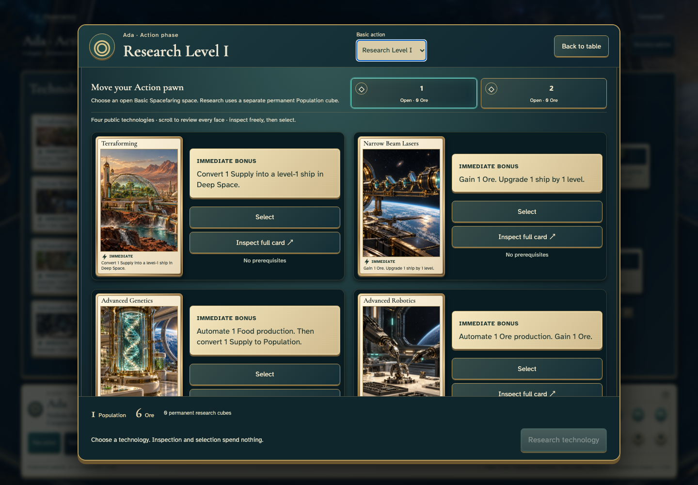](../../screenshots/contest-an-ore-outpost-and-return-the-former-owner-s-disc-with-separate-remote-controllers/050-ada-gather-open-desktop-darwin.png) |

- [x] Ada opens the real Action instrument
- [x] Actual canonical effects and acknowledgement settle.
- [x] Public topology retains physical separation.
- [x] The viewport fits without page scrolling.

## 52. Ada chooses Gather

Viewpoint: **Ada · separate host controller**.

| phone · 393 × 852 | desktop · 1440 × 1000 |
| --- | --- |
| [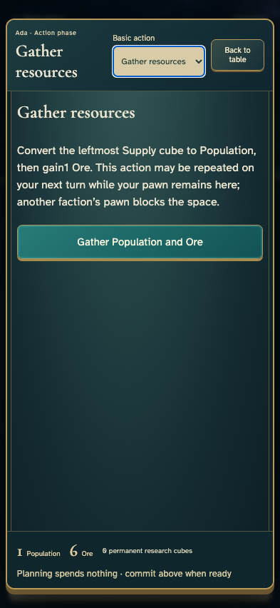](../../screenshots/contest-an-ore-outpost-and-return-the-former-owner-s-disc-with-separate-remote-controllers/051-ada-gather-kind-phone-darwin.png) | [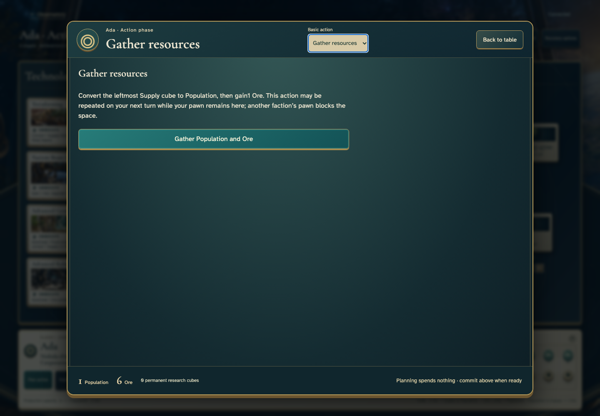](../../screenshots/contest-an-ore-outpost-and-return-the-former-owner-s-disc-with-separate-remote-controllers/051-ada-gather-kind-desktop-darwin.png) |

- [x] Ada chooses Gather
- [x] Actual canonical effects and acknowledgement settle.
- [x] Public topology retains physical separation.
- [x] The viewport fits without page scrolling.

## 53. Vacate the occupied build space through a legal Gather turn

Viewpoint: **Ada · separate host controller**.

| phone · 393 × 852 | desktop · 1440 × 1000 |
| --- | --- |
| [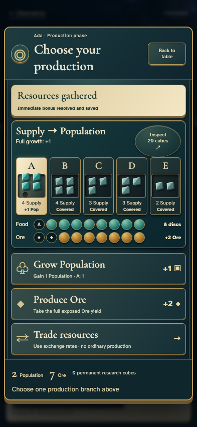](../../screenshots/contest-an-ore-outpost-and-return-the-former-owner-s-disc-with-separate-remote-controllers/052-ada-gathered-phone-darwin.png) | [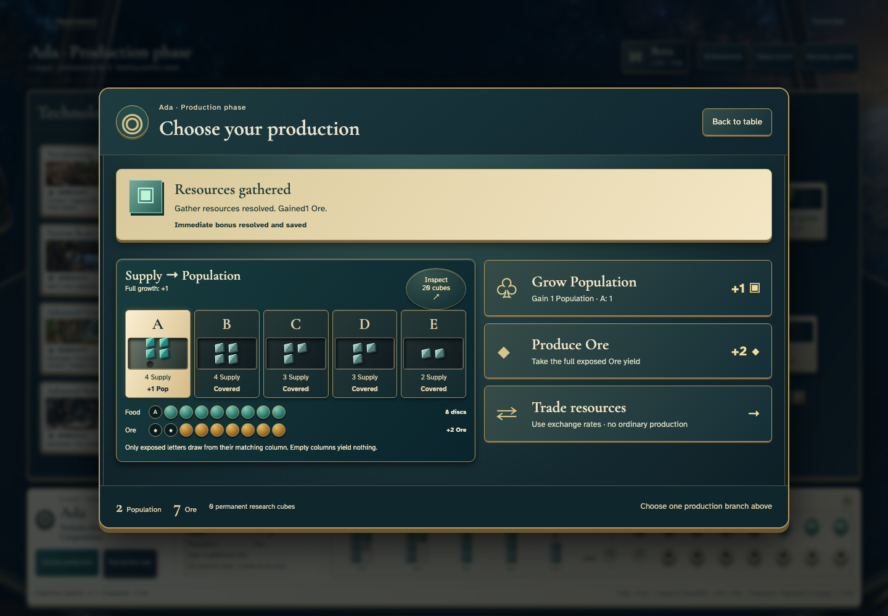](../../screenshots/contest-an-ore-outpost-and-return-the-former-owner-s-disc-with-separate-remote-controllers/052-ada-gathered-desktop-darwin.png) |

- [x] Vacate the occupied build space through a legal Gather turn
- [x] Actual canonical effects and acknowledgement settle.
- [x] Public topology retains physical separation.
- [x] The viewport fits without page scrolling.

## 54. Ada chooses ordinary Ore production and hands off

Viewpoint: **Ada · separate host controller**.

| phone · 393 × 852 | desktop · 1440 × 1000 |
| --- | --- |
|  |  |

- [x] Ada chooses ordinary Ore production and hands off
- [x] Actual canonical effects and acknowledgement settle.
- [x] Public topology retains physical separation.
- [x] The viewport fits without page scrolling.

## 55. The next distinct controller receives the saved Action phase

Viewpoint: **Bora · separate guest controller**.

| phone · 1440 × 1000 | desktop · 393 × 852 |
| --- | --- |
|  |  |

- [x] The next distinct controller receives the saved Action phase
- [x] Actual canonical effects and acknowledgement settle.
- [x] Public topology retains physical separation.
- [x] The viewport fits without page scrolling.

## 56. Bora opens the real Action instrument

Viewpoint: **Bora · separate guest controller**.

| phone · 1440 × 1000 | desktop · 393 × 852 |
| --- | --- |
|  | [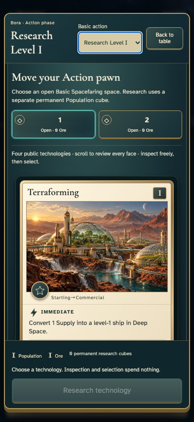](../../screenshots/contest-an-ore-outpost-and-return-the-former-owner-s-disc-with-separate-remote-controllers/055-bora-exceed-open-desktop-darwin.png) |

- [x] Bora opens the real Action instrument
- [x] Actual canonical effects and acknowledgement settle.
- [x] Public topology retains physical separation.
- [x] The viewport fits without page scrolling.

## 57. Bora chooses Basic build and jump

Viewpoint: **Bora · separate guest controller**.

| phone · 1440 × 1000 | desktop · 393 × 852 |
| --- | --- |
| [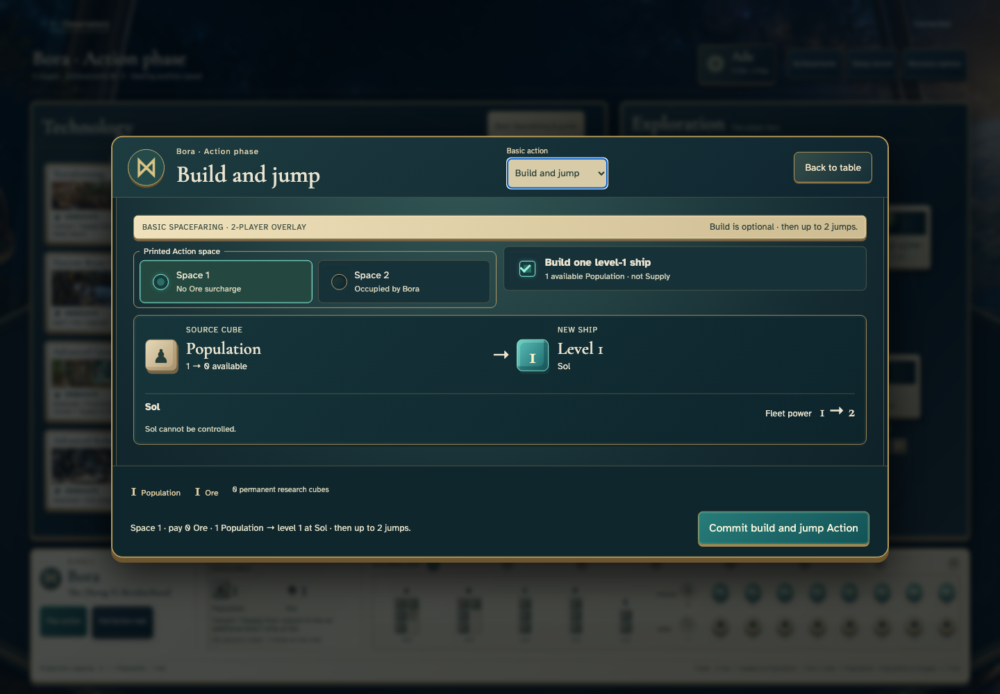](../../screenshots/contest-an-ore-outpost-and-return-the-former-owner-s-disc-with-separate-remote-controllers/056-bora-exceed-kind-phone-darwin.png) | [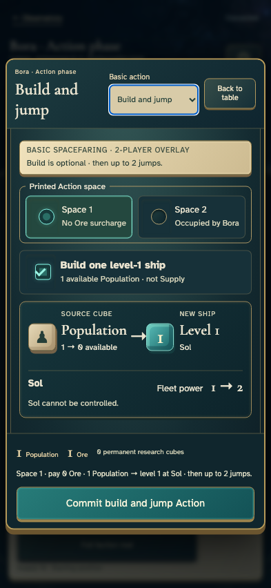](../../screenshots/contest-an-ore-outpost-and-return-the-former-owner-s-disc-with-separate-remote-controllers/056-bora-exceed-kind-desktop-darwin.png) |

- [x] Bora chooses Basic build and jump
- [x] Actual canonical effects and acknowledgement settle.
- [x] Public topology retains physical separation.
- [x] The viewport fits without page scrolling.

## 58. Use the existing fleet without converting another Population cube

Viewpoint: **Bora · separate guest controller**.

| phone · 1440 × 1000 | desktop · 393 × 852 |
| --- | --- |
| [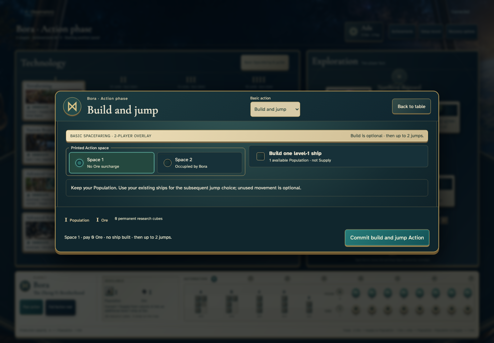](../../screenshots/contest-an-ore-outpost-and-return-the-former-owner-s-disc-with-separate-remote-controllers/057-bora-exceed-no-build-phone-darwin.png) | [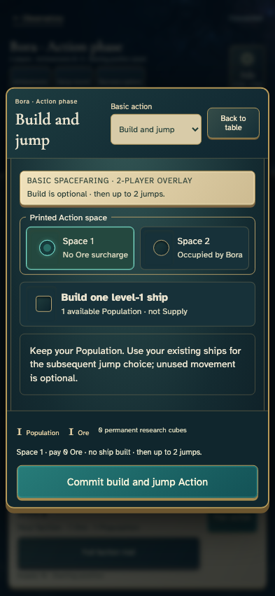](../../screenshots/contest-an-ore-outpost-and-return-the-former-owner-s-disc-with-separate-remote-controllers/057-bora-exceed-no-build-desktop-darwin.png) |

- [x] Use the existing fleet without converting another Population cube
- [x] Actual canonical effects and acknowledgement settle.
- [x] Public topology retains physical separation.
- [x] The viewport fits without page scrolling.

## 59. Commit the actual Population conversion and printed space cost before optional movement

Viewpoint: **Bora · separate guest controller**.

| phone · 1440 × 1000 | desktop · 393 × 852 |
| --- | --- |
|  | [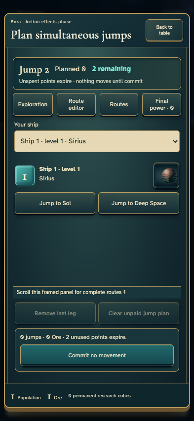](../../screenshots/contest-an-ore-outpost-and-return-the-former-owner-s-disc-with-separate-remote-controllers/058-bora-exceed-built-desktop-darwin.png) |

- [x] Commit the actual Population conversion and printed space cost before optional movement
- [x] Actual canonical effects and acknowledgement settle.
- [x] Public topology retains physical separation.
- [x] The viewport fits without page scrolling.

## 60. Read the complete public map before choosing a connected route

Viewpoint: **Bora · separate guest controller**.

| phone · 1440 × 1000 | desktop · 393 × 852 |
| --- | --- |
|  | [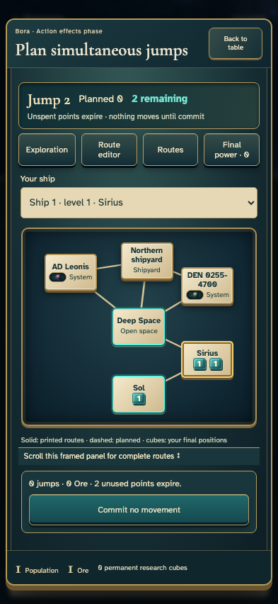](../../screenshots/contest-an-ore-outpost-and-return-the-former-owner-s-disc-with-separate-remote-controllers/059-bora-exceed-map-desktop-darwin.png) |

- [x] Read the complete public map before choosing a connected route
- [x] Actual canonical effects and acknowledgement settle.
- [x] Public topology retains physical separation.
- [x] The viewport fits without page scrolling.

## 61. Read the actual connected destinations in this interface

Viewpoint: **Bora · separate guest controller**.

| phone · 1440 × 1000 | desktop · 393 × 852 |
| --- | --- |
|  |  |

- [x] Read the actual connected destinations in this interface
- [x] Actual canonical effects and acknowledgement settle.
- [x] Public topology retains physical separation.
- [x] The viewport fits without page scrolling.

## 62. Choose a real owned ship for this unpaid route

Viewpoint: **Bora · separate guest controller**.

| phone · 1440 × 1000 | desktop · 393 × 852 |
| --- | --- |
|  | [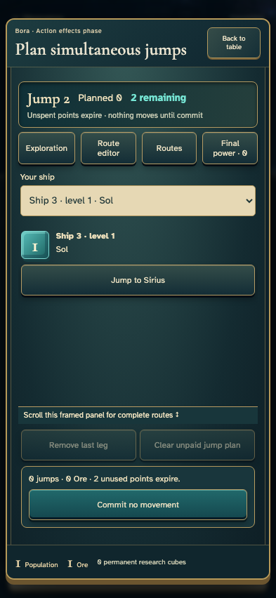](../../screenshots/contest-an-ore-outpost-and-return-the-former-owner-s-disc-with-separate-remote-controllers/061-bora-third-ship-desktop-darwin.png) |

- [x] Choose a real owned ship for this unpaid route
- [x] Actual canonical effects and acknowledgement settle.
- [x] Public topology retains physical separation.
- [x] The viewport fits without page scrolling.

## 63. Plan Sirius as an endpoint; nothing moves yet

Viewpoint: **Bora · separate guest controller**.

| phone · 1440 × 1000 | desktop · 393 × 852 |
| --- | --- |
|  |  |

- [x] Plan Sirius as an endpoint; nothing moves yet
- [x] Actual canonical effects and acknowledgement settle.
- [x] Public topology retains physical separation.
- [x] The viewport fits without page scrolling.

## 64. A later third ship exceeds the incumbent and resolves the actual disc transfer

Viewpoint: **Bora · separate guest controller**.

| phone · 1440 × 1000 | desktop · 393 × 852 |
| --- | --- |
|  |  |

- [x] A later third ship exceeds the incumbent and resolves the actual disc transfer
- [x] Actual canonical effects and acknowledgement settle.
- [x] Public topology retains physical separation.
- [x] The viewport fits without page scrolling.

## 65. The public board retains Bora’s new outpost before production

Viewpoint: **Bora · separate guest controller**.

| phone · 1440 × 1000 | desktop · 393 × 852 |
| --- | --- |
|  |  |

- [x] The public board retains Bora’s new outpost before production
- [x] Actual canonical effects and acknowledgement settle.
- [x] Public topology retains physical separation.
- [x] The viewport fits without page scrolling.

## 66. Bora inspects the actual production discs

Viewpoint: **Bora · separate guest controller**.

| phone · 1440 × 1000 | desktop · 393 × 852 |
| --- | --- |
|  |  |

- [x] Bora inspects the actual production discs
- [x] Actual canonical effects and acknowledgement settle.
- [x] Public topology retains physical separation.
- [x] The viewport fits without page scrolling.

## 67. Open the reusable public fleet inspection

Viewpoint: **Bora · separate guest controller**.

| phone · 1440 × 1000 | desktop · 393 × 852 |
| --- | --- |
|  |  |

- [x] Open the reusable public fleet inspection
- [x] Actual canonical effects and acknowledgement settle.
- [x] Public topology retains physical separation.
- [x] The viewport fits without page scrolling.

## 68. Read saved disc ownership separately from current summed fleet power

Viewpoint: **Bora · separate guest controller**.

| phone · 1440 × 1000 | desktop · 393 × 852 |
| --- | --- |
|  |  |

- [x] Read saved disc ownership separately from current summed fleet power
- [x] Actual canonical effects and acknowledgement settle.
- [x] Public topology retains physical separation.
- [x] The viewport fits without page scrolling.

## 69. Inspect every faction’s actual level sum and the incumbent’s disc

Viewpoint: **Bora · separate guest controller**.

| phone · 1440 × 1000 | desktop · 393 × 852 |
| --- | --- |
|  |  |

- [x] Inspect every faction’s actual level sum and the incumbent’s disc
- [x] Actual canonical effects and acknowledgement settle.
- [x] Public topology retains physical separation.
- [x] The viewport fits without page scrolling.

## 70. Keyboard scroll reaches production, printed bonus and the inspection boundary

Viewpoint: **Bora · separate guest controller**.

| phone · 1440 × 1000 | desktop · 393 × 852 |
| --- | --- |
|  |  |

- [x] Keyboard scroll reaches production, printed bonus and the inspection boundary
- [x] Actual canonical effects and acknowledgement settle.
- [x] Public topology retains physical separation.
- [x] The viewport fits without page scrolling.

## 71. Open the complete reusable fleet rules through semantic navigation

Viewpoint: **Bora · separate guest controller**.

| phone · 1440 × 1000 | desktop · 393 × 852 |
| --- | --- |
|  |  |

- [x] Open the complete reusable fleet rules through semantic navigation
- [x] Actual canonical effects and acknowledgement settle.
- [x] Public topology retains physical separation.
- [x] The viewport fits without page scrolling.

## 72. Return to the real ship register without taking a turn

Viewpoint: **Bora · separate guest controller**.

| phone · 1440 × 1000 | desktop · 393 × 852 |
| --- | --- |
|  |  |

- [x] Return to the real ship register without taking a turn
- [x] Actual canonical effects and acknowledgement settle.
- [x] Public topology retains physical separation.
- [x] The viewport fits without page scrolling.

## 73. Escape restores the exact fleet opener without taking a turn

Viewpoint: **Bora · separate guest controller**.

| phone · 1440 × 1000 | desktop · 393 × 852 |
| --- | --- |
|  |  |

- [x] Escape restores the exact fleet opener without taking a turn
- [x] Actual canonical effects and acknowledgement settle.
- [x] Public topology retains physical separation.
- [x] The viewport fits without page scrolling.

## 74. Close the mat and restore its own opener

Viewpoint: **Bora · separate guest controller**.

| phone · 1440 × 1000 | desktop · 393 × 852 |
| --- | --- |
|  |  |

- [x] Close the mat and restore its own opener
- [x] Actual canonical effects and acknowledgement settle.
- [x] Public topology retains physical separation.
- [x] The viewport fits without page scrolling.

## 75. Ada inspects the actual production discs

Viewpoint: **Ada · separate host controller**.

| phone · 393 × 852 | desktop · 1440 × 1000 |
| --- | --- |
|  |  |

- [x] Ada inspects the actual production discs
- [x] Actual canonical effects and acknowledgement settle.
- [x] Public topology retains physical separation.
- [x] The viewport fits without page scrolling.

## 76. Open the reusable public fleet inspection

Viewpoint: **Ada · separate host controller**.

| phone · 393 × 852 | desktop · 1440 × 1000 |
| --- | --- |
|  |  |

- [x] Open the reusable public fleet inspection
- [x] Actual canonical effects and acknowledgement settle.
- [x] Public topology retains physical separation.
- [x] The viewport fits without page scrolling.

## 77. Read saved disc ownership separately from current summed fleet power

Viewpoint: **Ada · separate host controller**.

| phone · 393 × 852 | desktop · 1440 × 1000 |
| --- | --- |
|  |  |

- [x] Read saved disc ownership separately from current summed fleet power
- [x] Actual canonical effects and acknowledgement settle.
- [x] Public topology retains physical separation.
- [x] The viewport fits without page scrolling.

## 78. Inspect every faction’s actual level sum and the incumbent’s disc

Viewpoint: **Ada · separate host controller**.

| phone · 393 × 852 | desktop · 1440 × 1000 |
| --- | --- |
|  |  |

- [x] Inspect every faction’s actual level sum and the incumbent’s disc
- [x] Actual canonical effects and acknowledgement settle.
- [x] Public topology retains physical separation.
- [x] The viewport fits without page scrolling.

## 79. Keyboard scroll reaches production, printed bonus and the inspection boundary

Viewpoint: **Ada · separate host controller**.

| phone · 393 × 852 | desktop · 1440 × 1000 |
| --- | --- |
|  |  |

- [x] Keyboard scroll reaches production, printed bonus and the inspection boundary
- [x] Actual canonical effects and acknowledgement settle.
- [x] Public topology retains physical separation.
- [x] The viewport fits without page scrolling.

## 80. Open the complete reusable fleet rules through semantic navigation

Viewpoint: **Ada · separate host controller**.

| phone · 393 × 852 | desktop · 1440 × 1000 |
| --- | --- |
|  |  |

- [x] Open the complete reusable fleet rules through semantic navigation
- [x] Actual canonical effects and acknowledgement settle.
- [x] Public topology retains physical separation.
- [x] The viewport fits without page scrolling.

## 81. Return to the real ship register without taking a turn

Viewpoint: **Ada · separate host controller**.

| phone · 393 × 852 | desktop · 1440 × 1000 |
| --- | --- |
|  |  |

- [x] Return to the real ship register without taking a turn
- [x] Actual canonical effects and acknowledgement settle.
- [x] Public topology retains physical separation.
- [x] The viewport fits without page scrolling.

## 82. Escape restores the exact fleet opener without taking a turn

Viewpoint: **Ada · separate host controller**.

| phone · 393 × 852 | desktop · 1440 × 1000 |
| --- | --- |
|  |  |

- [x] Escape restores the exact fleet opener without taking a turn
- [x] Actual canonical effects and acknowledgement settle.
- [x] Public topology retains physical separation.
- [x] The viewport fits without page scrolling.

## 83. Close the mat and restore its own opener

Viewpoint: **Ada · separate host controller**.

| phone · 393 × 852 | desktop · 1440 × 1000 |
| --- | --- |
|  |  |

- [x] Close the mat and restore its own opener
- [x] Actual canonical effects and acknowledgement settle.
- [x] Public topology retains physical separation.
- [x] The viewport fits without page scrolling.

## 84. Reload retains the same controlling faction and pending Production

Viewpoint: **Bora · separate guest controller**.

| phone · 1440 × 1000 | desktop · 393 × 852 |
| --- | --- |
|  |  |

- [x] Reload retains the same controlling faction and pending Production
- [x] Actual canonical effects and acknowledgement settle.
- [x] Public topology retains physical separation.
- [x] The viewport fits without page scrolling.

## 85. Resume without another outpost placement or gain bonus

Viewpoint: **Bora · separate guest controller**.

| phone · 1440 × 1000 | desktop · 393 × 852 |
| --- | --- |
|  |  |

- [x] Resume without another outpost placement or gain bonus
- [x] Actual canonical effects and acknowledgement settle.
- [x] Public topology retains physical separation.
- [x] The viewport fits without page scrolling.

## 86. Bora chooses ordinary Ore production and hands off

Viewpoint: **Bora · separate guest controller**.

| phone · 1440 × 1000 | desktop · 393 × 852 |
| --- | --- |
|  |  |

- [x] Bora chooses ordinary Ore production and hands off
- [x] Actual canonical effects and acknowledgement settle.
- [x] Public topology retains physical separation.
- [x] The viewport fits without page scrolling.

## 87. The next distinct controller receives the saved Action phase

Viewpoint: **Ada · separate host controller**.

| phone · 393 × 852 | desktop · 1440 × 1000 |
| --- | --- |
|  |  |

- [x] The next distinct controller receives the saved Action phase
- [x] Actual canonical effects and acknowledgement settle.
- [x] Public topology retains physical separation.
- [x] The viewport fits without page scrolling.
