# Contest an Ore outpost at two shared cardinal seats

Exactly one shared controller; all local seats/factions/Begin through the actual table. Two players for incoming tie/later exceed, four for simultaneous two-System bonuses or Food/Ore specialty. Setup seed002 or004; command identities disjoint. No companion devices, state injection or future deck read.

## 1. Arrive through the actual production interface

Viewpoint: **Ada · South · one shared controller**.

| desktop · 1440 × 1000 |
| --- |
|  |

tabletop-4k · 3840 × 2160

- [x] Arrive through the actual production interface
- [x] Actual canonical effects and acknowledgement settle.
- [x] Public topology retains physical separation.
- [x] The viewport fits without page scrolling.

## 2. Choose physical tabletop or separate-controller remote play

Viewpoint: **Ada · South · one shared controller**.

| desktop · 1440 × 1000 |
| --- |
|  |

tabletop-4k · 3840 × 2160

- [x] Choose physical tabletop or separate-controller remote play
- [x] Actual canonical effects and acknowledgement settle.
- [x] Public topology retains physical separation.
- [x] The viewport fits without page scrolling.

## 3. One shared controller opens the physical seats

Viewpoint: **Ada · South · one shared controller**.

| desktop · 1440 × 1000 |
| --- |
|  |

tabletop-4k · 3840 × 2160

- [x] One shared controller opens the physical seats
- [x] Actual canonical effects and acknowledgement settle.
- [x] Public topology retains physical separation.
- [x] The viewport fits without page scrolling.

## 4. Join directly at South

Viewpoint: **Ada · South · one shared controller**.

| desktop · 1440 × 1000 |
| --- |
|  |

tabletop-4k · 3840 × 2160

- [x] Join directly at South
- [x] Actual canonical effects and acknowledgement settle.
- [x] Public topology retains physical separation.
- [x] The viewport fits without page scrolling.

## 5. Name this physical seat Ada

Viewpoint: **Ada · South · one shared controller**.

| desktop · 1440 × 1000 |
| --- |
|  |

tabletop-4k · 3840 × 2160

- [x] Name this physical seat Ada
- [x] Actual canonical effects and acknowledgement settle.
- [x] Public topology retains physical separation.
- [x] The viewport fits without page scrolling.

## 6. Persist the named seat on the same display

Viewpoint: **Ada · South · one shared controller**.

| desktop · 1440 × 1000 |
| --- |
|  |

tabletop-4k · 3840 × 2160

- [x] Persist the named seat on the same display
- [x] Actual canonical effects and acknowledgement settle.
- [x] Public topology retains physical separation.
- [x] The viewport fits without page scrolling.

## 7. Join directly at North

Viewpoint: **Bora · North · one shared controller**.

| desktop · 1440 × 1000 |
| --- |
|  |

tabletop-4k · 3840 × 2160

- [x] Join directly at North
- [x] Actual canonical effects and acknowledgement settle.
- [x] Public topology retains physical separation.
- [x] The viewport fits without page scrolling.

## 8. Name this physical seat Bora

Viewpoint: **Bora · North · one shared controller**.

| desktop · 1440 × 1000 |
| --- |
| [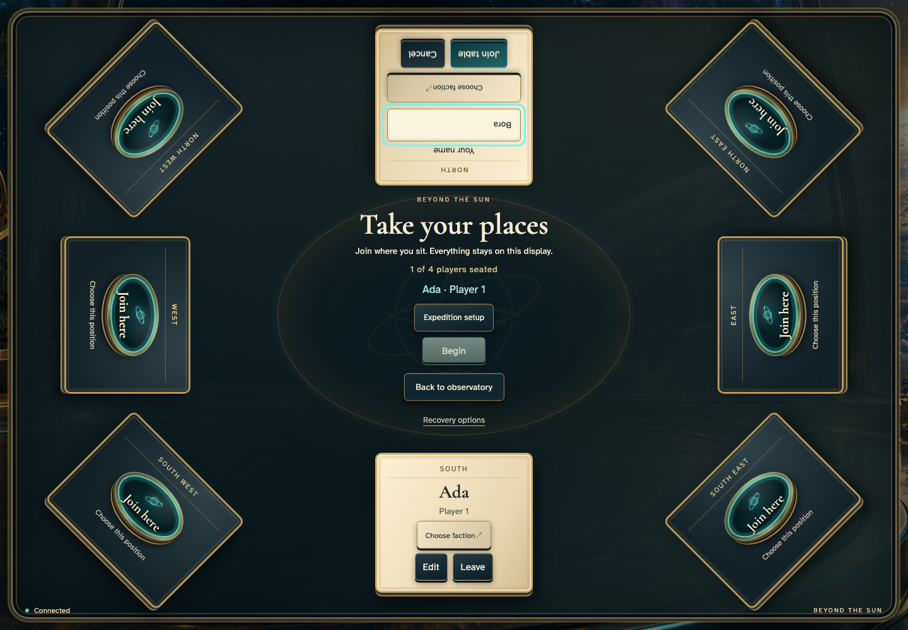](../../screenshots/contest-an-ore-outpost-at-two-shared-cardinal-seats/007-seat-1-name-desktop-darwin.png) |

tabletop-4k · 3840 × 2160

- [x] Name this physical seat Bora
- [x] Actual canonical effects and acknowledgement settle.
- [x] Public topology retains physical separation.
- [x] The viewport fits without page scrolling.

## 9. Persist the named seat on the same display

Viewpoint: **Bora · North · one shared controller**.

| desktop · 1440 × 1000 |
| --- |
|  |

tabletop-4k · 3840 × 2160

- [x] Persist the named seat on the same display
- [x] Actual canonical effects and acknowledgement settle.
- [x] Public topology retains physical separation.
- [x] The viewport fits without page scrolling.

## 10. Choose a legal unique Basic faction

Viewpoint: **Ada · South · one shared controller**.

| desktop · 1440 × 1000 |
| --- |
|  |

tabletop-4k · 3840 × 2160

- [x] Choose a legal unique Basic faction
- [x] Actual canonical effects and acknowledgement settle.
- [x] Public topology retains physical separation.
- [x] The viewport fits without page scrolling.

## 11. Ada chooses Nishida-Østergaard Corporation

Viewpoint: **Ada · South · one shared controller**.

| desktop · 1440 × 1000 |
| --- |
|  |

tabletop-4k · 3840 × 2160

- [x] Ada chooses Nishida-Østergaard Corporation
- [x] Actual canonical effects and acknowledgement settle.
- [x] Public topology retains physical separation.
- [x] The viewport fits without page scrolling.

## 12. Choose a legal unique Basic faction

Viewpoint: **Bora · North · one shared controller**.

| desktop · 1440 × 1000 |
| --- |
|  |

tabletop-4k · 3840 × 2160

- [x] Choose a legal unique Basic faction
- [x] Actual canonical effects and acknowledgement settle.
- [x] Public topology retains physical separation.
- [x] The viewport fits without page scrolling.

## 13. Bora chooses The Zheng-Yi Brotherhood

Viewpoint: **Bora · North · one shared controller**.

| desktop · 1440 × 1000 |
| --- |
|  |

tabletop-4k · 3840 × 2160

- [x] Bora chooses The Zheng-Yi Brotherhood
- [x] Actual canonical effects and acknowledgement settle.
- [x] Public topology retains physical separation.
- [x] The viewport fits without page scrolling.

## 14. Begin the immutable Basic game through normal UI

Viewpoint: **Ada · South · one shared controller**.

| desktop · 1440 × 1000 |
| --- |
| [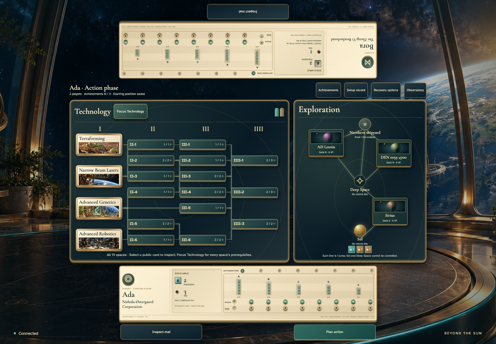](../../screenshots/contest-an-ore-outpost-at-two-shared-cardinal-seats/013-begun-desktop-darwin.png) |

tabletop-4k · 3840 × 2160

[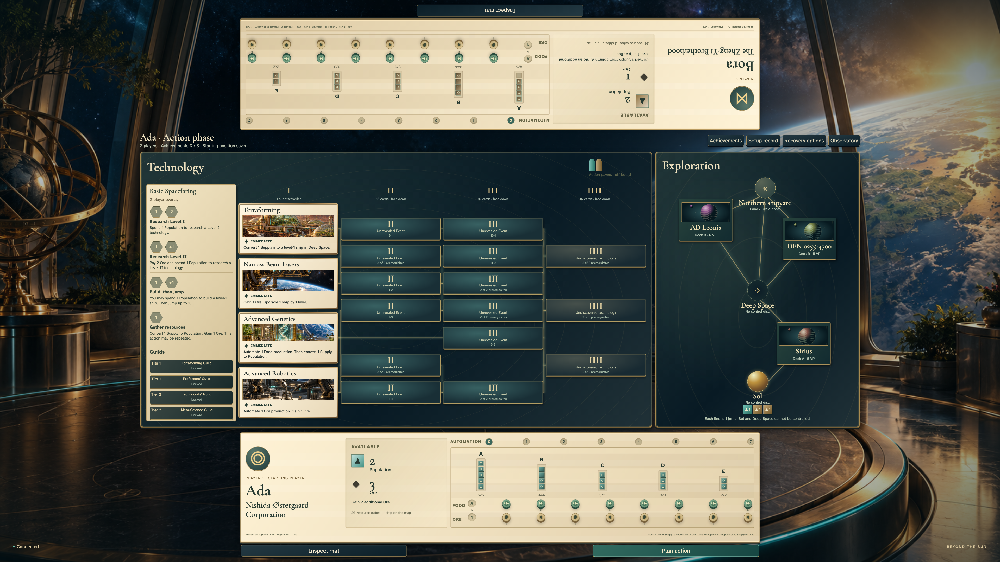](../../screenshots/contest-an-ore-outpost-at-two-shared-cardinal-seats/013-begun-tabletop-4k-darwin.png)

- [x] Begin the immutable Basic game through normal UI
- [x] Actual canonical effects and acknowledgement settle.
- [x] Public topology retains physical separation.
- [x] The viewport fits without page scrolling.

## 15. Ada opens the real Action instrument

Viewpoint: **Ada · South · one shared controller**.

| desktop · 1440 × 1000 |
| --- |
|  |

tabletop-4k · 3840 × 2160

[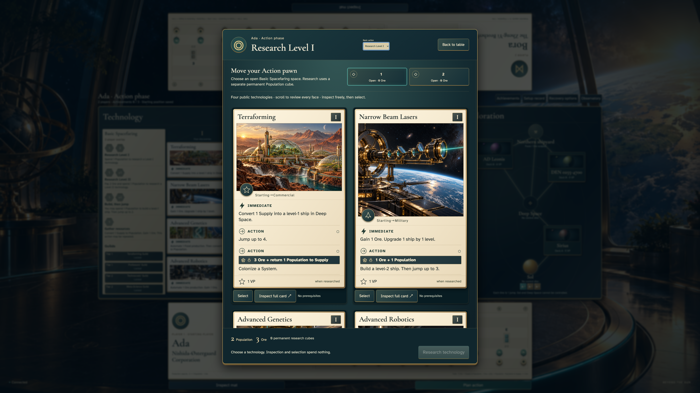](../../screenshots/contest-an-ore-outpost-at-two-shared-cardinal-seats/014-ada-build-open-tabletop-4k-darwin.png)

- [x] Ada opens the real Action instrument
- [x] Actual canonical effects and acknowledgement settle.
- [x] Public topology retains physical separation.
- [x] The viewport fits without page scrolling.

## 16. Ada chooses Basic build and jump

Viewpoint: **Ada · South · one shared controller**.

| desktop · 1440 × 1000 |
| --- |
| [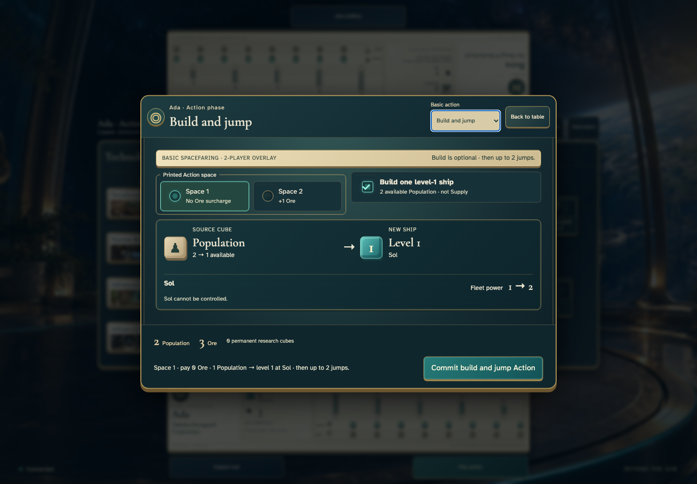](../../screenshots/contest-an-ore-outpost-at-two-shared-cardinal-seats/015-ada-build-kind-desktop-darwin.png) |

tabletop-4k · 3840 × 2160

- [x] Ada chooses Basic build and jump
- [x] Actual canonical effects and acknowledgement settle.
- [x] Public topology retains physical separation.
- [x] The viewport fits without page scrolling.

## 17. Commit the actual Population conversion and printed space cost before optional movement

Viewpoint: **Ada · South · one shared controller**.

| desktop · 1440 × 1000 |
| --- |
| [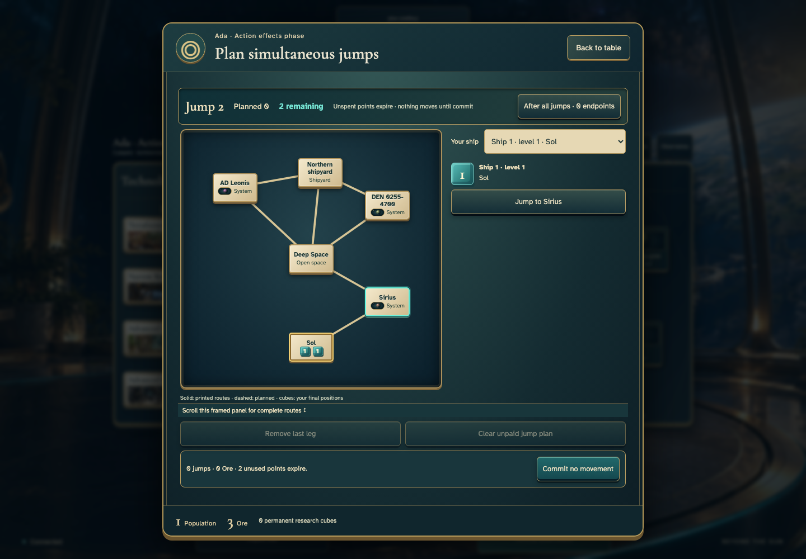](../../screenshots/contest-an-ore-outpost-at-two-shared-cardinal-seats/016-ada-build-built-desktop-darwin.png) |

tabletop-4k · 3840 × 2160

- [x] Commit the actual Population conversion and printed space cost before optional movement
- [x] Actual canonical effects and acknowledgement settle.
- [x] Public topology retains physical separation.
- [x] The viewport fits without page scrolling.

## 18. Read the complete public map before choosing a connected route

Viewpoint: **Ada · South · one shared controller**.

| desktop · 1440 × 1000 |
| --- |
|  |

tabletop-4k · 3840 × 2160

[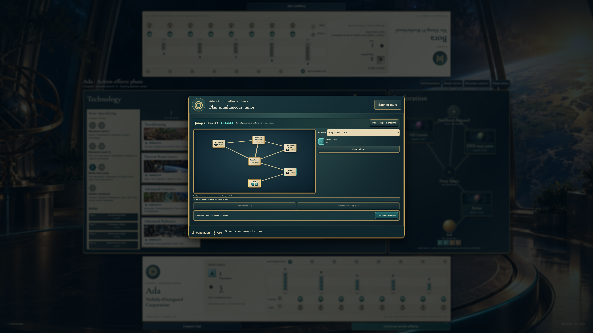](../../screenshots/contest-an-ore-outpost-at-two-shared-cardinal-seats/017-ada-build-map-tabletop-4k-darwin.png)

- [x] Read the complete public map before choosing a connected route
- [x] Actual canonical effects and acknowledgement settle.
- [x] Public topology retains physical separation.
- [x] The viewport fits without page scrolling.

## 19. Read the actual connected destinations in this interface

Viewpoint: **Ada · South · one shared controller**.

| desktop · 1440 × 1000 |
| --- |
|  |

tabletop-4k · 3840 × 2160

- [x] Read the actual connected destinations in this interface
- [x] Actual canonical effects and acknowledgement settle.
- [x] Public topology retains physical separation.
- [x] The viewport fits without page scrolling.

## 20. Choose a real owned ship for this unpaid route

Viewpoint: **Ada · South · one shared controller**.

| desktop · 1440 × 1000 |
| --- |
|  |

tabletop-4k · 3840 × 2160

- [x] Choose a real owned ship for this unpaid route
- [x] Actual canonical effects and acknowledgement settle.
- [x] Public topology retains physical separation.
- [x] The viewport fits without page scrolling.

## 21. Plan Sirius as an endpoint; nothing moves yet

Viewpoint: **Ada · South · one shared controller**.

| desktop · 1440 × 1000 |
| --- |
| [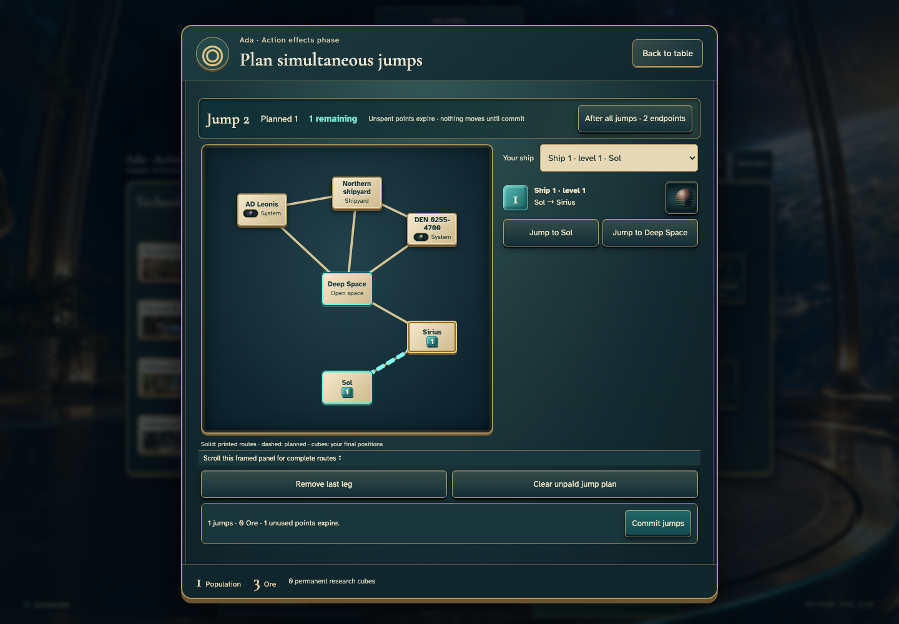](../../screenshots/contest-an-ore-outpost-at-two-shared-cardinal-seats/020-ada-first-endpoint-desktop-darwin.png) |

tabletop-4k · 3840 × 2160

- [x] Plan Sirius as an endpoint; nothing moves yet
- [x] Actual canonical effects and acknowledgement settle.
- [x] Public topology retains physical separation.
- [x] The viewport fits without page scrolling.

## 22. Choose a real owned ship for this unpaid route

Viewpoint: **Ada · South · one shared controller**.

| desktop · 1440 × 1000 |
| --- |
| [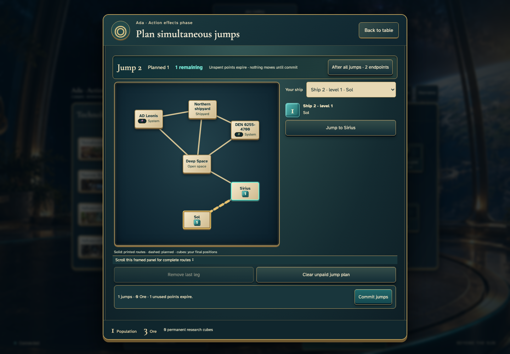](../../screenshots/contest-an-ore-outpost-at-two-shared-cardinal-seats/021-ada-second-ship-desktop-darwin.png) |

tabletop-4k · 3840 × 2160

[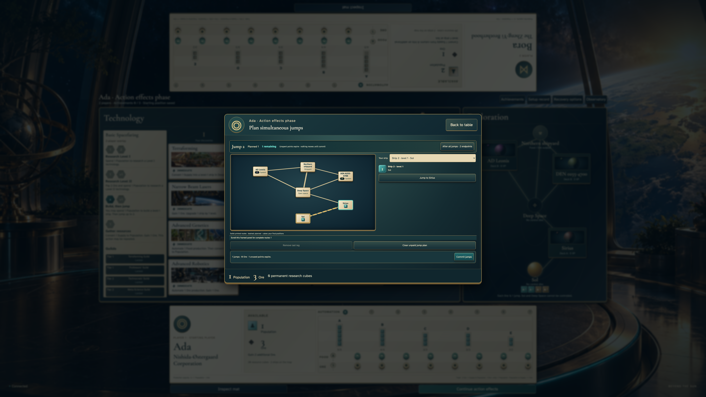](../../screenshots/contest-an-ore-outpost-at-two-shared-cardinal-seats/021-ada-second-ship-tabletop-4k-darwin.png)

- [x] Choose a real owned ship for this unpaid route
- [x] Actual canonical effects and acknowledgement settle.
- [x] Public topology retains physical separation.
- [x] The viewport fits without page scrolling.

## 23. Plan Sirius as an endpoint; nothing moves yet

Viewpoint: **Ada · South · one shared controller**.

| desktop · 1440 × 1000 |
| --- |
| [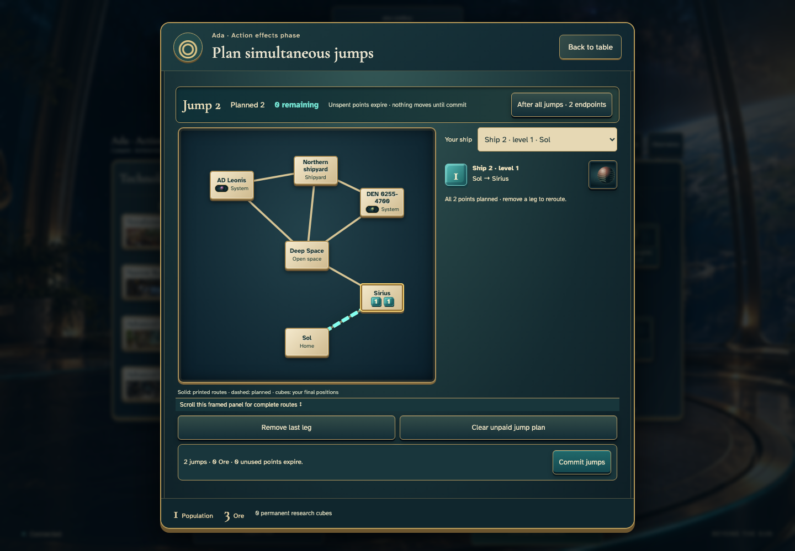](../../screenshots/contest-an-ore-outpost-at-two-shared-cardinal-seats/022-ada-second-endpoint-desktop-darwin.png) |

tabletop-4k · 3840 × 2160

[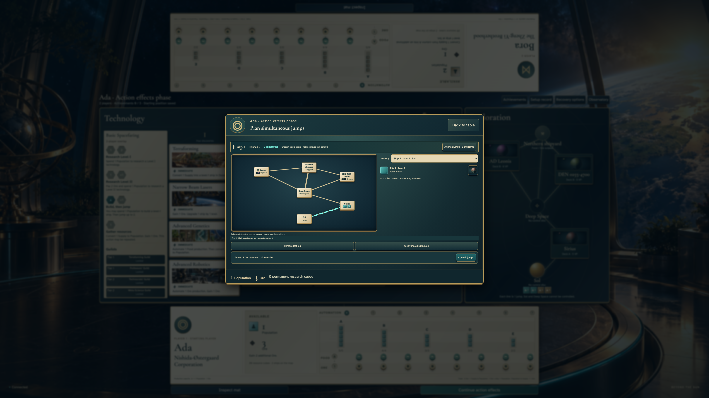](../../screenshots/contest-an-ore-outpost-at-two-shared-cardinal-seats/022-ada-second-endpoint-tabletop-4k-darwin.png)

- [x] Plan Sirius as an endpoint; nothing moves yet
- [x] Actual canonical effects and acknowledgement settle.
- [x] Public topology retains physical separation.
- [x] The viewport fits without page scrolling.

## 24. Resolve both endpoints and claim the Ore outpost once

Viewpoint: **Ada · South · one shared controller**.

| desktop · 1440 × 1000 |
| --- |
|  |

tabletop-4k · 3840 × 2160

- [x] Resolve both endpoints and claim the Ore outpost once
- [x] Actual canonical effects and acknowledgement settle.
- [x] Public topology retains physical separation.
- [x] The viewport fits without page scrolling.

## 25. Ada chooses ordinary Ore production and hands off

Viewpoint: **Ada · South · one shared controller**.

| desktop · 1440 × 1000 |
| --- |
|  |

tabletop-4k · 3840 × 2160

[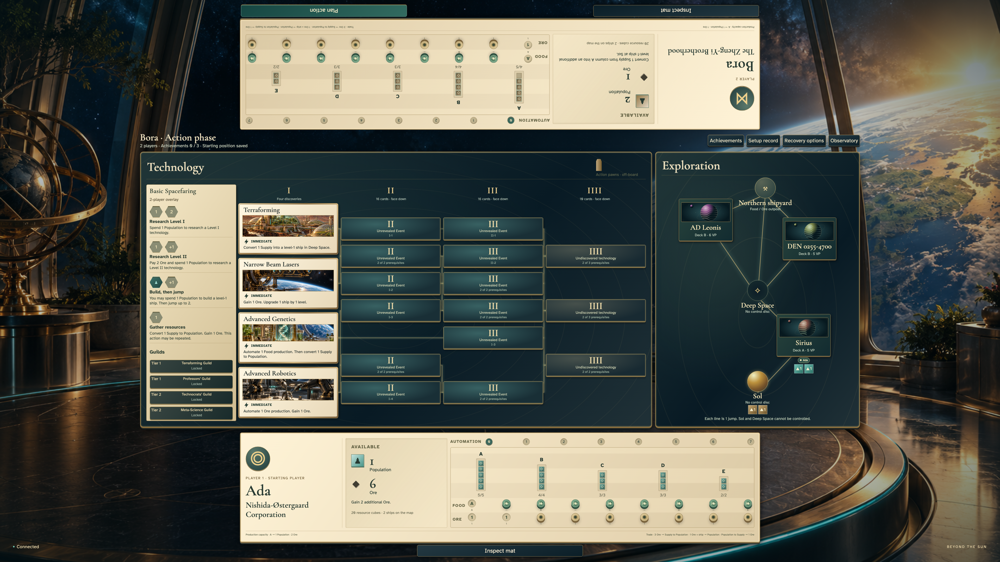](../../screenshots/contest-an-ore-outpost-at-two-shared-cardinal-seats/024-ada-claim-handoff-tabletop-4k-darwin.png)

- [x] Ada chooses ordinary Ore production and hands off
- [x] Actual canonical effects and acknowledgement settle.
- [x] Public topology retains physical separation.
- [x] The viewport fits without page scrolling.

## 26. Bora opens the real Action instrument

Viewpoint: **Bora · North · one shared controller**.

| desktop · 1440 × 1000 |
| --- |
| [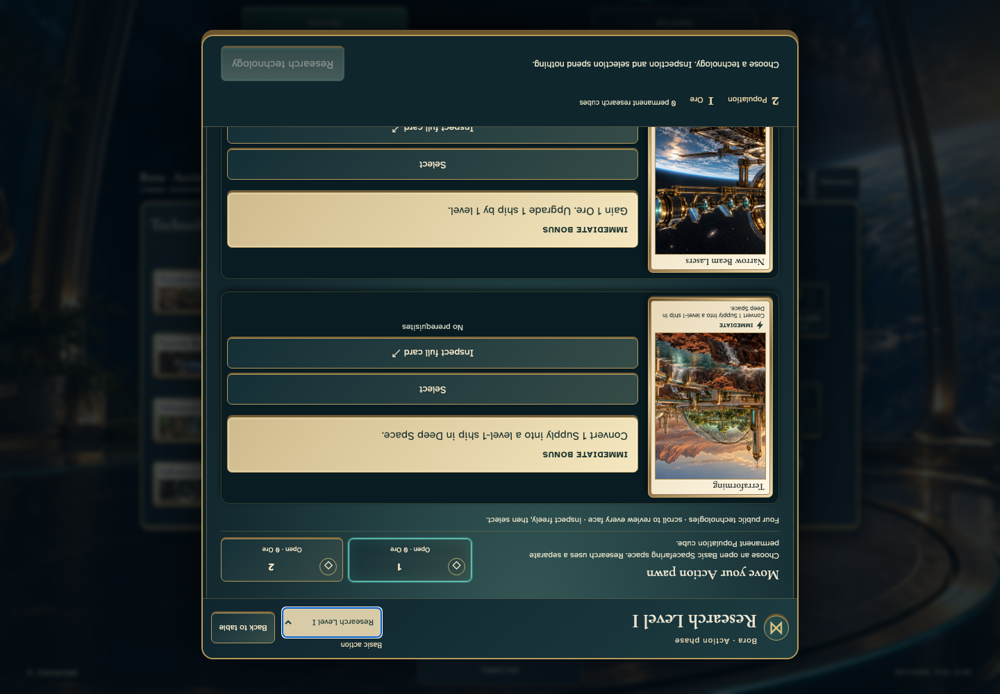](../../screenshots/contest-an-ore-outpost-at-two-shared-cardinal-seats/025-bora-build-open-desktop-darwin.png) |

tabletop-4k · 3840 × 2160

- [x] Bora opens the real Action instrument
- [x] Actual canonical effects and acknowledgement settle.
- [x] Public topology retains physical separation.
- [x] The viewport fits without page scrolling.

## 27. Bora chooses Basic build and jump

Viewpoint: **Bora · North · one shared controller**.

| desktop · 1440 × 1000 |
| --- |
| [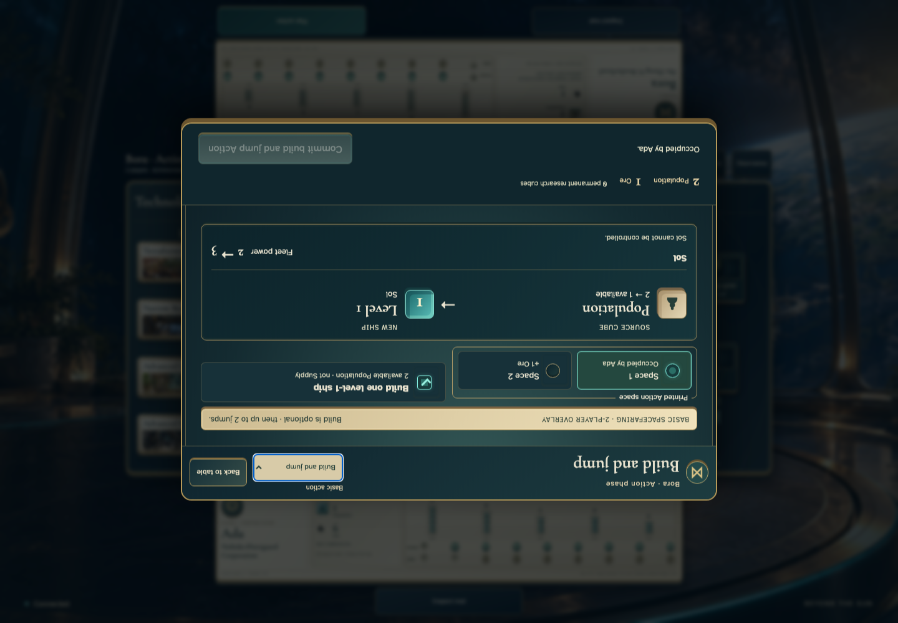](../../screenshots/contest-an-ore-outpost-at-two-shared-cardinal-seats/026-bora-build-kind-desktop-darwin.png) |

tabletop-4k · 3840 × 2160

[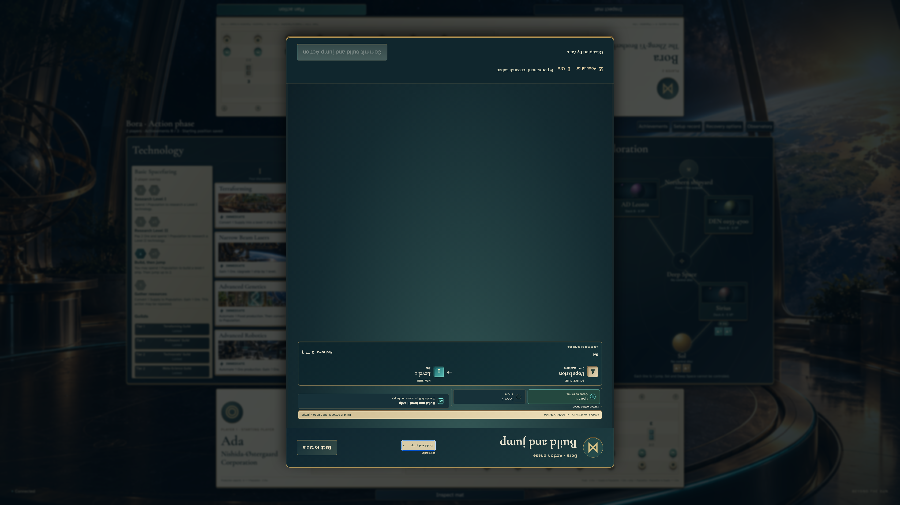](../../screenshots/contest-an-ore-outpost-at-two-shared-cardinal-seats/026-bora-build-kind-tabletop-4k-darwin.png)

- [x] Bora chooses Basic build and jump
- [x] Actual canonical effects and acknowledgement settle.
- [x] Public topology retains physical separation.
- [x] The viewport fits without page scrolling.

## 28. Choose the unoccupied second printed space with its real surcharge

Viewpoint: **Bora · North · one shared controller**.

| desktop · 1440 × 1000 |
| --- |
| [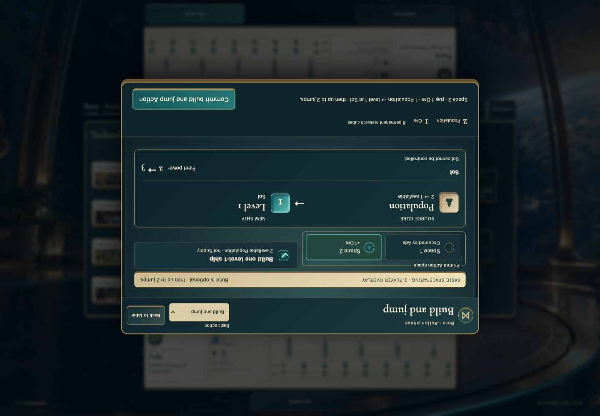](../../screenshots/contest-an-ore-outpost-at-two-shared-cardinal-seats/027-bora-build-space-desktop-darwin.png) |

tabletop-4k · 3840 × 2160

[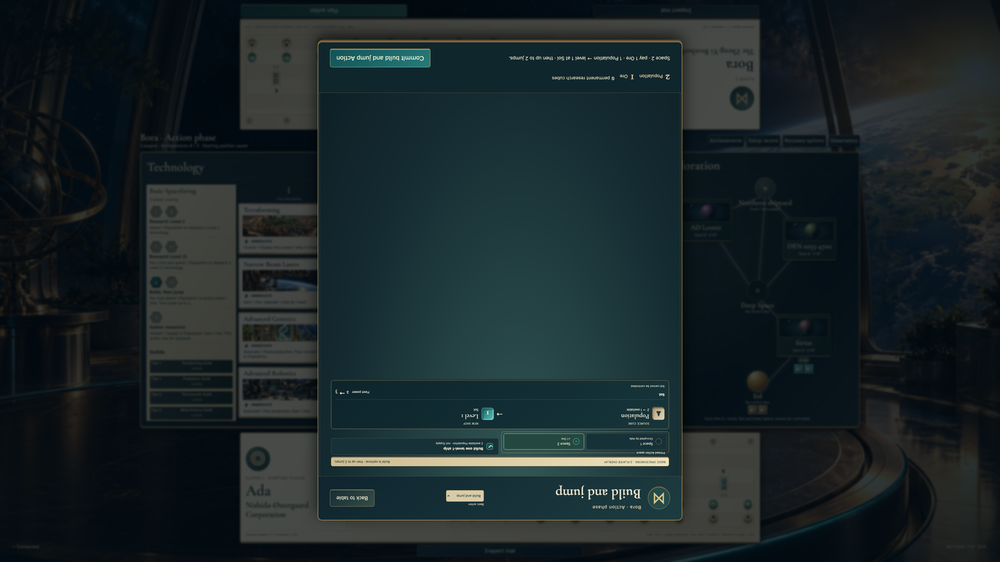](../../screenshots/contest-an-ore-outpost-at-two-shared-cardinal-seats/027-bora-build-space-tabletop-4k-darwin.png)

- [x] Choose the unoccupied second printed space with its real surcharge
- [x] Actual canonical effects and acknowledgement settle.
- [x] Public topology retains physical separation.
- [x] The viewport fits without page scrolling.

## 29. Commit the actual Population conversion and printed space cost before optional movement

Viewpoint: **Bora · North · one shared controller**.

| desktop · 1440 × 1000 |
| --- |
|  |

tabletop-4k · 3840 × 2160

- [x] Commit the actual Population conversion and printed space cost before optional movement
- [x] Actual canonical effects and acknowledgement settle.
- [x] Public topology retains physical separation.
- [x] The viewport fits without page scrolling.

## 30. Read the complete public map before choosing a connected route

Viewpoint: **Bora · North · one shared controller**.

| desktop · 1440 × 1000 |
| --- |
|  |

tabletop-4k · 3840 × 2160

- [x] Read the complete public map before choosing a connected route
- [x] Actual canonical effects and acknowledgement settle.
- [x] Public topology retains physical separation.
- [x] The viewport fits without page scrolling.

## 31. Read the actual connected destinations in this interface

Viewpoint: **Bora · North · one shared controller**.

| desktop · 1440 × 1000 |
| --- |
| [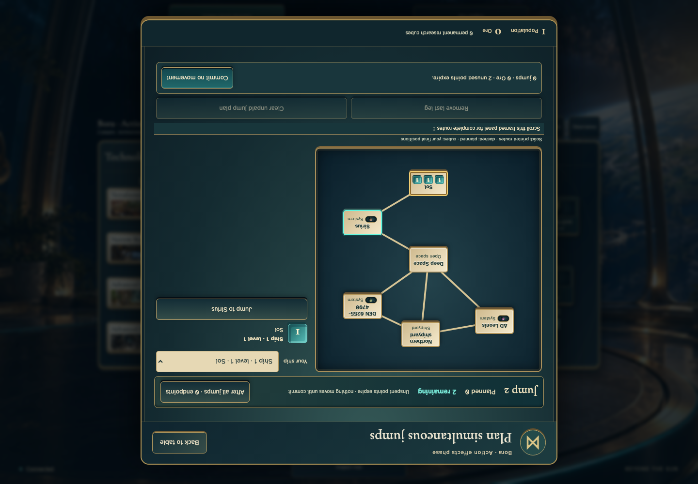](../../screenshots/contest-an-ore-outpost-at-two-shared-cardinal-seats/030-bora-build-editor-desktop-darwin.png) |

tabletop-4k · 3840 × 2160

- [x] Read the actual connected destinations in this interface
- [x] Actual canonical effects and acknowledgement settle.
- [x] Public topology retains physical separation.
- [x] The viewport fits without page scrolling.

## 32. Choose a real owned ship for this unpaid route

Viewpoint: **Bora · North · one shared controller**.

| desktop · 1440 × 1000 |
| --- |
|  |

tabletop-4k · 3840 × 2160

- [x] Choose a real owned ship for this unpaid route
- [x] Actual canonical effects and acknowledgement settle.
- [x] Public topology retains physical separation.
- [x] The viewport fits without page scrolling.

## 33. Plan Sirius as an endpoint; nothing moves yet

Viewpoint: **Bora · North · one shared controller**.

| desktop · 1440 × 1000 |
| --- |
| [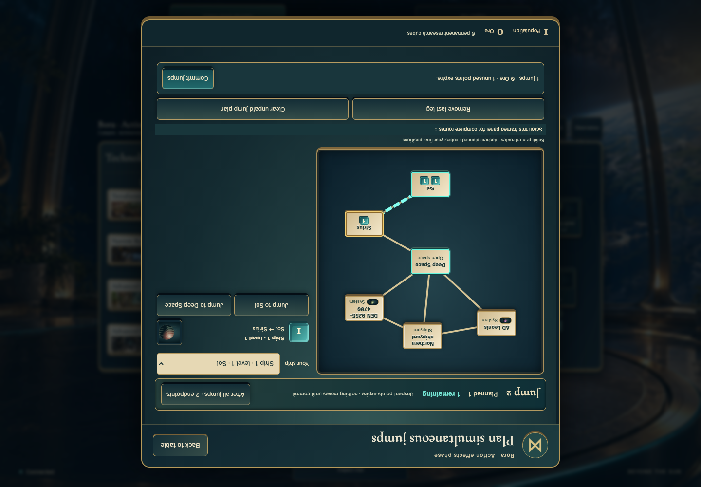](../../screenshots/contest-an-ore-outpost-at-two-shared-cardinal-seats/032-bora-first-endpoint-desktop-darwin.png) |

tabletop-4k · 3840 × 2160

- [x] Plan Sirius as an endpoint; nothing moves yet
- [x] Actual canonical effects and acknowledgement settle.
- [x] Public topology retains physical separation.
- [x] The viewport fits without page scrolling.

## 34. Choose a real owned ship for this unpaid route

Viewpoint: **Bora · North · one shared controller**.

| desktop · 1440 × 1000 |
| --- |
| [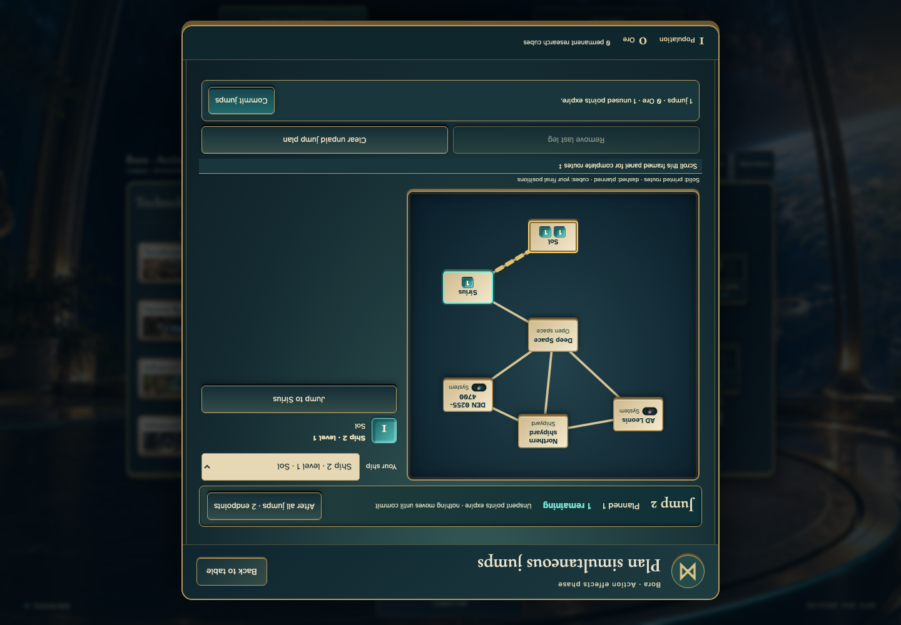](../../screenshots/contest-an-ore-outpost-at-two-shared-cardinal-seats/033-bora-second-ship-desktop-darwin.png) |

tabletop-4k · 3840 × 2160

[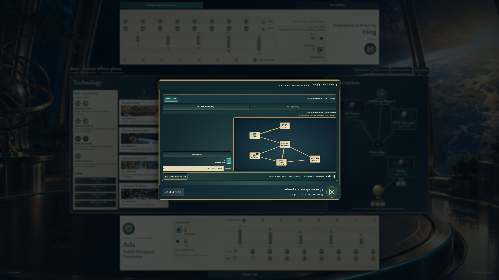](../../screenshots/contest-an-ore-outpost-at-two-shared-cardinal-seats/033-bora-second-ship-tabletop-4k-darwin.png)

- [x] Choose a real owned ship for this unpaid route
- [x] Actual canonical effects and acknowledgement settle.
- [x] Public topology retains physical separation.
- [x] The viewport fits without page scrolling.

## 35. Plan Sirius as an endpoint; nothing moves yet

Viewpoint: **Bora · North · one shared controller**.

| desktop · 1440 × 1000 |
| --- |
| [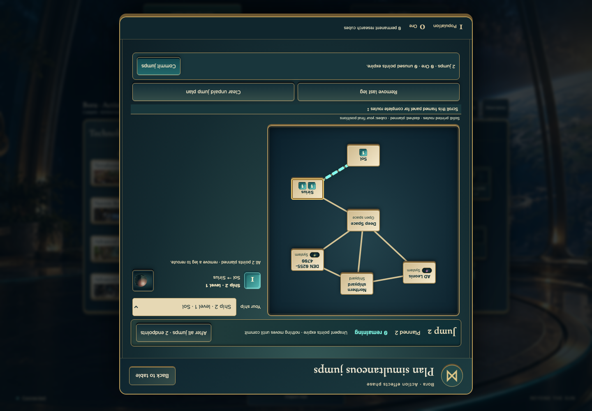](../../screenshots/contest-an-ore-outpost-at-two-shared-cardinal-seats/034-bora-second-endpoint-desktop-darwin.png) |

tabletop-4k · 3840 × 2160

- [x] Plan Sirius as an endpoint; nothing moves yet
- [x] Actual canonical effects and acknowledgement settle.
- [x] Public topology retains physical separation.
- [x] The viewport fits without page scrolling.

## 36. An incoming tied fleet does not gain an outpost or repeat its bonus

Viewpoint: **Bora · North · one shared controller**.

| desktop · 1440 × 1000 |
| --- |
|  |

tabletop-4k · 3840 × 2160

- [x] An incoming tied fleet does not gain an outpost or repeat its bonus
- [x] Actual canonical effects and acknowledgement settle.
- [x] Public topology retains physical separation.
- [x] The viewport fits without page scrolling.

## 37. Bora chooses ordinary Ore production and hands off

Viewpoint: **Bora · North · one shared controller**.

| desktop · 1440 × 1000 |
| --- |
|  |

tabletop-4k · 3840 × 2160

- [x] Bora chooses ordinary Ore production and hands off
- [x] Actual canonical effects and acknowledgement settle.
- [x] Public topology retains physical separation.
- [x] The viewport fits without page scrolling.

## 38. Ada inspects the actual production discs

Viewpoint: **Ada · South · one shared controller**.

| desktop · 1440 × 1000 |
| --- |
|  |

tabletop-4k · 3840 × 2160

[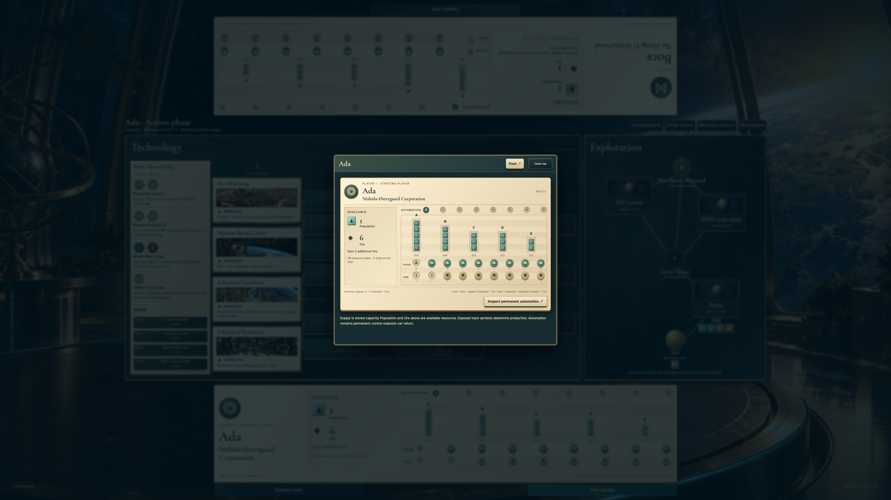](../../screenshots/contest-an-ore-outpost-at-two-shared-cardinal-seats/037-tied-ada-mat-tabletop-4k-darwin.png)

- [x] Ada inspects the actual production discs
- [x] Actual canonical effects and acknowledgement settle.
- [x] Public topology retains physical separation.
- [x] The viewport fits without page scrolling.

## 39. Open the reusable public fleet inspection

Viewpoint: **Ada · South · one shared controller**.

| desktop · 1440 × 1000 |
| --- |
| [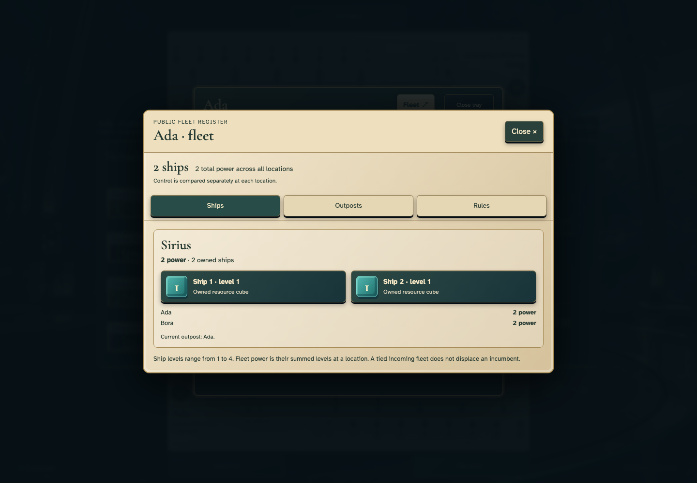](../../screenshots/contest-an-ore-outpost-at-two-shared-cardinal-seats/038-tied-ada-fleet-desktop-darwin.png) |

tabletop-4k · 3840 × 2160

- [x] Open the reusable public fleet inspection
- [x] Actual canonical effects and acknowledgement settle.
- [x] Public topology retains physical separation.
- [x] The viewport fits without page scrolling.

## 40. Read saved disc ownership separately from current summed fleet power

Viewpoint: **Ada · South · one shared controller**.

| desktop · 1440 × 1000 |
| --- |
| [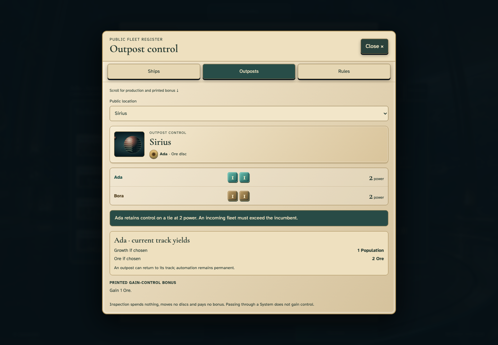](../../screenshots/contest-an-ore-outpost-at-two-shared-cardinal-seats/039-tied-ada-outposts-desktop-darwin.png) |

tabletop-4k · 3840 × 2160

- [x] Read saved disc ownership separately from current summed fleet power
- [x] Actual canonical effects and acknowledgement settle.
- [x] Public topology retains physical separation.
- [x] The viewport fits without page scrolling.

## 41. Inspect every faction’s actual level sum and the incumbent’s disc

Viewpoint: **Ada · South · one shared controller**.

| desktop · 1440 × 1000 |
| --- |
|  |

tabletop-4k · 3840 × 2160

- [x] Inspect every faction’s actual level sum and the incumbent’s disc
- [x] Actual canonical effects and acknowledgement settle.
- [x] Public topology retains physical separation.
- [x] The viewport fits without page scrolling.

## 42. Keyboard scroll reaches production, printed bonus and the inspection boundary

Viewpoint: **Ada · South · one shared controller**.

| desktop · 1440 × 1000 |
| --- |
|  |

tabletop-4k · 3840 × 2160

[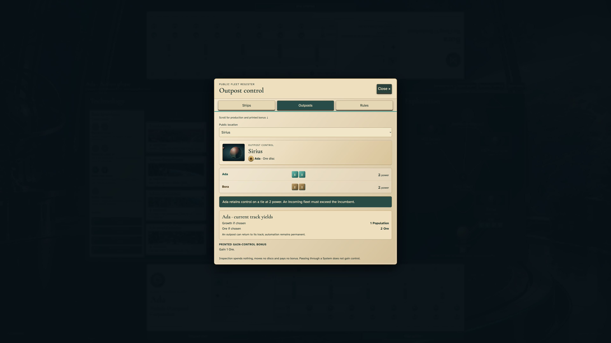](../../screenshots/contest-an-ore-outpost-at-two-shared-cardinal-seats/041-tied-ada-scroll-tabletop-4k-darwin.png)

- [x] Keyboard scroll reaches production, printed bonus and the inspection boundary
- [x] Actual canonical effects and acknowledgement settle.
- [x] Public topology retains physical separation.
- [x] The viewport fits without page scrolling.

## 43. Open the complete reusable fleet rules through semantic navigation

Viewpoint: **Ada · South · one shared controller**.

| desktop · 1440 × 1000 |
| --- |
| [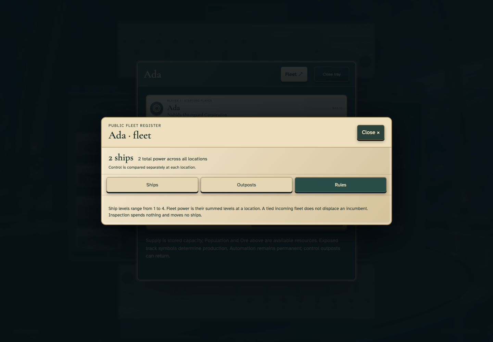](../../screenshots/contest-an-ore-outpost-at-two-shared-cardinal-seats/042-tied-ada-fleet-rules-desktop-darwin.png) |

tabletop-4k · 3840 × 2160

[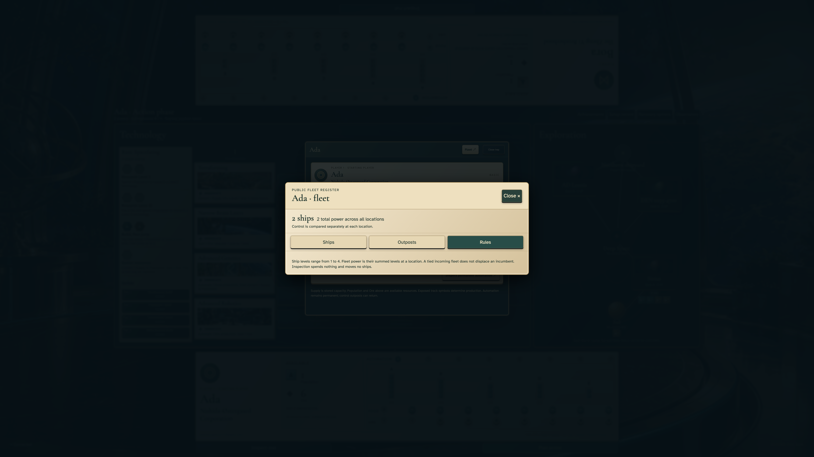](../../screenshots/contest-an-ore-outpost-at-two-shared-cardinal-seats/042-tied-ada-fleet-rules-tabletop-4k-darwin.png)

- [x] Open the complete reusable fleet rules through semantic navigation
- [x] Actual canonical effects and acknowledgement settle.
- [x] Public topology retains physical separation.
- [x] The viewport fits without page scrolling.

## 44. Return to the real ship register without taking a turn

Viewpoint: **Ada · South · one shared controller**.

| desktop · 1440 × 1000 |
| --- |
|  |

tabletop-4k · 3840 × 2160

- [x] Return to the real ship register without taking a turn
- [x] Actual canonical effects and acknowledgement settle.
- [x] Public topology retains physical separation.
- [x] The viewport fits without page scrolling.

## 45. Escape restores the exact fleet opener without taking a turn

Viewpoint: **Ada · South · one shared controller**.

| desktop · 1440 × 1000 |
| --- |
| [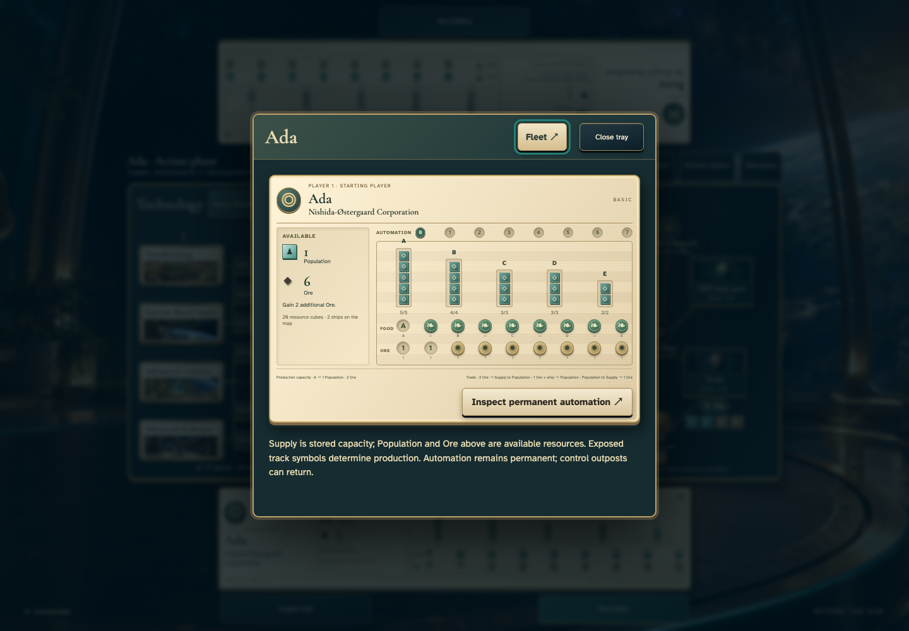](../../screenshots/contest-an-ore-outpost-at-two-shared-cardinal-seats/044-tied-ada-focus-return-desktop-darwin.png) |

tabletop-4k · 3840 × 2160

[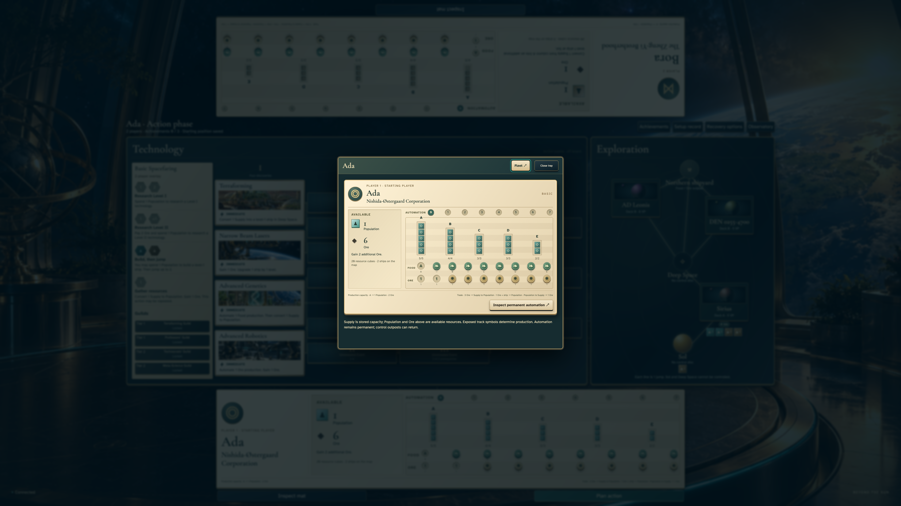](../../screenshots/contest-an-ore-outpost-at-two-shared-cardinal-seats/044-tied-ada-focus-return-tabletop-4k-darwin.png)

- [x] Escape restores the exact fleet opener without taking a turn
- [x] Actual canonical effects and acknowledgement settle.
- [x] Public topology retains physical separation.
- [x] The viewport fits without page scrolling.

## 46. Close the mat and restore its own opener

Viewpoint: **Ada · South · one shared controller**.

| desktop · 1440 × 1000 |
| --- |
| [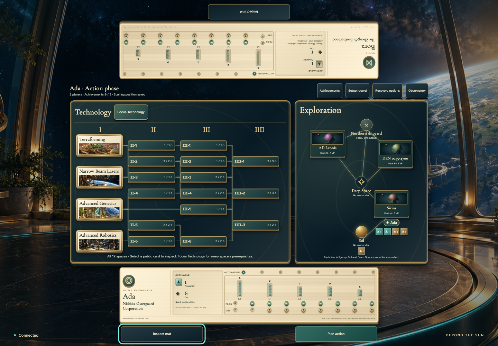](../../screenshots/contest-an-ore-outpost-at-two-shared-cardinal-seats/045-tied-ada-mat-return-desktop-darwin.png) |

tabletop-4k · 3840 × 2160

[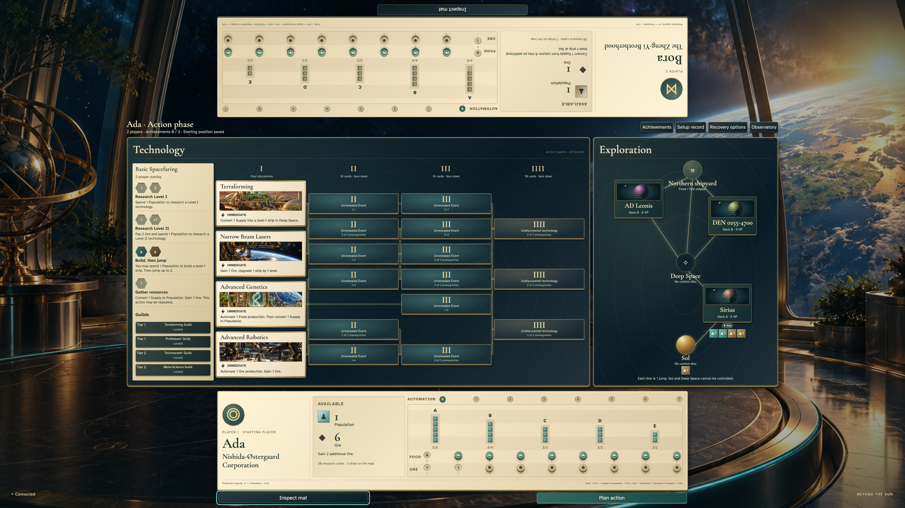](../../screenshots/contest-an-ore-outpost-at-two-shared-cardinal-seats/045-tied-ada-mat-return-tabletop-4k-darwin.png)

- [x] Close the mat and restore its own opener
- [x] Actual canonical effects and acknowledgement settle.
- [x] Public topology retains physical separation.
- [x] The viewport fits without page scrolling.

## 47. Ada opens the real Action instrument

Viewpoint: **Ada · South · one shared controller**.

| desktop · 1440 × 1000 |
| --- |
| [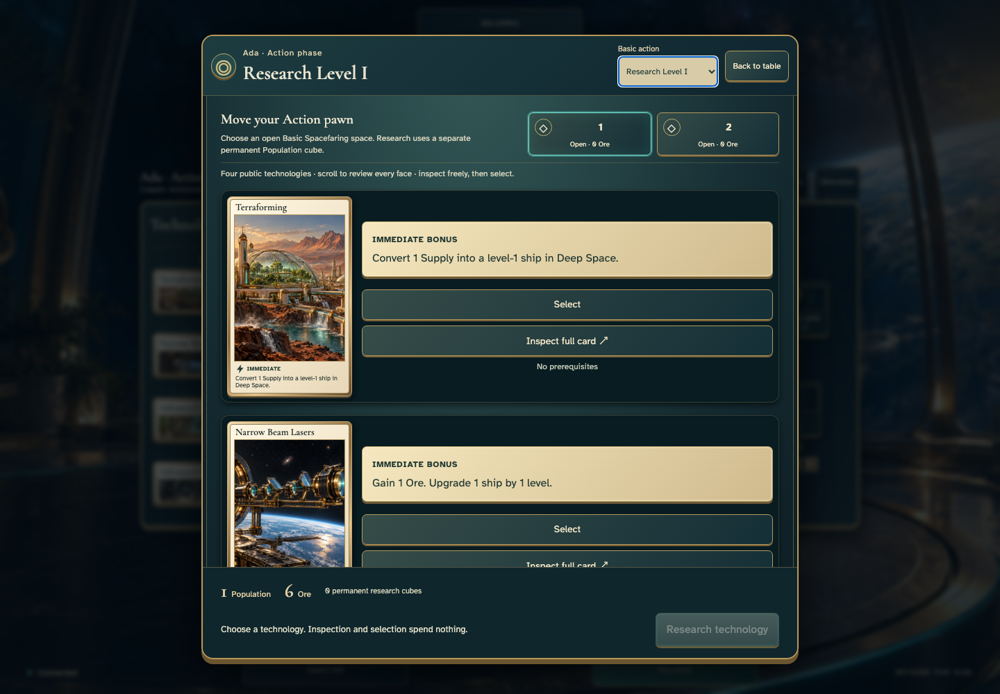](../../screenshots/contest-an-ore-outpost-at-two-shared-cardinal-seats/046-ada-gather-open-desktop-darwin.png) |

tabletop-4k · 3840 × 2160

[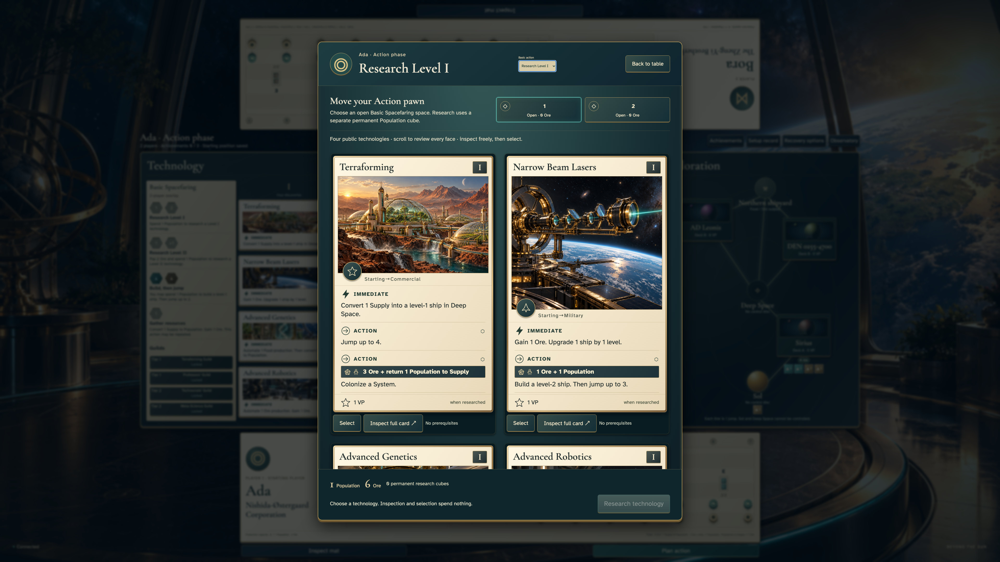](../../screenshots/contest-an-ore-outpost-at-two-shared-cardinal-seats/046-ada-gather-open-tabletop-4k-darwin.png)

- [x] Ada opens the real Action instrument
- [x] Actual canonical effects and acknowledgement settle.
- [x] Public topology retains physical separation.
- [x] The viewport fits without page scrolling.

## 48. Ada chooses Gather

Viewpoint: **Ada · South · one shared controller**.

| desktop · 1440 × 1000 |
| --- |
| [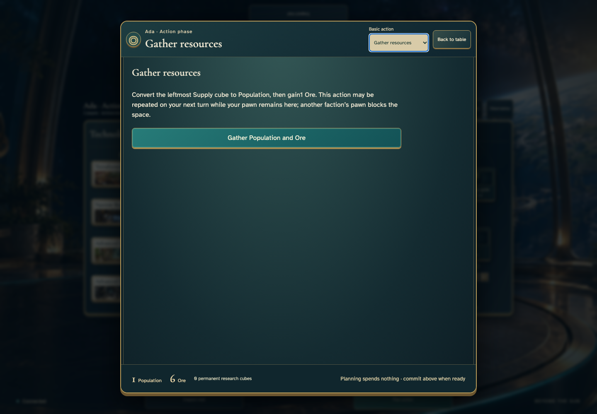](../../screenshots/contest-an-ore-outpost-at-two-shared-cardinal-seats/047-ada-gather-kind-desktop-darwin.png) |

tabletop-4k · 3840 × 2160

[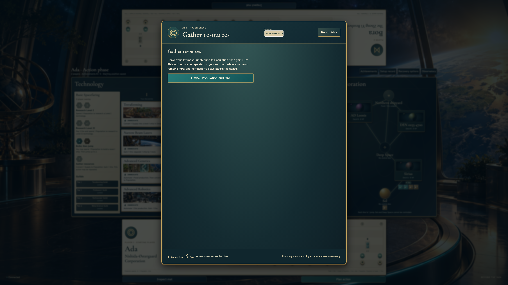](../../screenshots/contest-an-ore-outpost-at-two-shared-cardinal-seats/047-ada-gather-kind-tabletop-4k-darwin.png)

- [x] Ada chooses Gather
- [x] Actual canonical effects and acknowledgement settle.
- [x] Public topology retains physical separation.
- [x] The viewport fits without page scrolling.

## 49. Vacate the occupied build space through a legal Gather turn

Viewpoint: **Ada · South · one shared controller**.

| desktop · 1440 × 1000 |
| --- |
| [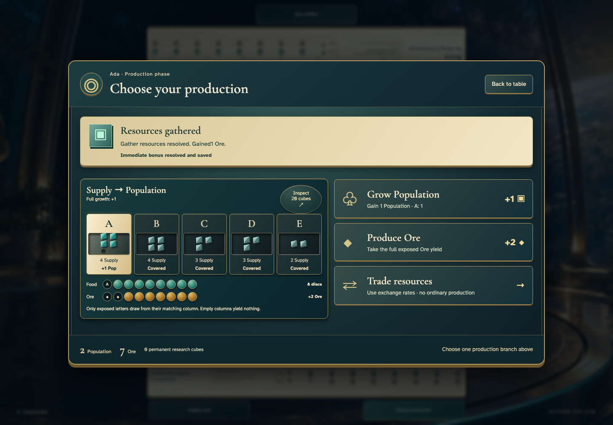](../../screenshots/contest-an-ore-outpost-at-two-shared-cardinal-seats/048-ada-gathered-desktop-darwin.png) |

tabletop-4k · 3840 × 2160

[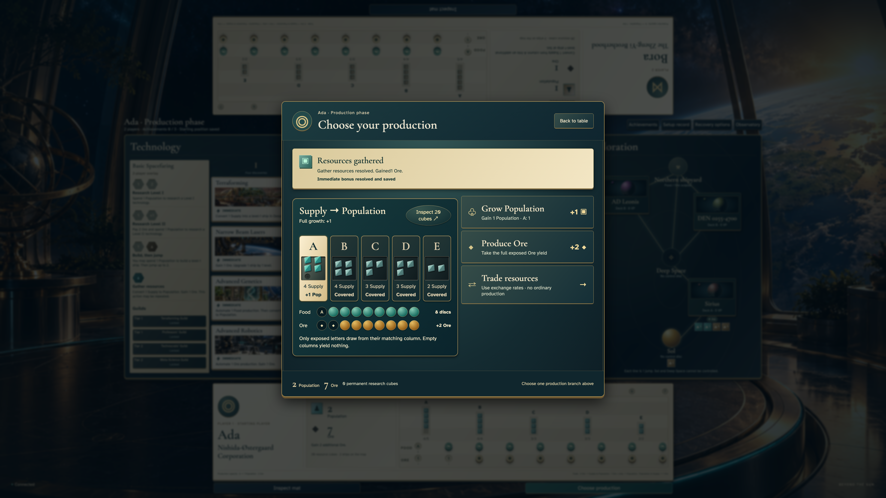](../../screenshots/contest-an-ore-outpost-at-two-shared-cardinal-seats/048-ada-gathered-tabletop-4k-darwin.png)

- [x] Vacate the occupied build space through a legal Gather turn
- [x] Actual canonical effects and acknowledgement settle.
- [x] Public topology retains physical separation.
- [x] The viewport fits without page scrolling.

## 50. Ada chooses ordinary Ore production and hands off

Viewpoint: **Ada · South · one shared controller**.

| desktop · 1440 × 1000 |
| --- |
| [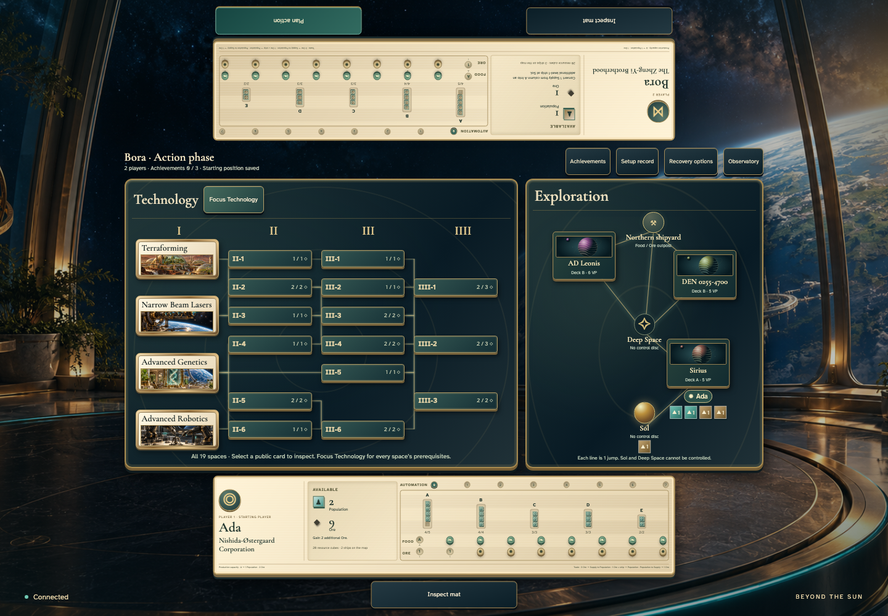](../../screenshots/contest-an-ore-outpost-at-two-shared-cardinal-seats/049-ada-gather-handoff-desktop-darwin.png) |

tabletop-4k · 3840 × 2160

- [x] Ada chooses ordinary Ore production and hands off
- [x] Actual canonical effects and acknowledgement settle.
- [x] Public topology retains physical separation.
- [x] The viewport fits without page scrolling.

## 51. Bora opens the real Action instrument

Viewpoint: **Bora · North · one shared controller**.

| desktop · 1440 × 1000 |
| --- |
|  |

tabletop-4k · 3840 × 2160

[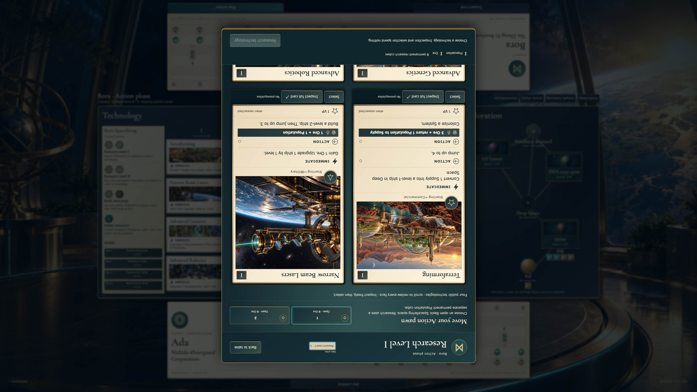](../../screenshots/contest-an-ore-outpost-at-two-shared-cardinal-seats/050-bora-exceed-open-tabletop-4k-darwin.png)

- [x] Bora opens the real Action instrument
- [x] Actual canonical effects and acknowledgement settle.
- [x] Public topology retains physical separation.
- [x] The viewport fits without page scrolling.

## 52. Bora chooses Basic build and jump

Viewpoint: **Bora · North · one shared controller**.

| desktop · 1440 × 1000 |
| --- |
| [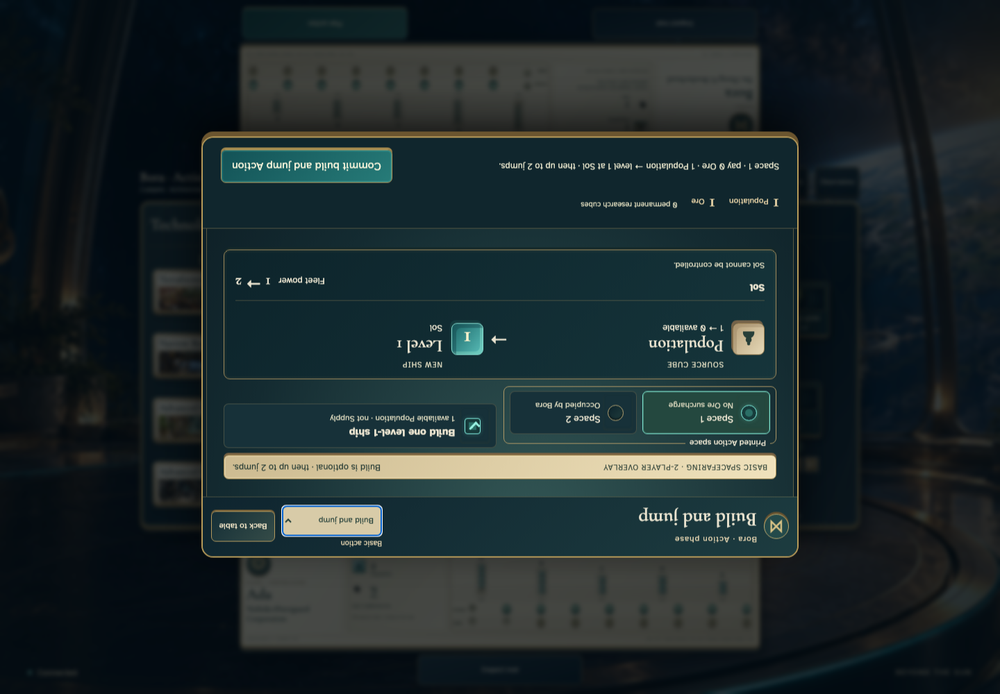](../../screenshots/contest-an-ore-outpost-at-two-shared-cardinal-seats/051-bora-exceed-kind-desktop-darwin.png) |

tabletop-4k · 3840 × 2160

[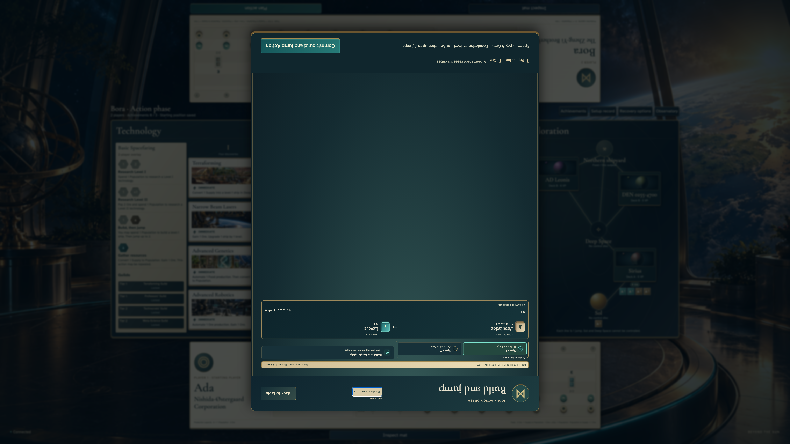](../../screenshots/contest-an-ore-outpost-at-two-shared-cardinal-seats/051-bora-exceed-kind-tabletop-4k-darwin.png)

- [x] Bora chooses Basic build and jump
- [x] Actual canonical effects and acknowledgement settle.
- [x] Public topology retains physical separation.
- [x] The viewport fits without page scrolling.

## 53. Use the existing fleet without converting another Population cube

Viewpoint: **Bora · North · one shared controller**.

| desktop · 1440 × 1000 |
| --- |
| [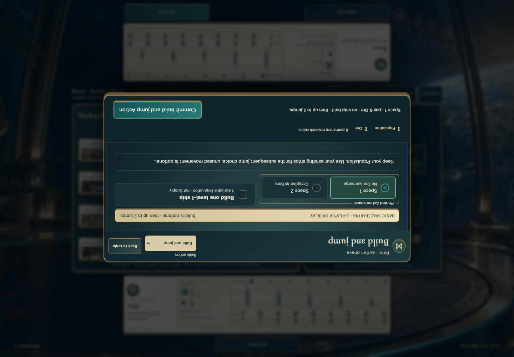](../../screenshots/contest-an-ore-outpost-at-two-shared-cardinal-seats/052-bora-exceed-no-build-desktop-darwin.png) |

tabletop-4k · 3840 × 2160

[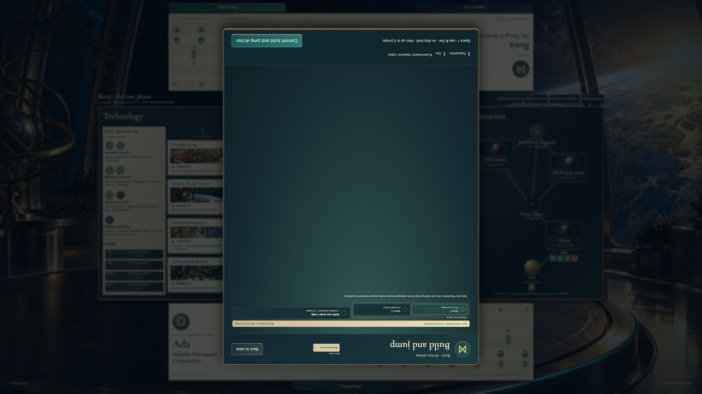](../../screenshots/contest-an-ore-outpost-at-two-shared-cardinal-seats/052-bora-exceed-no-build-tabletop-4k-darwin.png)

- [x] Use the existing fleet without converting another Population cube
- [x] Actual canonical effects and acknowledgement settle.
- [x] Public topology retains physical separation.
- [x] The viewport fits without page scrolling.

## 54. Commit the actual Population conversion and printed space cost before optional movement

Viewpoint: **Bora · North · one shared controller**.

| desktop · 1440 × 1000 |
| --- |
| [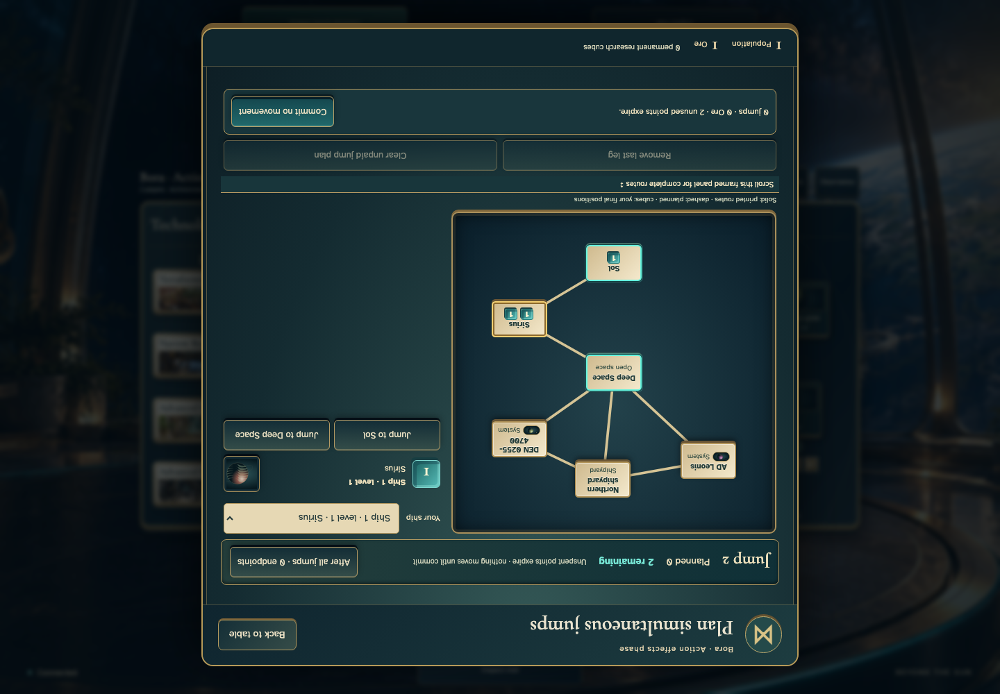](../../screenshots/contest-an-ore-outpost-at-two-shared-cardinal-seats/053-bora-exceed-built-desktop-darwin.png) |

tabletop-4k · 3840 × 2160

- [x] Commit the actual Population conversion and printed space cost before optional movement
- [x] Actual canonical effects and acknowledgement settle.
- [x] Public topology retains physical separation.
- [x] The viewport fits without page scrolling.

## 55. Read the complete public map before choosing a connected route

Viewpoint: **Bora · North · one shared controller**.

| desktop · 1440 × 1000 |
| --- |
|  |

tabletop-4k · 3840 × 2160

- [x] Read the complete public map before choosing a connected route
- [x] Actual canonical effects and acknowledgement settle.
- [x] Public topology retains physical separation.
- [x] The viewport fits without page scrolling.

## 56. Read the actual connected destinations in this interface

Viewpoint: **Bora · North · one shared controller**.

| desktop · 1440 × 1000 |
| --- |
|  |

tabletop-4k · 3840 × 2160

[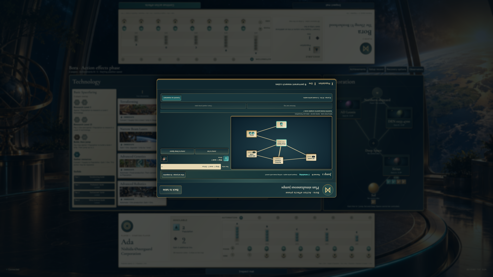](../../screenshots/contest-an-ore-outpost-at-two-shared-cardinal-seats/055-bora-exceed-editor-tabletop-4k-darwin.png)

- [x] Read the actual connected destinations in this interface
- [x] Actual canonical effects and acknowledgement settle.
- [x] Public topology retains physical separation.
- [x] The viewport fits without page scrolling.

## 57. Choose a real owned ship for this unpaid route

Viewpoint: **Bora · North · one shared controller**.

| desktop · 1440 × 1000 |
| --- |
|  |

tabletop-4k · 3840 × 2160

[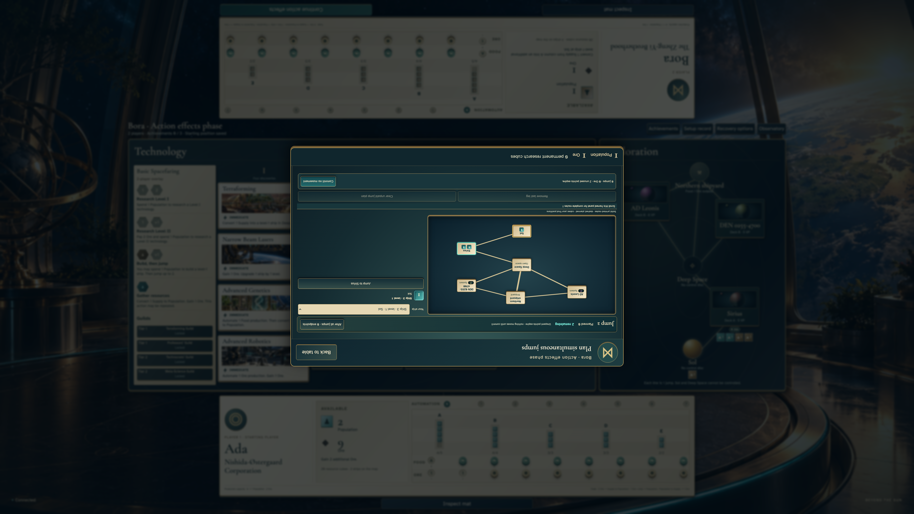](../../screenshots/contest-an-ore-outpost-at-two-shared-cardinal-seats/056-bora-third-ship-tabletop-4k-darwin.png)

- [x] Choose a real owned ship for this unpaid route
- [x] Actual canonical effects and acknowledgement settle.
- [x] Public topology retains physical separation.
- [x] The viewport fits without page scrolling.

## 58. Plan Sirius as an endpoint; nothing moves yet

Viewpoint: **Bora · North · one shared controller**.

| desktop · 1440 × 1000 |
| --- |
| [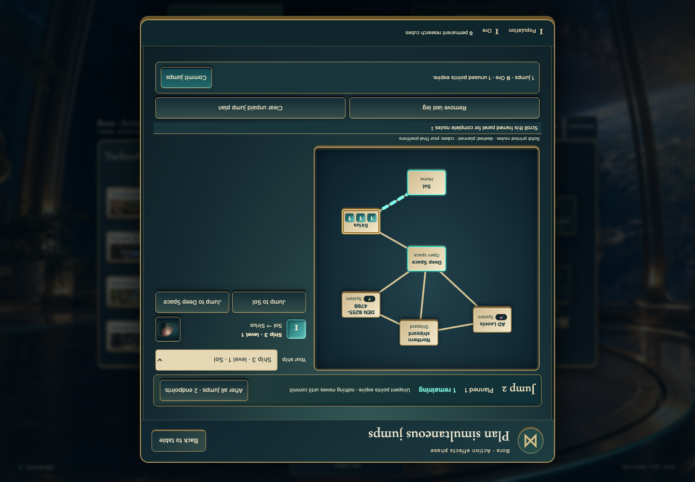](../../screenshots/contest-an-ore-outpost-at-two-shared-cardinal-seats/057-bora-third-endpoint-desktop-darwin.png) |

tabletop-4k · 3840 × 2160

- [x] Plan Sirius as an endpoint; nothing moves yet
- [x] Actual canonical effects and acknowledgement settle.
- [x] Public topology retains physical separation.
- [x] The viewport fits without page scrolling.

## 59. A later third ship exceeds the incumbent and resolves the actual disc transfer

Viewpoint: **Bora · North · one shared controller**.

| desktop · 1440 × 1000 |
| --- |
| [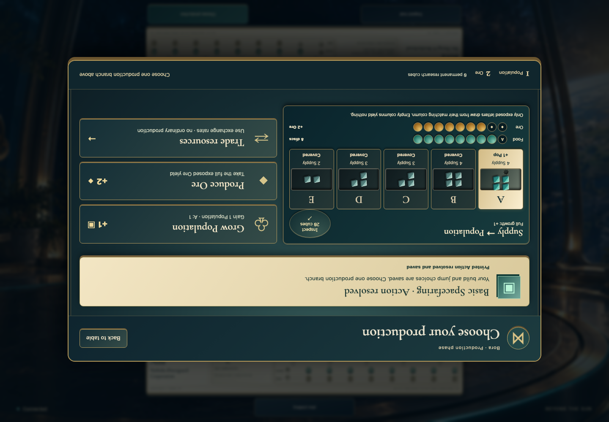](../../screenshots/contest-an-ore-outpost-at-two-shared-cardinal-seats/058-bora-transfer-desktop-darwin.png) |

tabletop-4k · 3840 × 2160

- [x] A later third ship exceeds the incumbent and resolves the actual disc transfer
- [x] Actual canonical effects and acknowledgement settle.
- [x] Public topology retains physical separation.
- [x] The viewport fits without page scrolling.

## 60. The public board retains Bora’s new outpost before production

Viewpoint: **Bora · North · one shared controller**.

| desktop · 1440 × 1000 |
| --- |
|  |

tabletop-4k · 3840 × 2160

- [x] The public board retains Bora’s new outpost before production
- [x] Actual canonical effects and acknowledgement settle.
- [x] Public topology retains physical separation.
- [x] The viewport fits without page scrolling.

## 61. Bora inspects the actual production discs

Viewpoint: **Bora · North · one shared controller**.

| desktop · 1440 × 1000 |
| --- |
|  |

tabletop-4k · 3840 × 2160

- [x] Bora inspects the actual production discs
- [x] Actual canonical effects and acknowledgement settle.
- [x] Public topology retains physical separation.
- [x] The viewport fits without page scrolling.

## 62. Open the reusable public fleet inspection

Viewpoint: **Bora · North · one shared controller**.

| desktop · 1440 × 1000 |
| --- |
|  |

tabletop-4k · 3840 × 2160

- [x] Open the reusable public fleet inspection
- [x] Actual canonical effects and acknowledgement settle.
- [x] Public topology retains physical separation.
- [x] The viewport fits without page scrolling.

## 63. Read saved disc ownership separately from current summed fleet power

Viewpoint: **Bora · North · one shared controller**.

| desktop · 1440 × 1000 |
| --- |
|  |

tabletop-4k · 3840 × 2160

- [x] Read saved disc ownership separately from current summed fleet power
- [x] Actual canonical effects and acknowledgement settle.
- [x] Public topology retains physical separation.
- [x] The viewport fits without page scrolling.

## 64. Inspect every faction’s actual level sum and the incumbent’s disc

Viewpoint: **Bora · North · one shared controller**.

| desktop · 1440 × 1000 |
| --- |
|  |

tabletop-4k · 3840 × 2160

- [x] Inspect every faction’s actual level sum and the incumbent’s disc
- [x] Actual canonical effects and acknowledgement settle.
- [x] Public topology retains physical separation.
- [x] The viewport fits without page scrolling.

## 65. Read the current conditional yields; an outpost does not pay regular production automatically

Viewpoint: **Bora · North · one shared controller**.

| desktop · 1440 × 1000 |
| --- |
|  |

tabletop-4k · 3840 × 2160

- [x] Read the current conditional yields; an outpost does not pay regular production automatically
- [x] Actual canonical effects and acknowledgement settle.
- [x] Public topology retains physical separation.
- [x] The viewport fits without page scrolling.

## 66. Read the complete control rule and actual printed gain-control bonus

Viewpoint: **Bora · North · one shared controller**.

| desktop · 1440 × 1000 |
| --- |
|  |

tabletop-4k · 3840 × 2160

- [x] Read the complete control rule and actual printed gain-control bonus
- [x] Actual canonical effects and acknowledgement settle.
- [x] Public topology retains physical separation.
- [x] The viewport fits without page scrolling.

## 67. Open the complete reusable fleet rules through semantic navigation

Viewpoint: **Bora · North · one shared controller**.

| desktop · 1440 × 1000 |
| --- |
|  |

tabletop-4k · 3840 × 2160

- [x] Open the complete reusable fleet rules through semantic navigation
- [x] Actual canonical effects and acknowledgement settle.
- [x] Public topology retains physical separation.
- [x] The viewport fits without page scrolling.

## 68. Return to the real ship register without taking a turn

Viewpoint: **Bora · North · one shared controller**.

| desktop · 1440 × 1000 |
| --- |
|  |

tabletop-4k · 3840 × 2160

- [x] Return to the real ship register without taking a turn
- [x] Actual canonical effects and acknowledgement settle.
- [x] Public topology retains physical separation.
- [x] The viewport fits without page scrolling.

## 69. Escape restores the exact fleet opener without taking a turn

Viewpoint: **Bora · North · one shared controller**.

| desktop · 1440 × 1000 |
| --- |
|  |

tabletop-4k · 3840 × 2160

- [x] Escape restores the exact fleet opener without taking a turn
- [x] Actual canonical effects and acknowledgement settle.
- [x] Public topology retains physical separation.
- [x] The viewport fits without page scrolling.

## 70. Close the mat and restore its own opener

Viewpoint: **Bora · North · one shared controller**.

| desktop · 1440 × 1000 |
| --- |
|  |

tabletop-4k · 3840 × 2160

- [x] Close the mat and restore its own opener
- [x] Actual canonical effects and acknowledgement settle.
- [x] Public topology retains physical separation.
- [x] The viewport fits without page scrolling.

## 71. Ada inspects the actual production discs

Viewpoint: **Ada · South · one shared controller**.

| desktop · 1440 × 1000 |
| --- |
|  |

tabletop-4k · 3840 × 2160

- [x] Ada inspects the actual production discs
- [x] Actual canonical effects and acknowledgement settle.
- [x] Public topology retains physical separation.
- [x] The viewport fits without page scrolling.

## 72. Open the reusable public fleet inspection

Viewpoint: **Ada · South · one shared controller**.

| desktop · 1440 × 1000 |
| --- |
|  |

tabletop-4k · 3840 × 2160

- [x] Open the reusable public fleet inspection
- [x] Actual canonical effects and acknowledgement settle.
- [x] Public topology retains physical separation.
- [x] The viewport fits without page scrolling.

## 73. Read saved disc ownership separately from current summed fleet power

Viewpoint: **Ada · South · one shared controller**.

| desktop · 1440 × 1000 |
| --- |
|  |

tabletop-4k · 3840 × 2160

- [x] Read saved disc ownership separately from current summed fleet power
- [x] Actual canonical effects and acknowledgement settle.
- [x] Public topology retains physical separation.
- [x] The viewport fits without page scrolling.

## 74. Inspect every faction’s actual level sum and the incumbent’s disc

Viewpoint: **Ada · South · one shared controller**.

| desktop · 1440 × 1000 |
| --- |
|  |

tabletop-4k · 3840 × 2160

- [x] Inspect every faction’s actual level sum and the incumbent’s disc
- [x] Actual canonical effects and acknowledgement settle.
- [x] Public topology retains physical separation.
- [x] The viewport fits without page scrolling.

## 75. Keyboard scroll reaches production, printed bonus and the inspection boundary

Viewpoint: **Ada · South · one shared controller**.

| desktop · 1440 × 1000 |
| --- |
|  |

tabletop-4k · 3840 × 2160

- [x] Keyboard scroll reaches production, printed bonus and the inspection boundary
- [x] Actual canonical effects and acknowledgement settle.
- [x] Public topology retains physical separation.
- [x] The viewport fits without page scrolling.

## 76. Open the complete reusable fleet rules through semantic navigation

Viewpoint: **Ada · South · one shared controller**.

| desktop · 1440 × 1000 |
| --- |
|  |

tabletop-4k · 3840 × 2160

- [x] Open the complete reusable fleet rules through semantic navigation
- [x] Actual canonical effects and acknowledgement settle.
- [x] Public topology retains physical separation.
- [x] The viewport fits without page scrolling.

## 77. Return to the real ship register without taking a turn

Viewpoint: **Ada · South · one shared controller**.

| desktop · 1440 × 1000 |
| --- |
|  |

tabletop-4k · 3840 × 2160

- [x] Return to the real ship register without taking a turn
- [x] Actual canonical effects and acknowledgement settle.
- [x] Public topology retains physical separation.
- [x] The viewport fits without page scrolling.

## 78. Escape restores the exact fleet opener without taking a turn

Viewpoint: **Ada · South · one shared controller**.

| desktop · 1440 × 1000 |
| --- |
|  |

tabletop-4k · 3840 × 2160

- [x] Escape restores the exact fleet opener without taking a turn
- [x] Actual canonical effects and acknowledgement settle.
- [x] Public topology retains physical separation.
- [x] The viewport fits without page scrolling.

## 79. Close the mat and restore its own opener

Viewpoint: **Ada · South · one shared controller**.

| desktop · 1440 × 1000 |
| --- |
|  |

tabletop-4k · 3840 × 2160

- [x] Close the mat and restore its own opener
- [x] Actual canonical effects and acknowledgement settle.
- [x] Public topology retains physical separation.
- [x] The viewport fits without page scrolling.

## 80. Reload retains the same controlling faction and pending Production

Viewpoint: **Bora · North · one shared controller**.

| desktop · 1440 × 1000 |
| --- |
|  |

tabletop-4k · 3840 × 2160

- [x] Reload retains the same controlling faction and pending Production
- [x] Actual canonical effects and acknowledgement settle.
- [x] Public topology retains physical separation.
- [x] The viewport fits without page scrolling.

## 81. Resume without another outpost placement or gain bonus

Viewpoint: **Bora · North · one shared controller**.

| desktop · 1440 × 1000 |
| --- |
|  |

tabletop-4k · 3840 × 2160

- [x] Resume without another outpost placement or gain bonus
- [x] Actual canonical effects and acknowledgement settle.
- [x] Public topology retains physical separation.
- [x] The viewport fits without page scrolling.

## 82. Bora chooses ordinary Ore production and hands off

Viewpoint: **Bora · North · one shared controller**.

| desktop · 1440 × 1000 |
| --- |
|  |

tabletop-4k · 3840 × 2160

- [x] Bora chooses ordinary Ore production and hands off
- [x] Actual canonical effects and acknowledgement settle.
- [x] Public topology retains physical separation.
- [x] The viewport fits without page scrolling.
