# Lose control during a rival trade while keeping permanent automation with separate remote controllers

Ordinary remote invite/claim/unique Basic factions/Ready/Begin; two real identities for contest or four for first-turn bonus/specialty choices. Seed fixed only at Begin (002 contest/specialty;004 bonuses); command identities disjoint. No injected game state or future deck read.

## 1. Arrive through the actual production interface

Viewpoint: **Ada · separate host controller**.

| phone · 393 × 852 | desktop · 1440 × 1000 |
| --- | --- |
|  |  |

- [x] Arrive through the actual production interface
- [x] Actual canonical effects and acknowledgement settle.
- [x] Public topology retains physical separation.
- [x] The viewport fits without page scrolling.

## 2. Choose physical tabletop or separate-controller remote play

Viewpoint: **Ada · separate host controller**.

| phone · 393 × 852 | desktop · 1440 × 1000 |
| --- | --- |
|  |  |

- [x] Choose physical tabletop or separate-controller remote play
- [x] Actual canonical effects and acknowledgement settle.
- [x] Public topology retains physical separation.
- [x] The viewport fits without page scrolling.

## 3. Open the ordinary remote host form

Viewpoint: **Ada · separate host controller**.

| phone · 393 × 852 | desktop · 1440 × 1000 |
| --- | --- |
|  |  |

- [x] Open the ordinary remote host form
- [x] Actual canonical effects and acknowledgement settle.
- [x] Public topology retains physical separation.
- [x] The viewport fits without page scrolling.

## 4. Enter Ada’s host name

Viewpoint: **Ada · separate host controller**.

| phone · 393 × 852 | desktop · 1440 × 1000 |
| --- | --- |
|  | [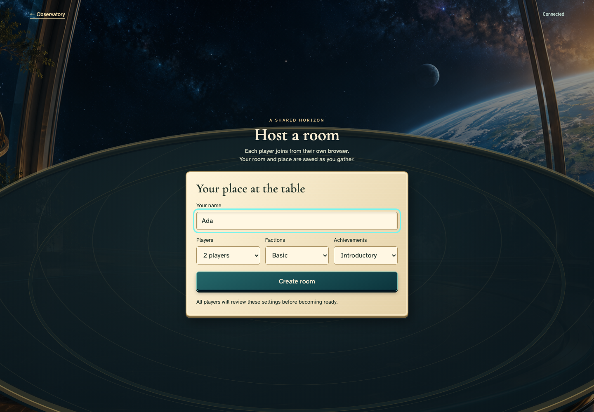](../../screenshots/lose-control-during-a-rival-trade-while-keeping-permanent-automation-with-separate-remote-controllers/003-host-name-desktop-darwin.png) |

- [x] Enter Ada’s host name
- [x] Actual canonical effects and acknowledgement settle.
- [x] Public topology retains physical separation.
- [x] The viewport fits without page scrolling.

## 5. The host receives the real public invitation

Viewpoint: **Ada · separate host controller**.

| phone · 393 × 852 | desktop · 1440 × 1000 |
| --- | --- |
| [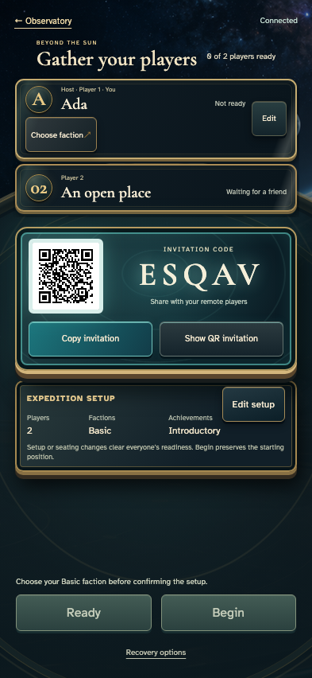](../../screenshots/lose-control-during-a-rival-trade-while-keeping-permanent-automation-with-separate-remote-controllers/004-host-room-phone-darwin.png) | [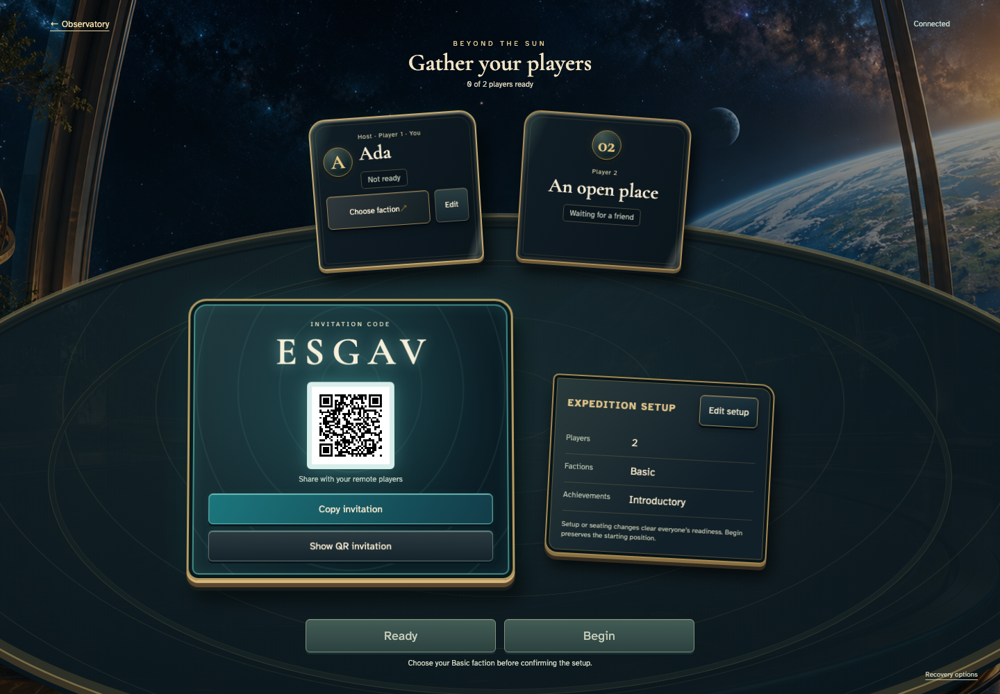](../../screenshots/lose-control-during-a-rival-trade-while-keeping-permanent-automation-with-separate-remote-controllers/004-host-room-desktop-darwin.png) |

- [x] The host receives the real public invitation
- [x] Actual canonical effects and acknowledgement settle.
- [x] Public topology retains physical separation.
- [x] The viewport fits without page scrolling.

## 6. An independent controller previews the invitation

Viewpoint: **Bora · separate guest controller**.

| phone · 1440 × 1000 | desktop · 393 × 852 |
| --- | --- |
| [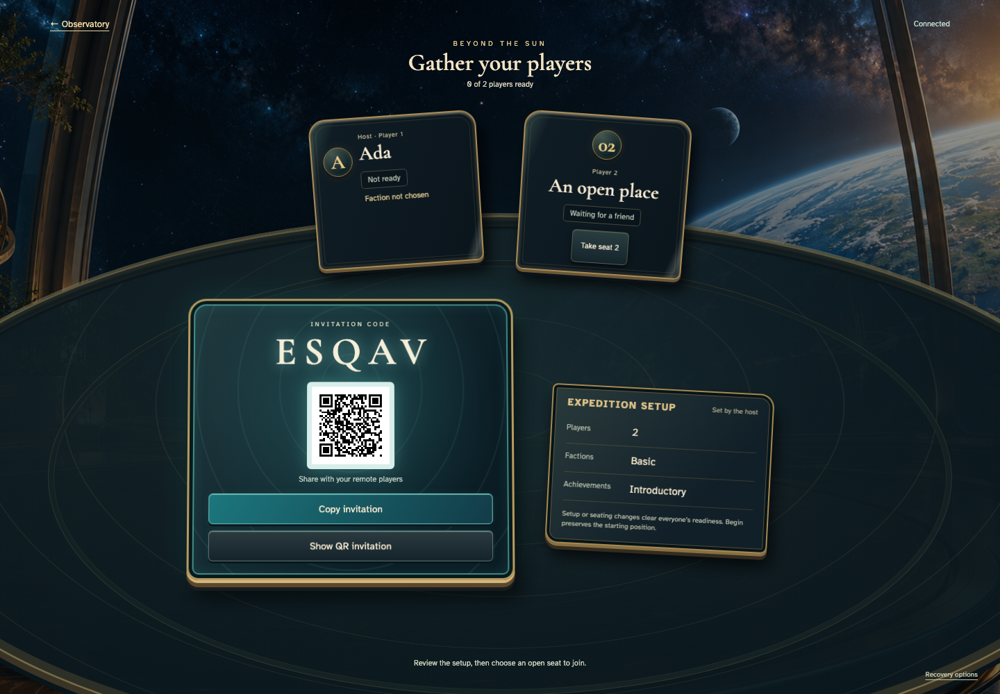](../../screenshots/lose-control-during-a-rival-trade-while-keeping-permanent-automation-with-separate-remote-controllers/005-guest-1-preview-phone-darwin.png) | [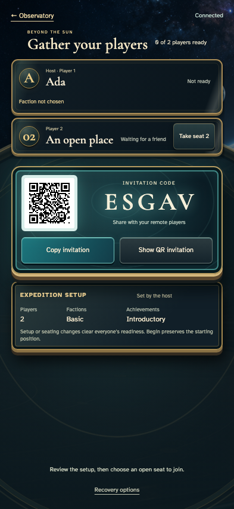](../../screenshots/lose-control-during-a-rival-trade-while-keeping-permanent-automation-with-separate-remote-controllers/005-guest-1-preview-desktop-darwin.png) |

- [x] An independent controller previews the invitation
- [x] Actual canonical effects and acknowledgement settle.
- [x] Public topology retains physical separation.
- [x] The viewport fits without page scrolling.

## 7. Claim an open remote seat through its own dialog

Viewpoint: **Bora · separate guest controller**.

| phone · 1440 × 1000 | desktop · 393 × 852 |
| --- | --- |
| [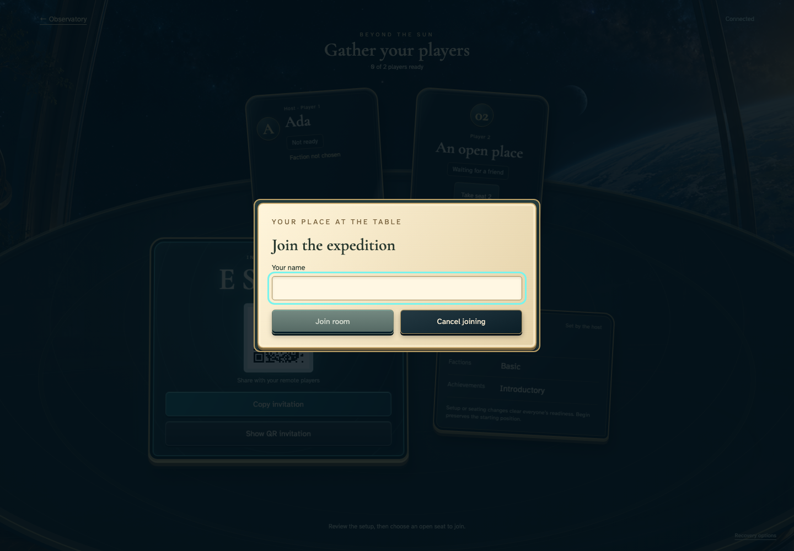](../../screenshots/lose-control-during-a-rival-trade-while-keeping-permanent-automation-with-separate-remote-controllers/006-guest-1-name-form-phone-darwin.png) |  |

- [x] Claim an open remote seat through its own dialog
- [x] Actual canonical effects and acknowledgement settle.
- [x] Public topology retains physical separation.
- [x] The viewport fits without page scrolling.

## 8. Enter the guest name

Viewpoint: **Bora · separate guest controller**.

| phone · 1440 × 1000 | desktop · 393 × 852 |
| --- | --- |
| [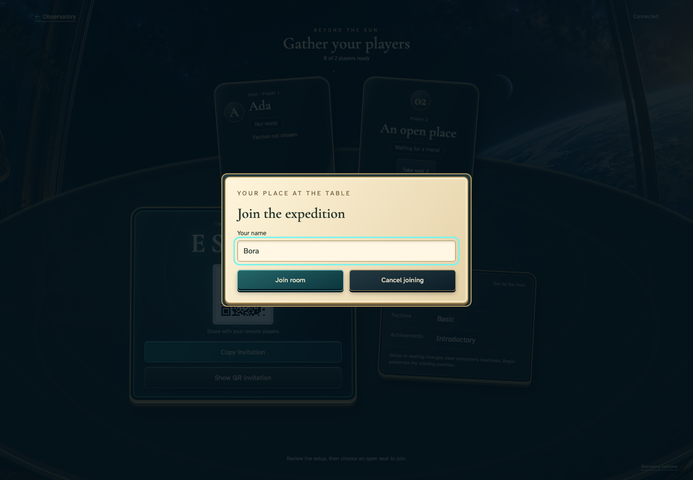](../../screenshots/lose-control-during-a-rival-trade-while-keeping-permanent-automation-with-separate-remote-controllers/007-guest-1-name-phone-darwin.png) |  |

- [x] Enter the guest name
- [x] Actual canonical effects and acknowledgement settle.
- [x] Public topology retains physical separation.
- [x] The viewport fits without page scrolling.

## 9. Persist this controller’s own seat

Viewpoint: **Bora · separate guest controller**.

| phone · 1440 × 1000 | desktop · 393 × 852 |
| --- | --- |
|  | [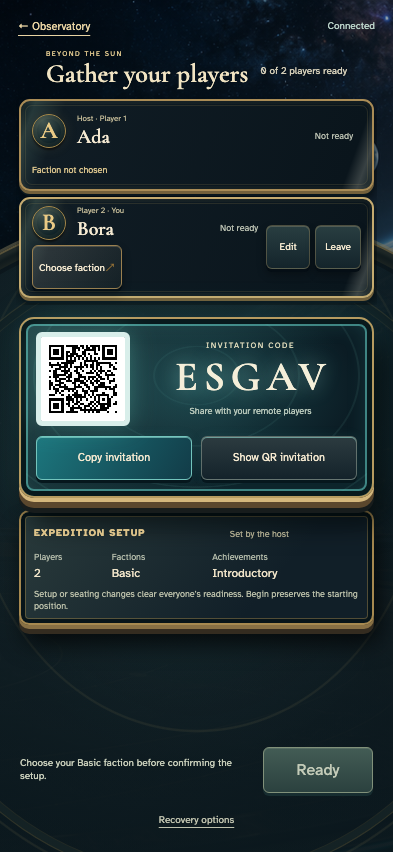](../../screenshots/lose-control-during-a-rival-trade-while-keeping-permanent-automation-with-separate-remote-controllers/008-guest-1-joined-desktop-darwin.png) |

- [x] Persist this controller’s own seat
- [x] Actual canonical effects and acknowledgement settle.
- [x] Public topology retains physical separation.
- [x] The viewport fits without page scrolling.

## 10. Choose a legal unique Basic faction

Viewpoint: **Ada · separate host controller**.

| phone · 393 × 852 | desktop · 1440 × 1000 |
| --- | --- |
|  |  |

- [x] Choose a legal unique Basic faction
- [x] Actual canonical effects and acknowledgement settle.
- [x] Public topology retains physical separation.
- [x] The viewport fits without page scrolling.

## 11. Ada chooses Nishida-Østergaard Corporation

Viewpoint: **Ada · separate host controller**.

| phone · 393 × 852 | desktop · 1440 × 1000 |
| --- | --- |
| [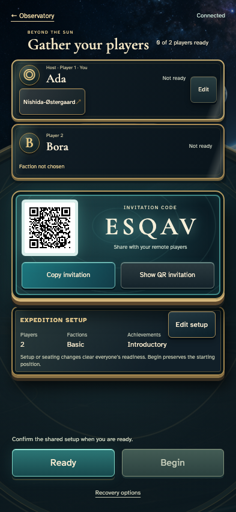](../../screenshots/lose-control-during-a-rival-trade-while-keeping-permanent-automation-with-separate-remote-controllers/010-faction-0-selected-phone-darwin.png) |  |

- [x] Ada chooses Nishida-Østergaard Corporation
- [x] Actual canonical effects and acknowledgement settle.
- [x] Public topology retains physical separation.
- [x] The viewport fits without page scrolling.

## 12. Choose a legal unique Basic faction

Viewpoint: **Bora · separate guest controller**.

| phone · 1440 × 1000 | desktop · 393 × 852 |
| --- | --- |
|  |  |

- [x] Choose a legal unique Basic faction
- [x] Actual canonical effects and acknowledgement settle.
- [x] Public topology retains physical separation.
- [x] The viewport fits without page scrolling.

## 13. Bora chooses The Zheng-Yi Brotherhood

Viewpoint: **Bora · separate guest controller**.

| phone · 1440 × 1000 | desktop · 393 × 852 |
| --- | --- |
|  | [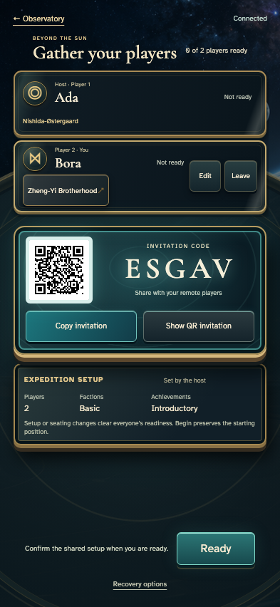](../../screenshots/lose-control-during-a-rival-trade-while-keeping-permanent-automation-with-separate-remote-controllers/012-faction-1-selected-desktop-darwin.png) |

- [x] Bora chooses The Zheng-Yi Brotherhood
- [x] Actual canonical effects and acknowledgement settle.
- [x] Public topology retains physical separation.
- [x] The viewport fits without page scrolling.

## 14. Ada acknowledges the current shared configuration

Viewpoint: **Ada · separate host controller**.

| phone · 393 × 852 | desktop · 1440 × 1000 |
| --- | --- |
| [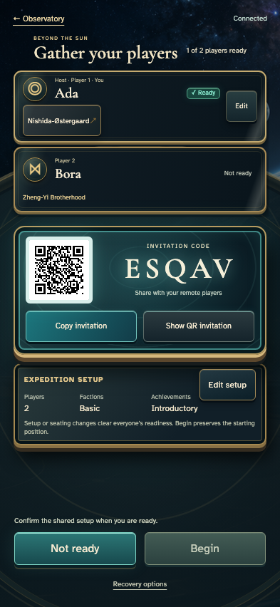](../../screenshots/lose-control-during-a-rival-trade-while-keeping-permanent-automation-with-separate-remote-controllers/013-ready-0-phone-darwin.png) | [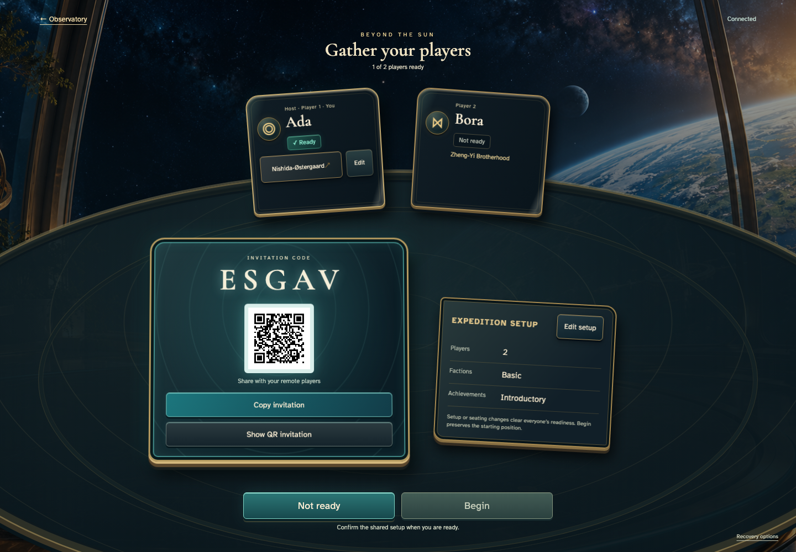](../../screenshots/lose-control-during-a-rival-trade-while-keeping-permanent-automation-with-separate-remote-controllers/013-ready-0-desktop-darwin.png) |

- [x] Ada acknowledges the current shared configuration
- [x] Actual canonical effects and acknowledgement settle.
- [x] Public topology retains physical separation.
- [x] The viewport fits without page scrolling.

## 15. Bora acknowledges the current shared configuration

Viewpoint: **Bora · separate guest controller**.

| phone · 1440 × 1000 | desktop · 393 × 852 |
| --- | --- |
| [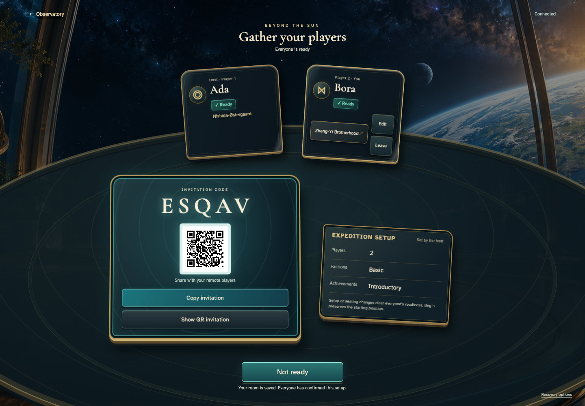](../../screenshots/lose-control-during-a-rival-trade-while-keeping-permanent-automation-with-separate-remote-controllers/014-ready-1-phone-darwin.png) | [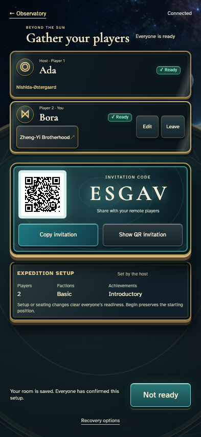](../../screenshots/lose-control-during-a-rival-trade-while-keeping-permanent-automation-with-separate-remote-controllers/014-ready-1-desktop-darwin.png) |

- [x] Bora acknowledges the current shared configuration
- [x] Actual canonical effects and acknowledgement settle.
- [x] Public topology retains physical separation.
- [x] The viewport fits without page scrolling.

## 16. Begin the immutable Basic game through normal UI

Viewpoint: **Ada · separate host controller**.

| phone · 393 × 852 | desktop · 1440 × 1000 |
| --- | --- |
|  | [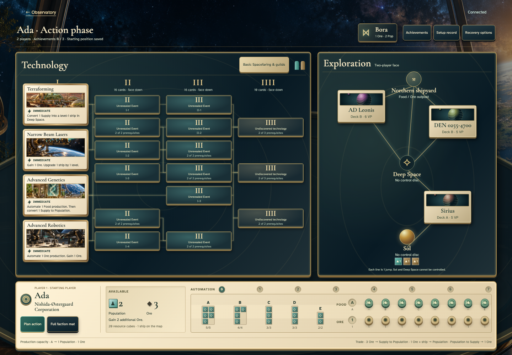](../../screenshots/lose-control-during-a-rival-trade-while-keeping-permanent-automation-with-separate-remote-controllers/015-begun-desktop-darwin.png) |

- [x] Begin the immutable Basic game through normal UI
- [x] Actual canonical effects and acknowledgement settle.
- [x] Public topology retains physical separation.
- [x] The viewport fits without page scrolling.

## 17. Ada opens the real Action instrument

Viewpoint: **Ada · separate host controller**.

| phone · 393 × 852 | desktop · 1440 × 1000 |
| --- | --- |
|  |  |

- [x] Ada opens the real Action instrument
- [x] Actual canonical effects and acknowledgement settle.
- [x] Public topology retains physical separation.
- [x] The viewport fits without page scrolling.

## 18. Ada chooses Basic build and jump

Viewpoint: **Ada · separate host controller**.

| phone · 393 × 852 | desktop · 1440 × 1000 |
| --- | --- |
|  | [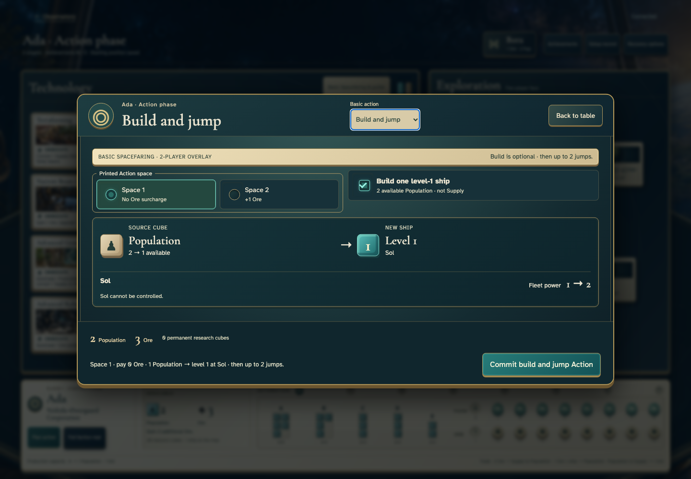](../../screenshots/lose-control-during-a-rival-trade-while-keeping-permanent-automation-with-separate-remote-controllers/017-offturn-ada-kind-desktop-darwin.png) |

- [x] Ada chooses Basic build and jump
- [x] Actual canonical effects and acknowledgement settle.
- [x] Public topology retains physical separation.
- [x] The viewport fits without page scrolling.

## 19. Commit the actual Population conversion and printed space cost before optional movement

Viewpoint: **Ada · separate host controller**.

| phone · 393 × 852 | desktop · 1440 × 1000 |
| --- | --- |
|  |  |

- [x] Commit the actual Population conversion and printed space cost before optional movement
- [x] Actual canonical effects and acknowledgement settle.
- [x] Public topology retains physical separation.
- [x] The viewport fits without page scrolling.

## 20. Read the complete public map before choosing a connected route

Viewpoint: **Ada · separate host controller**.

| phone · 393 × 852 | desktop · 1440 × 1000 |
| --- | --- |
| [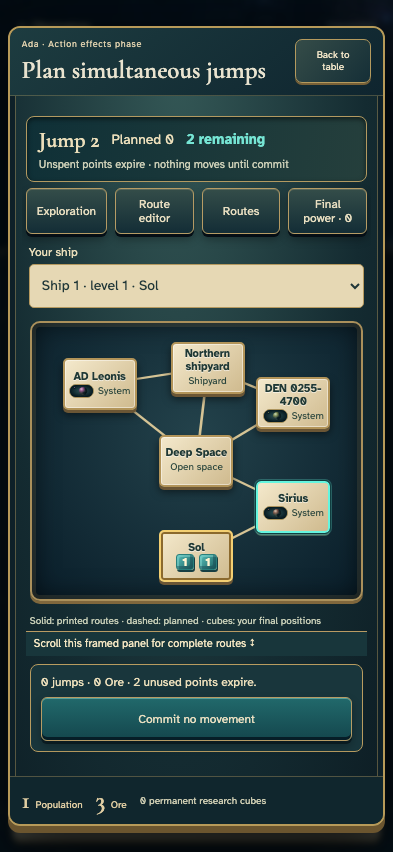](../../screenshots/lose-control-during-a-rival-trade-while-keeping-permanent-automation-with-separate-remote-controllers/019-offturn-ada-map-phone-darwin.png) |  |

- [x] Read the complete public map before choosing a connected route
- [x] Actual canonical effects and acknowledgement settle.
- [x] Public topology retains physical separation.
- [x] The viewport fits without page scrolling.

## 21. Read the actual connected destinations in this interface

Viewpoint: **Ada · separate host controller**.

| phone · 393 × 852 | desktop · 1440 × 1000 |
| --- | --- |
|  |  |

- [x] Read the actual connected destinations in this interface
- [x] Actual canonical effects and acknowledgement settle.
- [x] Public topology retains physical separation.
- [x] The viewport fits without page scrolling.

## 22. Choose a real owned ship for this unpaid route

Viewpoint: **Ada · separate host controller**.

| phone · 393 × 852 | desktop · 1440 × 1000 |
| --- | --- |
|  |  |

- [x] Choose a real owned ship for this unpaid route
- [x] Actual canonical effects and acknowledgement settle.
- [x] Public topology retains physical separation.
- [x] The viewport fits without page scrolling.

## 23. Plan Sirius as an endpoint; nothing moves yet

Viewpoint: **Ada · separate host controller**.

| phone · 393 × 852 | desktop · 1440 × 1000 |
| --- | --- |
|  | [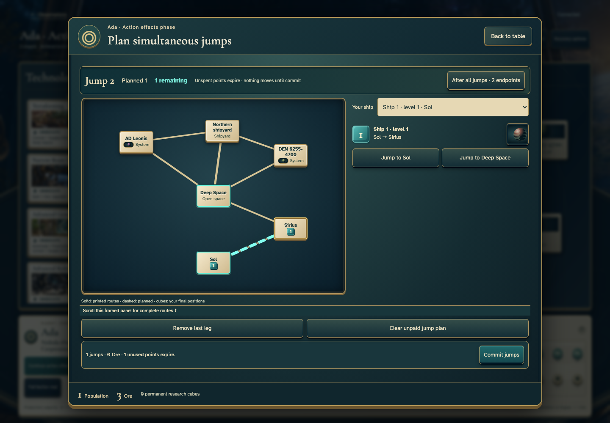](../../screenshots/lose-control-during-a-rival-trade-while-keeping-permanent-automation-with-separate-remote-controllers/022-offturn-claim-endpoint-desktop-darwin.png) |

- [x] Plan Sirius as an endpoint; nothing moves yet
- [x] Actual canonical effects and acknowledgement settle.
- [x] Public topology retains physical separation.
- [x] The viewport fits without page scrolling.

## 24. Ada establishes the initial one-power Ore outpost

Viewpoint: **Ada · separate host controller**.

| phone · 393 × 852 | desktop · 1440 × 1000 |
| --- | --- |
| [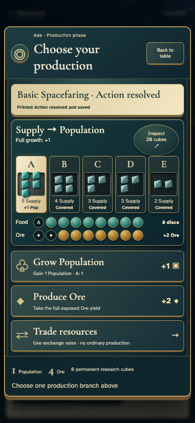](../../screenshots/lose-control-during-a-rival-trade-while-keeping-permanent-automation-with-separate-remote-controllers/023-offturn-first-claim-phone-darwin.png) | [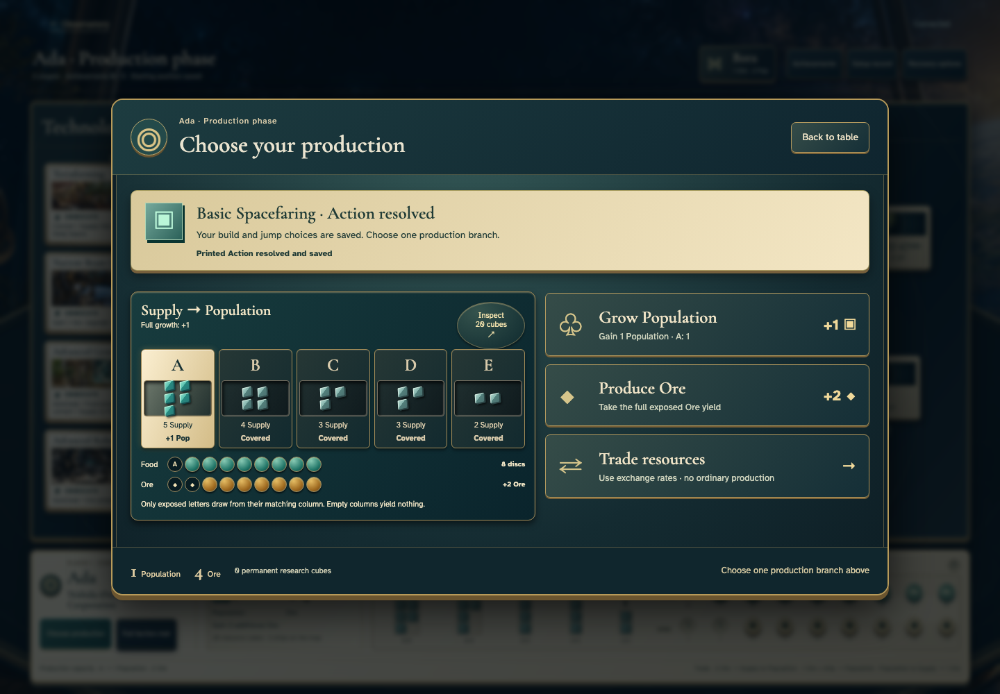](../../screenshots/lose-control-during-a-rival-trade-while-keeping-permanent-automation-with-separate-remote-controllers/023-offturn-first-claim-desktop-darwin.png) |

- [x] Ada establishes the initial one-power Ore outpost
- [x] Actual canonical effects and acknowledgement settle.
- [x] Public topology retains physical separation.
- [x] The viewport fits without page scrolling.

## 25. Ada chooses ordinary Ore production and hands off

Viewpoint: **Ada · separate host controller**.

| phone · 393 × 852 | desktop · 1440 × 1000 |
| --- | --- |
|  | [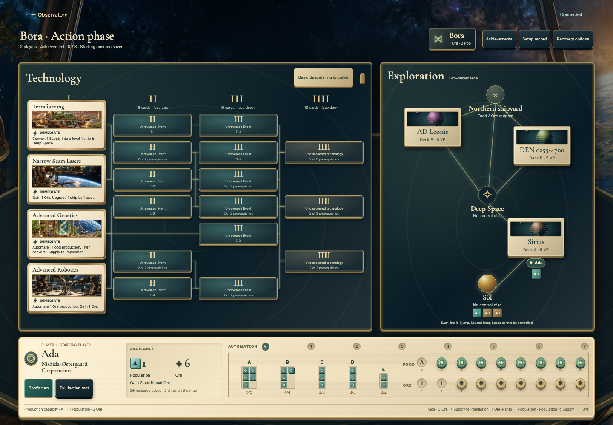](../../screenshots/lose-control-during-a-rival-trade-while-keeping-permanent-automation-with-separate-remote-controllers/024-offturn-ada-handoff-desktop-darwin.png) |

- [x] Ada chooses ordinary Ore production and hands off
- [x] Actual canonical effects and acknowledgement settle.
- [x] Public topology retains physical separation.
- [x] The viewport fits without page scrolling.

## 26. The next distinct controller receives the saved Action phase

Viewpoint: **Bora · separate guest controller**.

| phone · 1440 × 1000 | desktop · 393 × 852 |
| --- | --- |
|  |  |

- [x] The next distinct controller receives the saved Action phase
- [x] Actual canonical effects and acknowledgement settle.
- [x] Public topology retains physical separation.
- [x] The viewport fits without page scrolling.

## 27. Bora opens the real Action instrument

Viewpoint: **Bora · separate guest controller**.

| phone · 1440 × 1000 | desktop · 393 × 852 |
| --- | --- |
|  |  |

- [x] Bora opens the real Action instrument
- [x] Actual canonical effects and acknowledgement settle.
- [x] Public topology retains physical separation.
- [x] The viewport fits without page scrolling.

## 28. Bora chooses Basic build and jump

Viewpoint: **Bora · separate guest controller**.

| phone · 1440 × 1000 | desktop · 393 × 852 |
| --- | --- |
| [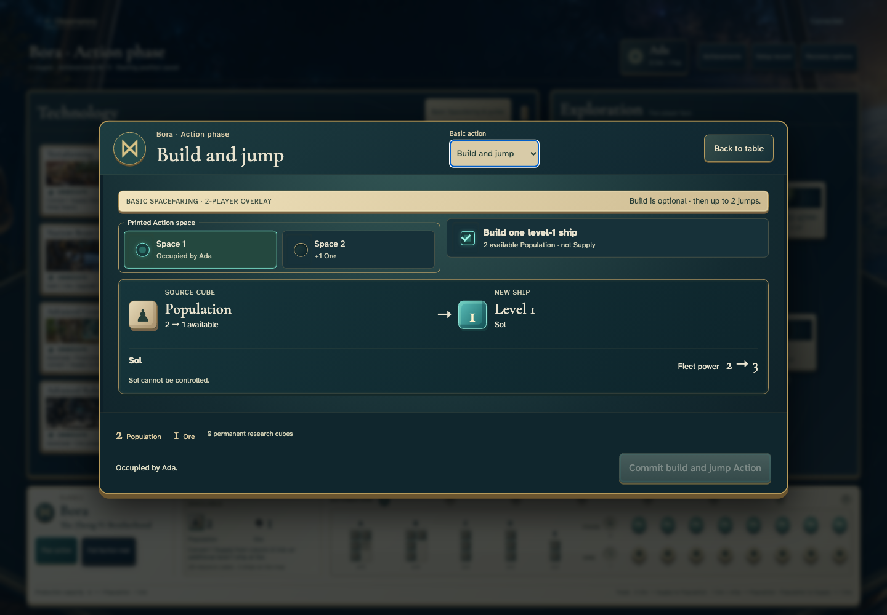](../../screenshots/lose-control-during-a-rival-trade-while-keeping-permanent-automation-with-separate-remote-controllers/027-offturn-bora-kind-phone-darwin.png) |  |

- [x] Bora chooses Basic build and jump
- [x] Actual canonical effects and acknowledgement settle.
- [x] Public topology retains physical separation.
- [x] The viewport fits without page scrolling.

## 29. Choose the unoccupied second printed space with its real surcharge

Viewpoint: **Bora · separate guest controller**.

| phone · 1440 × 1000 | desktop · 393 × 852 |
| --- | --- |
| [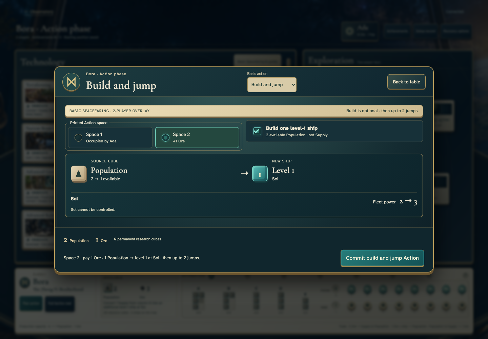](../../screenshots/lose-control-during-a-rival-trade-while-keeping-permanent-automation-with-separate-remote-controllers/028-offturn-bora-space-phone-darwin.png) |  |

- [x] Choose the unoccupied second printed space with its real surcharge
- [x] Actual canonical effects and acknowledgement settle.
- [x] Public topology retains physical separation.
- [x] The viewport fits without page scrolling.

## 30. Commit the actual Population conversion and printed space cost before optional movement

Viewpoint: **Bora · separate guest controller**.

| phone · 1440 × 1000 | desktop · 393 × 852 |
| --- | --- |
|  |  |

- [x] Commit the actual Population conversion and printed space cost before optional movement
- [x] Actual canonical effects and acknowledgement settle.
- [x] Public topology retains physical separation.
- [x] The viewport fits without page scrolling.

## 31. Read the complete public map before choosing a connected route

Viewpoint: **Bora · separate guest controller**.

| phone · 1440 × 1000 | desktop · 393 × 852 |
| --- | --- |
| [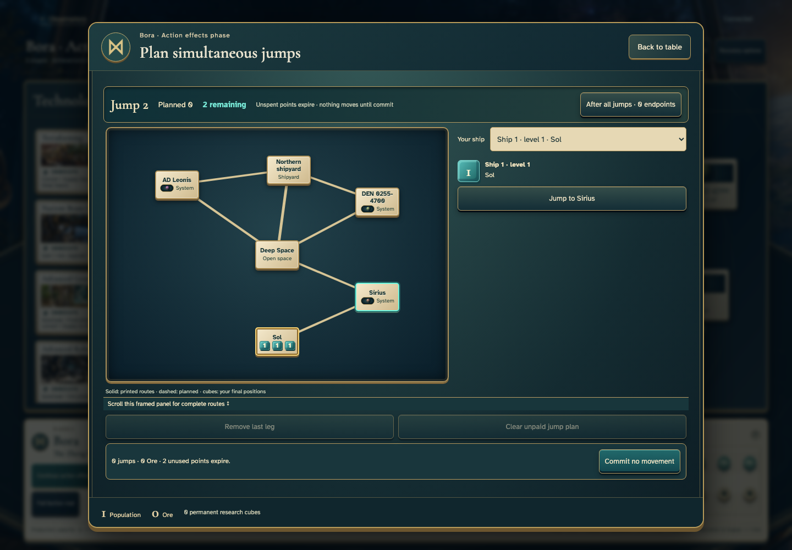](../../screenshots/lose-control-during-a-rival-trade-while-keeping-permanent-automation-with-separate-remote-controllers/030-offturn-bora-map-phone-darwin.png) |  |

- [x] Read the complete public map before choosing a connected route
- [x] Actual canonical effects and acknowledgement settle.
- [x] Public topology retains physical separation.
- [x] The viewport fits without page scrolling.

## 32. Read the actual connected destinations in this interface

Viewpoint: **Bora · separate guest controller**.

| phone · 1440 × 1000 | desktop · 393 × 852 |
| --- | --- |
|  |  |

- [x] Read the actual connected destinations in this interface
- [x] Actual canonical effects and acknowledgement settle.
- [x] Public topology retains physical separation.
- [x] The viewport fits without page scrolling.

## 33. Choose a real owned ship for this unpaid route

Viewpoint: **Bora · separate guest controller**.

| phone · 1440 × 1000 | desktop · 393 × 852 |
| --- | --- |
|  | [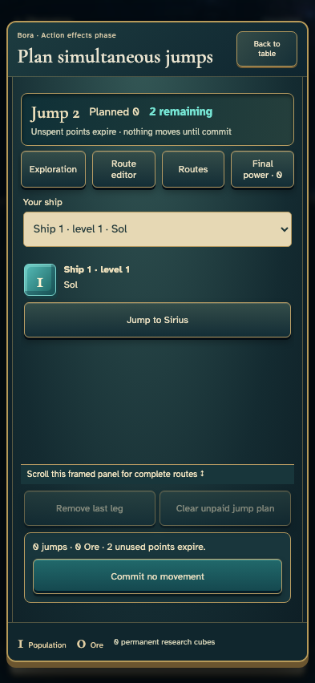](../../screenshots/lose-control-during-a-rival-trade-while-keeping-permanent-automation-with-separate-remote-controllers/032-offturn-rival-first-ship-desktop-darwin.png) |

- [x] Choose a real owned ship for this unpaid route
- [x] Actual canonical effects and acknowledgement settle.
- [x] Public topology retains physical separation.
- [x] The viewport fits without page scrolling.

## 34. Plan Sirius as an endpoint; nothing moves yet

Viewpoint: **Bora · separate guest controller**.

| phone · 1440 × 1000 | desktop · 393 × 852 |
| --- | --- |
|  | [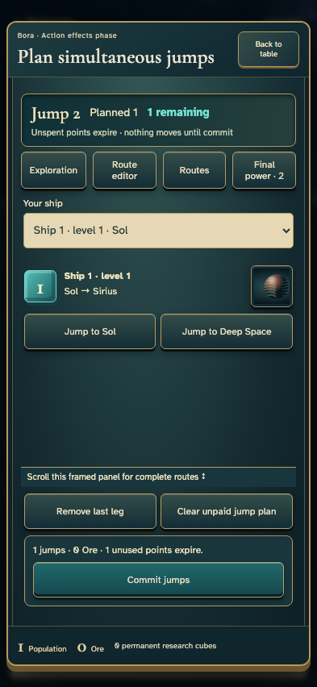](../../screenshots/lose-control-during-a-rival-trade-while-keeping-permanent-automation-with-separate-remote-controllers/033-offturn-rival-first-endpoint-desktop-darwin.png) |

- [x] Plan Sirius as an endpoint; nothing moves yet
- [x] Actual canonical effects and acknowledgement settle.
- [x] Public topology retains physical separation.
- [x] The viewport fits without page scrolling.

## 35. Choose a real owned ship for this unpaid route

Viewpoint: **Bora · separate guest controller**.

| phone · 1440 × 1000 | desktop · 393 × 852 |
| --- | --- |
| [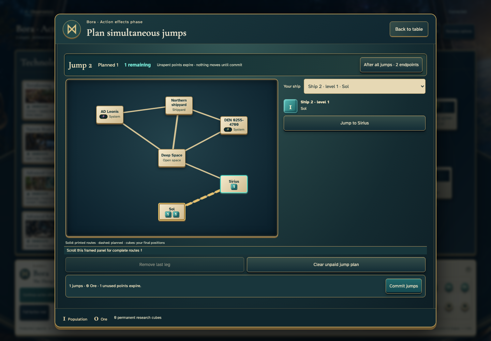](../../screenshots/lose-control-during-a-rival-trade-while-keeping-permanent-automation-with-separate-remote-controllers/034-offturn-rival-second-ship-phone-darwin.png) |  |

- [x] Choose a real owned ship for this unpaid route
- [x] Actual canonical effects and acknowledgement settle.
- [x] Public topology retains physical separation.
- [x] The viewport fits without page scrolling.

## 36. Plan Sirius as an endpoint; nothing moves yet

Viewpoint: **Bora · separate guest controller**.

| phone · 1440 × 1000 | desktop · 393 × 852 |
| --- | --- |
|  | [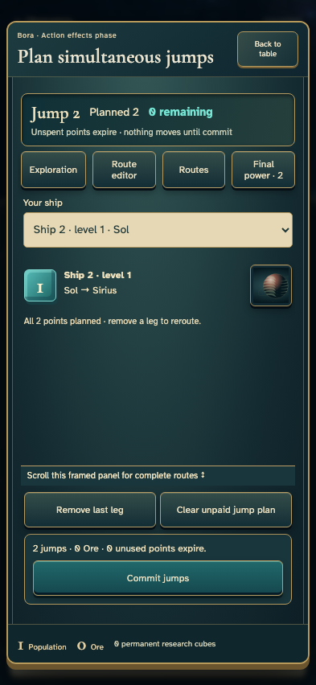](../../screenshots/lose-control-during-a-rival-trade-while-keeping-permanent-automation-with-separate-remote-controllers/035-offturn-rival-second-endpoint-desktop-darwin.png) |

- [x] Plan Sirius as an endpoint; nothing moves yet
- [x] Actual canonical effects and acknowledgement settle.
- [x] Public topology retains physical separation.
- [x] The viewport fits without page scrolling.

## 37. Bora’s two-power fleet takes actual control

Viewpoint: **Bora · separate guest controller**.

| phone · 1440 × 1000 | desktop · 393 × 852 |
| --- | --- |
| [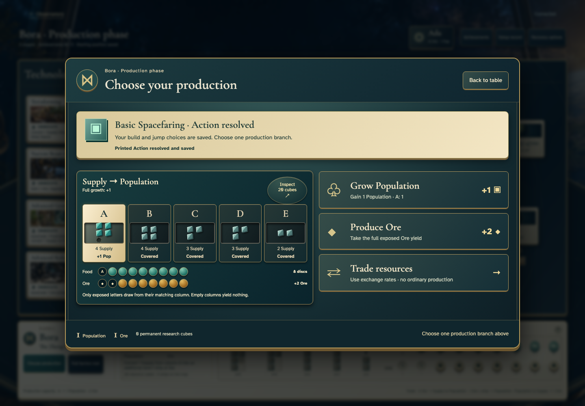](../../screenshots/lose-control-during-a-rival-trade-while-keeping-permanent-automation-with-separate-remote-controllers/036-offturn-rival-control-phone-darwin.png) |  |

- [x] Bora’s two-power fleet takes actual control
- [x] Actual canonical effects and acknowledgement settle.
- [x] Public topology retains physical separation.
- [x] The viewport fits without page scrolling.

## 38. Bora chooses ordinary Ore production and hands off

Viewpoint: **Bora · separate guest controller**.

| phone · 1440 × 1000 | desktop · 393 × 852 |
| --- | --- |
| [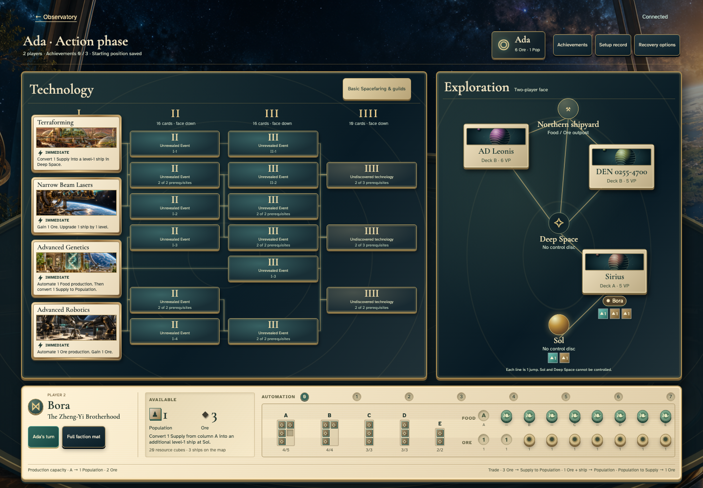](../../screenshots/lose-control-during-a-rival-trade-while-keeping-permanent-automation-with-separate-remote-controllers/037-offturn-bora-handoff-phone-darwin.png) |  |

- [x] Bora chooses ordinary Ore production and hands off
- [x] Actual canonical effects and acknowledgement settle.
- [x] Public topology retains physical separation.
- [x] The viewport fits without page scrolling.

## 39. The next distinct controller receives the saved Action phase

Viewpoint: **Ada · separate host controller**.

| phone · 393 × 852 | desktop · 1440 × 1000 |
| --- | --- |
| [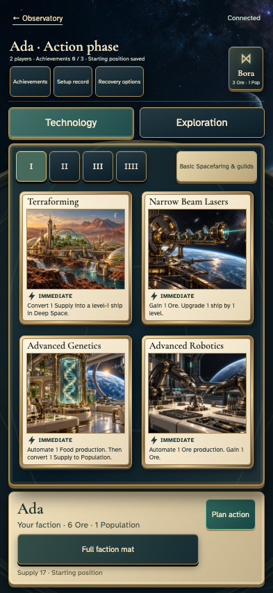](../../screenshots/lose-control-during-a-rival-trade-while-keeping-permanent-automation-with-separate-remote-controllers/038-offturn-bora-next-phone-darwin.png) | [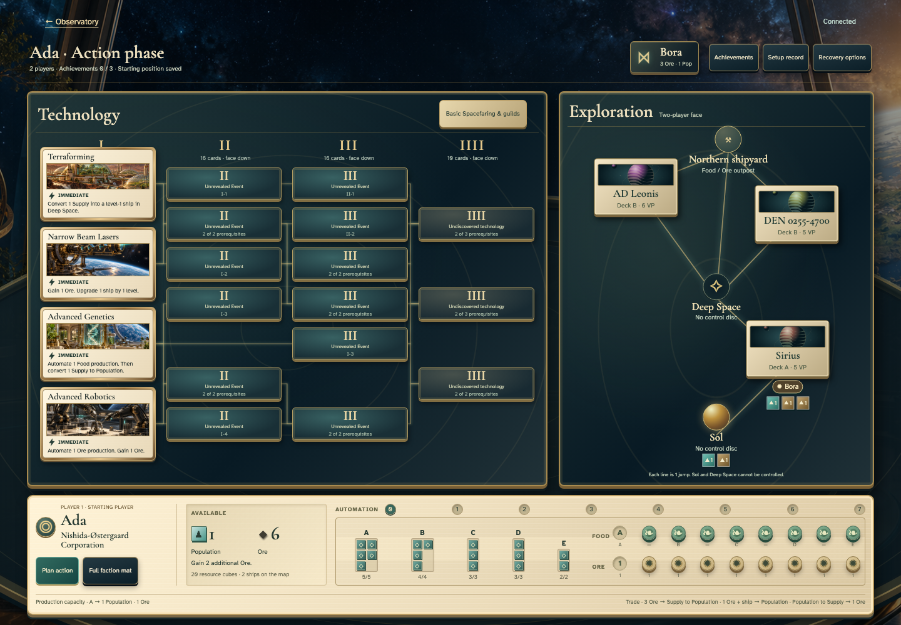](../../screenshots/lose-control-during-a-rival-trade-while-keeping-permanent-automation-with-separate-remote-controllers/038-offturn-bora-next-desktop-darwin.png) |

- [x] The next distinct controller receives the saved Action phase
- [x] Actual canonical effects and acknowledgement settle.
- [x] Public topology retains physical separation.
- [x] The viewport fits without page scrolling.

## 40. Ada opens the real Action instrument

Viewpoint: **Ada · separate host controller**.

| phone · 393 × 852 | desktop · 1440 × 1000 |
| --- | --- |
| [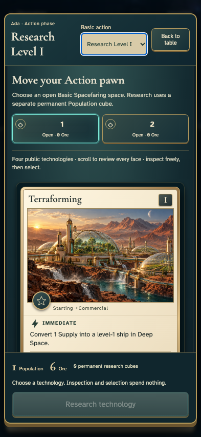](../../screenshots/lose-control-during-a-rival-trade-while-keeping-permanent-automation-with-separate-remote-controllers/039-offturn-research-open-phone-darwin.png) |  |

- [x] Ada opens the real Action instrument
- [x] Actual canonical effects and acknowledgement settle.
- [x] Public topology retains physical separation.
- [x] The viewport fits without page scrolling.

## 41. Ada chooses Research Level I

Viewpoint: **Ada · separate host controller**.

| phone · 393 × 852 | desktop · 1440 × 1000 |
| --- | --- |
|  | [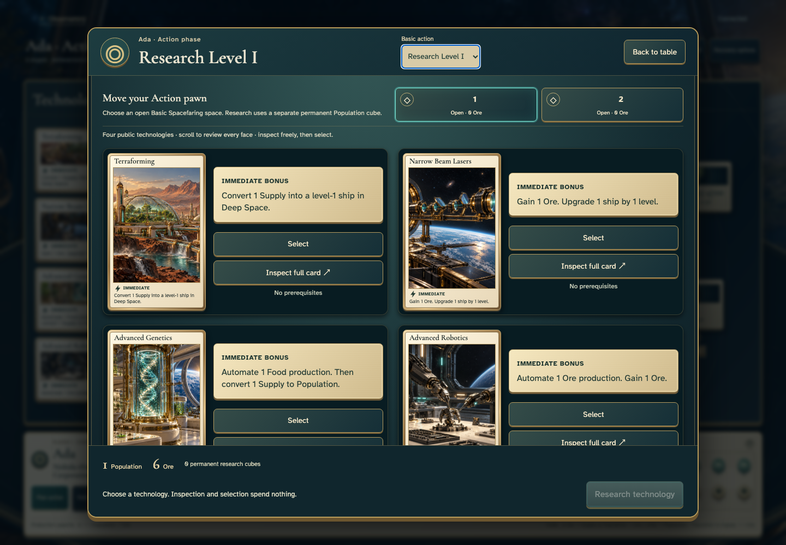](../../screenshots/lose-control-during-a-rival-trade-while-keeping-permanent-automation-with-separate-remote-controllers/040-offturn-research-kind-desktop-darwin.png) |

- [x] Ada chooses Research Level I
- [x] Actual canonical effects and acknowledgement settle.
- [x] Public topology retains physical separation.
- [x] The viewport fits without page scrolling.

## 42. Choose the real unoccupied research space

Viewpoint: **Ada · separate host controller**.

| phone · 393 × 852 | desktop · 1440 × 1000 |
| --- | --- |
| [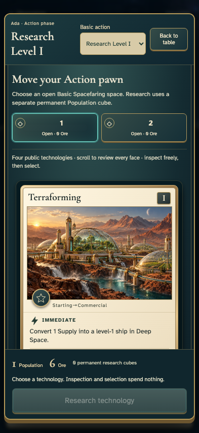](../../screenshots/lose-control-during-a-rival-trade-while-keeping-permanent-automation-with-separate-remote-controllers/041-offturn-research-space-phone-darwin.png) | [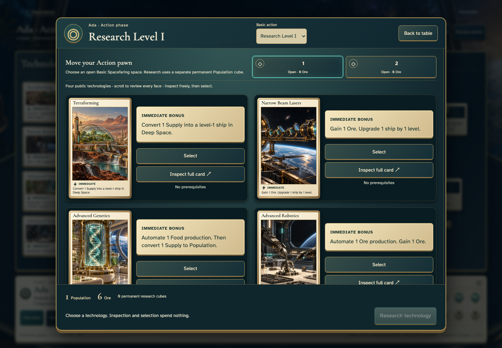](../../screenshots/lose-control-during-a-rival-trade-while-keeping-permanent-automation-with-separate-remote-controllers/041-offturn-research-space-desktop-darwin.png) |

- [x] Choose the real unoccupied research space
- [x] Actual canonical effects and acknowledgement settle.
- [x] Public topology retains physical separation.
- [x] The viewport fits without page scrolling.

## 43. Inspect the printed permanent automation bonus

Viewpoint: **Ada · separate host controller**.

| phone · 393 × 852 | desktop · 1440 × 1000 |
| --- | --- |
| [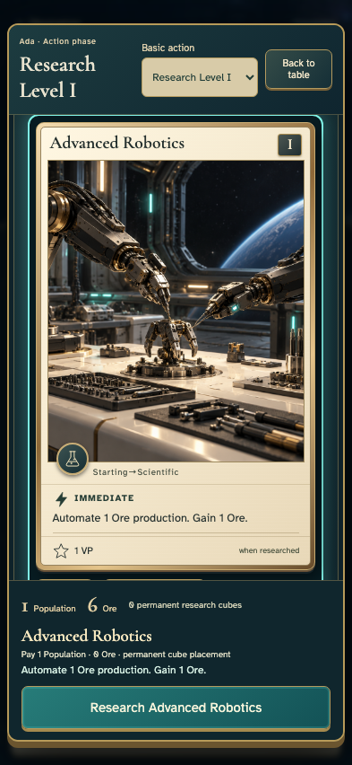](../../screenshots/lose-control-during-a-rival-trade-while-keeping-permanent-automation-with-separate-remote-controllers/042-offturn-robotics-face-phone-darwin.png) | [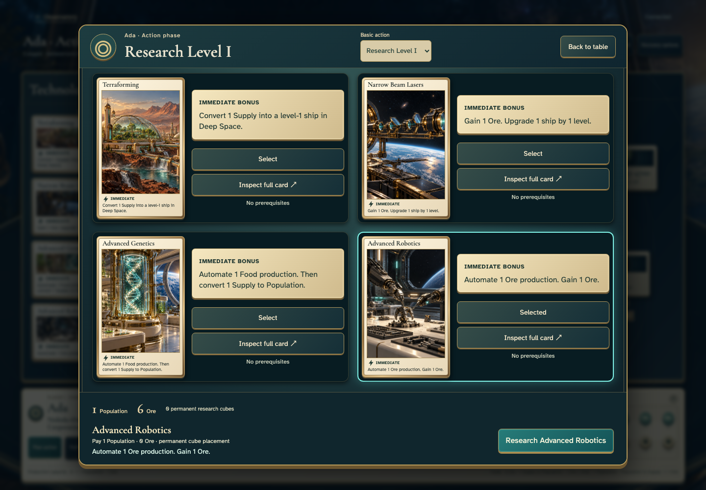](../../screenshots/lose-control-during-a-rival-trade-while-keeping-permanent-automation-with-separate-remote-controllers/042-offturn-robotics-face-desktop-darwin.png) |

- [x] Inspect the printed permanent automation bonus
- [x] Actual canonical effects and acknowledgement settle.
- [x] Public topology retains physical separation.
- [x] The viewport fits without page scrolling.

## 44. Research and resolve permanent Ore automation before Production

Viewpoint: **Ada · separate host controller**.

| phone · 393 × 852 | desktop · 1440 × 1000 |
| --- | --- |
|  | [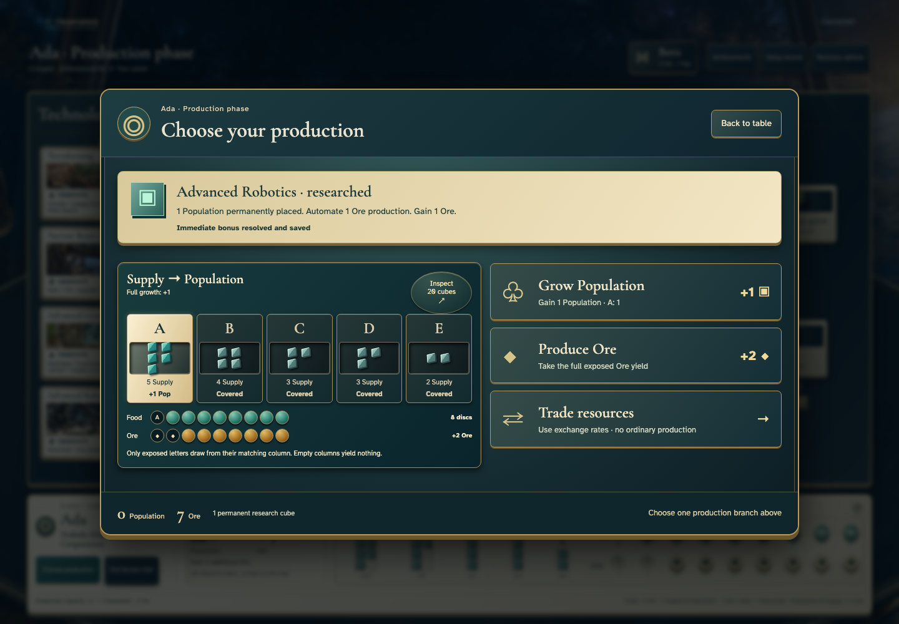](../../screenshots/lose-control-during-a-rival-trade-while-keeping-permanent-automation-with-separate-remote-controllers/043-offturn-automation-desktop-darwin.png) |

- [x] Research and resolve permanent Ore automation before Production
- [x] Actual canonical effects and acknowledgement settle.
- [x] Public topology retains physical separation.
- [x] The viewport fits without page scrolling.

## 45. Choose Trade to preserve a clear no-production boundary

Viewpoint: **Ada · separate host controller**.

| phone · 393 × 852 | desktop · 1440 × 1000 |
| --- | --- |
|  | [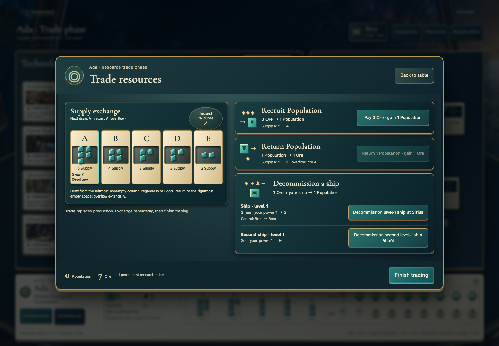](../../screenshots/lose-control-during-a-rival-trade-while-keeping-permanent-automation-with-separate-remote-controllers/044-offturn-ada-trade-desktop-darwin.png) |

- [x] Choose Trade to preserve a clear no-production boundary
- [x] Actual canonical effects and acknowledgement settle.
- [x] Public topology retains physical separation.
- [x] The viewport fits without page scrolling.

## 46. Hand off without a regular Production payout

Viewpoint: **Ada · separate host controller**.

| phone · 393 × 852 | desktop · 1440 × 1000 |
| --- | --- |
|  |  |

- [x] Hand off without a regular Production payout
- [x] Actual canonical effects and acknowledgement settle.
- [x] Public topology retains physical separation.
- [x] The viewport fits without page scrolling.

## 47. Bora opens the real Action instrument

Viewpoint: **Bora · separate guest controller**.

| phone · 1440 × 1000 | desktop · 393 × 852 |
| --- | --- |
| [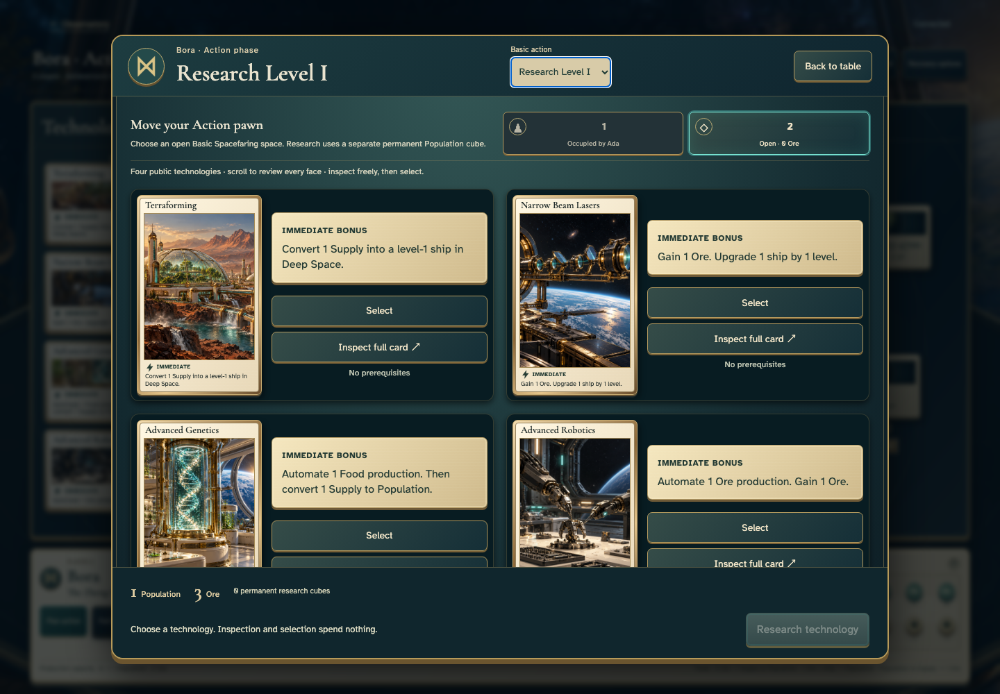](../../screenshots/lose-control-during-a-rival-trade-while-keeping-permanent-automation-with-separate-remote-controllers/046-offturn-bora-gather-open-phone-darwin.png) | [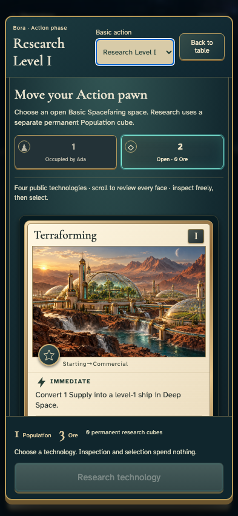](../../screenshots/lose-control-during-a-rival-trade-while-keeping-permanent-automation-with-separate-remote-controllers/046-offturn-bora-gather-open-desktop-darwin.png) |

- [x] Bora opens the real Action instrument
- [x] Actual canonical effects and acknowledgement settle.
- [x] Public topology retains physical separation.
- [x] The viewport fits without page scrolling.

## 48. Bora chooses Gather

Viewpoint: **Bora · separate guest controller**.

| phone · 1440 × 1000 | desktop · 393 × 852 |
| --- | --- |
| [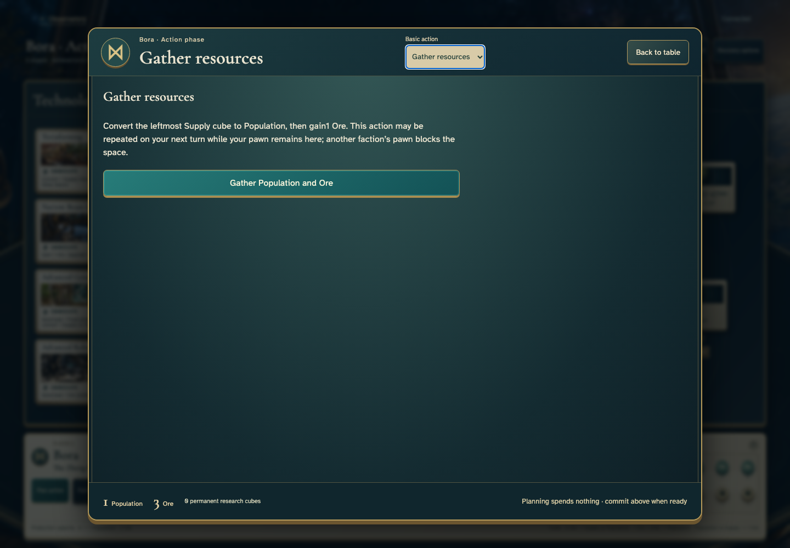](../../screenshots/lose-control-during-a-rival-trade-while-keeping-permanent-automation-with-separate-remote-controllers/047-offturn-bora-gather-kind-phone-darwin.png) | [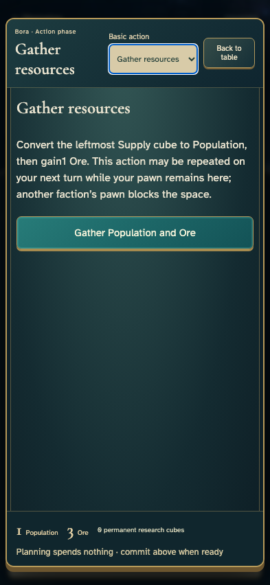](../../screenshots/lose-control-during-a-rival-trade-while-keeping-permanent-automation-with-separate-remote-controllers/047-offturn-bora-gather-kind-desktop-darwin.png) |

- [x] Bora chooses Gather
- [x] Actual canonical effects and acknowledgement settle.
- [x] Public topology retains physical separation.
- [x] The viewport fits without page scrolling.

## 49. Gather through the actual next actor’s turn

Viewpoint: **Bora · separate guest controller**.

| phone · 1440 × 1000 | desktop · 393 × 852 |
| --- | --- |
| [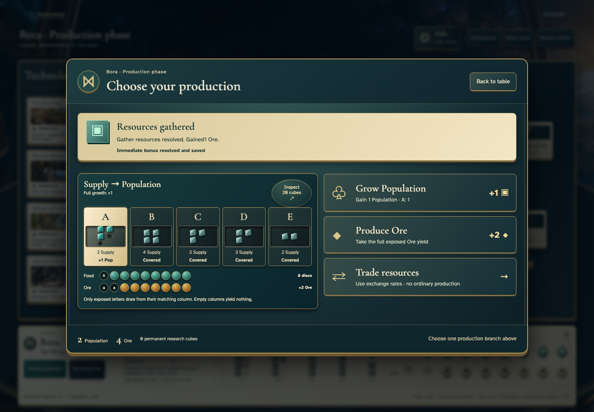](../../screenshots/lose-control-during-a-rival-trade-while-keeping-permanent-automation-with-separate-remote-controllers/048-offturn-bora-gathered-phone-darwin.png) | [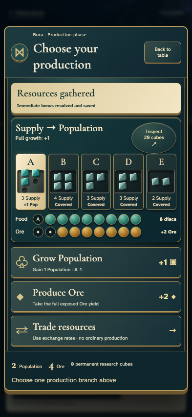](../../screenshots/lose-control-during-a-rival-trade-while-keeping-permanent-automation-with-separate-remote-controllers/048-offturn-bora-gathered-desktop-darwin.png) |

- [x] Gather through the actual next actor’s turn
- [x] Actual canonical effects and acknowledgement settle.
- [x] Public topology retains physical separation.
- [x] The viewport fits without page scrolling.

## 50. Bora chooses paid decommission exchanges instead of ordinary Production

Viewpoint: **Bora · separate guest controller**.

| phone · 1440 × 1000 | desktop · 393 × 852 |
| --- | --- |
|  |  |

- [x] Bora chooses paid decommission exchanges instead of ordinary Production
- [x] Actual canonical effects and acknowledgement settle.
- [x] Public topology retains physical separation.
- [x] The viewport fits without page scrolling.

## 51. Review the printed ship-decommission exchange in this interface

Viewpoint: **Bora · separate guest controller**.

| phone · 1440 × 1000 | desktop · 393 × 852 |
| --- | --- |
| [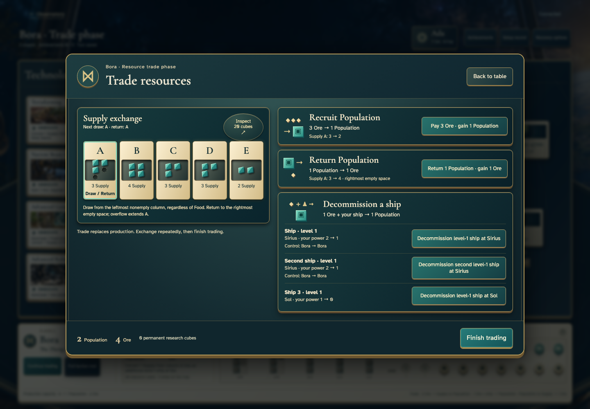](../../screenshots/lose-control-during-a-rival-trade-while-keeping-permanent-automation-with-separate-remote-controllers/050-offturn-first-return-exchange-phone-darwin.png) | [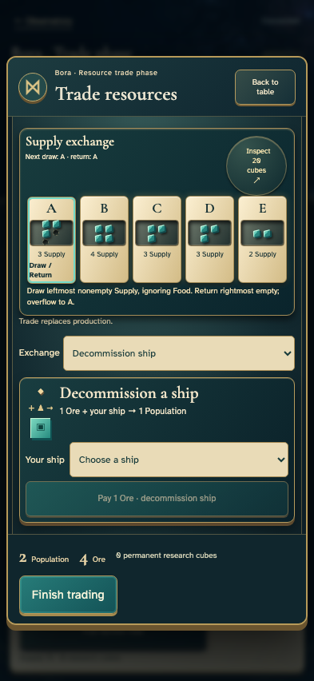](../../screenshots/lose-control-during-a-rival-trade-while-keeping-permanent-automation-with-separate-remote-controllers/050-offturn-first-return-exchange-desktop-darwin.png) |

- [x] Review the printed ship-decommission exchange in this interface
- [x] Actual canonical effects and acknowledgement settle.
- [x] Public topology retains physical separation.
- [x] The viewport fits without page scrolling.

## 52. Review the owned ship and its control consequence before paying

Viewpoint: **Bora · separate guest controller**.

| phone · 1440 × 1000 | desktop · 393 × 852 |
| --- | --- |
|  |  |

- [x] Review the owned ship and its control consequence before paying
- [x] Actual canonical effects and acknowledgement settle.
- [x] Public topology retains physical separation.
- [x] The viewport fits without page scrolling.

## 53. Bora withdraws into a highest-power tie and keeps the outpost

Viewpoint: **Bora · separate guest controller**.

| phone · 1440 × 1000 | desktop · 393 × 852 |
| --- | --- |
|  |  |

- [x] Bora withdraws into a highest-power tie and keeps the outpost
- [x] Actual canonical effects and acknowledgement settle.
- [x] Public topology retains physical separation.
- [x] The viewport fits without page scrolling.

## 54. Inspect public control during Bora’s trading turn

Viewpoint: **Bora · separate guest controller**.

| phone · 1440 × 1000 | desktop · 393 × 852 |
| --- | --- |
|  |  |

- [x] Inspect public control during Bora’s trading turn
- [x] Actual canonical effects and acknowledgement settle.
- [x] Public topology retains physical separation.
- [x] The viewport fits without page scrolling.

## 55. Ada inspects the actual production discs

Viewpoint: **Ada · separate host controller**.

| phone · 393 × 852 | desktop · 1440 × 1000 |
| --- | --- |
|  | [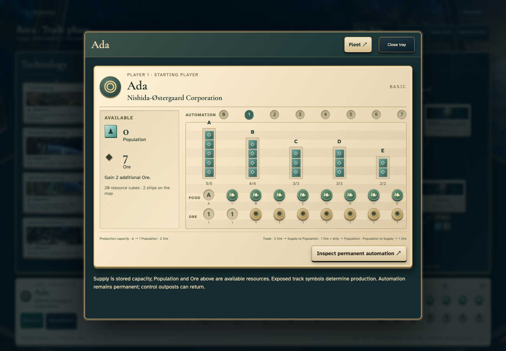](../../screenshots/lose-control-during-a-rival-trade-while-keeping-permanent-automation-with-separate-remote-controllers/054-offturn-incumbent-tie-mat-desktop-darwin.png) |

- [x] Ada inspects the actual production discs
- [x] Actual canonical effects and acknowledgement settle.
- [x] Public topology retains physical separation.
- [x] The viewport fits without page scrolling.

## 56. Open the reusable public fleet inspection

Viewpoint: **Ada · separate host controller**.

| phone · 393 × 852 | desktop · 1440 × 1000 |
| --- | --- |
|  | [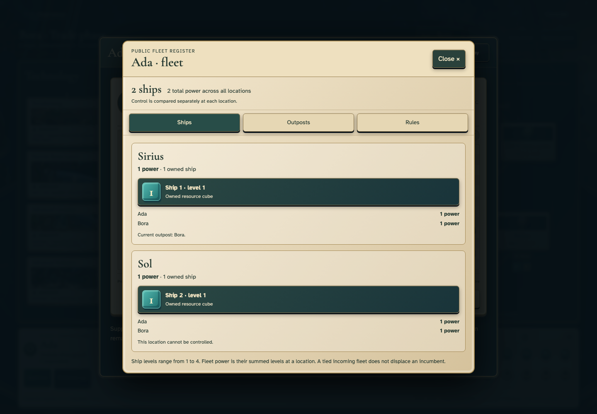](../../screenshots/lose-control-during-a-rival-trade-while-keeping-permanent-automation-with-separate-remote-controllers/055-offturn-incumbent-tie-fleet-desktop-darwin.png) |

- [x] Open the reusable public fleet inspection
- [x] Actual canonical effects and acknowledgement settle.
- [x] Public topology retains physical separation.
- [x] The viewport fits without page scrolling.

## 57. Read saved disc ownership separately from current summed fleet power

Viewpoint: **Ada · separate host controller**.

| phone · 393 × 852 | desktop · 1440 × 1000 |
| --- | --- |
|  |  |

- [x] Read saved disc ownership separately from current summed fleet power
- [x] Actual canonical effects and acknowledgement settle.
- [x] Public topology retains physical separation.
- [x] The viewport fits without page scrolling.

## 58. Inspect every faction’s actual level sum and the incumbent’s disc

Viewpoint: **Ada · separate host controller**.

| phone · 393 × 852 | desktop · 1440 × 1000 |
| --- | --- |
|  |  |

- [x] Inspect every faction’s actual level sum and the incumbent’s disc
- [x] Actual canonical effects and acknowledgement settle.
- [x] Public topology retains physical separation.
- [x] The viewport fits without page scrolling.

## 59. Keyboard scroll reaches production, printed bonus and the inspection boundary

Viewpoint: **Ada · separate host controller**.

| phone · 393 × 852 | desktop · 1440 × 1000 |
| --- | --- |
|  |  |

- [x] Keyboard scroll reaches production, printed bonus and the inspection boundary
- [x] Actual canonical effects and acknowledgement settle.
- [x] Public topology retains physical separation.
- [x] The viewport fits without page scrolling.

## 60. Open the complete reusable fleet rules through semantic navigation

Viewpoint: **Ada · separate host controller**.

| phone · 393 × 852 | desktop · 1440 × 1000 |
| --- | --- |
|  |  |

- [x] Open the complete reusable fleet rules through semantic navigation
- [x] Actual canonical effects and acknowledgement settle.
- [x] Public topology retains physical separation.
- [x] The viewport fits without page scrolling.

## 61. Return to the real ship register without taking a turn

Viewpoint: **Ada · separate host controller**.

| phone · 393 × 852 | desktop · 1440 × 1000 |
| --- | --- |
|  |  |

- [x] Return to the real ship register without taking a turn
- [x] Actual canonical effects and acknowledgement settle.
- [x] Public topology retains physical separation.
- [x] The viewport fits without page scrolling.

## 62. Escape restores the exact fleet opener without taking a turn

Viewpoint: **Ada · separate host controller**.

| phone · 393 × 852 | desktop · 1440 × 1000 |
| --- | --- |
|  |  |

- [x] Escape restores the exact fleet opener without taking a turn
- [x] Actual canonical effects and acknowledgement settle.
- [x] Public topology retains physical separation.
- [x] The viewport fits without page scrolling.

## 63. Close the mat and restore its own opener

Viewpoint: **Ada · separate host controller**.

| phone · 393 × 852 | desktop · 1440 × 1000 |
| --- | --- |
|  |  |

- [x] Close the mat and restore its own opener
- [x] Actual canonical effects and acknowledgement settle.
- [x] Public topology retains physical separation.
- [x] The viewport fits without page scrolling.

## 64. Return to the same actor and paid trade

Viewpoint: **Bora · separate guest controller**.

| phone · 1440 × 1000 | desktop · 393 × 852 |
| --- | --- |
|  |  |

- [x] Return to the same actor and paid trade
- [x] Actual canonical effects and acknowledgement settle.
- [x] Public topology retains physical separation.
- [x] The viewport fits without page scrolling.

## 65. Review the printed ship-decommission exchange in this interface

Viewpoint: **Bora · separate guest controller**.

| phone · 1440 × 1000 | desktop · 393 × 852 |
| --- | --- |
|  |  |

- [x] Review the printed ship-decommission exchange in this interface
- [x] Actual canonical effects and acknowledgement settle.
- [x] Public topology retains physical separation.
- [x] The viewport fits without page scrolling.

## 66. Review the owned ship and its control consequence before paying

Viewpoint: **Bora · separate guest controller**.

| phone · 1440 × 1000 | desktop · 393 × 852 |
| --- | --- |
|  |  |

- [x] Review the owned ship and its control consequence before paying
- [x] Actual canonical effects and acknowledgement settle.
- [x] Public topology retains physical separation.
- [x] The viewport fits without page scrolling.

## 67. The stronger remaining opponent gains control during Bora’s turn

Viewpoint: **Bora · separate guest controller**.

| phone · 1440 × 1000 | desktop · 393 × 852 |
| --- | --- |
|  |  |

- [x] The stronger remaining opponent gains control during Bora’s turn
- [x] Actual canonical effects and acknowledgement settle.
- [x] Public topology retains physical separation.
- [x] The viewport fits without page scrolling.

## 68. The trading continuation resumes after control transfer

Viewpoint: **Bora · separate guest controller**.

| phone · 1440 × 1000 | desktop · 393 × 852 |
| --- | --- |
|  |  |

- [x] The trading continuation resumes after control transfer
- [x] Actual canonical effects and acknowledgement settle.
- [x] Public topology retains physical separation.
- [x] The viewport fits without page scrolling.

## 69. Ada inspects the actual production discs

Viewpoint: **Ada · separate host controller**.

| phone · 393 × 852 | desktop · 1440 × 1000 |
| --- | --- |
|  |  |

- [x] Ada inspects the actual production discs
- [x] Actual canonical effects and acknowledgement settle.
- [x] Public topology retains physical separation.
- [x] The viewport fits without page scrolling.

## 70. Open the reusable public fleet inspection

Viewpoint: **Ada · separate host controller**.

| phone · 393 × 852 | desktop · 1440 × 1000 |
| --- | --- |
|  |  |

- [x] Open the reusable public fleet inspection
- [x] Actual canonical effects and acknowledgement settle.
- [x] Public topology retains physical separation.
- [x] The viewport fits without page scrolling.

## 71. Read saved disc ownership separately from current summed fleet power

Viewpoint: **Ada · separate host controller**.

| phone · 393 × 852 | desktop · 1440 × 1000 |
| --- | --- |
|  |  |

- [x] Read saved disc ownership separately from current summed fleet power
- [x] Actual canonical effects and acknowledgement settle.
- [x] Public topology retains physical separation.
- [x] The viewport fits without page scrolling.

## 72. Inspect every faction’s actual level sum and the incumbent’s disc

Viewpoint: **Ada · separate host controller**.

| phone · 393 × 852 | desktop · 1440 × 1000 |
| --- | --- |
|  |  |

- [x] Inspect every faction’s actual level sum and the incumbent’s disc
- [x] Actual canonical effects and acknowledgement settle.
- [x] Public topology retains physical separation.
- [x] The viewport fits without page scrolling.

## 73. Keyboard scroll reaches production, printed bonus and the inspection boundary

Viewpoint: **Ada · separate host controller**.

| phone · 393 × 852 | desktop · 1440 × 1000 |
| --- | --- |
|  |  |

- [x] Keyboard scroll reaches production, printed bonus and the inspection boundary
- [x] Actual canonical effects and acknowledgement settle.
- [x] Public topology retains physical separation.
- [x] The viewport fits without page scrolling.

## 74. Open the complete reusable fleet rules through semantic navigation

Viewpoint: **Ada · separate host controller**.

| phone · 393 × 852 | desktop · 1440 × 1000 |
| --- | --- |
|  |  |

- [x] Open the complete reusable fleet rules through semantic navigation
- [x] Actual canonical effects and acknowledgement settle.
- [x] Public topology retains physical separation.
- [x] The viewport fits without page scrolling.

## 75. Return to the real ship register without taking a turn

Viewpoint: **Ada · separate host controller**.

| phone · 393 × 852 | desktop · 1440 × 1000 |
| --- | --- |
|  |  |

- [x] Return to the real ship register without taking a turn
- [x] Actual canonical effects and acknowledgement settle.
- [x] Public topology retains physical separation.
- [x] The viewport fits without page scrolling.

## 76. Escape restores the exact fleet opener without taking a turn

Viewpoint: **Ada · separate host controller**.

| phone · 393 × 852 | desktop · 1440 × 1000 |
| --- | --- |
|  |  |

- [x] Escape restores the exact fleet opener without taking a turn
- [x] Actual canonical effects and acknowledgement settle.
- [x] Public topology retains physical separation.
- [x] The viewport fits without page scrolling.

## 77. Close the mat and restore its own opener

Viewpoint: **Ada · separate host controller**.

| phone · 393 × 852 | desktop · 1440 × 1000 |
| --- | --- |
|  |  |

- [x] Close the mat and restore its own opener
- [x] Actual canonical effects and acknowledgement settle.
- [x] Public topology retains physical separation.
- [x] The viewport fits without page scrolling.

## 78. Bora inspects the actual production discs

Viewpoint: **Bora · separate guest controller**.

| phone · 1440 × 1000 | desktop · 393 × 852 |
| --- | --- |
|  |  |

- [x] Bora inspects the actual production discs
- [x] Actual canonical effects and acknowledgement settle.
- [x] Public topology retains physical separation.
- [x] The viewport fits without page scrolling.

## 79. Open the reusable public fleet inspection

Viewpoint: **Bora · separate guest controller**.

| phone · 1440 × 1000 | desktop · 393 × 852 |
| --- | --- |
|  |  |

- [x] Open the reusable public fleet inspection
- [x] Actual canonical effects and acknowledgement settle.
- [x] Public topology retains physical separation.
- [x] The viewport fits without page scrolling.

## 80. Read saved disc ownership separately from current summed fleet power

Viewpoint: **Bora · separate guest controller**.

| phone · 1440 × 1000 | desktop · 393 × 852 |
| --- | --- |
|  |  |

- [x] Read saved disc ownership separately from current summed fleet power
- [x] Actual canonical effects and acknowledgement settle.
- [x] Public topology retains physical separation.
- [x] The viewport fits without page scrolling.

## 81. Inspect every faction’s actual level sum and the incumbent’s disc

Viewpoint: **Bora · separate guest controller**.

| phone · 1440 × 1000 | desktop · 393 × 852 |
| --- | --- |
|  |  |

- [x] Inspect every faction’s actual level sum and the incumbent’s disc
- [x] Actual canonical effects and acknowledgement settle.
- [x] Public topology retains physical separation.
- [x] The viewport fits without page scrolling.

## 82. Keyboard scroll reaches production, printed bonus and the inspection boundary

Viewpoint: **Bora · separate guest controller**.

| phone · 1440 × 1000 | desktop · 393 × 852 |
| --- | --- |
|  |  |

- [x] Keyboard scroll reaches production, printed bonus and the inspection boundary
- [x] Actual canonical effects and acknowledgement settle.
- [x] Public topology retains physical separation.
- [x] The viewport fits without page scrolling.

## 83. Open the complete reusable fleet rules through semantic navigation

Viewpoint: **Bora · separate guest controller**.

| phone · 1440 × 1000 | desktop · 393 × 852 |
| --- | --- |
|  |  |

- [x] Open the complete reusable fleet rules through semantic navigation
- [x] Actual canonical effects and acknowledgement settle.
- [x] Public topology retains physical separation.
- [x] The viewport fits without page scrolling.

## 84. Return to the real ship register without taking a turn

Viewpoint: **Bora · separate guest controller**.

| phone · 1440 × 1000 | desktop · 393 × 852 |
| --- | --- |
|  |  |

- [x] Return to the real ship register without taking a turn
- [x] Actual canonical effects and acknowledgement settle.
- [x] Public topology retains physical separation.
- [x] The viewport fits without page scrolling.

## 85. Escape restores the exact fleet opener without taking a turn

Viewpoint: **Bora · separate guest controller**.

| phone · 1440 × 1000 | desktop · 393 × 852 |
| --- | --- |
|  |  |

- [x] Escape restores the exact fleet opener without taking a turn
- [x] Actual canonical effects and acknowledgement settle.
- [x] Public topology retains physical separation.
- [x] The viewport fits without page scrolling.

## 86. Close the mat and restore its own opener

Viewpoint: **Bora · separate guest controller**.

| phone · 1440 × 1000 | desktop · 393 × 852 |
| --- | --- |
|  |  |

- [x] Close the mat and restore its own opener
- [x] Actual canonical effects and acknowledgement settle.
- [x] Public topology retains physical separation.
- [x] The viewport fits without page scrolling.

## 87. Reload retains Bora’s trade after the other player gained control

Viewpoint: **Bora · separate guest controller**.

| phone · 1440 × 1000 | desktop · 393 × 852 |
| --- | --- |
|  |  |

- [x] Reload retains Bora’s trade after the other player gained control
- [x] Actual canonical effects and acknowledgement settle.
- [x] Public topology retains physical separation.
- [x] The viewport fits without page scrolling.

## 88. Paid exchanges remain exact after reload

Viewpoint: **Bora · separate guest controller**.

| phone · 1440 × 1000 | desktop · 393 × 852 |
| --- | --- |
|  |  |

- [x] Paid exchanges remain exact after reload
- [x] Actual canonical effects and acknowledgement settle.
- [x] Public topology retains physical separation.
- [x] The viewport fits without page scrolling.

## 89. Only Finish trading hands control to Ada

Viewpoint: **Bora · separate guest controller**.

| phone · 1440 × 1000 | desktop · 393 × 852 |
| --- | --- |
|  |  |

- [x] Only Finish trading hands control to Ada
- [x] Actual canonical effects and acknowledgement settle.
- [x] Public topology retains physical separation.
- [x] The viewport fits without page scrolling.
