# Retain an empty outpost without any owned ships with separate remote controllers

Ordinary remote invite/claim/unique Basic factions/Ready/Begin; two real identities for contest or four for first-turn bonus/specialty choices. Seed fixed only at Begin (002 contest/specialty;004 bonuses); command identities disjoint. No injected game state or future deck read.

## 1. Arrive through the actual production interface

Viewpoint: **Ada · separate host controller**.

| phone · 393 × 852 | desktop · 1440 × 1000 |
| --- | --- |
|  |  |

- [x] Arrive through the actual production interface
- [x] Actual canonical effects and acknowledgement settle.
- [x] Public topology retains physical separation.
- [x] The viewport fits without page scrolling.

## 2. Choose physical tabletop or separate-controller remote play

Viewpoint: **Ada · separate host controller**.

| phone · 393 × 852 | desktop · 1440 × 1000 |
| --- | --- |
|  |  |

- [x] Choose physical tabletop or separate-controller remote play
- [x] Actual canonical effects and acknowledgement settle.
- [x] Public topology retains physical separation.
- [x] The viewport fits without page scrolling.

## 3. Open the ordinary remote host form

Viewpoint: **Ada · separate host controller**.

| phone · 393 × 852 | desktop · 1440 × 1000 |
| --- | --- |
|  |  |

- [x] Open the ordinary remote host form
- [x] Actual canonical effects and acknowledgement settle.
- [x] Public topology retains physical separation.
- [x] The viewport fits without page scrolling.

## 4. Enter Ada’s host name

Viewpoint: **Ada · separate host controller**.

| phone · 393 × 852 | desktop · 1440 × 1000 |
| --- | --- |
|  |  |

- [x] Enter Ada’s host name
- [x] Actual canonical effects and acknowledgement settle.
- [x] Public topology retains physical separation.
- [x] The viewport fits without page scrolling.

## 5. The host receives the real public invitation

Viewpoint: **Ada · separate host controller**.

| phone · 393 × 852 | desktop · 1440 × 1000 |
| --- | --- |
| [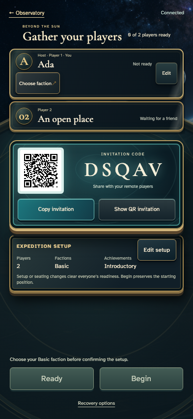](../../screenshots/retain-an-empty-outpost-without-any-owned-ships-with-separate-remote-controllers/004-host-room-phone-darwin.png) | [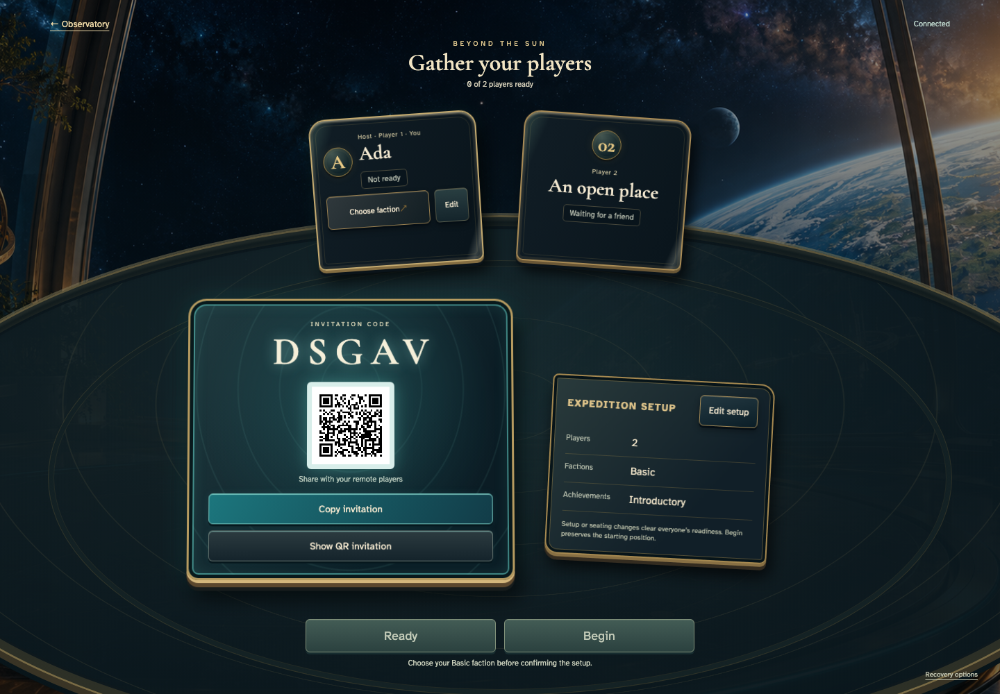](../../screenshots/retain-an-empty-outpost-without-any-owned-ships-with-separate-remote-controllers/004-host-room-desktop-darwin.png) |

- [x] The host receives the real public invitation
- [x] Actual canonical effects and acknowledgement settle.
- [x] Public topology retains physical separation.
- [x] The viewport fits without page scrolling.

## 6. An independent controller previews the invitation

Viewpoint: **Bora · separate guest controller**.

| phone · 1440 × 1000 | desktop · 393 × 852 |
| --- | --- |
| [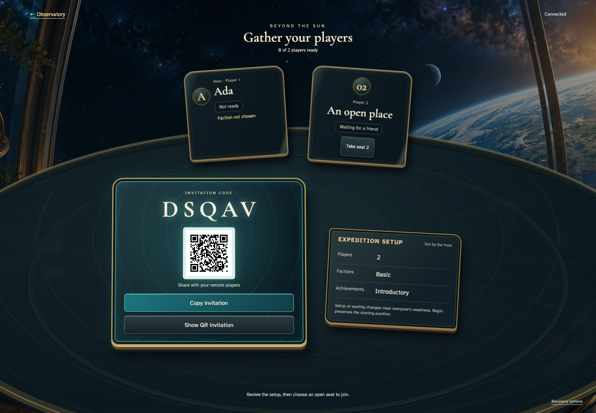](../../screenshots/retain-an-empty-outpost-without-any-owned-ships-with-separate-remote-controllers/005-guest-1-preview-phone-darwin.png) | [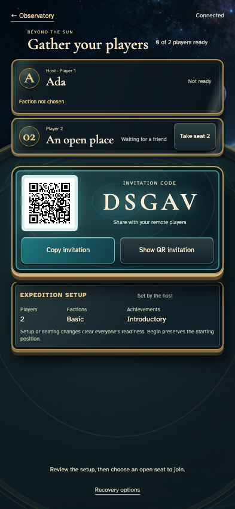](../../screenshots/retain-an-empty-outpost-without-any-owned-ships-with-separate-remote-controllers/005-guest-1-preview-desktop-darwin.png) |

- [x] An independent controller previews the invitation
- [x] Actual canonical effects and acknowledgement settle.
- [x] Public topology retains physical separation.
- [x] The viewport fits without page scrolling.

## 7. Claim an open remote seat through its own dialog

Viewpoint: **Bora · separate guest controller**.

| phone · 1440 × 1000 | desktop · 393 × 852 |
| --- | --- |
| [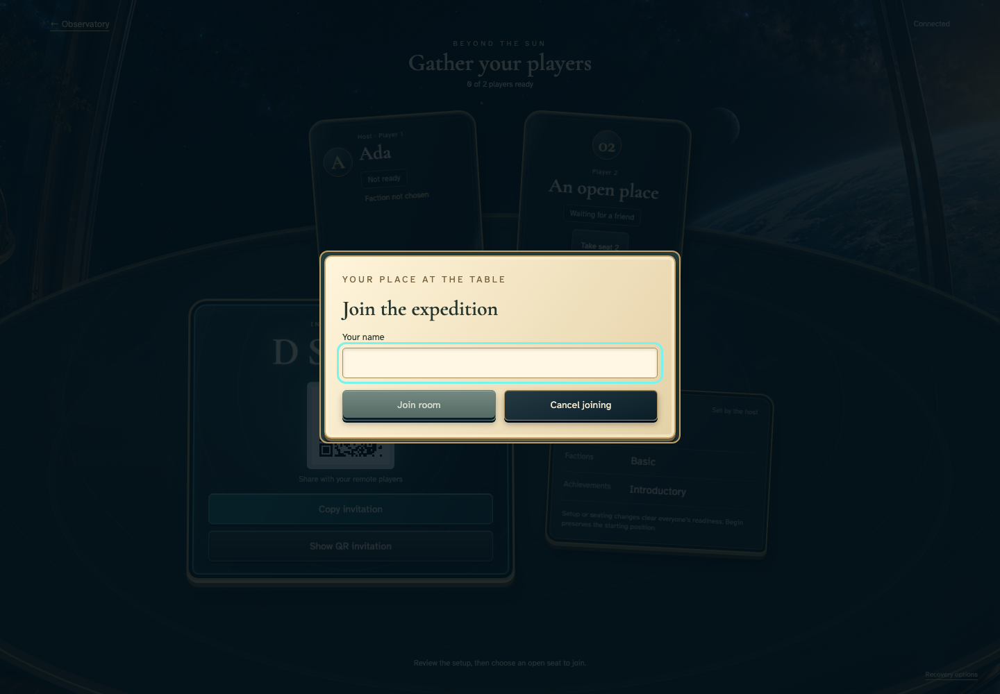](../../screenshots/retain-an-empty-outpost-without-any-owned-ships-with-separate-remote-controllers/006-guest-1-name-form-phone-darwin.png) |  |

- [x] Claim an open remote seat through its own dialog
- [x] Actual canonical effects and acknowledgement settle.
- [x] Public topology retains physical separation.
- [x] The viewport fits without page scrolling.

## 8. Enter the guest name

Viewpoint: **Bora · separate guest controller**.

| phone · 1440 × 1000 | desktop · 393 × 852 |
| --- | --- |
| [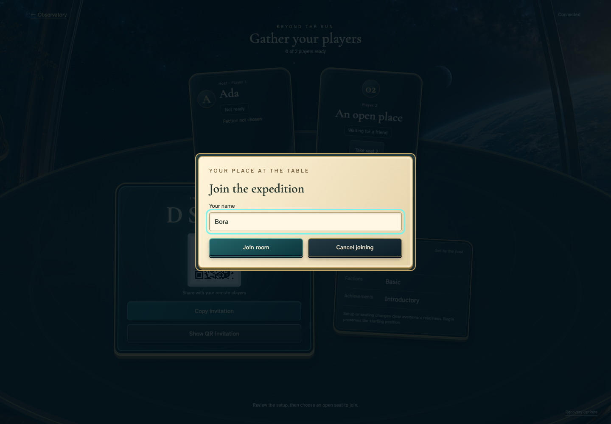](../../screenshots/retain-an-empty-outpost-without-any-owned-ships-with-separate-remote-controllers/007-guest-1-name-phone-darwin.png) |  |

- [x] Enter the guest name
- [x] Actual canonical effects and acknowledgement settle.
- [x] Public topology retains physical separation.
- [x] The viewport fits without page scrolling.

## 9. Persist this controller’s own seat

Viewpoint: **Bora · separate guest controller**.

| phone · 1440 × 1000 | desktop · 393 × 852 |
| --- | --- |
| [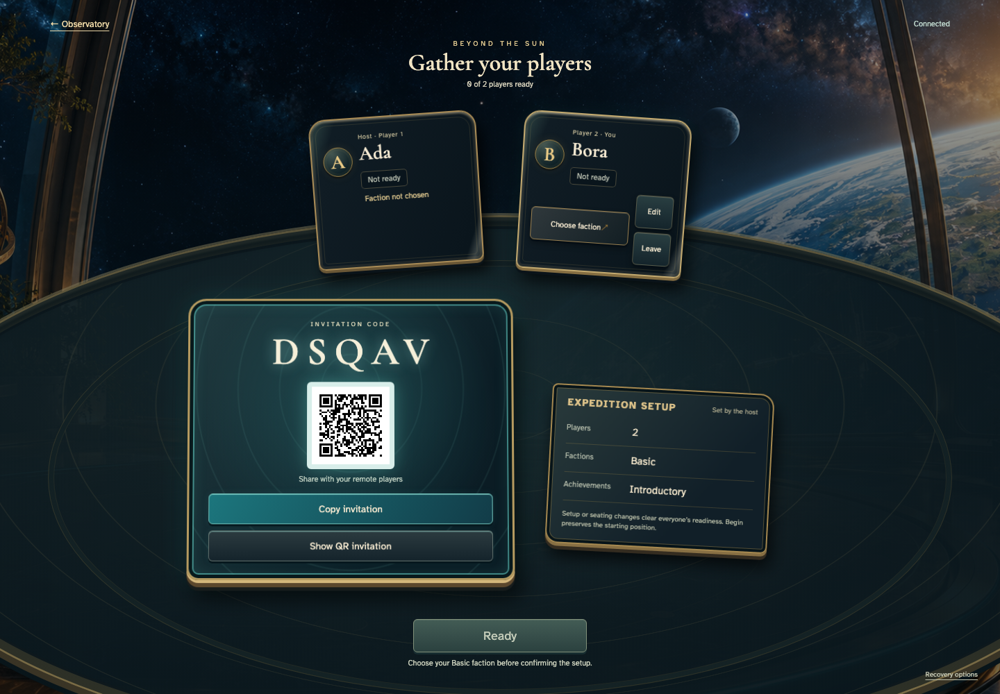](../../screenshots/retain-an-empty-outpost-without-any-owned-ships-with-separate-remote-controllers/008-guest-1-joined-phone-darwin.png) | [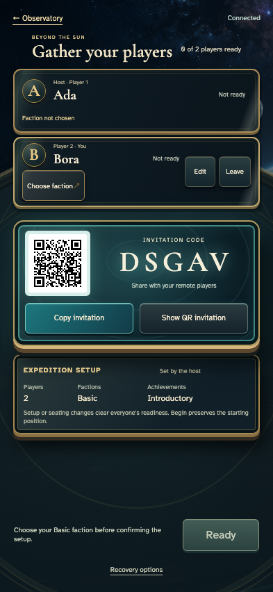](../../screenshots/retain-an-empty-outpost-without-any-owned-ships-with-separate-remote-controllers/008-guest-1-joined-desktop-darwin.png) |

- [x] Persist this controller’s own seat
- [x] Actual canonical effects and acknowledgement settle.
- [x] Public topology retains physical separation.
- [x] The viewport fits without page scrolling.

## 10. Choose a legal unique Basic faction

Viewpoint: **Ada · separate host controller**.

| phone · 393 × 852 | desktop · 1440 × 1000 |
| --- | --- |
|  |  |

- [x] Choose a legal unique Basic faction
- [x] Actual canonical effects and acknowledgement settle.
- [x] Public topology retains physical separation.
- [x] The viewport fits without page scrolling.

## 11. Ada chooses Nishida-Østergaard Corporation

Viewpoint: **Ada · separate host controller**.

| phone · 393 × 852 | desktop · 1440 × 1000 |
| --- | --- |
| [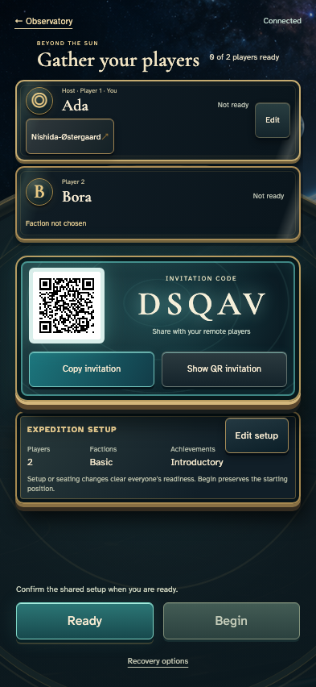](../../screenshots/retain-an-empty-outpost-without-any-owned-ships-with-separate-remote-controllers/010-faction-0-selected-phone-darwin.png) |  |

- [x] Ada chooses Nishida-Østergaard Corporation
- [x] Actual canonical effects and acknowledgement settle.
- [x] Public topology retains physical separation.
- [x] The viewport fits without page scrolling.

## 12. Choose a legal unique Basic faction

Viewpoint: **Bora · separate guest controller**.

| phone · 1440 × 1000 | desktop · 393 × 852 |
| --- | --- |
| [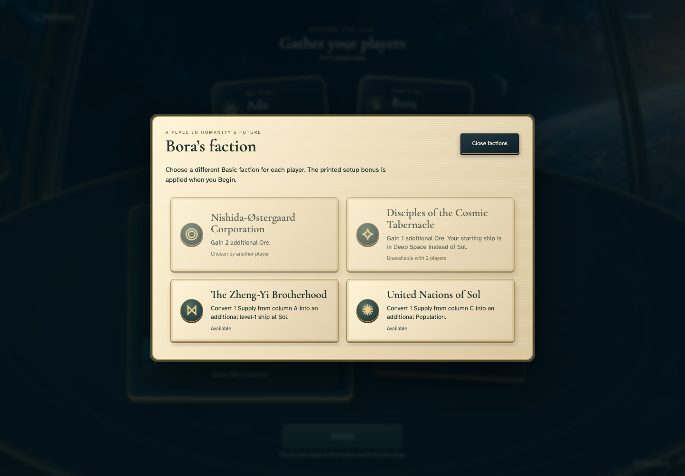](../../screenshots/retain-an-empty-outpost-without-any-owned-ships-with-separate-remote-controllers/011-faction-1-open-phone-darwin.png) |  |

- [x] Choose a legal unique Basic faction
- [x] Actual canonical effects and acknowledgement settle.
- [x] Public topology retains physical separation.
- [x] The viewport fits without page scrolling.

## 13. Bora chooses The Zheng-Yi Brotherhood

Viewpoint: **Bora · separate guest controller**.

| phone · 1440 × 1000 | desktop · 393 × 852 |
| --- | --- |
|  | [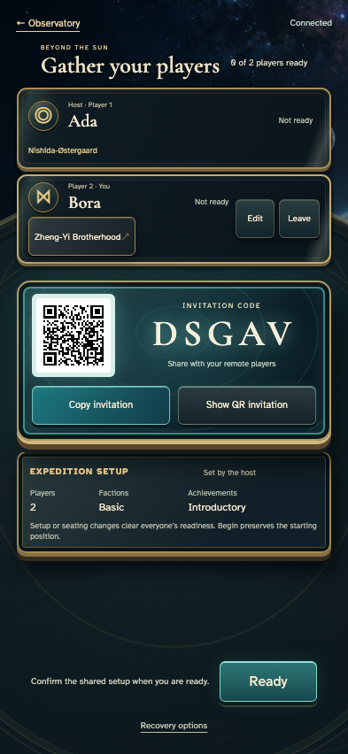](../../screenshots/retain-an-empty-outpost-without-any-owned-ships-with-separate-remote-controllers/012-faction-1-selected-desktop-darwin.png) |

- [x] Bora chooses The Zheng-Yi Brotherhood
- [x] Actual canonical effects and acknowledgement settle.
- [x] Public topology retains physical separation.
- [x] The viewport fits without page scrolling.

## 14. Ada acknowledges the current shared configuration

Viewpoint: **Ada · separate host controller**.

| phone · 393 × 852 | desktop · 1440 × 1000 |
| --- | --- |
| [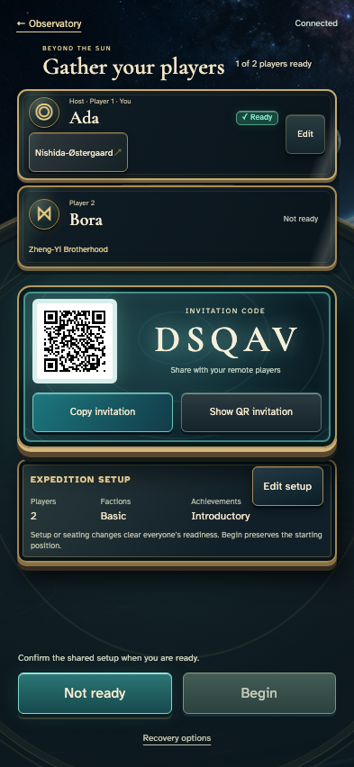](../../screenshots/retain-an-empty-outpost-without-any-owned-ships-with-separate-remote-controllers/013-ready-0-phone-darwin.png) | [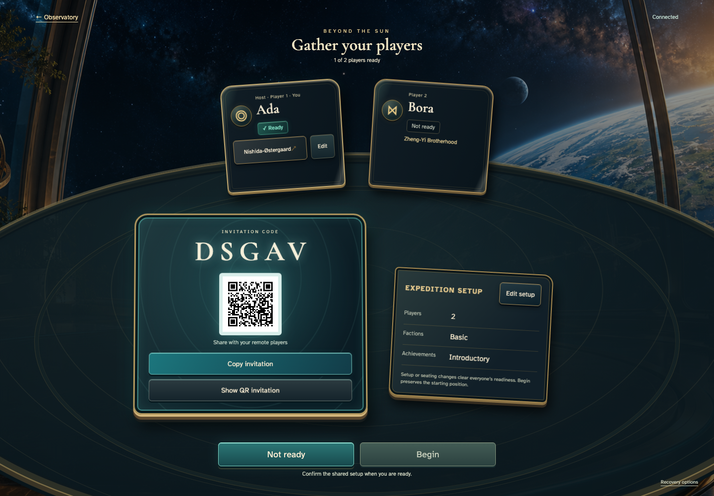](../../screenshots/retain-an-empty-outpost-without-any-owned-ships-with-separate-remote-controllers/013-ready-0-desktop-darwin.png) |

- [x] Ada acknowledges the current shared configuration
- [x] Actual canonical effects and acknowledgement settle.
- [x] Public topology retains physical separation.
- [x] The viewport fits without page scrolling.

## 15. Bora acknowledges the current shared configuration

Viewpoint: **Bora · separate guest controller**.

| phone · 1440 × 1000 | desktop · 393 × 852 |
| --- | --- |
| [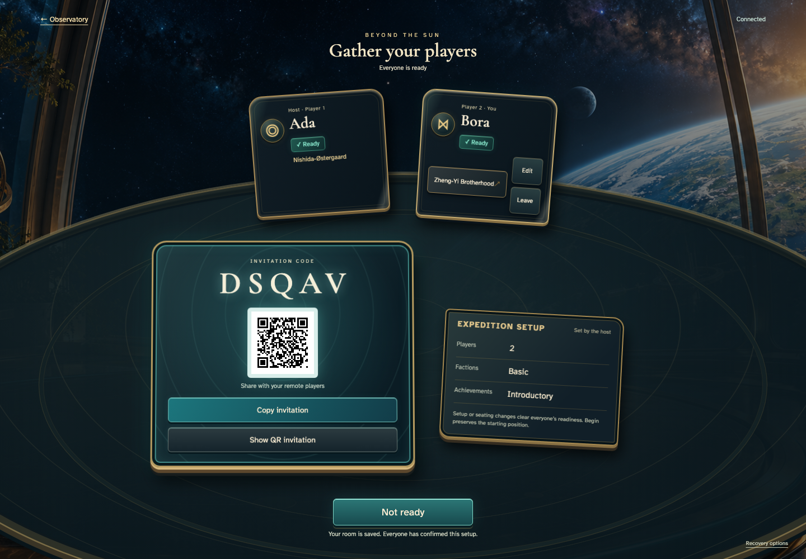](../../screenshots/retain-an-empty-outpost-without-any-owned-ships-with-separate-remote-controllers/014-ready-1-phone-darwin.png) | [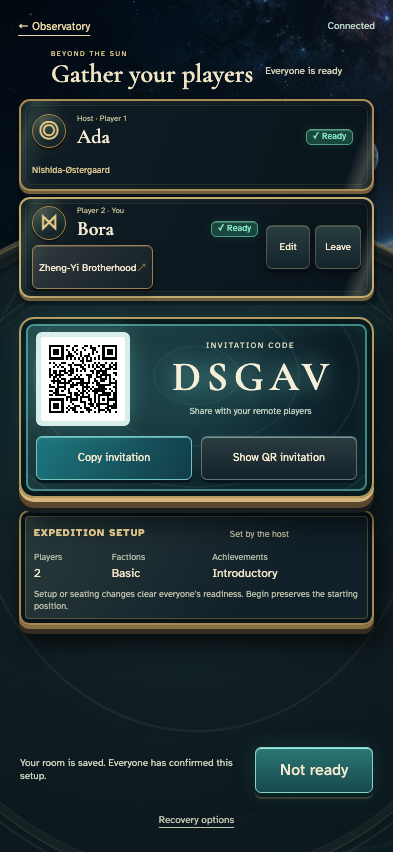](../../screenshots/retain-an-empty-outpost-without-any-owned-ships-with-separate-remote-controllers/014-ready-1-desktop-darwin.png) |

- [x] Bora acknowledges the current shared configuration
- [x] Actual canonical effects and acknowledgement settle.
- [x] Public topology retains physical separation.
- [x] The viewport fits without page scrolling.

## 16. Begin the immutable Basic game through normal UI

Viewpoint: **Ada · separate host controller**.

| phone · 393 × 852 | desktop · 1440 × 1000 |
| --- | --- |
|  |  |

- [x] Begin the immutable Basic game through normal UI
- [x] Actual canonical effects and acknowledgement settle.
- [x] Public topology retains physical separation.
- [x] The viewport fits without page scrolling.

## 17. Ada opens the real Action instrument

Viewpoint: **Ada · separate host controller**.

| phone · 393 × 852 | desktop · 1440 × 1000 |
| --- | --- |
|  |  |

- [x] Ada opens the real Action instrument
- [x] Actual canonical effects and acknowledgement settle.
- [x] Public topology retains physical separation.
- [x] The viewport fits without page scrolling.

## 18. Ada chooses Basic build and jump

Viewpoint: **Ada · separate host controller**.

| phone · 393 × 852 | desktop · 1440 × 1000 |
| --- | --- |
|  |  |

- [x] Ada chooses Basic build and jump
- [x] Actual canonical effects and acknowledgement settle.
- [x] Public topology retains physical separation.
- [x] The viewport fits without page scrolling.

## 19. Use the existing fleet without converting another Population cube

Viewpoint: **Ada · separate host controller**.

| phone · 393 × 852 | desktop · 1440 × 1000 |
| --- | --- |
| [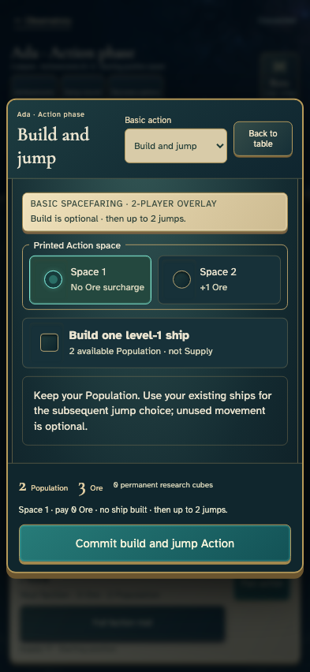](../../screenshots/retain-an-empty-outpost-without-any-owned-ships-with-separate-remote-controllers/018-claim-single-no-build-phone-darwin.png) | [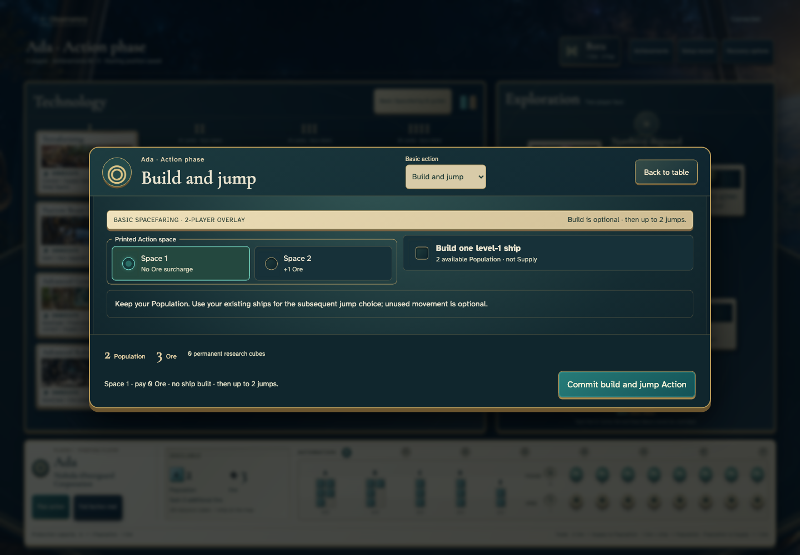](../../screenshots/retain-an-empty-outpost-without-any-owned-ships-with-separate-remote-controllers/018-claim-single-no-build-desktop-darwin.png) |

- [x] Use the existing fleet without converting another Population cube
- [x] Actual canonical effects and acknowledgement settle.
- [x] Public topology retains physical separation.
- [x] The viewport fits without page scrolling.

## 20. Commit the actual Population conversion and printed space cost before optional movement

Viewpoint: **Ada · separate host controller**.

| phone · 393 × 852 | desktop · 1440 × 1000 |
| --- | --- |
| [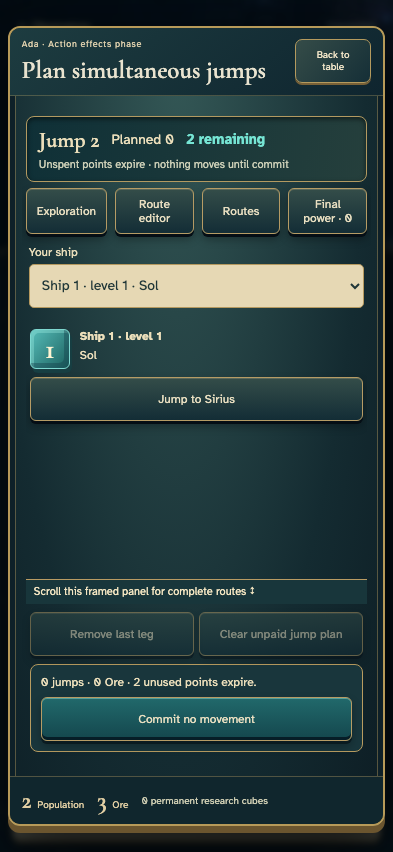](../../screenshots/retain-an-empty-outpost-without-any-owned-ships-with-separate-remote-controllers/019-claim-single-built-phone-darwin.png) |  |

- [x] Commit the actual Population conversion and printed space cost before optional movement
- [x] Actual canonical effects and acknowledgement settle.
- [x] Public topology retains physical separation.
- [x] The viewport fits without page scrolling.

## 21. Read the complete public map before choosing a connected route

Viewpoint: **Ada · separate host controller**.

| phone · 393 × 852 | desktop · 1440 × 1000 |
| --- | --- |
| [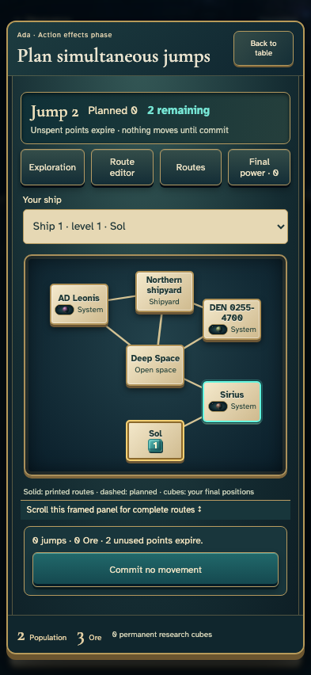](../../screenshots/retain-an-empty-outpost-without-any-owned-ships-with-separate-remote-controllers/020-claim-single-map-phone-darwin.png) |  |

- [x] Read the complete public map before choosing a connected route
- [x] Actual canonical effects and acknowledgement settle.
- [x] Public topology retains physical separation.
- [x] The viewport fits without page scrolling.

## 22. Read the actual connected destinations in this interface

Viewpoint: **Ada · separate host controller**.

| phone · 393 × 852 | desktop · 1440 × 1000 |
| --- | --- |
|  |  |

- [x] Read the actual connected destinations in this interface
- [x] Actual canonical effects and acknowledgement settle.
- [x] Public topology retains physical separation.
- [x] The viewport fits without page scrolling.

## 23. Choose a real owned ship for this unpaid route

Viewpoint: **Ada · separate host controller**.

| phone · 393 × 852 | desktop · 1440 × 1000 |
| --- | --- |
|  |  |

- [x] Choose a real owned ship for this unpaid route
- [x] Actual canonical effects and acknowledgement settle.
- [x] Public topology retains physical separation.
- [x] The viewport fits without page scrolling.

## 24. Plan Sirius as an endpoint; nothing moves yet

Viewpoint: **Ada · separate host controller**.

| phone · 393 × 852 | desktop · 1440 × 1000 |
| --- | --- |
| [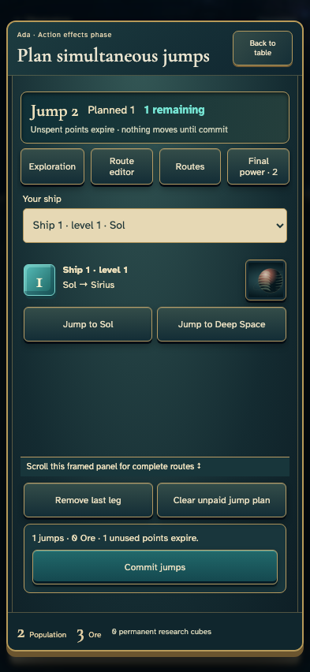](../../screenshots/retain-an-empty-outpost-without-any-owned-ships-with-separate-remote-controllers/023-claim-endpoint-endpoint-phone-darwin.png) | [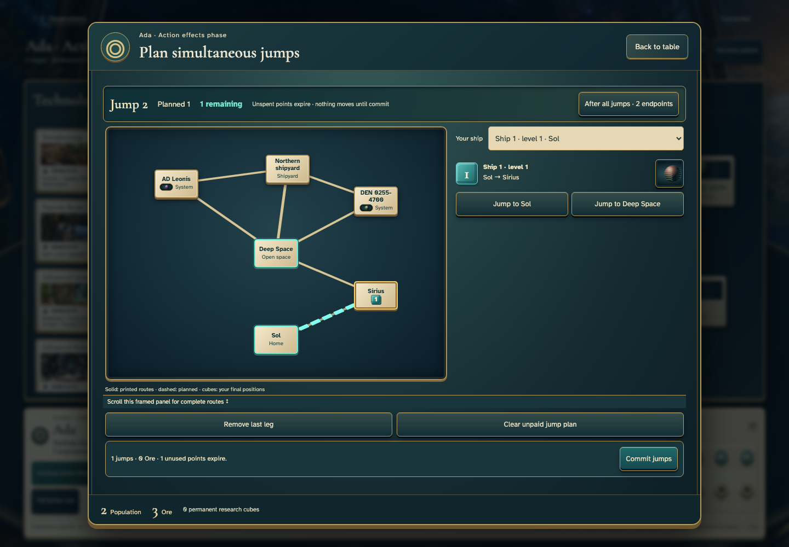](../../screenshots/retain-an-empty-outpost-without-any-owned-ships-with-separate-remote-controllers/023-claim-endpoint-endpoint-desktop-darwin.png) |

- [x] Plan Sirius as an endpoint; nothing moves yet
- [x] Actual canonical effects and acknowledgement settle.
- [x] Public topology retains physical separation.
- [x] The viewport fits without page scrolling.

## 25. Claim Sirius with one ship and receive its gain-control bonus

Viewpoint: **Ada · separate host controller**.

| phone · 393 × 852 | desktop · 1440 × 1000 |
| --- | --- |
|  |  |

- [x] Claim Sirius with one ship and receive its gain-control bonus
- [x] Actual canonical effects and acknowledgement settle.
- [x] Public topology retains physical separation.
- [x] The viewport fits without page scrolling.

## 26. Ada chooses ordinary Ore production and hands off

Viewpoint: **Ada · separate host controller**.

| phone · 393 × 852 | desktop · 1440 × 1000 |
| --- | --- |
|  | [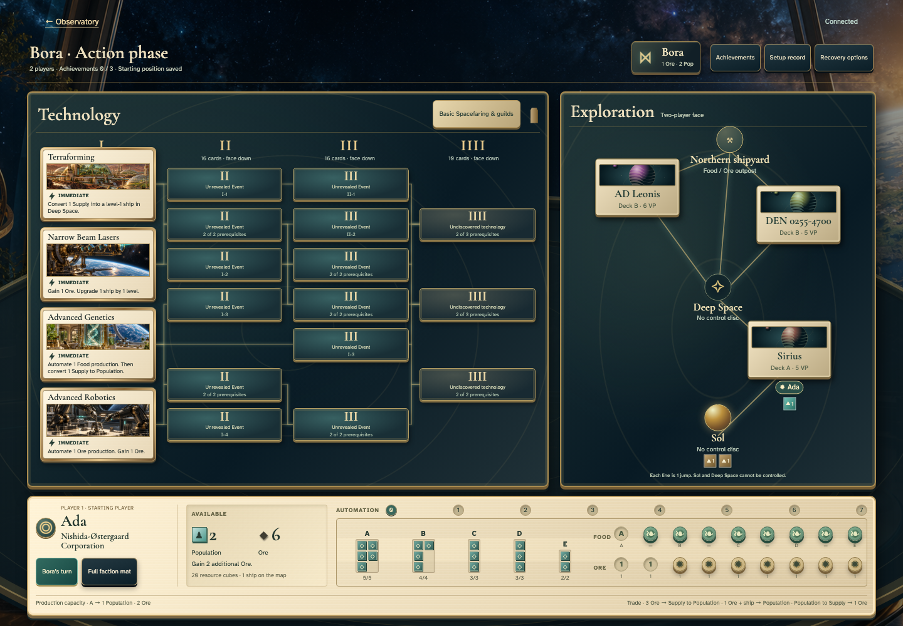](../../screenshots/retain-an-empty-outpost-without-any-owned-ships-with-separate-remote-controllers/025-empty-claim-handoff-desktop-darwin.png) |

- [x] Ada chooses ordinary Ore production and hands off
- [x] Actual canonical effects and acknowledgement settle.
- [x] Public topology retains physical separation.
- [x] The viewport fits without page scrolling.

## 27. The next distinct controller receives the saved Action phase

Viewpoint: **Bora · separate guest controller**.

| phone · 1440 × 1000 | desktop · 393 × 852 |
| --- | --- |
|  |  |

- [x] The next distinct controller receives the saved Action phase
- [x] Actual canonical effects and acknowledgement settle.
- [x] Public topology retains physical separation.
- [x] The viewport fits without page scrolling.

## 28. Bora opens the real Action instrument

Viewpoint: **Bora · separate guest controller**.

| phone · 1440 × 1000 | desktop · 393 × 852 |
| --- | --- |
|  |  |

- [x] Bora opens the real Action instrument
- [x] Actual canonical effects and acknowledgement settle.
- [x] Public topology retains physical separation.
- [x] The viewport fits without page scrolling.

## 29. Bora chooses Gather

Viewpoint: **Bora · separate guest controller**.

| phone · 1440 × 1000 | desktop · 393 × 852 |
| --- | --- |
| [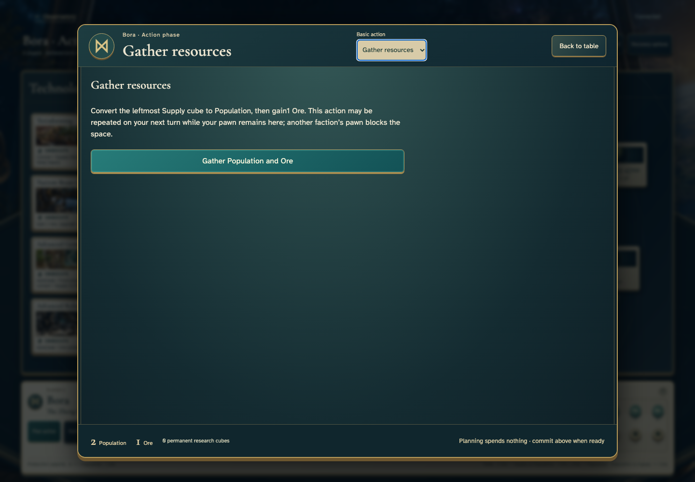](../../screenshots/retain-an-empty-outpost-without-any-owned-ships-with-separate-remote-controllers/028-empty-bora-kind-phone-darwin.png) | [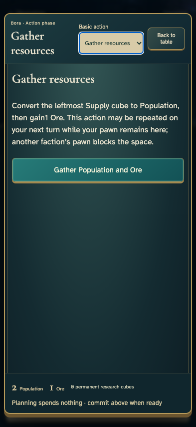](../../screenshots/retain-an-empty-outpost-without-any-owned-ships-with-separate-remote-controllers/028-empty-bora-kind-desktop-darwin.png) |

- [x] Bora chooses Gather
- [x] Actual canonical effects and acknowledgement settle.
- [x] Public topology retains physical separation.
- [x] The viewport fits without page scrolling.

## 30. A real intervening opponent turn leaves Sirius untouched

Viewpoint: **Bora · separate guest controller**.

| phone · 1440 × 1000 | desktop · 393 × 852 |
| --- | --- |
| [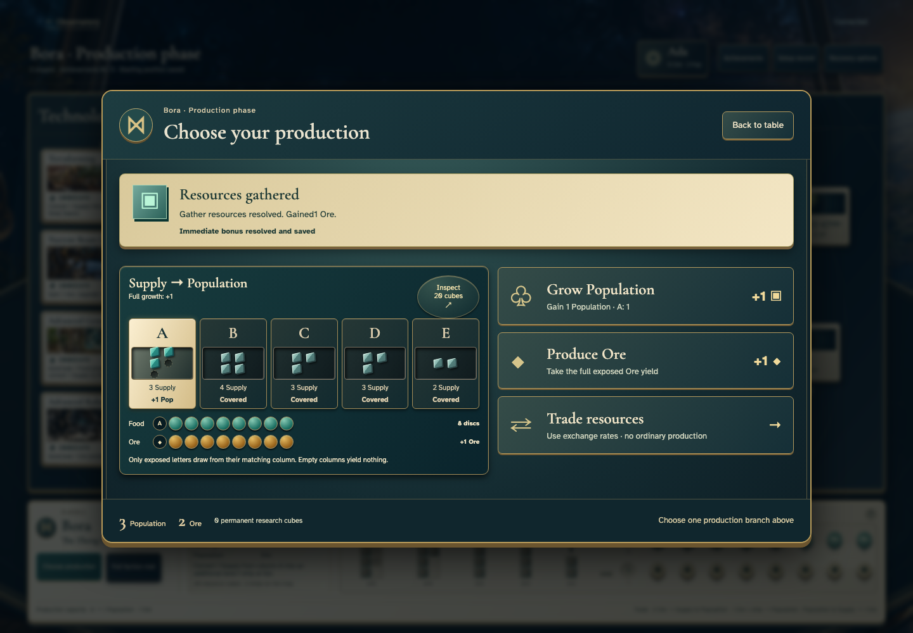](../../screenshots/retain-an-empty-outpost-without-any-owned-ships-with-separate-remote-controllers/029-empty-bora-gather-phone-darwin.png) | [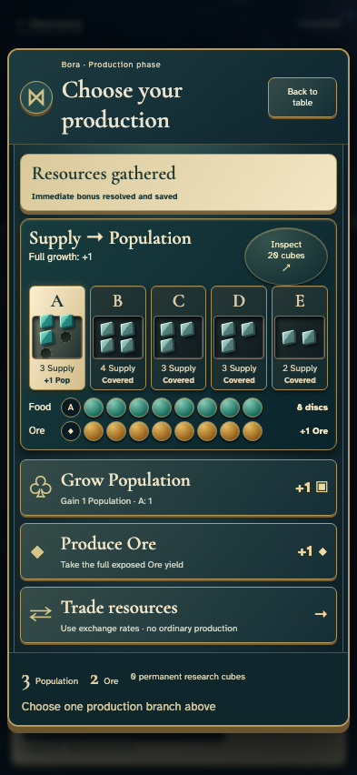](../../screenshots/retain-an-empty-outpost-without-any-owned-ships-with-separate-remote-controllers/029-empty-bora-gather-desktop-darwin.png) |

- [x] A real intervening opponent turn leaves Sirius untouched
- [x] Actual canonical effects and acknowledgement settle.
- [x] Public topology retains physical separation.
- [x] The viewport fits without page scrolling.

## 31. Bora chooses ordinary Ore production and hands off

Viewpoint: **Bora · separate guest controller**.

| phone · 1440 × 1000 | desktop · 393 × 852 |
| --- | --- |
| [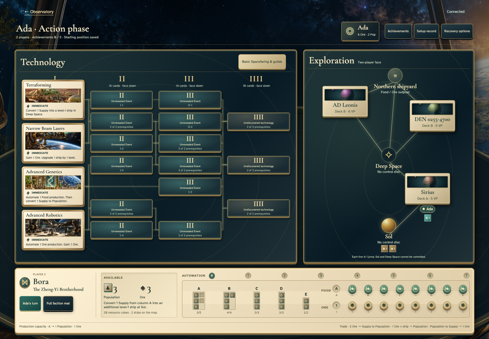](../../screenshots/retain-an-empty-outpost-without-any-owned-ships-with-separate-remote-controllers/030-empty-bora-handoff-phone-darwin.png) | [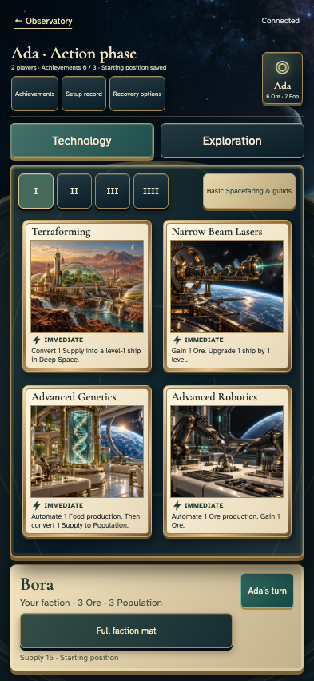](../../screenshots/retain-an-empty-outpost-without-any-owned-ships-with-separate-remote-controllers/030-empty-bora-handoff-desktop-darwin.png) |

- [x] Bora chooses ordinary Ore production and hands off
- [x] Actual canonical effects and acknowledgement settle.
- [x] Public topology retains physical separation.
- [x] The viewport fits without page scrolling.

## 32. The next distinct controller receives the saved Action phase

Viewpoint: **Ada · separate host controller**.

| phone · 393 × 852 | desktop · 1440 × 1000 |
| --- | --- |
|  |  |

- [x] The next distinct controller receives the saved Action phase
- [x] Actual canonical effects and acknowledgement settle.
- [x] Public topology retains physical separation.
- [x] The viewport fits without page scrolling.

## 33. Ada opens the real Action instrument

Viewpoint: **Ada · separate host controller**.

| phone · 393 × 852 | desktop · 1440 × 1000 |
| --- | --- |
| [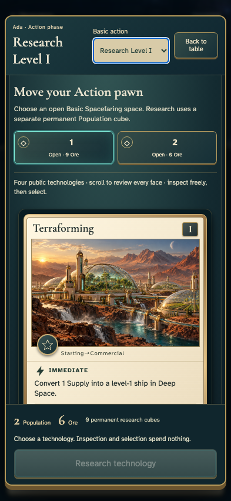](../../screenshots/retain-an-empty-outpost-without-any-owned-ships-with-separate-remote-controllers/032-empty-depart-open-phone-darwin.png) | [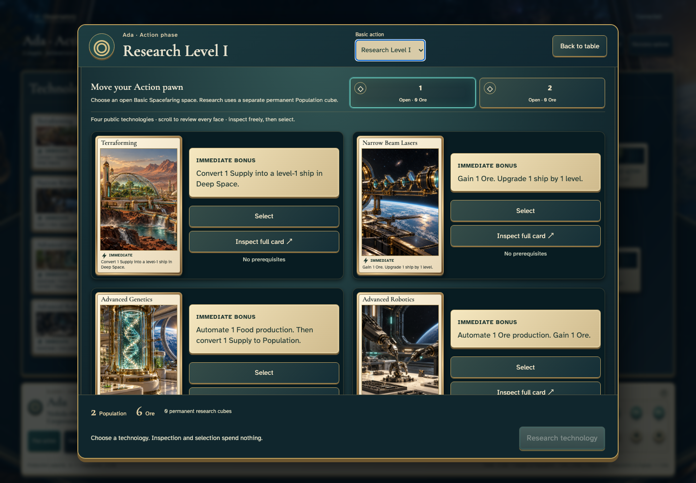](../../screenshots/retain-an-empty-outpost-without-any-owned-ships-with-separate-remote-controllers/032-empty-depart-open-desktop-darwin.png) |

- [x] Ada opens the real Action instrument
- [x] Actual canonical effects and acknowledgement settle.
- [x] Public topology retains physical separation.
- [x] The viewport fits without page scrolling.

## 34. Ada chooses Basic build and jump

Viewpoint: **Ada · separate host controller**.

| phone · 393 × 852 | desktop · 1440 × 1000 |
| --- | --- |
| [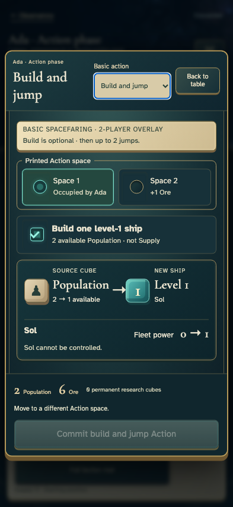](../../screenshots/retain-an-empty-outpost-without-any-owned-ships-with-separate-remote-controllers/033-empty-depart-kind-phone-darwin.png) | [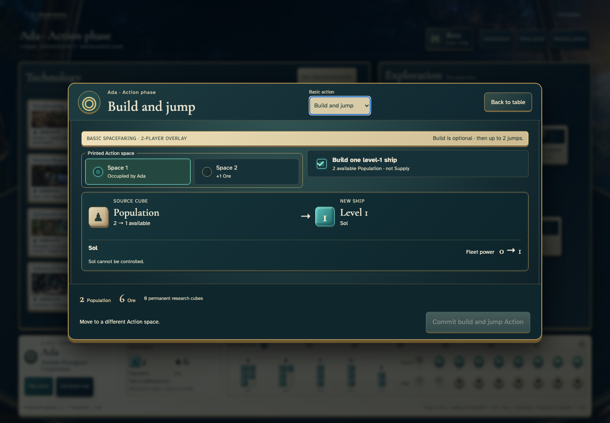](../../screenshots/retain-an-empty-outpost-without-any-owned-ships-with-separate-remote-controllers/033-empty-depart-kind-desktop-darwin.png) |

- [x] Ada chooses Basic build and jump
- [x] Actual canonical effects and acknowledgement settle.
- [x] Public topology retains physical separation.
- [x] The viewport fits without page scrolling.

## 35. Choose the unoccupied second printed space with its real surcharge

Viewpoint: **Ada · separate host controller**.

| phone · 393 × 852 | desktop · 1440 × 1000 |
| --- | --- |
| [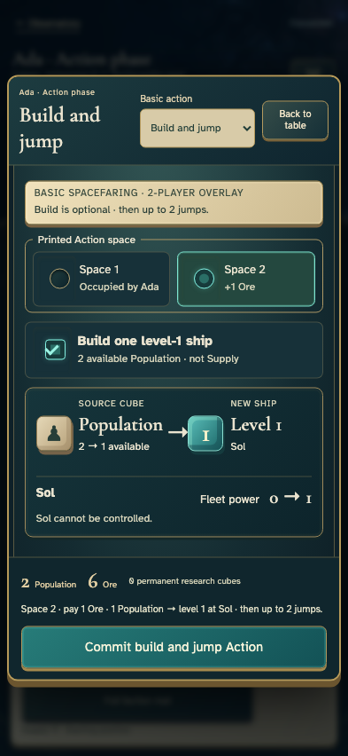](../../screenshots/retain-an-empty-outpost-without-any-owned-ships-with-separate-remote-controllers/034-empty-depart-space-phone-darwin.png) | [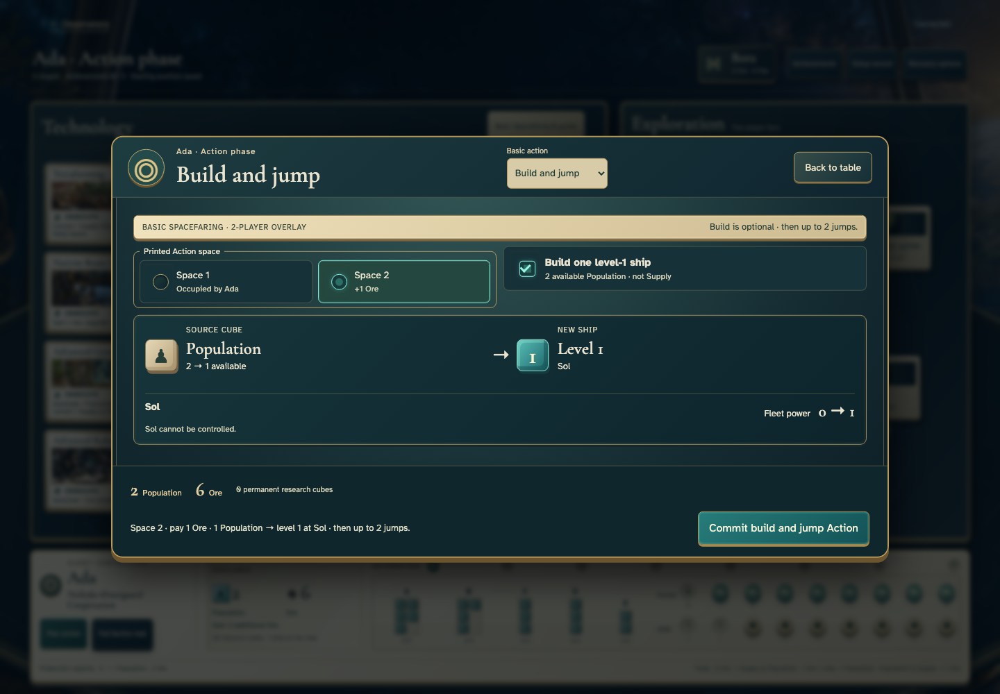](../../screenshots/retain-an-empty-outpost-without-any-owned-ships-with-separate-remote-controllers/034-empty-depart-space-desktop-darwin.png) |

- [x] Choose the unoccupied second printed space with its real surcharge
- [x] Actual canonical effects and acknowledgement settle.
- [x] Public topology retains physical separation.
- [x] The viewport fits without page scrolling.

## 36. Use the existing fleet without converting another Population cube

Viewpoint: **Ada · separate host controller**.

| phone · 393 × 852 | desktop · 1440 × 1000 |
| --- | --- |
| [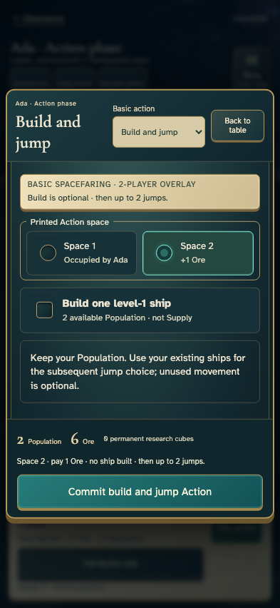](../../screenshots/retain-an-empty-outpost-without-any-owned-ships-with-separate-remote-controllers/035-empty-depart-no-build-phone-darwin.png) | [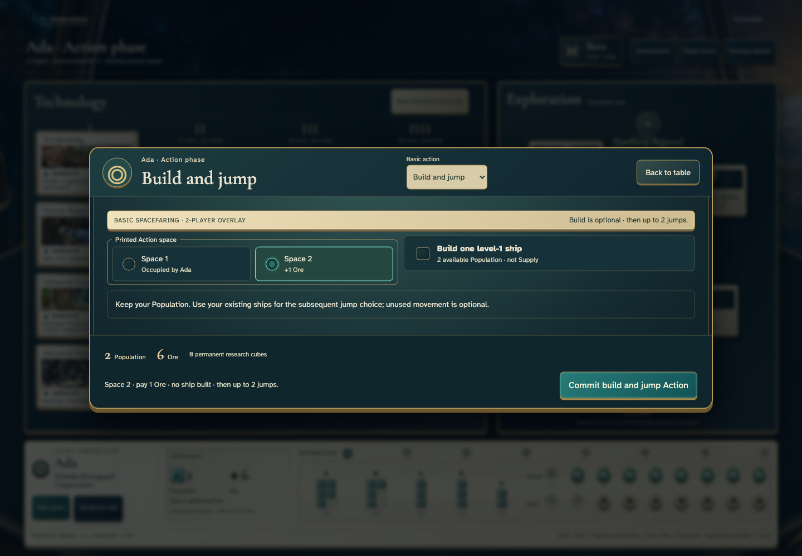](../../screenshots/retain-an-empty-outpost-without-any-owned-ships-with-separate-remote-controllers/035-empty-depart-no-build-desktop-darwin.png) |

- [x] Use the existing fleet without converting another Population cube
- [x] Actual canonical effects and acknowledgement settle.
- [x] Public topology retains physical separation.
- [x] The viewport fits without page scrolling.

## 37. Commit the actual Population conversion and printed space cost before optional movement

Viewpoint: **Ada · separate host controller**.

| phone · 393 × 852 | desktop · 1440 × 1000 |
| --- | --- |
|  |  |

- [x] Commit the actual Population conversion and printed space cost before optional movement
- [x] Actual canonical effects and acknowledgement settle.
- [x] Public topology retains physical separation.
- [x] The viewport fits without page scrolling.

## 38. Read the complete public map before choosing a connected route

Viewpoint: **Ada · separate host controller**.

| phone · 393 × 852 | desktop · 1440 × 1000 |
| --- | --- |
| [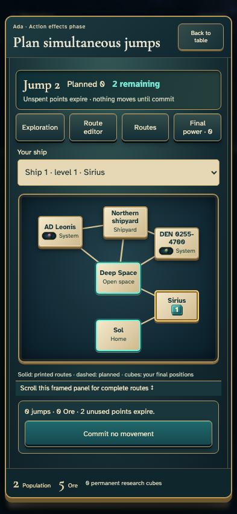](../../screenshots/retain-an-empty-outpost-without-any-owned-ships-with-separate-remote-controllers/037-empty-depart-map-phone-darwin.png) |  |

- [x] Read the complete public map before choosing a connected route
- [x] Actual canonical effects and acknowledgement settle.
- [x] Public topology retains physical separation.
- [x] The viewport fits without page scrolling.

## 39. Read the actual connected destinations in this interface

Viewpoint: **Ada · separate host controller**.

| phone · 393 × 852 | desktop · 1440 × 1000 |
| --- | --- |
| [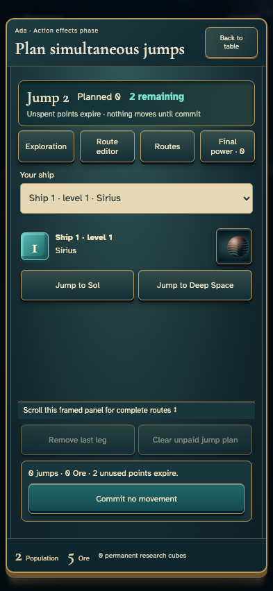](../../screenshots/retain-an-empty-outpost-without-any-owned-ships-with-separate-remote-controllers/038-empty-depart-editor-phone-darwin.png) |  |

- [x] Read the actual connected destinations in this interface
- [x] Actual canonical effects and acknowledgement settle.
- [x] Public topology retains physical separation.
- [x] The viewport fits without page scrolling.

## 40. Choose a real owned ship for this unpaid route

Viewpoint: **Ada · separate host controller**.

| phone · 393 × 852 | desktop · 1440 × 1000 |
| --- | --- |
|  | [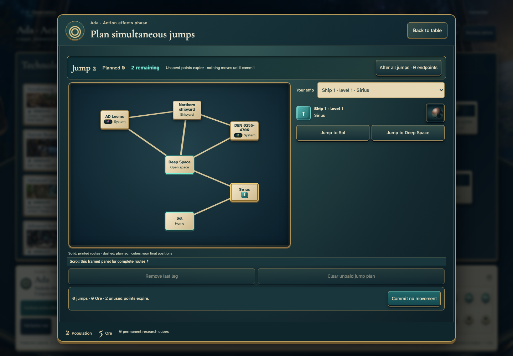](../../screenshots/retain-an-empty-outpost-without-any-owned-ships-with-separate-remote-controllers/039-empty-sol-ship-desktop-darwin.png) |

- [x] Choose a real owned ship for this unpaid route
- [x] Actual canonical effects and acknowledgement settle.
- [x] Public topology retains physical separation.
- [x] The viewport fits without page scrolling.

## 41. Plan Sol as an endpoint; nothing moves yet

Viewpoint: **Ada · separate host controller**.

| phone · 393 × 852 | desktop · 1440 × 1000 |
| --- | --- |
| [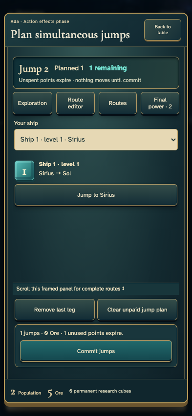](../../screenshots/retain-an-empty-outpost-without-any-owned-ships-with-separate-remote-controllers/040-empty-sol-endpoint-phone-darwin.png) | [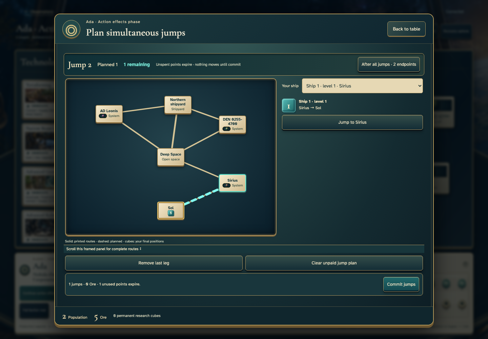](../../screenshots/retain-an-empty-outpost-without-any-owned-ships-with-separate-remote-controllers/040-empty-sol-endpoint-desktop-darwin.png) |

- [x] Plan Sol as an endpoint; nothing moves yet
- [x] Actual canonical effects and acknowledgement settle.
- [x] Public topology retains physical separation.
- [x] The viewport fits without page scrolling.

## 42. The only incumbent ship leaves an otherwise empty System

Viewpoint: **Ada · separate host controller**.

| phone · 393 × 852 | desktop · 1440 × 1000 |
| --- | --- |
| [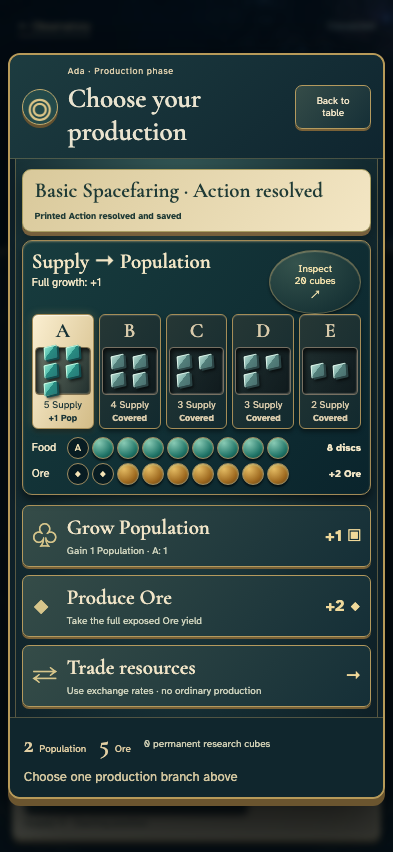](../../screenshots/retain-an-empty-outpost-without-any-owned-ships-with-separate-remote-controllers/041-empty-withdrawn-phone-darwin.png) | [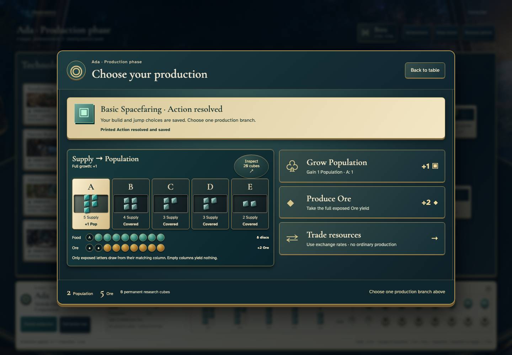](../../screenshots/retain-an-empty-outpost-without-any-owned-ships-with-separate-remote-controllers/041-empty-withdrawn-desktop-darwin.png) |

- [x] The only incumbent ship leaves an otherwise empty System
- [x] Actual canonical effects and acknowledgement settle.
- [x] Public topology retains physical separation.
- [x] The viewport fits without page scrolling.

## 43. Choose Trade instead of ordinary growth or Ore production

Viewpoint: **Ada · separate host controller**.

| phone · 393 × 852 | desktop · 1440 × 1000 |
| --- | --- |
|  | [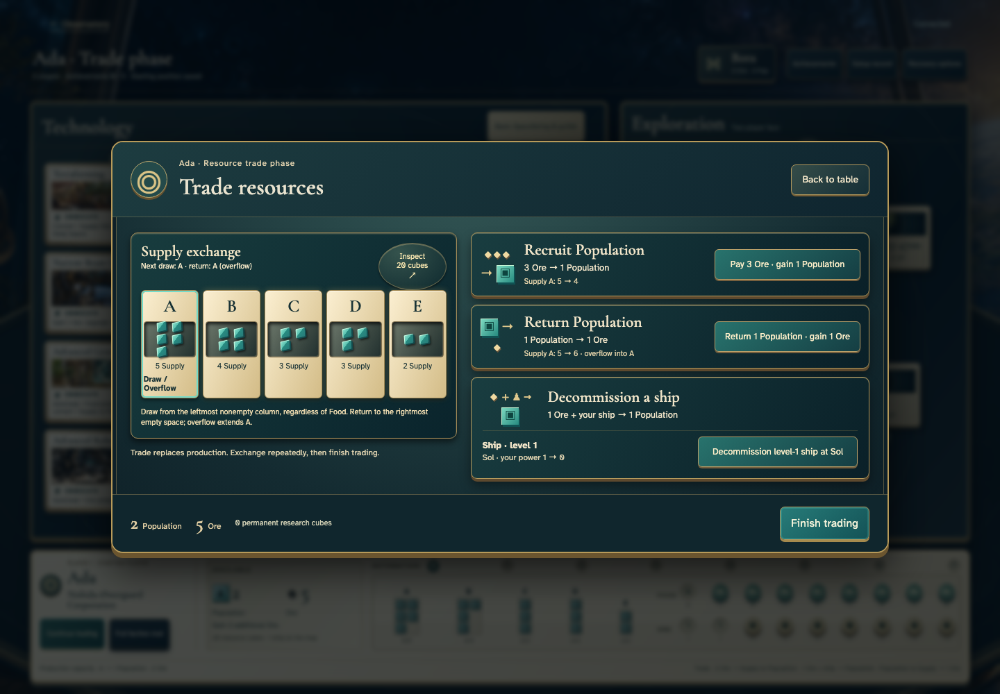](../../screenshots/retain-an-empty-outpost-without-any-owned-ships-with-separate-remote-controllers/042-empty-trade-desktop-darwin.png) |

- [x] Choose Trade instead of ordinary growth or Ore production
- [x] Actual canonical effects and acknowledgement settle.
- [x] Public topology retains physical separation.
- [x] The viewport fits without page scrolling.

## 44. Review the printed ship-decommission exchange in this interface

Viewpoint: **Ada · separate host controller**.

| phone · 393 × 852 | desktop · 1440 × 1000 |
| --- | --- |
| [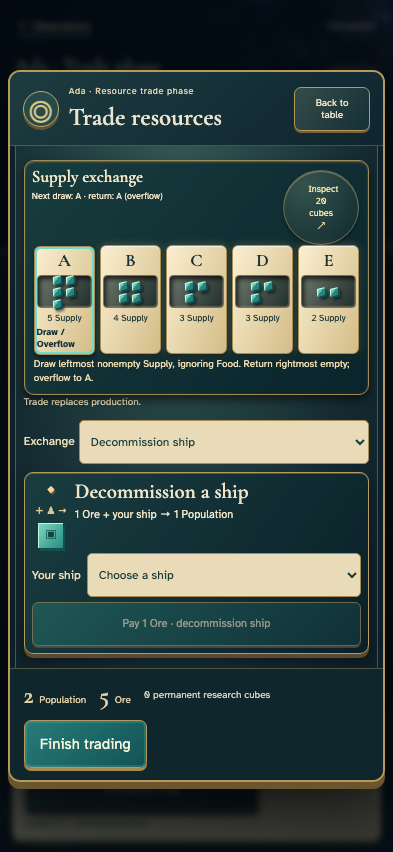](../../screenshots/retain-an-empty-outpost-without-any-owned-ships-with-separate-remote-controllers/043-empty-last-ship-exchange-phone-darwin.png) |  |

- [x] Review the printed ship-decommission exchange in this interface
- [x] Actual canonical effects and acknowledgement settle.
- [x] Public topology retains physical separation.
- [x] The viewport fits without page scrolling.

## 45. Review the owned ship and its control consequence before paying

Viewpoint: **Ada · separate host controller**.

| phone · 393 × 852 | desktop · 1440 × 1000 |
| --- | --- |
| [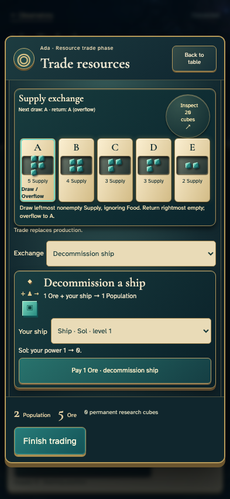](../../screenshots/retain-an-empty-outpost-without-any-owned-ships-with-separate-remote-controllers/044-empty-last-ship-selected-phone-darwin.png) |  |

- [x] Review the owned ship and its control consequence before paying
- [x] Actual canonical effects and acknowledgement settle.
- [x] Public topology retains physical separation.
- [x] The viewport fits without page scrolling.

## 46. Pay one Ore and return the last owned ship to Population

Viewpoint: **Ada · separate host controller**.

| phone · 393 × 852 | desktop · 1440 × 1000 |
| --- | --- |
| [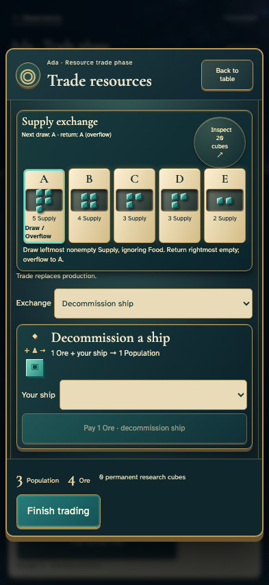](../../screenshots/retain-an-empty-outpost-without-any-owned-ships-with-separate-remote-controllers/045-empty-paid-phone-darwin.png) | [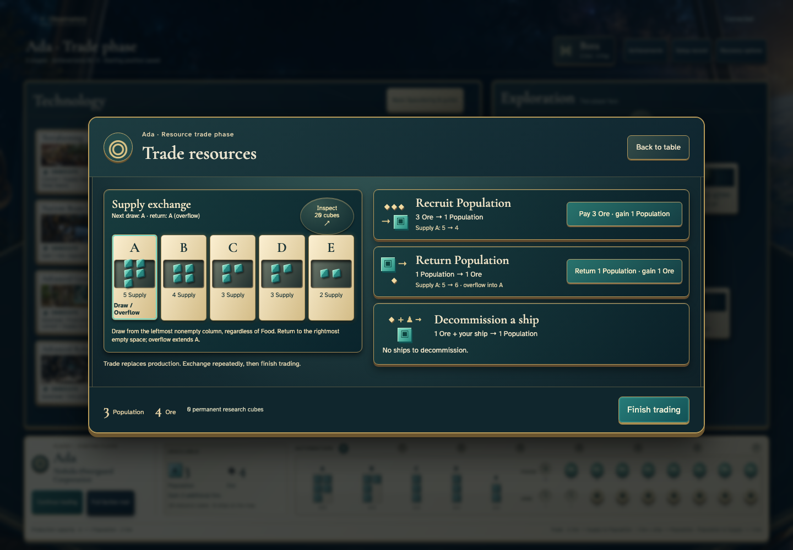](../../screenshots/retain-an-empty-outpost-without-any-owned-ships-with-separate-remote-controllers/045-empty-paid-desktop-darwin.png) |

- [x] Pay one Ore and return the last owned ship to Population
- [x] Actual canonical effects and acknowledgement settle.
- [x] Public topology retains physical separation.
- [x] The viewport fits without page scrolling.

## 47. Leave the trade open while inspecting the retained outpost

Viewpoint: **Ada · separate host controller**.

| phone · 393 × 852 | desktop · 1440 × 1000 |
| --- | --- |
| [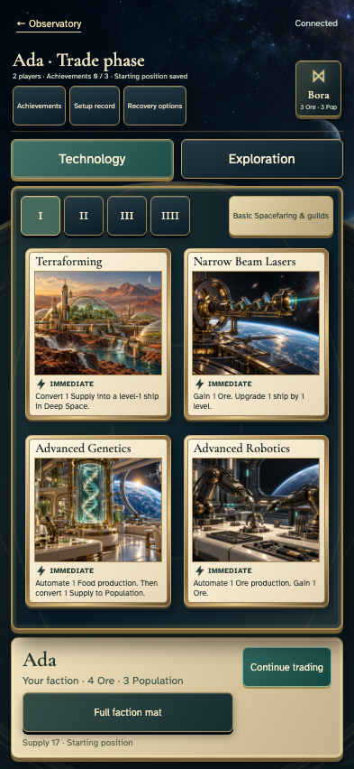](../../screenshots/retain-an-empty-outpost-without-any-owned-ships-with-separate-remote-controllers/046-empty-trade-board-phone-darwin.png) |  |

- [x] Leave the trade open while inspecting the retained outpost
- [x] Actual canonical effects and acknowledgement settle.
- [x] Public topology retains physical separation.
- [x] The viewport fits without page scrolling.

## 48. Ada inspects the actual production discs

Viewpoint: **Ada · separate host controller**.

| phone · 393 × 852 | desktop · 1440 × 1000 |
| --- | --- |
| [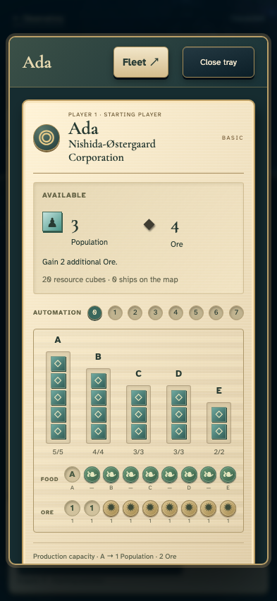](../../screenshots/retain-an-empty-outpost-without-any-owned-ships-with-separate-remote-controllers/047-empty-retained-mat-phone-darwin.png) |  |

- [x] Ada inspects the actual production discs
- [x] Actual canonical effects and acknowledgement settle.
- [x] Public topology retains physical separation.
- [x] The viewport fits without page scrolling.

## 49. Open the reusable public fleet inspection

Viewpoint: **Ada · separate host controller**.

| phone · 393 × 852 | desktop · 1440 × 1000 |
| --- | --- |
|  |  |

- [x] Open the reusable public fleet inspection
- [x] Actual canonical effects and acknowledgement settle.
- [x] Public topology retains physical separation.
- [x] The viewport fits without page scrolling.

## 50. Read saved disc ownership separately from current summed fleet power

Viewpoint: **Ada · separate host controller**.

| phone · 393 × 852 | desktop · 1440 × 1000 |
| --- | --- |
|  |  |

- [x] Read saved disc ownership separately from current summed fleet power
- [x] Actual canonical effects and acknowledgement settle.
- [x] Public topology retains physical separation.
- [x] The viewport fits without page scrolling.

## 51. Inspect every faction’s actual level sum and the incumbent’s disc

Viewpoint: **Ada · separate host controller**.

| phone · 393 × 852 | desktop · 1440 × 1000 |
| --- | --- |
|  |  |

- [x] Inspect every faction’s actual level sum and the incumbent’s disc
- [x] Actual canonical effects and acknowledgement settle.
- [x] Public topology retains physical separation.
- [x] The viewport fits without page scrolling.

## 52. Keyboard scroll reaches production, printed bonus and the inspection boundary

Viewpoint: **Ada · separate host controller**.

| phone · 393 × 852 | desktop · 1440 × 1000 |
| --- | --- |
|  |  |

- [x] Keyboard scroll reaches production, printed bonus and the inspection boundary
- [x] Actual canonical effects and acknowledgement settle.
- [x] Public topology retains physical separation.
- [x] The viewport fits without page scrolling.

## 53. Open the complete reusable fleet rules through semantic navigation

Viewpoint: **Ada · separate host controller**.

| phone · 393 × 852 | desktop · 1440 × 1000 |
| --- | --- |
|  |  |

- [x] Open the complete reusable fleet rules through semantic navigation
- [x] Actual canonical effects and acknowledgement settle.
- [x] Public topology retains physical separation.
- [x] The viewport fits without page scrolling.

## 54. Return to the real ship register without taking a turn

Viewpoint: **Ada · separate host controller**.

| phone · 393 × 852 | desktop · 1440 × 1000 |
| --- | --- |
|  |  |

- [x] Return to the real ship register without taking a turn
- [x] Actual canonical effects and acknowledgement settle.
- [x] Public topology retains physical separation.
- [x] The viewport fits without page scrolling.

## 55. Escape restores the exact fleet opener without taking a turn

Viewpoint: **Ada · separate host controller**.

| phone · 393 × 852 | desktop · 1440 × 1000 |
| --- | --- |
|  |  |

- [x] Escape restores the exact fleet opener without taking a turn
- [x] Actual canonical effects and acknowledgement settle.
- [x] Public topology retains physical separation.
- [x] The viewport fits without page scrolling.

## 56. Close the mat and restore its own opener

Viewpoint: **Ada · separate host controller**.

| phone · 393 × 852 | desktop · 1440 × 1000 |
| --- | --- |
|  |  |

- [x] Close the mat and restore its own opener
- [x] Actual canonical effects and acknowledgement settle.
- [x] Public topology retains physical separation.
- [x] The viewport fits without page scrolling.

## 57. Reload retains an outpost with no owned ships and pending Trade

Viewpoint: **Ada · separate host controller**.

| phone · 393 × 852 | desktop · 1440 × 1000 |
| --- | --- |
|  |  |

- [x] Reload retains an outpost with no owned ships and pending Trade
- [x] Actual canonical effects and acknowledgement settle.
- [x] Public topology retains physical separation.
- [x] The viewport fits without page scrolling.

## 58. Restore the exact paid balance without a Production payout

Viewpoint: **Ada · separate host controller**.

| phone · 393 × 852 | desktop · 1440 × 1000 |
| --- | --- |
|  |  |

- [x] Restore the exact paid balance without a Production payout
- [x] Actual canonical effects and acknowledgement settle.
- [x] Public topology retains physical separation.
- [x] The viewport fits without page scrolling.

## 59. Finish hands off without ordinary production

Viewpoint: **Ada · separate host controller**.

| phone · 393 × 852 | desktop · 1440 × 1000 |
| --- | --- |
|  |  |

- [x] Finish hands off without ordinary production
- [x] Actual canonical effects and acknowledgement settle.
- [x] Public topology retains physical separation.
- [x] The viewport fits without page scrolling.
