# Retain an empty outpost without ships at two shared corner seats

Exactly one shared controller; all local seats/factions/Begin through the actual table. Two players for incoming tie/later exceed, four for simultaneous two-System bonuses or Food/Ore specialty. Setup seed002 or004; command identities disjoint. No companion devices, state injection or future deck read.

## 1. Arrive through the actual production interface

Viewpoint: **Ada · South West · one shared controller**.

| desktop · 1440 × 1000 |
| --- |
|  |

tabletop-4k · 3840 × 2160

- [x] Arrive through the actual production interface
- [x] Actual canonical effects and acknowledgement settle.
- [x] Public topology retains physical separation.
- [x] The viewport fits without page scrolling.

## 2. Choose physical tabletop or separate-controller remote play

Viewpoint: **Ada · South West · one shared controller**.

| desktop · 1440 × 1000 |
| --- |
|  |

tabletop-4k · 3840 × 2160

- [x] Choose physical tabletop or separate-controller remote play
- [x] Actual canonical effects and acknowledgement settle.
- [x] Public topology retains physical separation.
- [x] The viewport fits without page scrolling.

## 3. One shared controller opens the physical seats

Viewpoint: **Ada · South West · one shared controller**.

| desktop · 1440 × 1000 |
| --- |
|  |

tabletop-4k · 3840 × 2160

- [x] One shared controller opens the physical seats
- [x] Actual canonical effects and acknowledgement settle.
- [x] Public topology retains physical separation.
- [x] The viewport fits without page scrolling.

## 4. Join directly at South West

Viewpoint: **Ada · South West · one shared controller**.

| desktop · 1440 × 1000 |
| --- |
|  |

tabletop-4k · 3840 × 2160

- [x] Join directly at South West
- [x] Actual canonical effects and acknowledgement settle.
- [x] Public topology retains physical separation.
- [x] The viewport fits without page scrolling.

## 5. Name this physical seat Ada

Viewpoint: **Ada · South West · one shared controller**.

| desktop · 1440 × 1000 |
| --- |
| [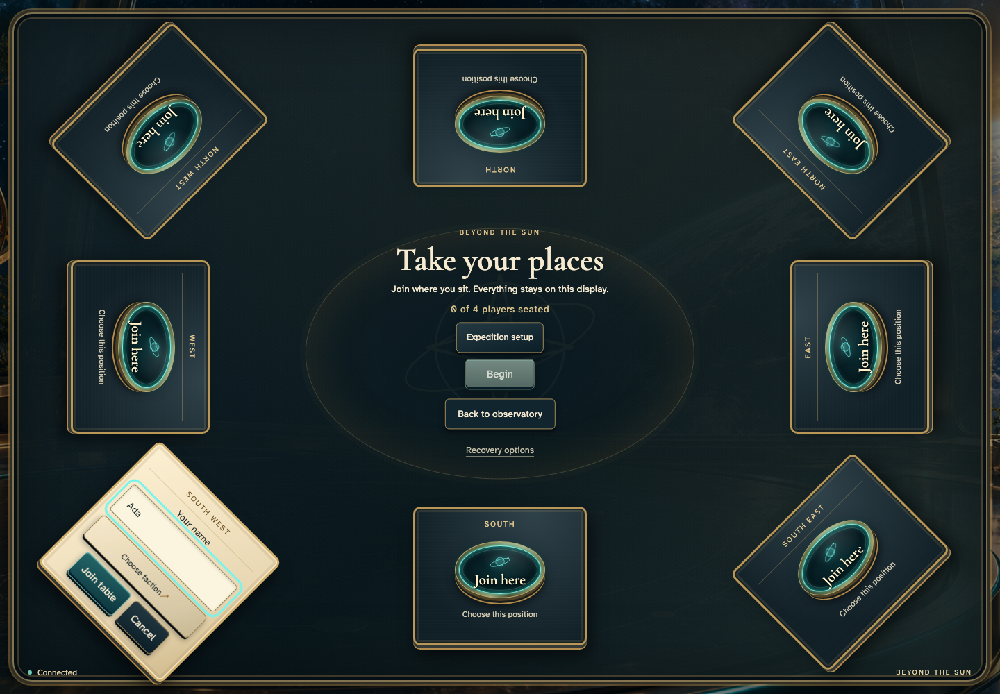](../../screenshots/retain-an-empty-outpost-without-ships-at-two-shared-corner-seats/004-seat-0-name-desktop-darwin.png) |

tabletop-4k · 3840 × 2160

- [x] Name this physical seat Ada
- [x] Actual canonical effects and acknowledgement settle.
- [x] Public topology retains physical separation.
- [x] The viewport fits without page scrolling.

## 6. Persist the named seat on the same display

Viewpoint: **Ada · South West · one shared controller**.

| desktop · 1440 × 1000 |
| --- |
|  |

tabletop-4k · 3840 × 2160

- [x] Persist the named seat on the same display
- [x] Actual canonical effects and acknowledgement settle.
- [x] Public topology retains physical separation.
- [x] The viewport fits without page scrolling.

## 7. Join directly at North East

Viewpoint: **Bora · North East · one shared controller**.

| desktop · 1440 × 1000 |
| --- |
|  |

tabletop-4k · 3840 × 2160

- [x] Join directly at North East
- [x] Actual canonical effects and acknowledgement settle.
- [x] Public topology retains physical separation.
- [x] The viewport fits without page scrolling.

## 8. Name this physical seat Bora

Viewpoint: **Bora · North East · one shared controller**.

| desktop · 1440 × 1000 |
| --- |
| [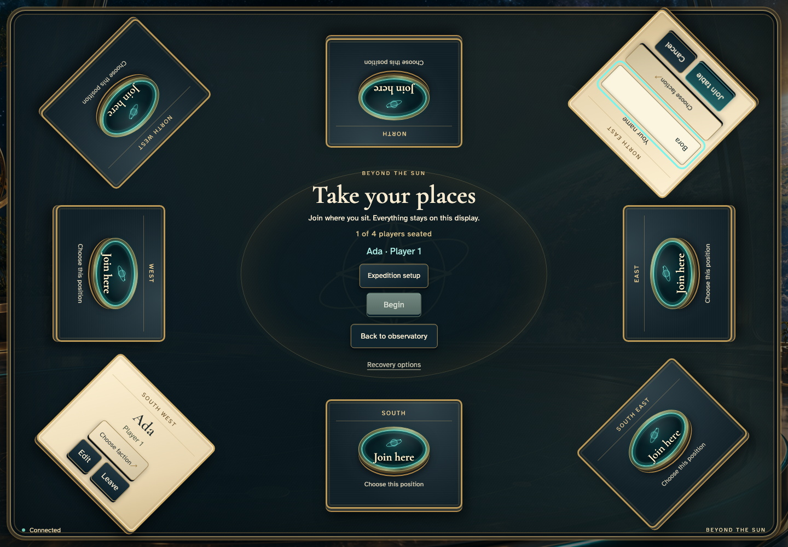](../../screenshots/retain-an-empty-outpost-without-ships-at-two-shared-corner-seats/007-seat-1-name-desktop-darwin.png) |

tabletop-4k · 3840 × 2160

- [x] Name this physical seat Bora
- [x] Actual canonical effects and acknowledgement settle.
- [x] Public topology retains physical separation.
- [x] The viewport fits without page scrolling.

## 9. Persist the named seat on the same display

Viewpoint: **Bora · North East · one shared controller**.

| desktop · 1440 × 1000 |
| --- |
|  |

tabletop-4k · 3840 × 2160

[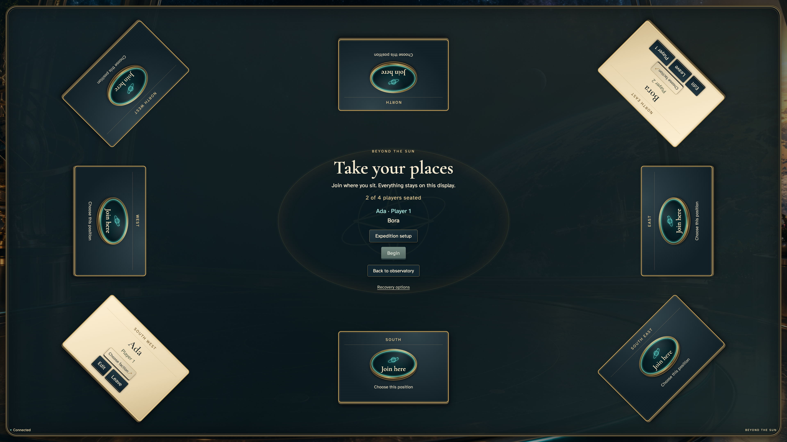](../../screenshots/retain-an-empty-outpost-without-ships-at-two-shared-corner-seats/008-seat-1-joined-tabletop-4k-darwin.png)

- [x] Persist the named seat on the same display
- [x] Actual canonical effects and acknowledgement settle.
- [x] Public topology retains physical separation.
- [x] The viewport fits without page scrolling.

## 10. Choose a legal unique Basic faction

Viewpoint: **Ada · South West · one shared controller**.

| desktop · 1440 × 1000 |
| --- |
|  |

tabletop-4k · 3840 × 2160

- [x] Choose a legal unique Basic faction
- [x] Actual canonical effects and acknowledgement settle.
- [x] Public topology retains physical separation.
- [x] The viewport fits without page scrolling.

## 11. Ada chooses Nishida-Østergaard Corporation

Viewpoint: **Ada · South West · one shared controller**.

| desktop · 1440 × 1000 |
| --- |
| [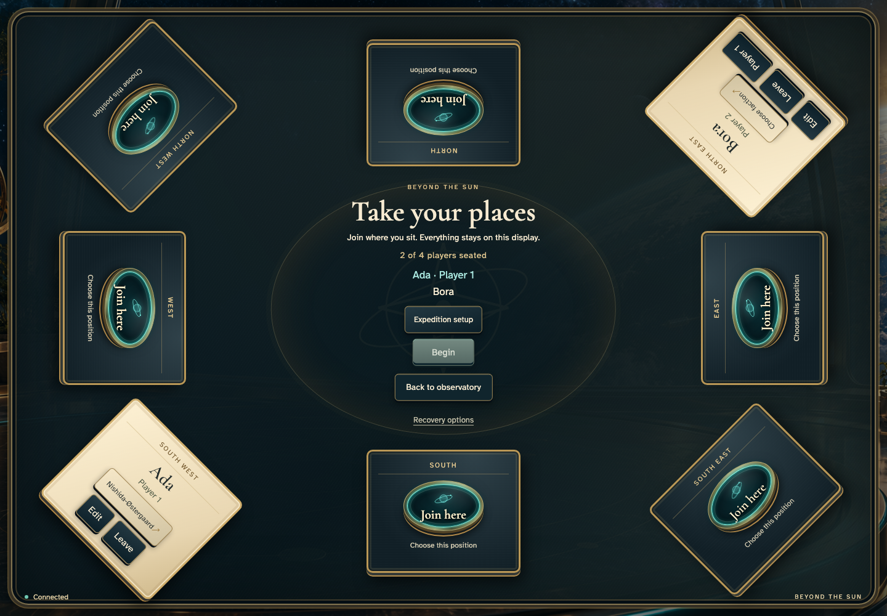](../../screenshots/retain-an-empty-outpost-without-ships-at-two-shared-corner-seats/010-faction-0-selected-desktop-darwin.png) |

tabletop-4k · 3840 × 2160

- [x] Ada chooses Nishida-Østergaard Corporation
- [x] Actual canonical effects and acknowledgement settle.
- [x] Public topology retains physical separation.
- [x] The viewport fits without page scrolling.

## 12. Choose a legal unique Basic faction

Viewpoint: **Bora · North East · one shared controller**.

| desktop · 1440 × 1000 |
| --- |
|  |

tabletop-4k · 3840 × 2160

- [x] Choose a legal unique Basic faction
- [x] Actual canonical effects and acknowledgement settle.
- [x] Public topology retains physical separation.
- [x] The viewport fits without page scrolling.

## 13. Bora chooses The Zheng-Yi Brotherhood

Viewpoint: **Bora · North East · one shared controller**.

| desktop · 1440 × 1000 |
| --- |
| [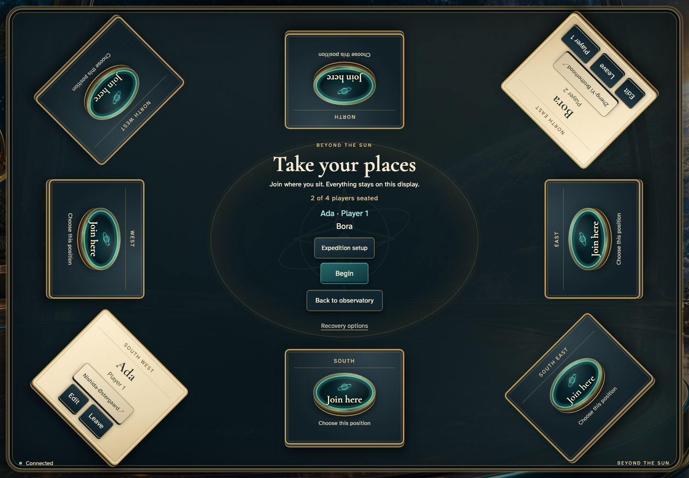](../../screenshots/retain-an-empty-outpost-without-ships-at-two-shared-corner-seats/012-faction-1-selected-desktop-darwin.png) |

tabletop-4k · 3840 × 2160

[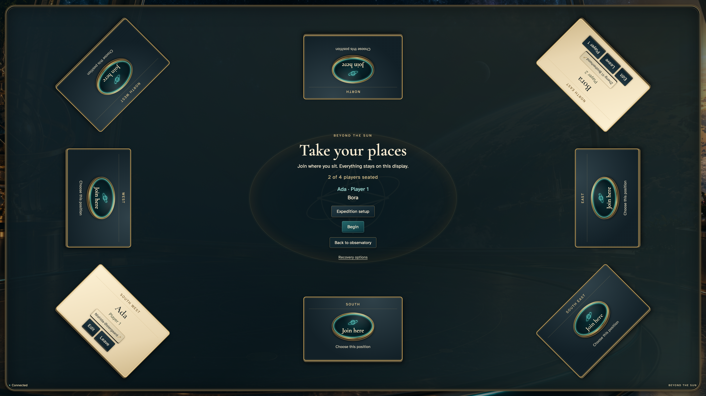](../../screenshots/retain-an-empty-outpost-without-ships-at-two-shared-corner-seats/012-faction-1-selected-tabletop-4k-darwin.png)

- [x] Bora chooses The Zheng-Yi Brotherhood
- [x] Actual canonical effects and acknowledgement settle.
- [x] Public topology retains physical separation.
- [x] The viewport fits without page scrolling.

## 14. Begin the immutable Basic game through normal UI

Viewpoint: **Ada · South West · one shared controller**.

| desktop · 1440 × 1000 |
| --- |
| [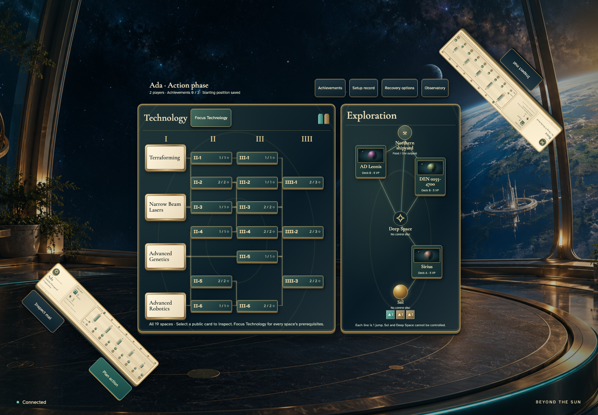](../../screenshots/retain-an-empty-outpost-without-ships-at-two-shared-corner-seats/013-begun-desktop-darwin.png) |

tabletop-4k · 3840 × 2160

[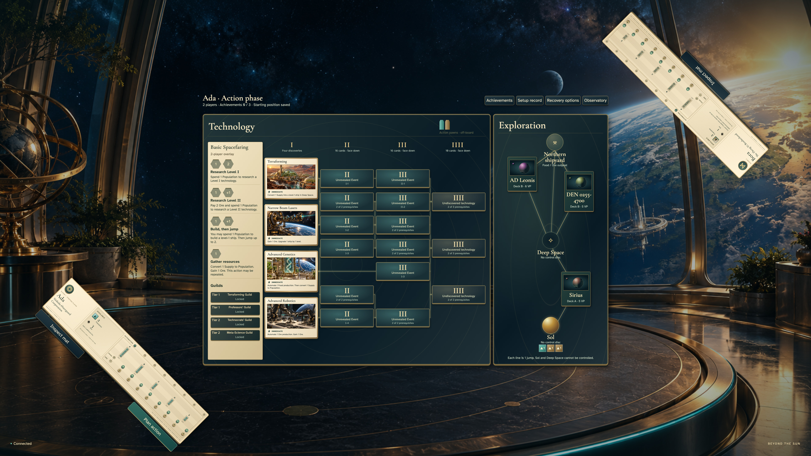](../../screenshots/retain-an-empty-outpost-without-ships-at-two-shared-corner-seats/013-begun-tabletop-4k-darwin.png)

- [x] Begin the immutable Basic game through normal UI
- [x] Actual canonical effects and acknowledgement settle.
- [x] Public topology retains physical separation.
- [x] The viewport fits without page scrolling.

## 15. Ada opens the real Action instrument

Viewpoint: **Ada · South West · one shared controller**.

| desktop · 1440 × 1000 |
| --- |
| [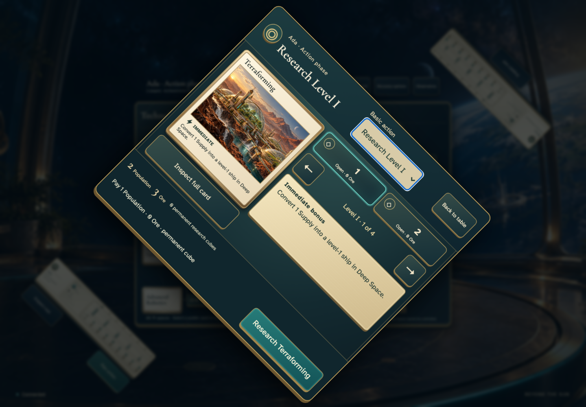](../../screenshots/retain-an-empty-outpost-without-ships-at-two-shared-corner-seats/014-claim-single-open-desktop-darwin.png) |

tabletop-4k · 3840 × 2160

[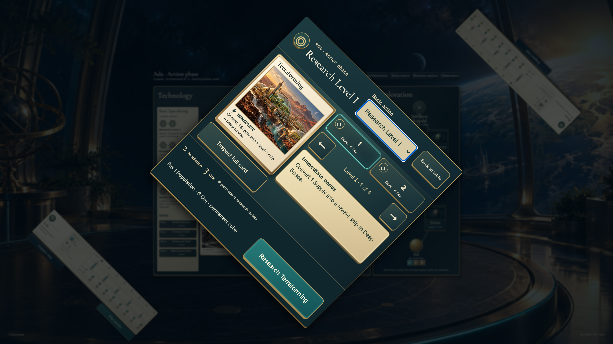](../../screenshots/retain-an-empty-outpost-without-ships-at-two-shared-corner-seats/014-claim-single-open-tabletop-4k-darwin.png)

- [x] Ada opens the real Action instrument
- [x] Actual canonical effects and acknowledgement settle.
- [x] Public topology retains physical separation.
- [x] The viewport fits without page scrolling.

## 16. Ada chooses Basic build and jump

Viewpoint: **Ada · South West · one shared controller**.

| desktop · 1440 × 1000 |
| --- |
| [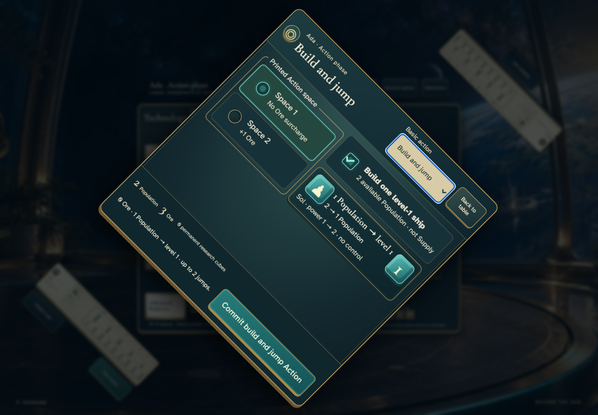](../../screenshots/retain-an-empty-outpost-without-ships-at-two-shared-corner-seats/015-claim-single-kind-desktop-darwin.png) |

tabletop-4k · 3840 × 2160

[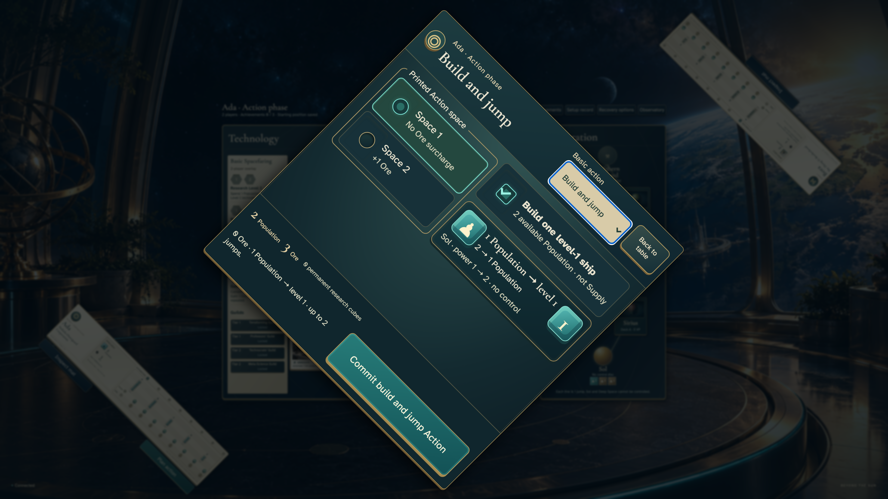](../../screenshots/retain-an-empty-outpost-without-ships-at-two-shared-corner-seats/015-claim-single-kind-tabletop-4k-darwin.png)

- [x] Ada chooses Basic build and jump
- [x] Actual canonical effects and acknowledgement settle.
- [x] Public topology retains physical separation.
- [x] The viewport fits without page scrolling.

## 17. Use the existing fleet without converting another Population cube

Viewpoint: **Ada · South West · one shared controller**.

| desktop · 1440 × 1000 |
| --- |
| [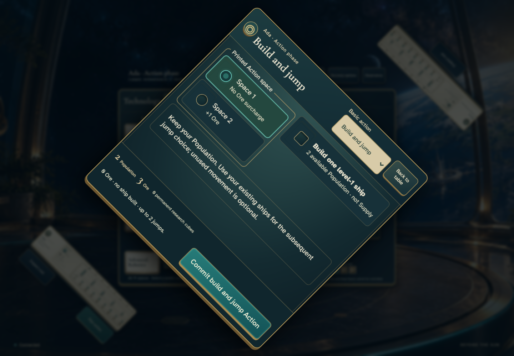](../../screenshots/retain-an-empty-outpost-without-ships-at-two-shared-corner-seats/016-claim-single-no-build-desktop-darwin.png) |

tabletop-4k · 3840 × 2160

- [x] Use the existing fleet without converting another Population cube
- [x] Actual canonical effects and acknowledgement settle.
- [x] Public topology retains physical separation.
- [x] The viewport fits without page scrolling.

## 18. Commit the actual Population conversion and printed space cost before optional movement

Viewpoint: **Ada · South West · one shared controller**.

| desktop · 1440 × 1000 |
| --- |
|  |

tabletop-4k · 3840 × 2160

[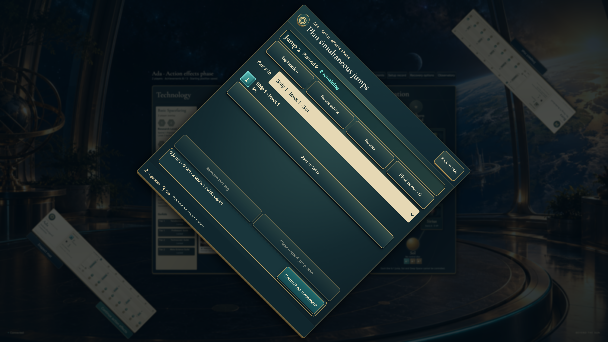](../../screenshots/retain-an-empty-outpost-without-ships-at-two-shared-corner-seats/017-claim-single-built-tabletop-4k-darwin.png)

- [x] Commit the actual Population conversion and printed space cost before optional movement
- [x] Actual canonical effects and acknowledgement settle.
- [x] Public topology retains physical separation.
- [x] The viewport fits without page scrolling.

## 19. Read the complete public map before choosing a connected route

Viewpoint: **Ada · South West · one shared controller**.

| desktop · 1440 × 1000 |
| --- |
|  |

tabletop-4k · 3840 × 2160

[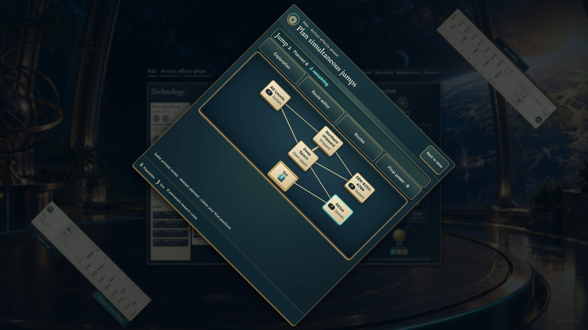](../../screenshots/retain-an-empty-outpost-without-ships-at-two-shared-corner-seats/018-claim-single-map-tabletop-4k-darwin.png)

- [x] Read the complete public map before choosing a connected route
- [x] Actual canonical effects and acknowledgement settle.
- [x] Public topology retains physical separation.
- [x] The viewport fits without page scrolling.

## 20. Read the actual connected destinations in this interface

Viewpoint: **Ada · South West · one shared controller**.

| desktop · 1440 × 1000 |
| --- |
| [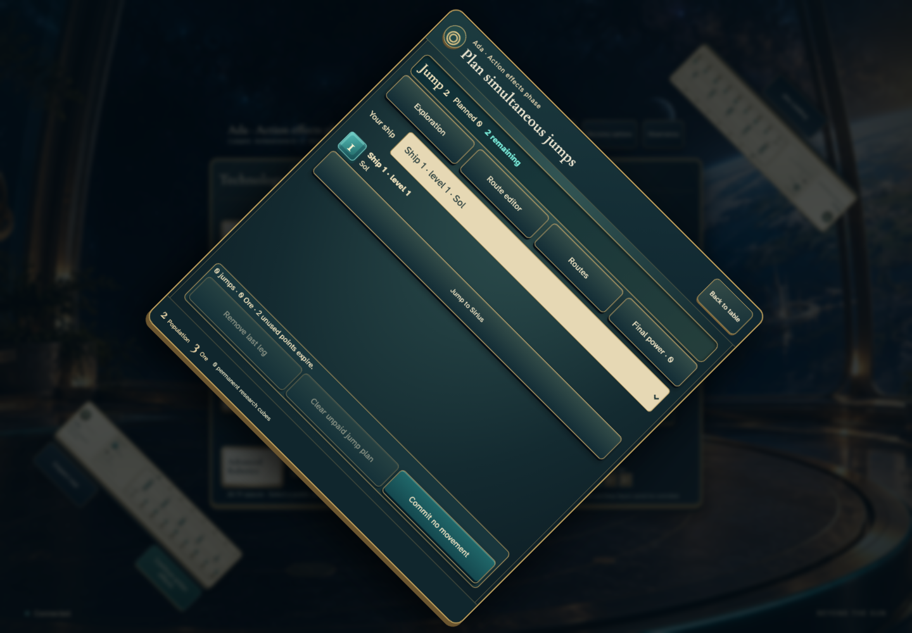](../../screenshots/retain-an-empty-outpost-without-ships-at-two-shared-corner-seats/019-claim-single-editor-desktop-darwin.png) |

tabletop-4k · 3840 × 2160

- [x] Read the actual connected destinations in this interface
- [x] Actual canonical effects and acknowledgement settle.
- [x] Public topology retains physical separation.
- [x] The viewport fits without page scrolling.

## 21. Choose a real owned ship for this unpaid route

Viewpoint: **Ada · South West · one shared controller**.

| desktop · 1440 × 1000 |
| --- |
|  |

tabletop-4k · 3840 × 2160

- [x] Choose a real owned ship for this unpaid route
- [x] Actual canonical effects and acknowledgement settle.
- [x] Public topology retains physical separation.
- [x] The viewport fits without page scrolling.

## 22. Plan Sirius as an endpoint; nothing moves yet

Viewpoint: **Ada · South West · one shared controller**.

| desktop · 1440 × 1000 |
| --- |
|  |

tabletop-4k · 3840 × 2160

[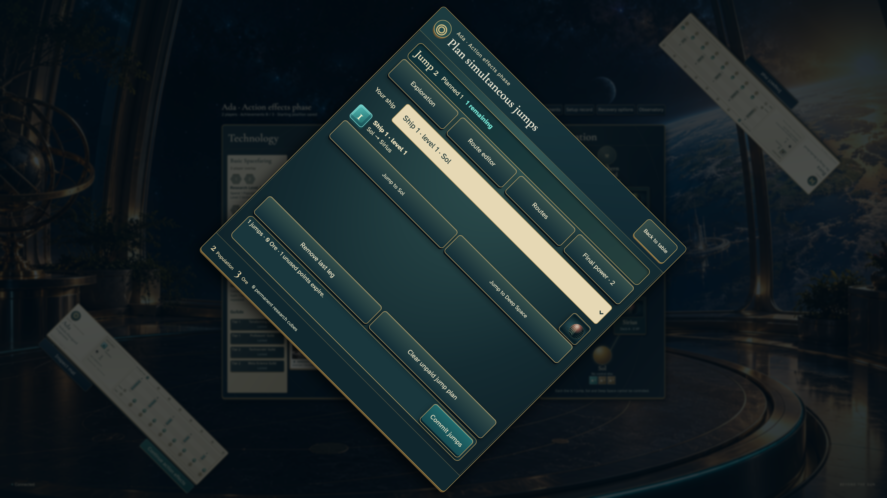](../../screenshots/retain-an-empty-outpost-without-ships-at-two-shared-corner-seats/021-claim-endpoint-endpoint-tabletop-4k-darwin.png)

- [x] Plan Sirius as an endpoint; nothing moves yet
- [x] Actual canonical effects and acknowledgement settle.
- [x] Public topology retains physical separation.
- [x] The viewport fits without page scrolling.

## 23. Claim Sirius with one ship and receive its gain-control bonus

Viewpoint: **Ada · South West · one shared controller**.

| desktop · 1440 × 1000 |
| --- |
| [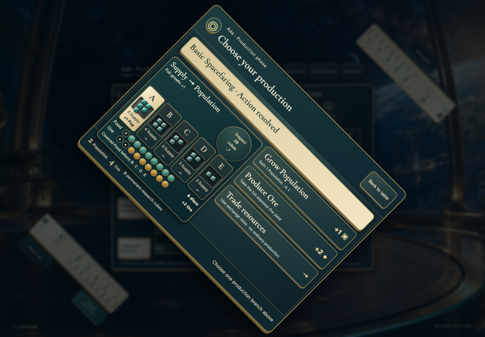](../../screenshots/retain-an-empty-outpost-without-ships-at-two-shared-corner-seats/022-empty-claim-desktop-darwin.png) |

tabletop-4k · 3840 × 2160

[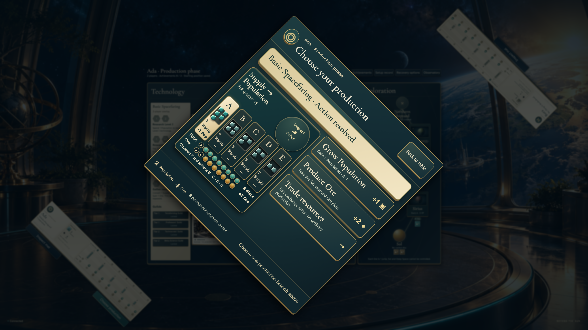](../../screenshots/retain-an-empty-outpost-without-ships-at-two-shared-corner-seats/022-empty-claim-tabletop-4k-darwin.png)

- [x] Claim Sirius with one ship and receive its gain-control bonus
- [x] Actual canonical effects and acknowledgement settle.
- [x] Public topology retains physical separation.
- [x] The viewport fits without page scrolling.

## 24. Ada chooses ordinary Ore production and hands off

Viewpoint: **Ada · South West · one shared controller**.

| desktop · 1440 × 1000 |
| --- |
| [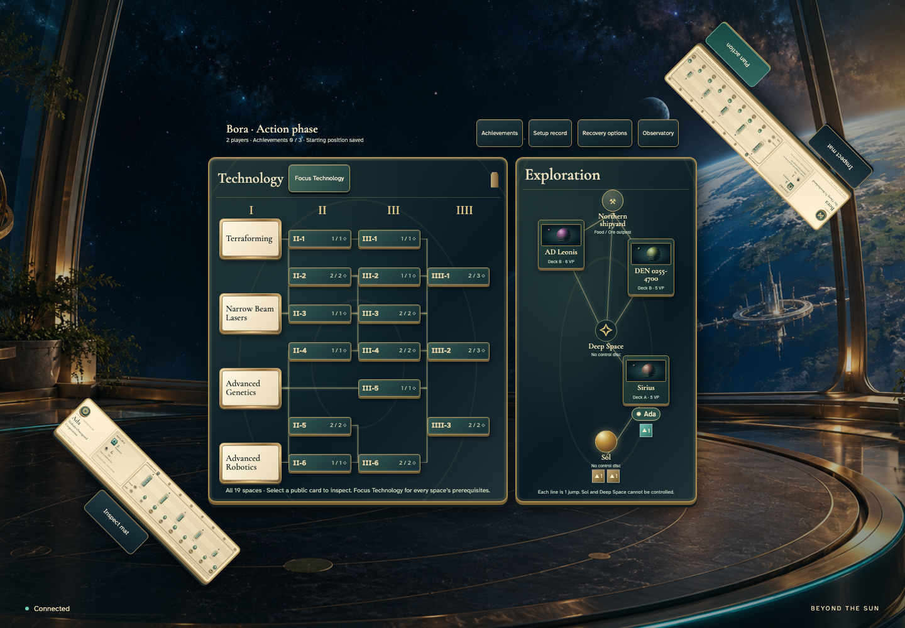](../../screenshots/retain-an-empty-outpost-without-ships-at-two-shared-corner-seats/023-empty-claim-handoff-desktop-darwin.png) |

tabletop-4k · 3840 × 2160

[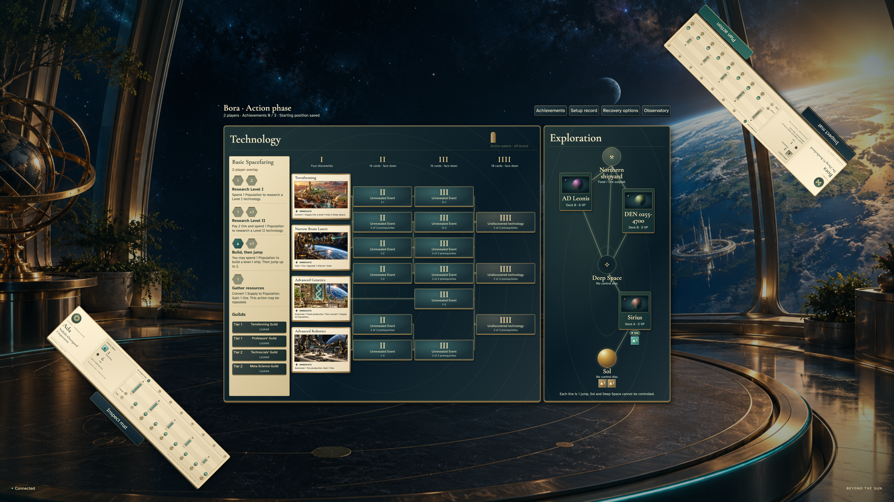](../../screenshots/retain-an-empty-outpost-without-ships-at-two-shared-corner-seats/023-empty-claim-handoff-tabletop-4k-darwin.png)

- [x] Ada chooses ordinary Ore production and hands off
- [x] Actual canonical effects and acknowledgement settle.
- [x] Public topology retains physical separation.
- [x] The viewport fits without page scrolling.

## 25. Bora opens the real Action instrument

Viewpoint: **Bora · North East · one shared controller**.

| desktop · 1440 × 1000 |
| --- |
| [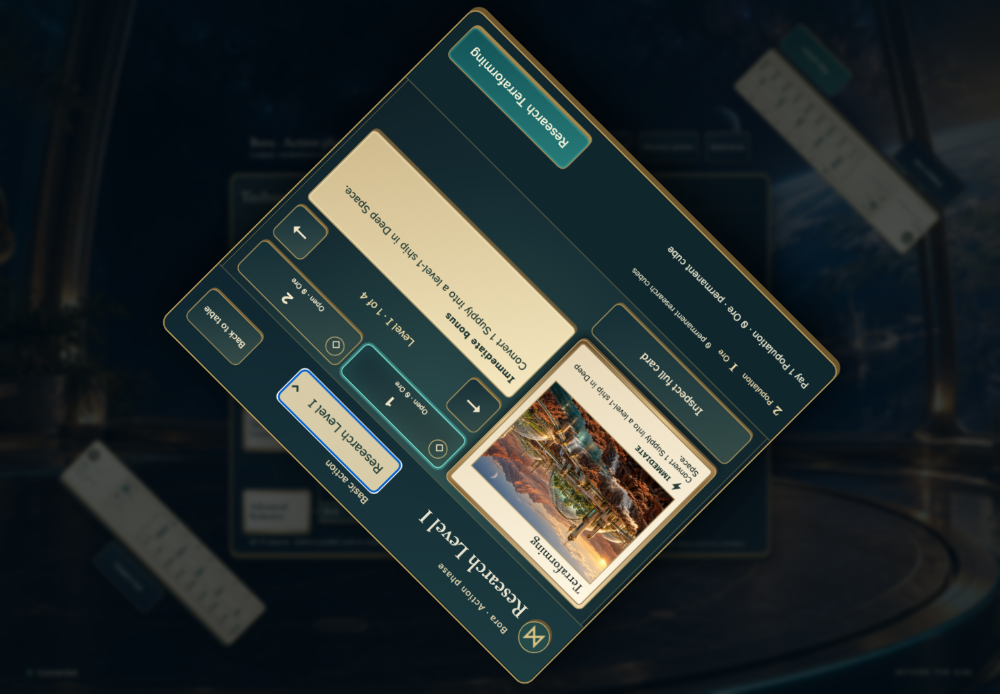](../../screenshots/retain-an-empty-outpost-without-ships-at-two-shared-corner-seats/024-empty-bora-open-desktop-darwin.png) |

tabletop-4k · 3840 × 2160

[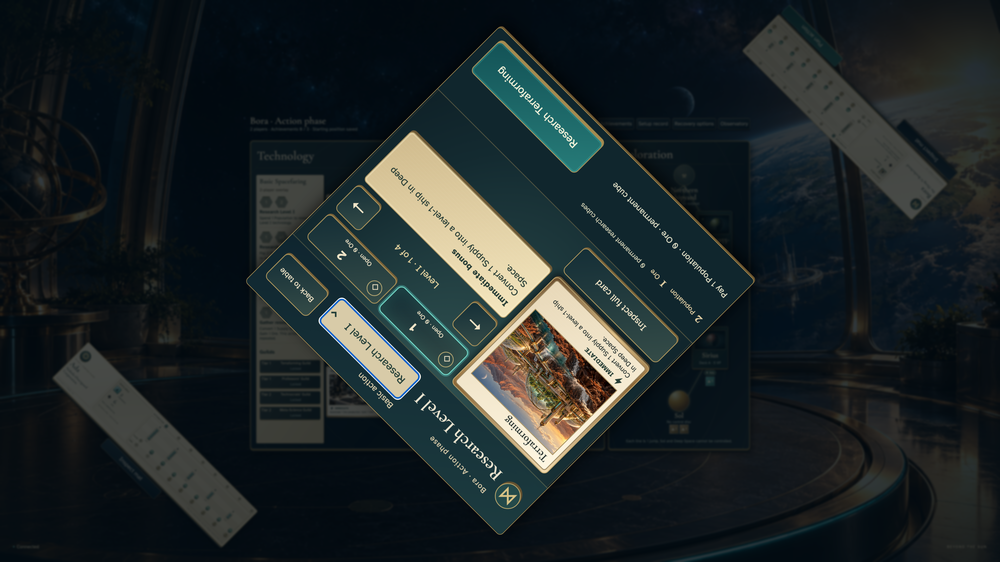](../../screenshots/retain-an-empty-outpost-without-ships-at-two-shared-corner-seats/024-empty-bora-open-tabletop-4k-darwin.png)

- [x] Bora opens the real Action instrument
- [x] Actual canonical effects and acknowledgement settle.
- [x] Public topology retains physical separation.
- [x] The viewport fits without page scrolling.

## 26. Bora chooses Gather

Viewpoint: **Bora · North East · one shared controller**.

| desktop · 1440 × 1000 |
| --- |
| [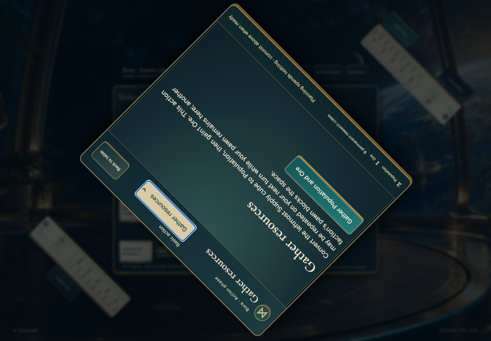](../../screenshots/retain-an-empty-outpost-without-ships-at-two-shared-corner-seats/025-empty-bora-kind-desktop-darwin.png) |

tabletop-4k · 3840 × 2160

[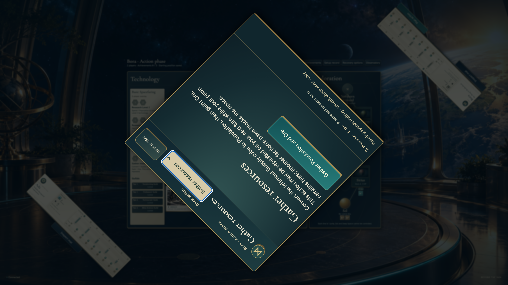](../../screenshots/retain-an-empty-outpost-without-ships-at-two-shared-corner-seats/025-empty-bora-kind-tabletop-4k-darwin.png)

- [x] Bora chooses Gather
- [x] Actual canonical effects and acknowledgement settle.
- [x] Public topology retains physical separation.
- [x] The viewport fits without page scrolling.

## 27. A real intervening opponent turn leaves Sirius untouched

Viewpoint: **Bora · North East · one shared controller**.

| desktop · 1440 × 1000 |
| --- |
| [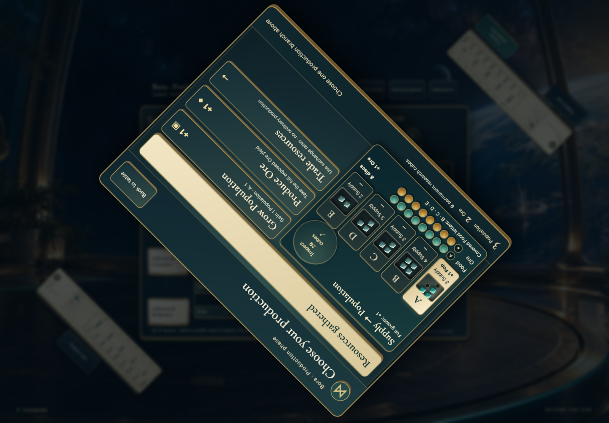](../../screenshots/retain-an-empty-outpost-without-ships-at-two-shared-corner-seats/026-empty-bora-gather-desktop-darwin.png) |

tabletop-4k · 3840 × 2160

[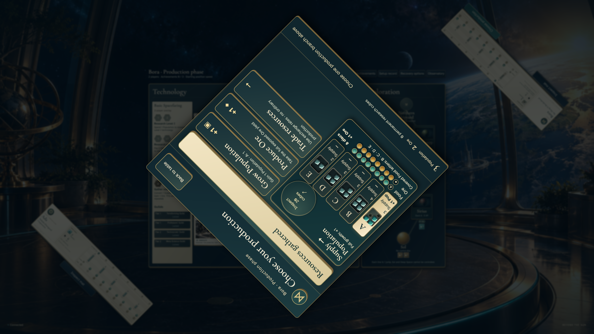](../../screenshots/retain-an-empty-outpost-without-ships-at-two-shared-corner-seats/026-empty-bora-gather-tabletop-4k-darwin.png)

- [x] A real intervening opponent turn leaves Sirius untouched
- [x] Actual canonical effects and acknowledgement settle.
- [x] Public topology retains physical separation.
- [x] The viewport fits without page scrolling.

## 28. Bora chooses ordinary Ore production and hands off

Viewpoint: **Bora · North East · one shared controller**.

| desktop · 1440 × 1000 |
| --- |
| [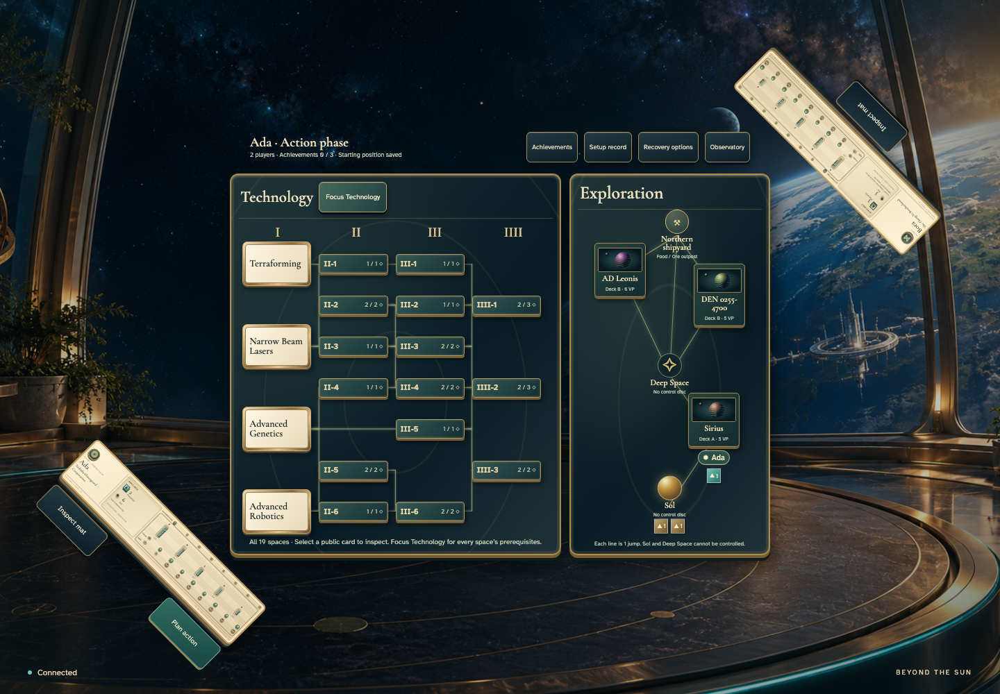](../../screenshots/retain-an-empty-outpost-without-ships-at-two-shared-corner-seats/027-empty-bora-handoff-desktop-darwin.png) |

tabletop-4k · 3840 × 2160

- [x] Bora chooses ordinary Ore production and hands off
- [x] Actual canonical effects and acknowledgement settle.
- [x] Public topology retains physical separation.
- [x] The viewport fits without page scrolling.

## 29. Ada opens the real Action instrument

Viewpoint: **Ada · South West · one shared controller**.

| desktop · 1440 × 1000 |
| --- |
|  |

tabletop-4k · 3840 × 2160

[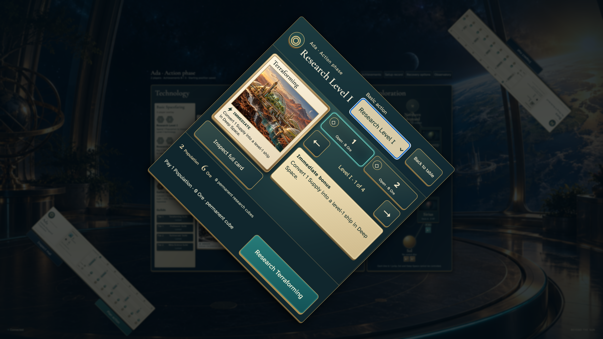](../../screenshots/retain-an-empty-outpost-without-ships-at-two-shared-corner-seats/028-empty-depart-open-tabletop-4k-darwin.png)

- [x] Ada opens the real Action instrument
- [x] Actual canonical effects and acknowledgement settle.
- [x] Public topology retains physical separation.
- [x] The viewport fits without page scrolling.

## 30. Ada chooses Basic build and jump

Viewpoint: **Ada · South West · one shared controller**.

| desktop · 1440 × 1000 |
| --- |
| [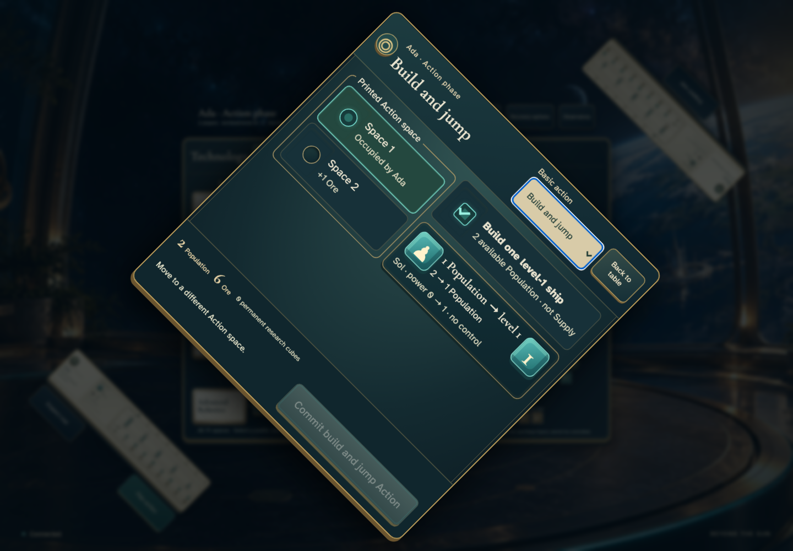](../../screenshots/retain-an-empty-outpost-without-ships-at-two-shared-corner-seats/029-empty-depart-kind-desktop-darwin.png) |

tabletop-4k · 3840 × 2160

[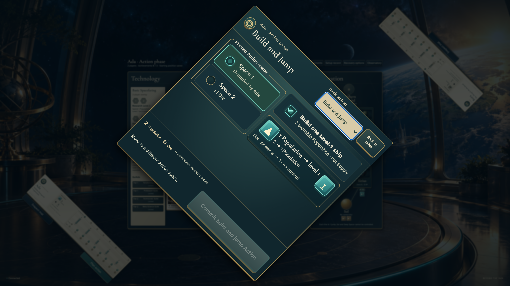](../../screenshots/retain-an-empty-outpost-without-ships-at-two-shared-corner-seats/029-empty-depart-kind-tabletop-4k-darwin.png)

- [x] Ada chooses Basic build and jump
- [x] Actual canonical effects and acknowledgement settle.
- [x] Public topology retains physical separation.
- [x] The viewport fits without page scrolling.

## 31. Choose the unoccupied second printed space with its real surcharge

Viewpoint: **Ada · South West · one shared controller**.

| desktop · 1440 × 1000 |
| --- |
| [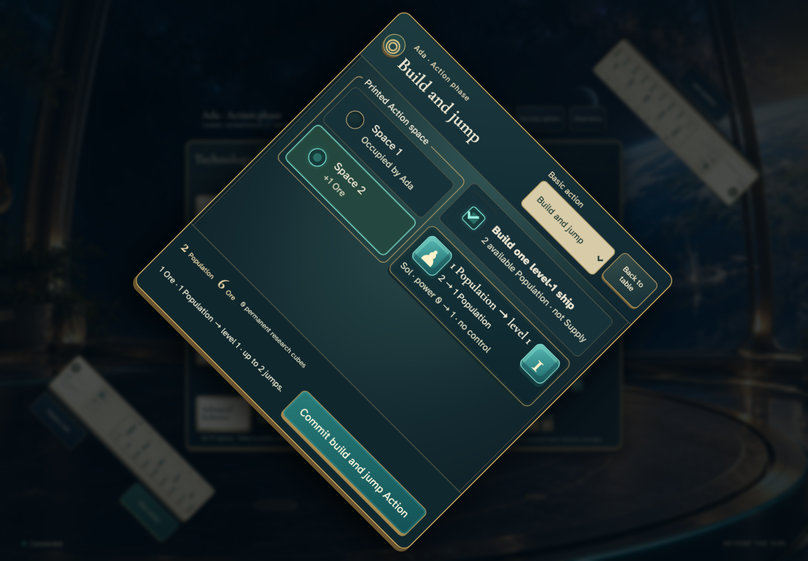](../../screenshots/retain-an-empty-outpost-without-ships-at-two-shared-corner-seats/030-empty-depart-space-desktop-darwin.png) |

tabletop-4k · 3840 × 2160

[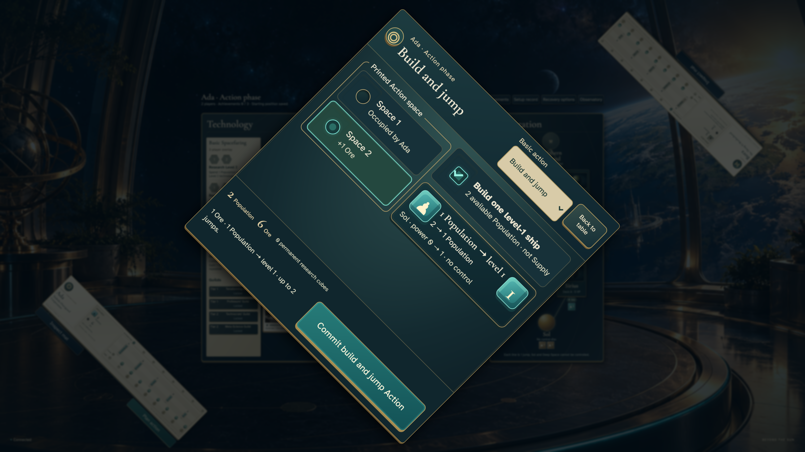](../../screenshots/retain-an-empty-outpost-without-ships-at-two-shared-corner-seats/030-empty-depart-space-tabletop-4k-darwin.png)

- [x] Choose the unoccupied second printed space with its real surcharge
- [x] Actual canonical effects and acknowledgement settle.
- [x] Public topology retains physical separation.
- [x] The viewport fits without page scrolling.

## 32. Use the existing fleet without converting another Population cube

Viewpoint: **Ada · South West · one shared controller**.

| desktop · 1440 × 1000 |
| --- |
| [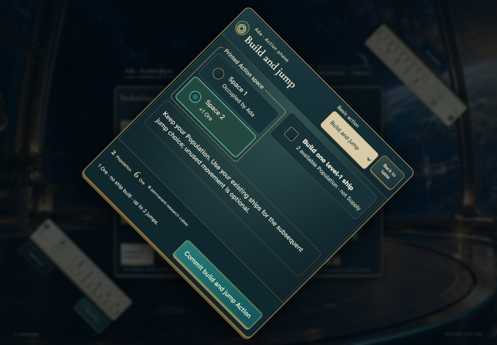](../../screenshots/retain-an-empty-outpost-without-ships-at-two-shared-corner-seats/031-empty-depart-no-build-desktop-darwin.png) |

tabletop-4k · 3840 × 2160

[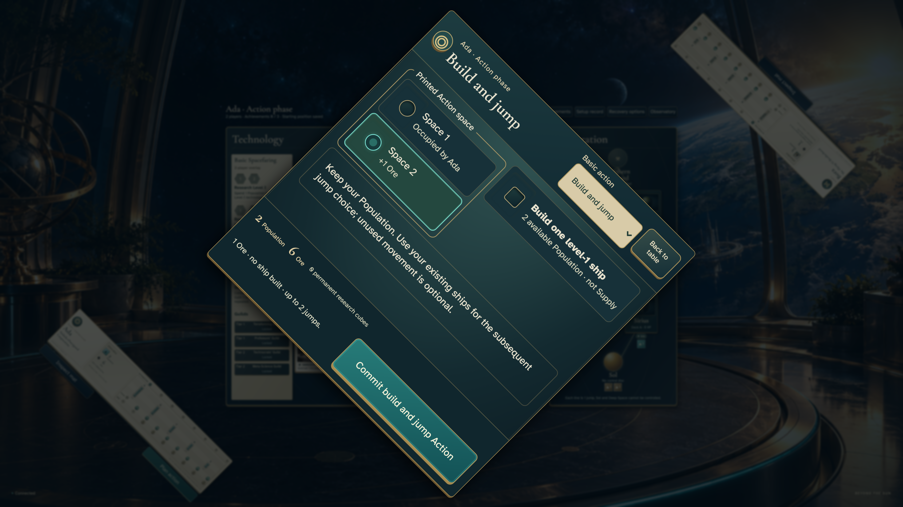](../../screenshots/retain-an-empty-outpost-without-ships-at-two-shared-corner-seats/031-empty-depart-no-build-tabletop-4k-darwin.png)

- [x] Use the existing fleet without converting another Population cube
- [x] Actual canonical effects and acknowledgement settle.
- [x] Public topology retains physical separation.
- [x] The viewport fits without page scrolling.

## 33. Commit the actual Population conversion and printed space cost before optional movement

Viewpoint: **Ada · South West · one shared controller**.

| desktop · 1440 × 1000 |
| --- |
| [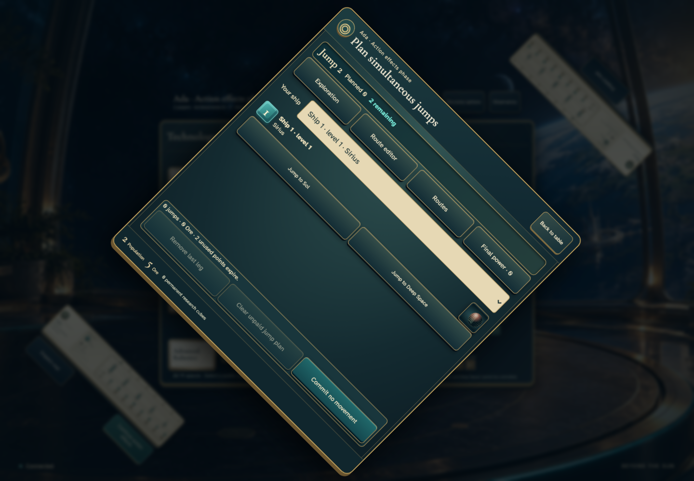](../../screenshots/retain-an-empty-outpost-without-ships-at-two-shared-corner-seats/032-empty-depart-built-desktop-darwin.png) |

tabletop-4k · 3840 × 2160

- [x] Commit the actual Population conversion and printed space cost before optional movement
- [x] Actual canonical effects and acknowledgement settle.
- [x] Public topology retains physical separation.
- [x] The viewport fits without page scrolling.

## 34. Read the complete public map before choosing a connected route

Viewpoint: **Ada · South West · one shared controller**.

| desktop · 1440 × 1000 |
| --- |
| [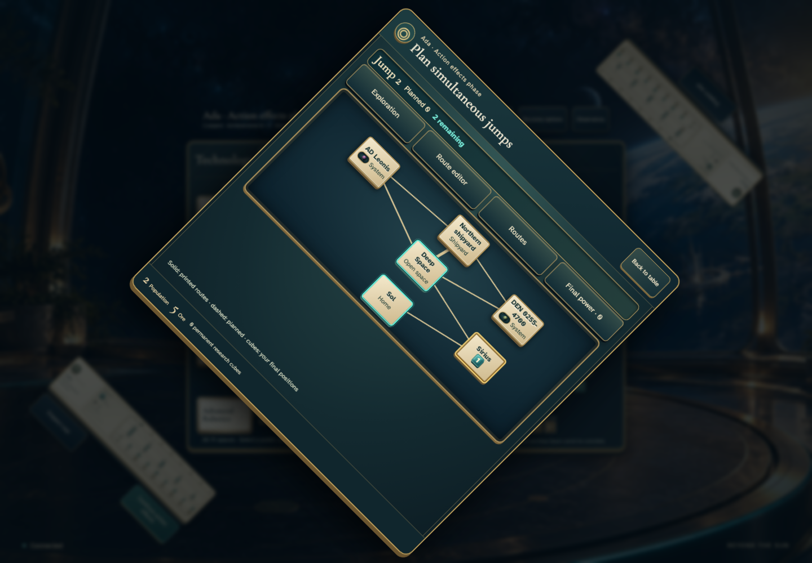](../../screenshots/retain-an-empty-outpost-without-ships-at-two-shared-corner-seats/033-empty-depart-map-desktop-darwin.png) |

tabletop-4k · 3840 × 2160

[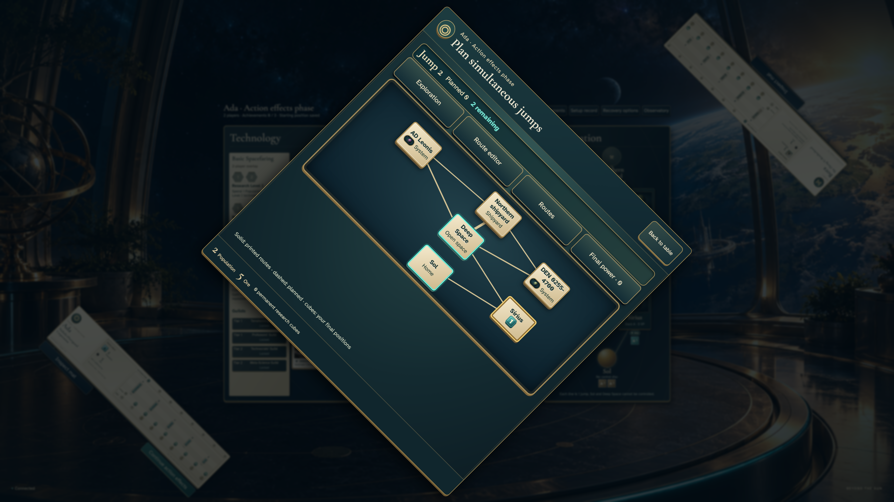](../../screenshots/retain-an-empty-outpost-without-ships-at-two-shared-corner-seats/033-empty-depart-map-tabletop-4k-darwin.png)

- [x] Read the complete public map before choosing a connected route
- [x] Actual canonical effects and acknowledgement settle.
- [x] Public topology retains physical separation.
- [x] The viewport fits without page scrolling.

## 35. Read the actual connected destinations in this interface

Viewpoint: **Ada · South West · one shared controller**.

| desktop · 1440 × 1000 |
| --- |
|  |

tabletop-4k · 3840 × 2160

[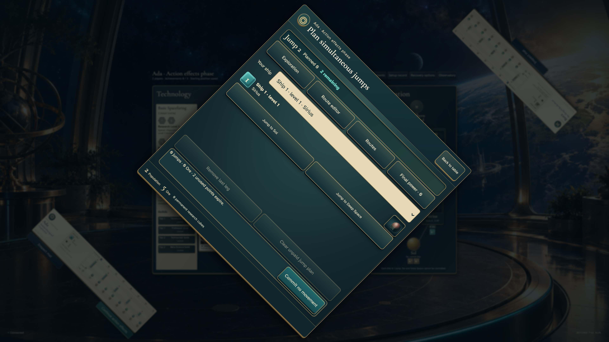](../../screenshots/retain-an-empty-outpost-without-ships-at-two-shared-corner-seats/034-empty-depart-editor-tabletop-4k-darwin.png)

- [x] Read the actual connected destinations in this interface
- [x] Actual canonical effects and acknowledgement settle.
- [x] Public topology retains physical separation.
- [x] The viewport fits without page scrolling.

## 36. Choose a real owned ship for this unpaid route

Viewpoint: **Ada · South West · one shared controller**.

| desktop · 1440 × 1000 |
| --- |
|  |

tabletop-4k · 3840 × 2160

- [x] Choose a real owned ship for this unpaid route
- [x] Actual canonical effects and acknowledgement settle.
- [x] Public topology retains physical separation.
- [x] The viewport fits without page scrolling.

## 37. Plan Sol as an endpoint; nothing moves yet

Viewpoint: **Ada · South West · one shared controller**.

| desktop · 1440 × 1000 |
| --- |
| [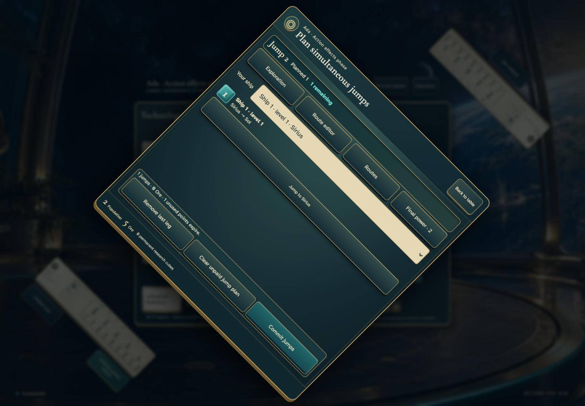](../../screenshots/retain-an-empty-outpost-without-ships-at-two-shared-corner-seats/036-empty-sol-endpoint-desktop-darwin.png) |

tabletop-4k · 3840 × 2160

[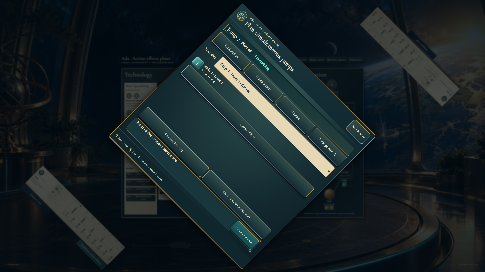](../../screenshots/retain-an-empty-outpost-without-ships-at-two-shared-corner-seats/036-empty-sol-endpoint-tabletop-4k-darwin.png)

- [x] Plan Sol as an endpoint; nothing moves yet
- [x] Actual canonical effects and acknowledgement settle.
- [x] Public topology retains physical separation.
- [x] The viewport fits without page scrolling.

## 38. The only incumbent ship leaves an otherwise empty System

Viewpoint: **Ada · South West · one shared controller**.

| desktop · 1440 × 1000 |
| --- |
|  |

tabletop-4k · 3840 × 2160

[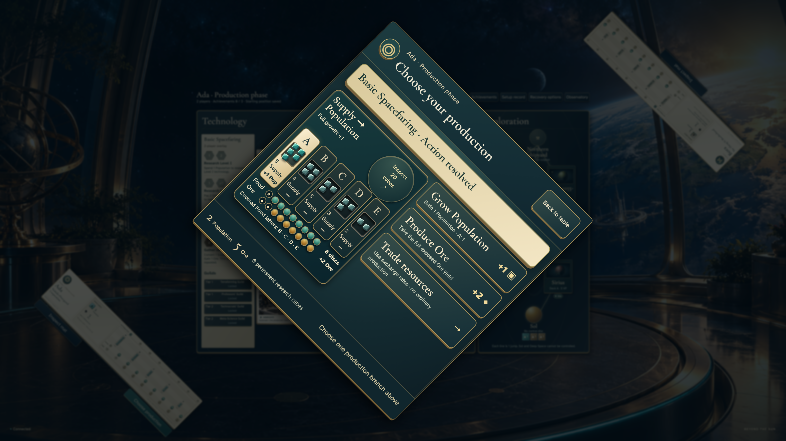](../../screenshots/retain-an-empty-outpost-without-ships-at-two-shared-corner-seats/037-empty-withdrawn-tabletop-4k-darwin.png)

- [x] The only incumbent ship leaves an otherwise empty System
- [x] Actual canonical effects and acknowledgement settle.
- [x] Public topology retains physical separation.
- [x] The viewport fits without page scrolling.

## 39. Choose Trade instead of ordinary growth or Ore production

Viewpoint: **Ada · South West · one shared controller**.

| desktop · 1440 × 1000 |
| --- |
| [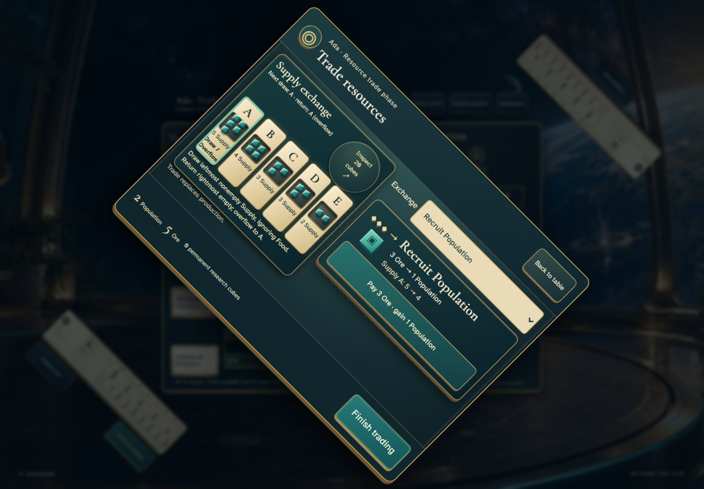](../../screenshots/retain-an-empty-outpost-without-ships-at-two-shared-corner-seats/038-empty-trade-desktop-darwin.png) |

tabletop-4k · 3840 × 2160

[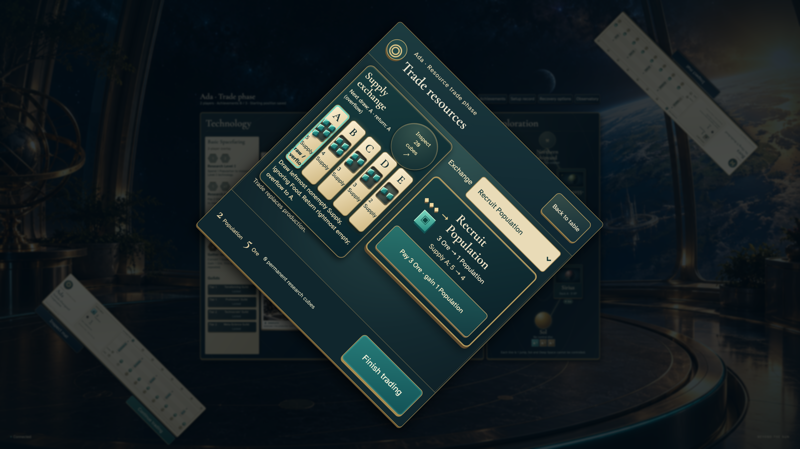](../../screenshots/retain-an-empty-outpost-without-ships-at-two-shared-corner-seats/038-empty-trade-tabletop-4k-darwin.png)

- [x] Choose Trade instead of ordinary growth or Ore production
- [x] Actual canonical effects and acknowledgement settle.
- [x] Public topology retains physical separation.
- [x] The viewport fits without page scrolling.

## 40. Review the printed ship-decommission exchange in this interface

Viewpoint: **Ada · South West · one shared controller**.

| desktop · 1440 × 1000 |
| --- |
| [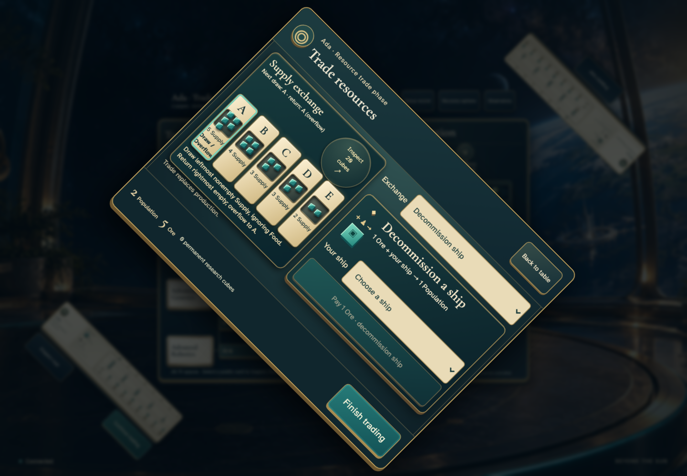](../../screenshots/retain-an-empty-outpost-without-ships-at-two-shared-corner-seats/039-empty-last-ship-exchange-desktop-darwin.png) |

tabletop-4k · 3840 × 2160

- [x] Review the printed ship-decommission exchange in this interface
- [x] Actual canonical effects and acknowledgement settle.
- [x] Public topology retains physical separation.
- [x] The viewport fits without page scrolling.

## 41. Review the owned ship and its control consequence before paying

Viewpoint: **Ada · South West · one shared controller**.

| desktop · 1440 × 1000 |
| --- |
| [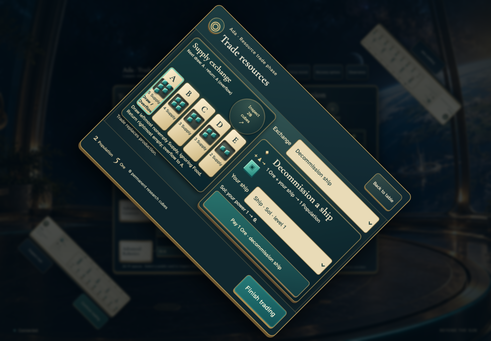](../../screenshots/retain-an-empty-outpost-without-ships-at-two-shared-corner-seats/040-empty-last-ship-selected-desktop-darwin.png) |

tabletop-4k · 3840 × 2160

[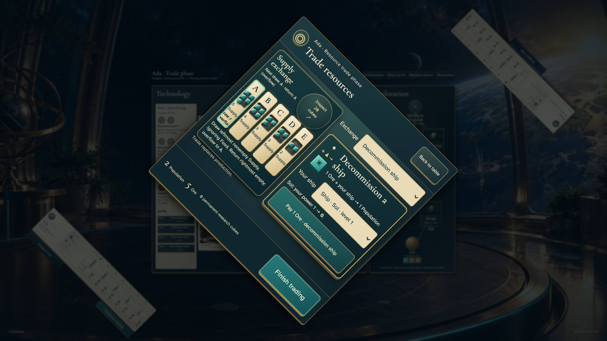](../../screenshots/retain-an-empty-outpost-without-ships-at-two-shared-corner-seats/040-empty-last-ship-selected-tabletop-4k-darwin.png)

- [x] Review the owned ship and its control consequence before paying
- [x] Actual canonical effects and acknowledgement settle.
- [x] Public topology retains physical separation.
- [x] The viewport fits without page scrolling.

## 42. Pay one Ore and return the last owned ship to Population

Viewpoint: **Ada · South West · one shared controller**.

| desktop · 1440 × 1000 |
| --- |
|  |

tabletop-4k · 3840 × 2160

[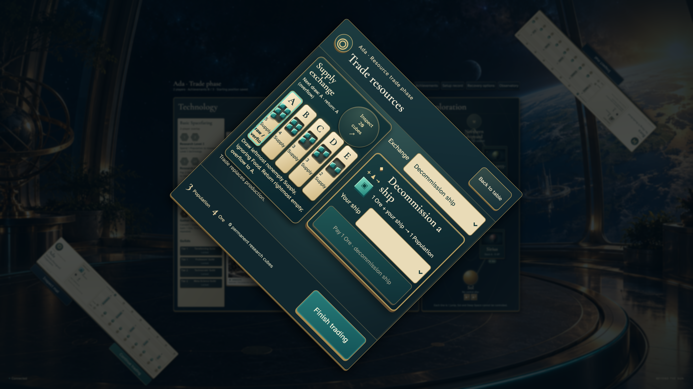](../../screenshots/retain-an-empty-outpost-without-ships-at-two-shared-corner-seats/041-empty-paid-tabletop-4k-darwin.png)

- [x] Pay one Ore and return the last owned ship to Population
- [x] Actual canonical effects and acknowledgement settle.
- [x] Public topology retains physical separation.
- [x] The viewport fits without page scrolling.

## 43. Leave the trade open while inspecting the retained outpost

Viewpoint: **Ada · South West · one shared controller**.

| desktop · 1440 × 1000 |
| --- |
|  |

tabletop-4k · 3840 × 2160

- [x] Leave the trade open while inspecting the retained outpost
- [x] Actual canonical effects and acknowledgement settle.
- [x] Public topology retains physical separation.
- [x] The viewport fits without page scrolling.

## 44. Ada inspects the actual production discs

Viewpoint: **Ada · South West · one shared controller**.

| desktop · 1440 × 1000 |
| --- |
| [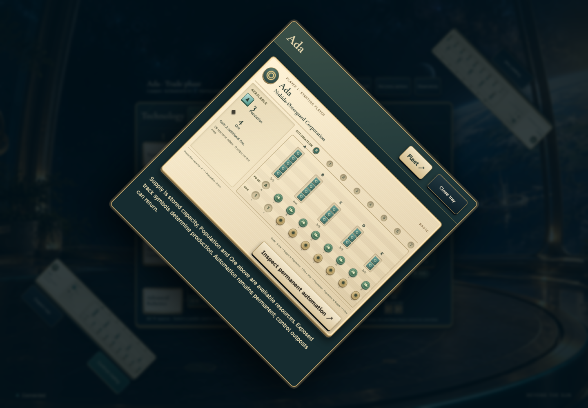](../../screenshots/retain-an-empty-outpost-without-ships-at-two-shared-corner-seats/043-empty-retained-mat-desktop-darwin.png) |

tabletop-4k · 3840 × 2160

[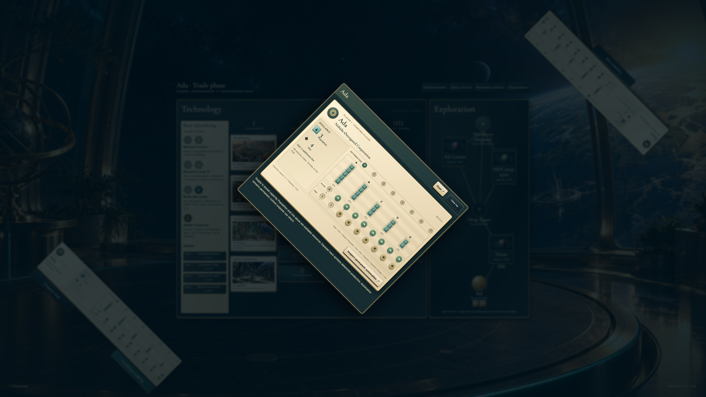](../../screenshots/retain-an-empty-outpost-without-ships-at-two-shared-corner-seats/043-empty-retained-mat-tabletop-4k-darwin.png)

- [x] Ada inspects the actual production discs
- [x] Actual canonical effects and acknowledgement settle.
- [x] Public topology retains physical separation.
- [x] The viewport fits without page scrolling.

## 45. Open the reusable public fleet inspection

Viewpoint: **Ada · South West · one shared controller**.

| desktop · 1440 × 1000 |
| --- |
|  |

tabletop-4k · 3840 × 2160

- [x] Open the reusable public fleet inspection
- [x] Actual canonical effects and acknowledgement settle.
- [x] Public topology retains physical separation.
- [x] The viewport fits without page scrolling.

## 46. Read saved disc ownership separately from current summed fleet power

Viewpoint: **Ada · South West · one shared controller**.

| desktop · 1440 × 1000 |
| --- |
|  |

tabletop-4k · 3840 × 2160

- [x] Read saved disc ownership separately from current summed fleet power
- [x] Actual canonical effects and acknowledgement settle.
- [x] Public topology retains physical separation.
- [x] The viewport fits without page scrolling.

## 47. Inspect every faction’s actual level sum and the incumbent’s disc

Viewpoint: **Ada · South West · one shared controller**.

| desktop · 1440 × 1000 |
| --- |
|  |

tabletop-4k · 3840 × 2160

- [x] Inspect every faction’s actual level sum and the incumbent’s disc
- [x] Actual canonical effects and acknowledgement settle.
- [x] Public topology retains physical separation.
- [x] The viewport fits without page scrolling.

## 48. Read the current conditional yields; an outpost does not pay regular production automatically

Viewpoint: **Ada · South West · one shared controller**.

| desktop · 1440 × 1000 |
| --- |
|  |

tabletop-4k · 3840 × 2160

- [x] Read the current conditional yields; an outpost does not pay regular production automatically
- [x] Actual canonical effects and acknowledgement settle.
- [x] Public topology retains physical separation.
- [x] The viewport fits without page scrolling.

## 49. Read the complete control rule and actual printed gain-control bonus

Viewpoint: **Ada · South West · one shared controller**.

| desktop · 1440 × 1000 |
| --- |
|  |

tabletop-4k · 3840 × 2160

- [x] Read the complete control rule and actual printed gain-control bonus
- [x] Actual canonical effects and acknowledgement settle.
- [x] Public topology retains physical separation.
- [x] The viewport fits without page scrolling.

## 50. Open the complete reusable fleet rules through semantic navigation

Viewpoint: **Ada · South West · one shared controller**.

| desktop · 1440 × 1000 |
| --- |
|  |

tabletop-4k · 3840 × 2160

- [x] Open the complete reusable fleet rules through semantic navigation
- [x] Actual canonical effects and acknowledgement settle.
- [x] Public topology retains physical separation.
- [x] The viewport fits without page scrolling.

## 51. Return to the real ship register without taking a turn

Viewpoint: **Ada · South West · one shared controller**.

| desktop · 1440 × 1000 |
| --- |
|  |

tabletop-4k · 3840 × 2160

- [x] Return to the real ship register without taking a turn
- [x] Actual canonical effects and acknowledgement settle.
- [x] Public topology retains physical separation.
- [x] The viewport fits without page scrolling.

## 52. Escape restores the exact fleet opener without taking a turn

Viewpoint: **Ada · South West · one shared controller**.

| desktop · 1440 × 1000 |
| --- |
|  |

tabletop-4k · 3840 × 2160

- [x] Escape restores the exact fleet opener without taking a turn
- [x] Actual canonical effects and acknowledgement settle.
- [x] Public topology retains physical separation.
- [x] The viewport fits without page scrolling.

## 53. Close the mat and restore its own opener

Viewpoint: **Ada · South West · one shared controller**.

| desktop · 1440 × 1000 |
| --- |
|  |

tabletop-4k · 3840 × 2160

- [x] Close the mat and restore its own opener
- [x] Actual canonical effects and acknowledgement settle.
- [x] Public topology retains physical separation.
- [x] The viewport fits without page scrolling.

## 54. Reload retains an outpost with no owned ships and pending Trade

Viewpoint: **Ada · South West · one shared controller**.

| desktop · 1440 × 1000 |
| --- |
|  |

tabletop-4k · 3840 × 2160

- [x] Reload retains an outpost with no owned ships and pending Trade
- [x] Actual canonical effects and acknowledgement settle.
- [x] Public topology retains physical separation.
- [x] The viewport fits without page scrolling.

## 55. Restore the exact paid balance without a Production payout

Viewpoint: **Ada · South West · one shared controller**.

| desktop · 1440 × 1000 |
| --- |
|  |

tabletop-4k · 3840 × 2160

- [x] Restore the exact paid balance without a Production payout
- [x] Actual canonical effects and acknowledgement settle.
- [x] Public topology retains physical separation.
- [x] The viewport fits without page scrolling.

## 56. Finish hands off without ordinary production

Viewpoint: **Ada · South West · one shared controller**.

| desktop · 1440 × 1000 |
| --- |
|  |

tabletop-4k · 3840 × 2160

- [x] Finish hands off without ordinary production
- [x] Actual canonical effects and acknowledgement settle.
- [x] Public topology retains physical separation.
- [x] The viewport fits without page scrolling.
