# Return an outpost during rival trade and retain automation at two shared cardinal seats

Exactly one shared controller; all local seats/factions/Begin through the actual table. Two players for incoming tie/later exceed, four for simultaneous two-System bonuses or Food/Ore specialty. Setup seed002 or004; command identities disjoint. No companion devices, state injection or future deck read.

## 1. Arrive through the actual production interface

Viewpoint: **Ada · South · one shared controller**.

| desktop · 1440 × 1000 |
| --- |
|  |

tabletop-4k · 3840 × 2160

- [x] Arrive through the actual production interface
- [x] Actual canonical effects and acknowledgement settle.
- [x] Public topology retains physical separation.
- [x] The viewport fits without page scrolling.

## 2. Choose physical tabletop or separate-controller remote play

Viewpoint: **Ada · South · one shared controller**.

| desktop · 1440 × 1000 |
| --- |
|  |

tabletop-4k · 3840 × 2160

- [x] Choose physical tabletop or separate-controller remote play
- [x] Actual canonical effects and acknowledgement settle.
- [x] Public topology retains physical separation.
- [x] The viewport fits without page scrolling.

## 3. One shared controller opens the physical seats

Viewpoint: **Ada · South · one shared controller**.

| desktop · 1440 × 1000 |
| --- |
|  |

tabletop-4k · 3840 × 2160

- [x] One shared controller opens the physical seats
- [x] Actual canonical effects and acknowledgement settle.
- [x] Public topology retains physical separation.
- [x] The viewport fits without page scrolling.

## 4. Join directly at South

Viewpoint: **Ada · South · one shared controller**.

| desktop · 1440 × 1000 |
| --- |
|  |

tabletop-4k · 3840 × 2160

- [x] Join directly at South
- [x] Actual canonical effects and acknowledgement settle.
- [x] Public topology retains physical separation.
- [x] The viewport fits without page scrolling.

## 5. Name this physical seat Ada

Viewpoint: **Ada · South · one shared controller**.

| desktop · 1440 × 1000 |
| --- |
|  |

tabletop-4k · 3840 × 2160

- [x] Name this physical seat Ada
- [x] Actual canonical effects and acknowledgement settle.
- [x] Public topology retains physical separation.
- [x] The viewport fits without page scrolling.

## 6. Persist the named seat on the same display

Viewpoint: **Ada · South · one shared controller**.

| desktop · 1440 × 1000 |
| --- |
|  |

tabletop-4k · 3840 × 2160

- [x] Persist the named seat on the same display
- [x] Actual canonical effects and acknowledgement settle.
- [x] Public topology retains physical separation.
- [x] The viewport fits without page scrolling.

## 7. Join directly at North

Viewpoint: **Bora · North · one shared controller**.

| desktop · 1440 × 1000 |
| --- |
| [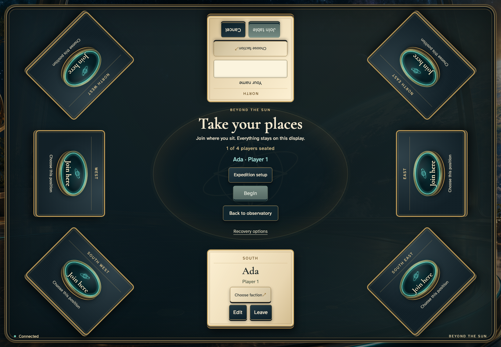](../../screenshots/return-an-outpost-during-rival-trade-and-retain-automation-at-two-shared-cardinal-seats/006-seat-1-editor-desktop-darwin.png) |

tabletop-4k · 3840 × 2160

[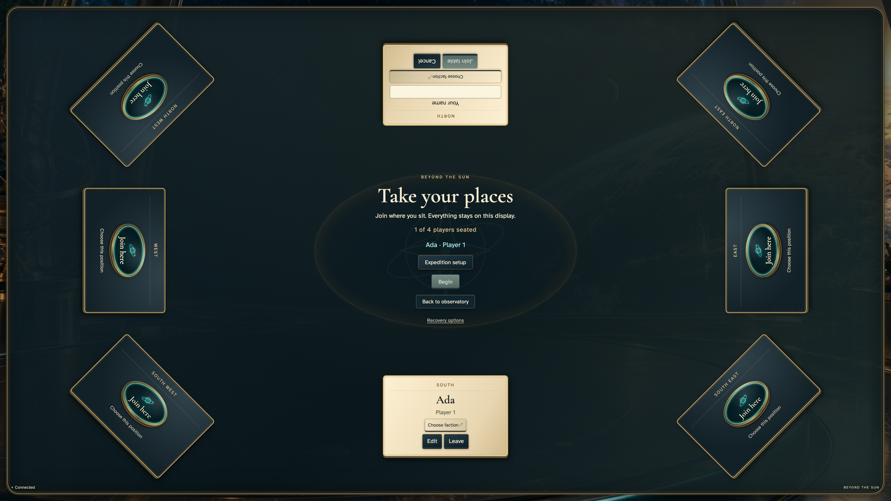](../../screenshots/return-an-outpost-during-rival-trade-and-retain-automation-at-two-shared-cardinal-seats/006-seat-1-editor-tabletop-4k-darwin.png)

- [x] Join directly at North
- [x] Actual canonical effects and acknowledgement settle.
- [x] Public topology retains physical separation.
- [x] The viewport fits without page scrolling.

## 8. Name this physical seat Bora

Viewpoint: **Bora · North · one shared controller**.

| desktop · 1440 × 1000 |
| --- |
|  |

tabletop-4k · 3840 × 2160

- [x] Name this physical seat Bora
- [x] Actual canonical effects and acknowledgement settle.
- [x] Public topology retains physical separation.
- [x] The viewport fits without page scrolling.

## 9. Persist the named seat on the same display

Viewpoint: **Bora · North · one shared controller**.

| desktop · 1440 × 1000 |
| --- |
|  |

tabletop-4k · 3840 × 2160

- [x] Persist the named seat on the same display
- [x] Actual canonical effects and acknowledgement settle.
- [x] Public topology retains physical separation.
- [x] The viewport fits without page scrolling.

## 10. Choose a legal unique Basic faction

Viewpoint: **Ada · South · one shared controller**.

| desktop · 1440 × 1000 |
| --- |
|  |

tabletop-4k · 3840 × 2160

- [x] Choose a legal unique Basic faction
- [x] Actual canonical effects and acknowledgement settle.
- [x] Public topology retains physical separation.
- [x] The viewport fits without page scrolling.

## 11. Ada chooses Nishida-Østergaard Corporation

Viewpoint: **Ada · South · one shared controller**.

| desktop · 1440 × 1000 |
| --- |
|  |

tabletop-4k · 3840 × 2160

- [x] Ada chooses Nishida-Østergaard Corporation
- [x] Actual canonical effects and acknowledgement settle.
- [x] Public topology retains physical separation.
- [x] The viewport fits without page scrolling.

## 12. Choose a legal unique Basic faction

Viewpoint: **Bora · North · one shared controller**.

| desktop · 1440 × 1000 |
| --- |
|  |

tabletop-4k · 3840 × 2160

- [x] Choose a legal unique Basic faction
- [x] Actual canonical effects and acknowledgement settle.
- [x] Public topology retains physical separation.
- [x] The viewport fits without page scrolling.

## 13. Bora chooses The Zheng-Yi Brotherhood

Viewpoint: **Bora · North · one shared controller**.

| desktop · 1440 × 1000 |
| --- |
|  |

tabletop-4k · 3840 × 2160

- [x] Bora chooses The Zheng-Yi Brotherhood
- [x] Actual canonical effects and acknowledgement settle.
- [x] Public topology retains physical separation.
- [x] The viewport fits without page scrolling.

## 14. Begin the immutable Basic game through normal UI

Viewpoint: **Ada · South · one shared controller**.

| desktop · 1440 × 1000 |
| --- |
|  |

tabletop-4k · 3840 × 2160

- [x] Begin the immutable Basic game through normal UI
- [x] Actual canonical effects and acknowledgement settle.
- [x] Public topology retains physical separation.
- [x] The viewport fits without page scrolling.

## 15. Ada opens the real Action instrument

Viewpoint: **Ada · South · one shared controller**.

| desktop · 1440 × 1000 |
| --- |
|  |

tabletop-4k · 3840 × 2160

- [x] Ada opens the real Action instrument
- [x] Actual canonical effects and acknowledgement settle.
- [x] Public topology retains physical separation.
- [x] The viewport fits without page scrolling.

## 16. Ada chooses Basic build and jump

Viewpoint: **Ada · South · one shared controller**.

| desktop · 1440 × 1000 |
| --- |
|  |

tabletop-4k · 3840 × 2160

[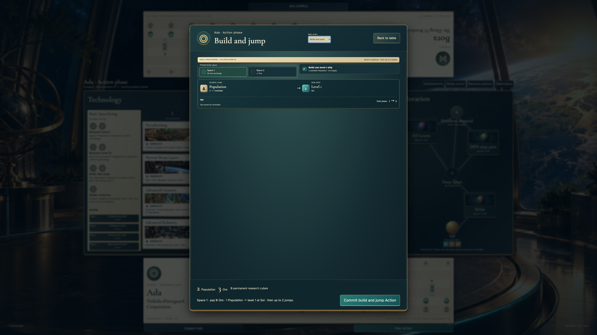](../../screenshots/return-an-outpost-during-rival-trade-and-retain-automation-at-two-shared-cardinal-seats/015-offturn-ada-kind-tabletop-4k-darwin.png)

- [x] Ada chooses Basic build and jump
- [x] Actual canonical effects and acknowledgement settle.
- [x] Public topology retains physical separation.
- [x] The viewport fits without page scrolling.

## 17. Commit the actual Population conversion and printed space cost before optional movement

Viewpoint: **Ada · South · one shared controller**.

| desktop · 1440 × 1000 |
| --- |
|  |

tabletop-4k · 3840 × 2160

- [x] Commit the actual Population conversion and printed space cost before optional movement
- [x] Actual canonical effects and acknowledgement settle.
- [x] Public topology retains physical separation.
- [x] The viewport fits without page scrolling.

## 18. Read the complete public map before choosing a connected route

Viewpoint: **Ada · South · one shared controller**.

| desktop · 1440 × 1000 |
| --- |
|  |

tabletop-4k · 3840 × 2160

- [x] Read the complete public map before choosing a connected route
- [x] Actual canonical effects and acknowledgement settle.
- [x] Public topology retains physical separation.
- [x] The viewport fits without page scrolling.

## 19. Read the actual connected destinations in this interface

Viewpoint: **Ada · South · one shared controller**.

| desktop · 1440 × 1000 |
| --- |
|  |

tabletop-4k · 3840 × 2160

- [x] Read the actual connected destinations in this interface
- [x] Actual canonical effects and acknowledgement settle.
- [x] Public topology retains physical separation.
- [x] The viewport fits without page scrolling.

## 20. Choose a real owned ship for this unpaid route

Viewpoint: **Ada · South · one shared controller**.

| desktop · 1440 × 1000 |
| --- |
|  |

tabletop-4k · 3840 × 2160

- [x] Choose a real owned ship for this unpaid route
- [x] Actual canonical effects and acknowledgement settle.
- [x] Public topology retains physical separation.
- [x] The viewport fits without page scrolling.

## 21. Plan Sirius as an endpoint; nothing moves yet

Viewpoint: **Ada · South · one shared controller**.

| desktop · 1440 × 1000 |
| --- |
|  |

tabletop-4k · 3840 × 2160

[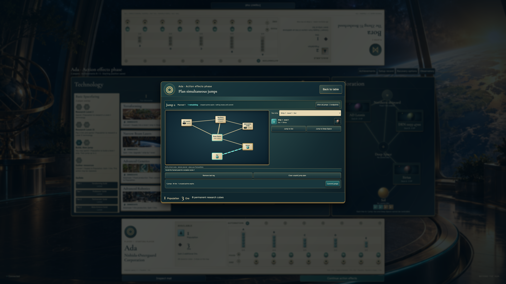](../../screenshots/return-an-outpost-during-rival-trade-and-retain-automation-at-two-shared-cardinal-seats/020-offturn-claim-endpoint-tabletop-4k-darwin.png)

- [x] Plan Sirius as an endpoint; nothing moves yet
- [x] Actual canonical effects and acknowledgement settle.
- [x] Public topology retains physical separation.
- [x] The viewport fits without page scrolling.

## 22. Ada establishes the initial one-power Ore outpost

Viewpoint: **Ada · South · one shared controller**.

| desktop · 1440 × 1000 |
| --- |
|  |

tabletop-4k · 3840 × 2160

[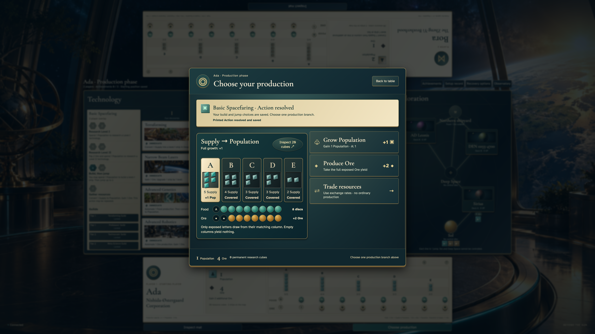](../../screenshots/return-an-outpost-during-rival-trade-and-retain-automation-at-two-shared-cardinal-seats/021-offturn-first-claim-tabletop-4k-darwin.png)

- [x] Ada establishes the initial one-power Ore outpost
- [x] Actual canonical effects and acknowledgement settle.
- [x] Public topology retains physical separation.
- [x] The viewport fits without page scrolling.

## 23. Ada chooses ordinary Ore production and hands off

Viewpoint: **Ada · South · one shared controller**.

| desktop · 1440 × 1000 |
| --- |
| [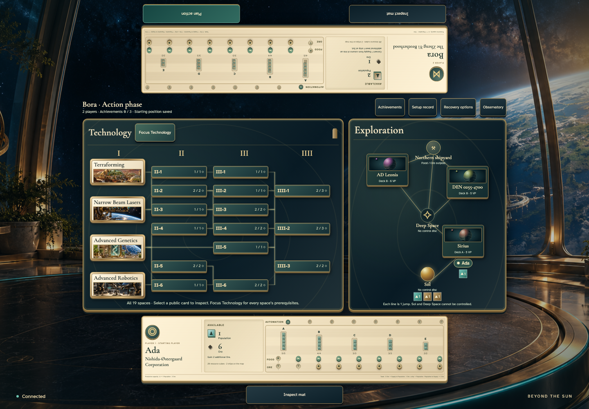](../../screenshots/return-an-outpost-during-rival-trade-and-retain-automation-at-two-shared-cardinal-seats/022-offturn-ada-handoff-desktop-darwin.png) |

tabletop-4k · 3840 × 2160

[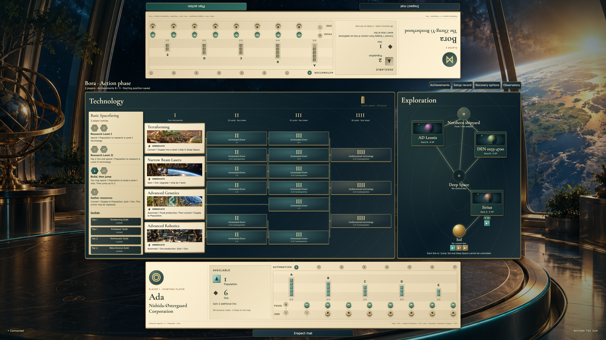](../../screenshots/return-an-outpost-during-rival-trade-and-retain-automation-at-two-shared-cardinal-seats/022-offturn-ada-handoff-tabletop-4k-darwin.png)

- [x] Ada chooses ordinary Ore production and hands off
- [x] Actual canonical effects and acknowledgement settle.
- [x] Public topology retains physical separation.
- [x] The viewport fits without page scrolling.

## 24. Bora opens the real Action instrument

Viewpoint: **Bora · North · one shared controller**.

| desktop · 1440 × 1000 |
| --- |
| [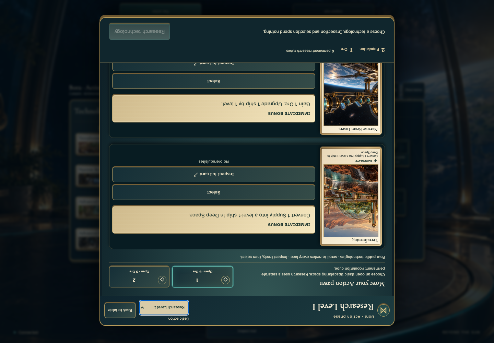](../../screenshots/return-an-outpost-during-rival-trade-and-retain-automation-at-two-shared-cardinal-seats/023-offturn-bora-open-desktop-darwin.png) |

tabletop-4k · 3840 × 2160

[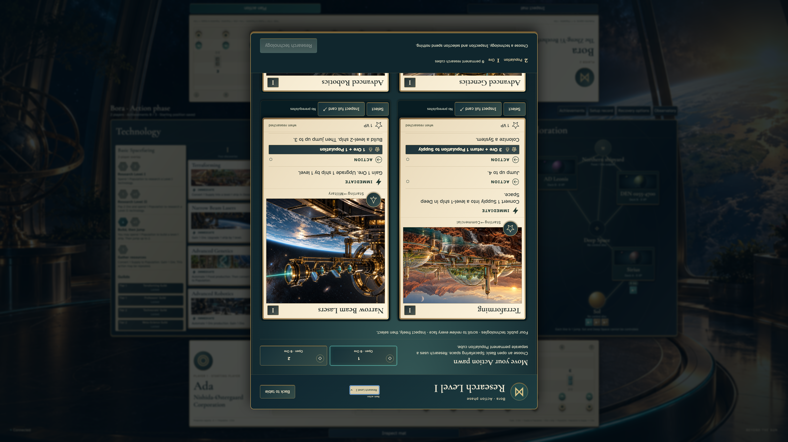](../../screenshots/return-an-outpost-during-rival-trade-and-retain-automation-at-two-shared-cardinal-seats/023-offturn-bora-open-tabletop-4k-darwin.png)

- [x] Bora opens the real Action instrument
- [x] Actual canonical effects and acknowledgement settle.
- [x] Public topology retains physical separation.
- [x] The viewport fits without page scrolling.

## 25. Bora chooses Basic build and jump

Viewpoint: **Bora · North · one shared controller**.

| desktop · 1440 × 1000 |
| --- |
| [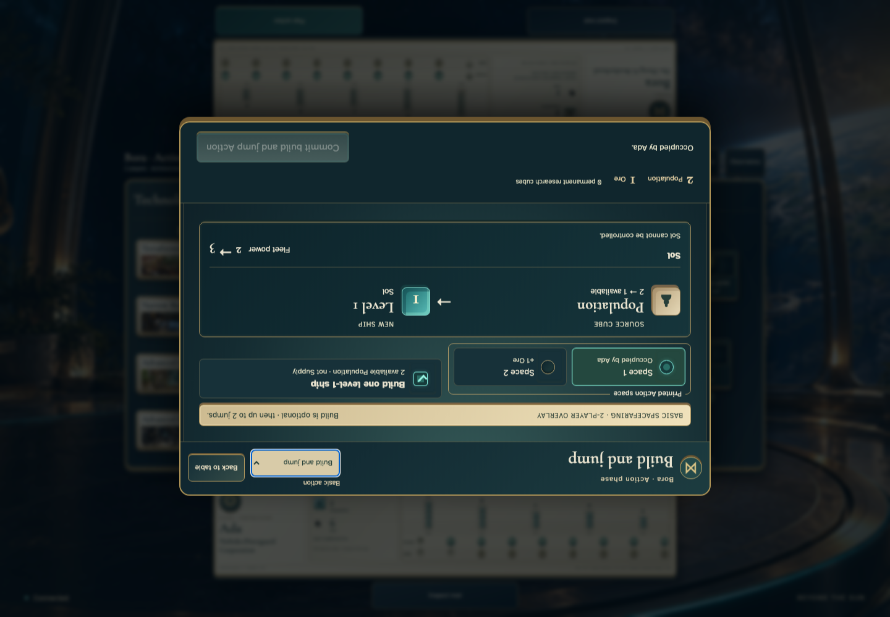](../../screenshots/return-an-outpost-during-rival-trade-and-retain-automation-at-two-shared-cardinal-seats/024-offturn-bora-kind-desktop-darwin.png) |

tabletop-4k · 3840 × 2160

[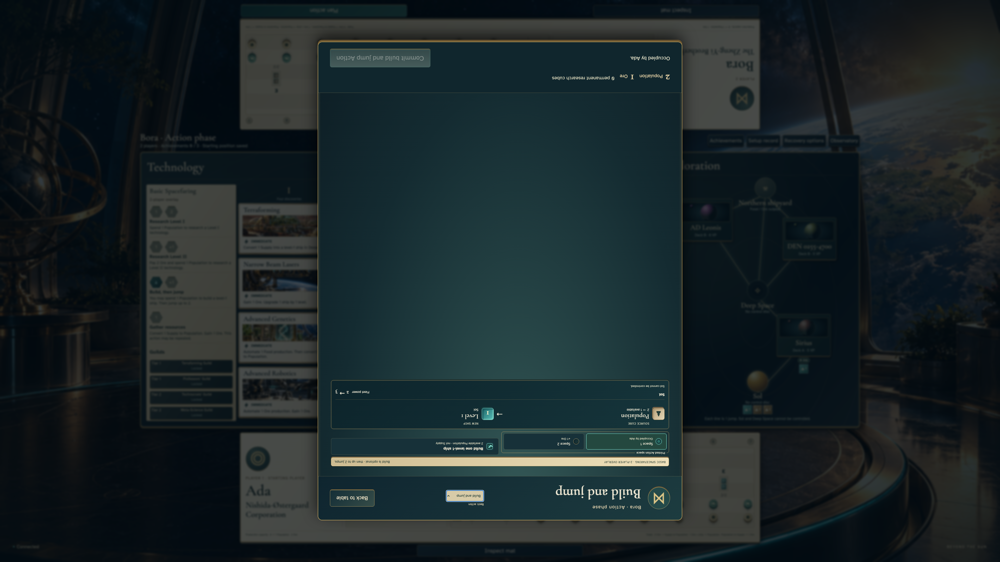](../../screenshots/return-an-outpost-during-rival-trade-and-retain-automation-at-two-shared-cardinal-seats/024-offturn-bora-kind-tabletop-4k-darwin.png)

- [x] Bora chooses Basic build and jump
- [x] Actual canonical effects and acknowledgement settle.
- [x] Public topology retains physical separation.
- [x] The viewport fits without page scrolling.

## 26. Choose the unoccupied second printed space with its real surcharge

Viewpoint: **Bora · North · one shared controller**.

| desktop · 1440 × 1000 |
| --- |
| [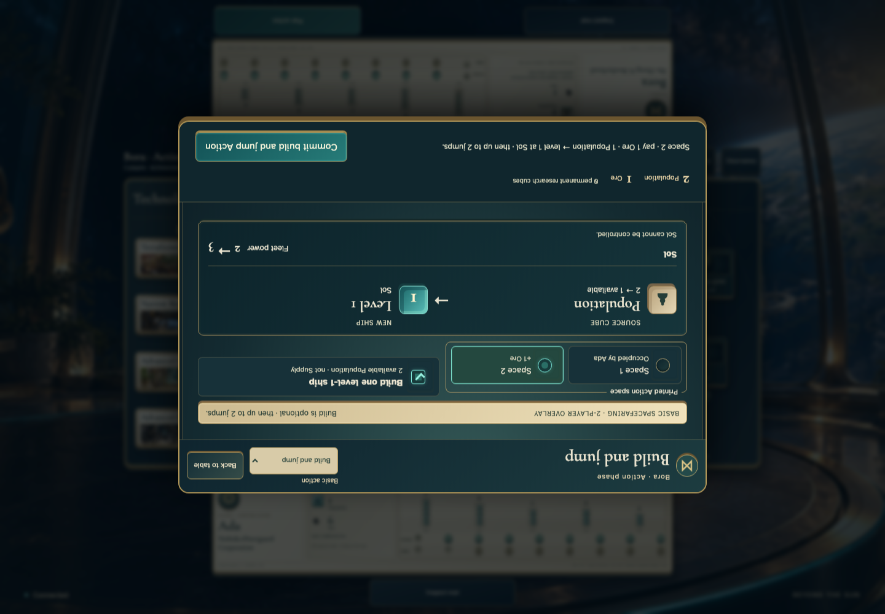](../../screenshots/return-an-outpost-during-rival-trade-and-retain-automation-at-two-shared-cardinal-seats/025-offturn-bora-space-desktop-darwin.png) |

tabletop-4k · 3840 × 2160

[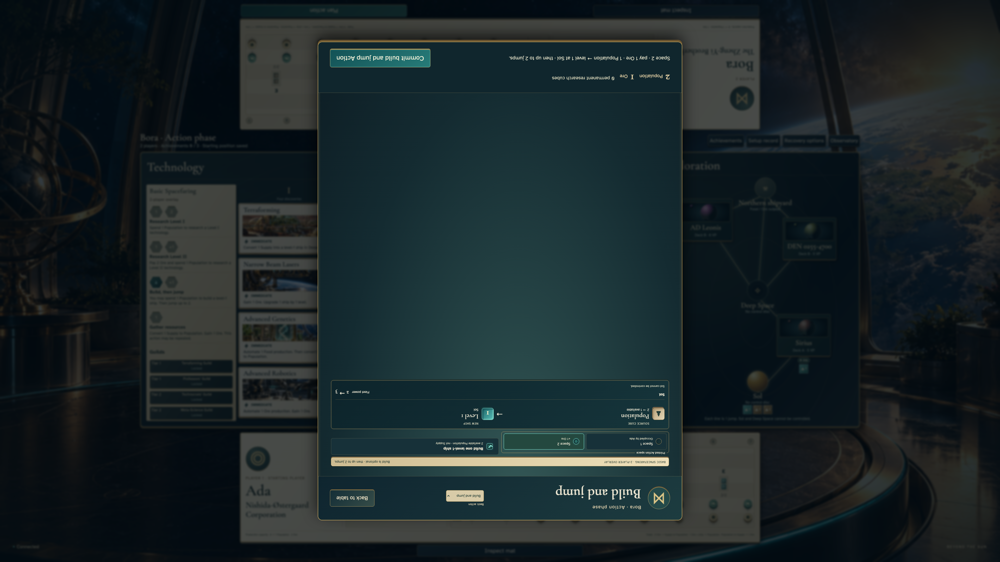](../../screenshots/return-an-outpost-during-rival-trade-and-retain-automation-at-two-shared-cardinal-seats/025-offturn-bora-space-tabletop-4k-darwin.png)

- [x] Choose the unoccupied second printed space with its real surcharge
- [x] Actual canonical effects and acknowledgement settle.
- [x] Public topology retains physical separation.
- [x] The viewport fits without page scrolling.

## 27. Commit the actual Population conversion and printed space cost before optional movement

Viewpoint: **Bora · North · one shared controller**.

| desktop · 1440 × 1000 |
| --- |
|  |

tabletop-4k · 3840 × 2160

- [x] Commit the actual Population conversion and printed space cost before optional movement
- [x] Actual canonical effects and acknowledgement settle.
- [x] Public topology retains physical separation.
- [x] The viewport fits without page scrolling.

## 28. Read the complete public map before choosing a connected route

Viewpoint: **Bora · North · one shared controller**.

| desktop · 1440 × 1000 |
| --- |
|  |

tabletop-4k · 3840 × 2160

[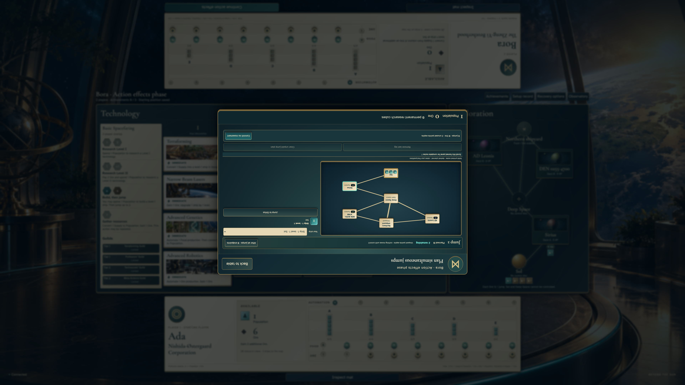](../../screenshots/return-an-outpost-during-rival-trade-and-retain-automation-at-two-shared-cardinal-seats/027-offturn-bora-map-tabletop-4k-darwin.png)

- [x] Read the complete public map before choosing a connected route
- [x] Actual canonical effects and acknowledgement settle.
- [x] Public topology retains physical separation.
- [x] The viewport fits without page scrolling.

## 29. Read the actual connected destinations in this interface

Viewpoint: **Bora · North · one shared controller**.

| desktop · 1440 × 1000 |
| --- |
|  |

tabletop-4k · 3840 × 2160

- [x] Read the actual connected destinations in this interface
- [x] Actual canonical effects and acknowledgement settle.
- [x] Public topology retains physical separation.
- [x] The viewport fits without page scrolling.

## 30. Choose a real owned ship for this unpaid route

Viewpoint: **Bora · North · one shared controller**.

| desktop · 1440 × 1000 |
| --- |
| [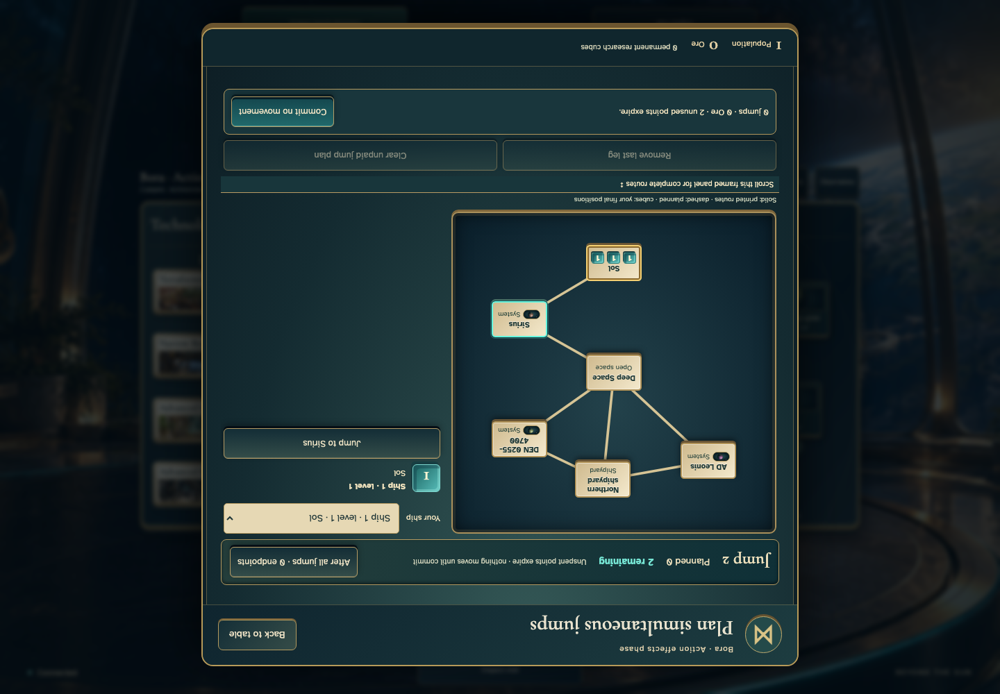](../../screenshots/return-an-outpost-during-rival-trade-and-retain-automation-at-two-shared-cardinal-seats/029-offturn-rival-first-ship-desktop-darwin.png) |

tabletop-4k · 3840 × 2160

- [x] Choose a real owned ship for this unpaid route
- [x] Actual canonical effects and acknowledgement settle.
- [x] Public topology retains physical separation.
- [x] The viewport fits without page scrolling.

## 31. Plan Sirius as an endpoint; nothing moves yet

Viewpoint: **Bora · North · one shared controller**.

| desktop · 1440 × 1000 |
| --- |
| [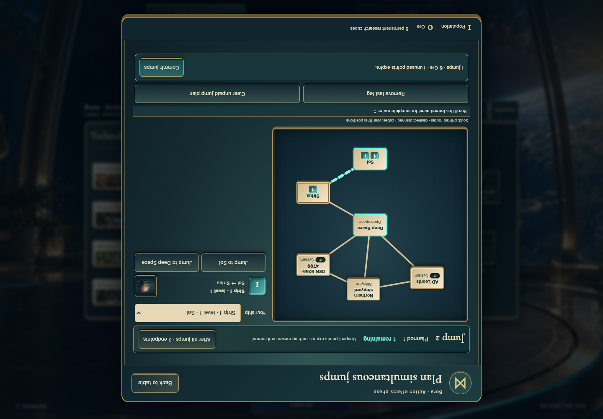](../../screenshots/return-an-outpost-during-rival-trade-and-retain-automation-at-two-shared-cardinal-seats/030-offturn-rival-first-endpoint-desktop-darwin.png) |

tabletop-4k · 3840 × 2160

- [x] Plan Sirius as an endpoint; nothing moves yet
- [x] Actual canonical effects and acknowledgement settle.
- [x] Public topology retains physical separation.
- [x] The viewport fits without page scrolling.

## 32. Choose a real owned ship for this unpaid route

Viewpoint: **Bora · North · one shared controller**.

| desktop · 1440 × 1000 |
| --- |
| [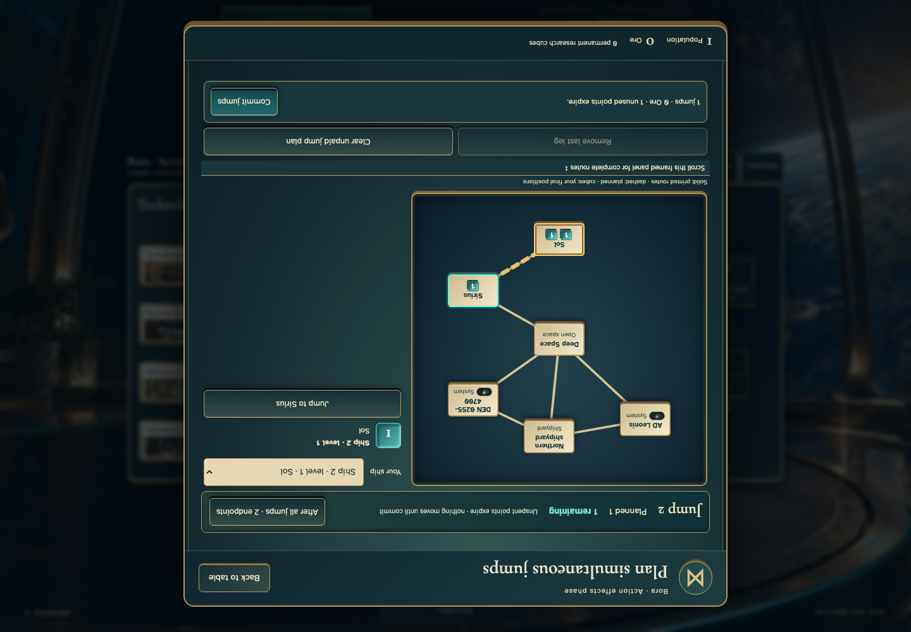](../../screenshots/return-an-outpost-during-rival-trade-and-retain-automation-at-two-shared-cardinal-seats/031-offturn-rival-second-ship-desktop-darwin.png) |

tabletop-4k · 3840 × 2160

[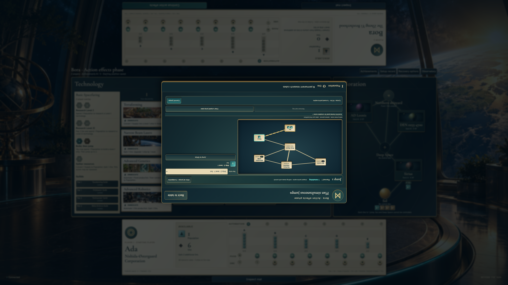](../../screenshots/return-an-outpost-during-rival-trade-and-retain-automation-at-two-shared-cardinal-seats/031-offturn-rival-second-ship-tabletop-4k-darwin.png)

- [x] Choose a real owned ship for this unpaid route
- [x] Actual canonical effects and acknowledgement settle.
- [x] Public topology retains physical separation.
- [x] The viewport fits without page scrolling.

## 33. Plan Sirius as an endpoint; nothing moves yet

Viewpoint: **Bora · North · one shared controller**.

| desktop · 1440 × 1000 |
| --- |
| [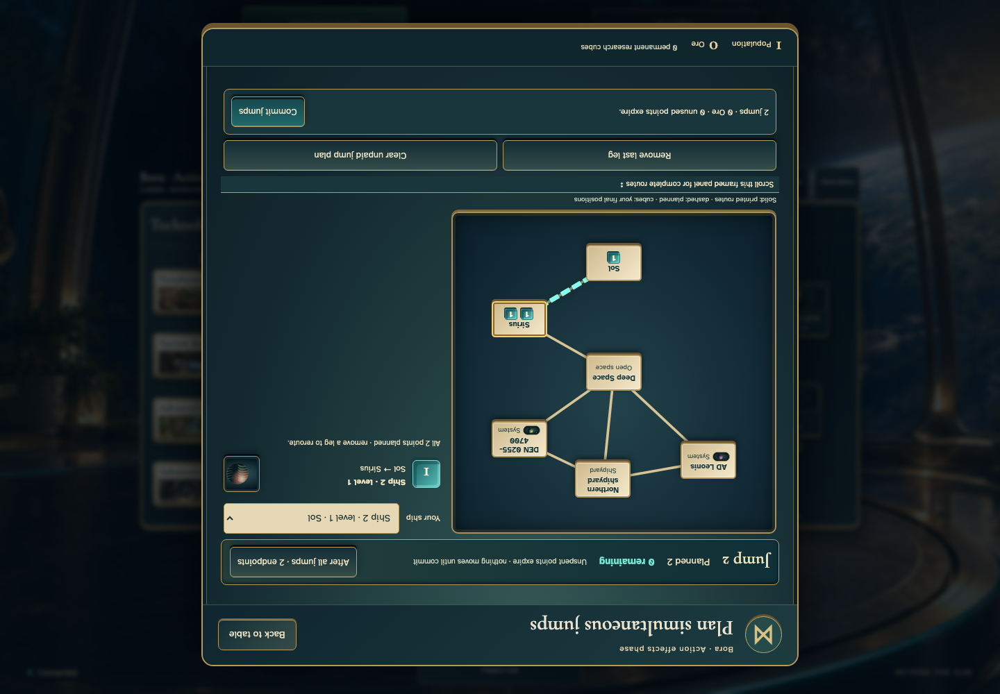](../../screenshots/return-an-outpost-during-rival-trade-and-retain-automation-at-two-shared-cardinal-seats/032-offturn-rival-second-endpoint-desktop-darwin.png) |

tabletop-4k · 3840 × 2160

[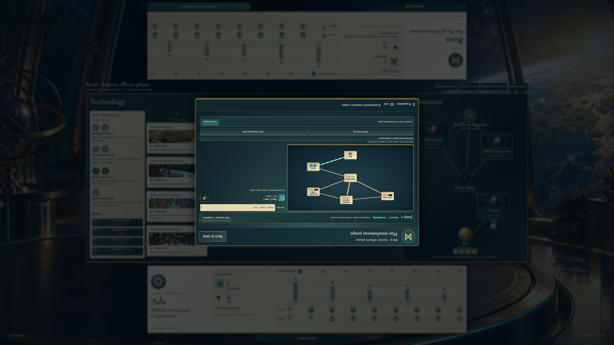](../../screenshots/return-an-outpost-during-rival-trade-and-retain-automation-at-two-shared-cardinal-seats/032-offturn-rival-second-endpoint-tabletop-4k-darwin.png)

- [x] Plan Sirius as an endpoint; nothing moves yet
- [x] Actual canonical effects and acknowledgement settle.
- [x] Public topology retains physical separation.
- [x] The viewport fits without page scrolling.

## 34. Bora’s two-power fleet takes actual control

Viewpoint: **Bora · North · one shared controller**.

| desktop · 1440 × 1000 |
| --- |
| [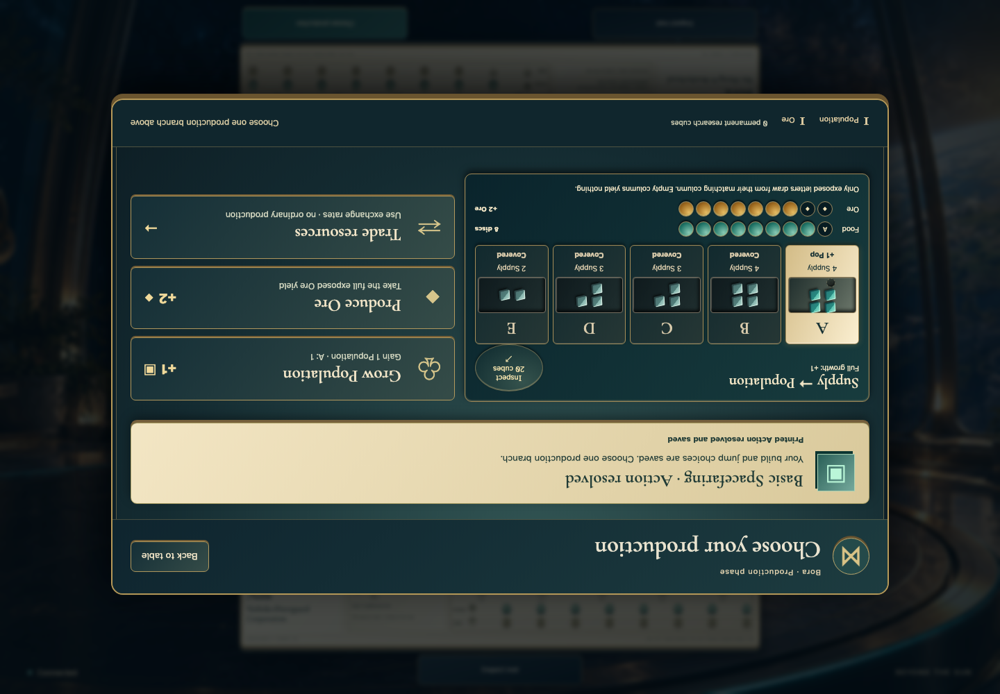](../../screenshots/return-an-outpost-during-rival-trade-and-retain-automation-at-two-shared-cardinal-seats/033-offturn-rival-control-desktop-darwin.png) |

tabletop-4k · 3840 × 2160

[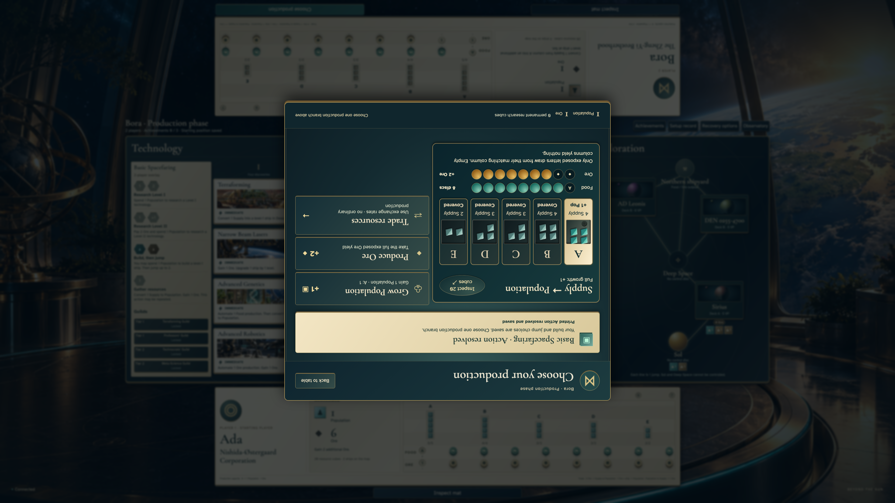](../../screenshots/return-an-outpost-during-rival-trade-and-retain-automation-at-two-shared-cardinal-seats/033-offturn-rival-control-tabletop-4k-darwin.png)

- [x] Bora’s two-power fleet takes actual control
- [x] Actual canonical effects and acknowledgement settle.
- [x] Public topology retains physical separation.
- [x] The viewport fits without page scrolling.

## 35. Bora chooses ordinary Ore production and hands off

Viewpoint: **Bora · North · one shared controller**.

| desktop · 1440 × 1000 |
| --- |
|  |

tabletop-4k · 3840 × 2160

[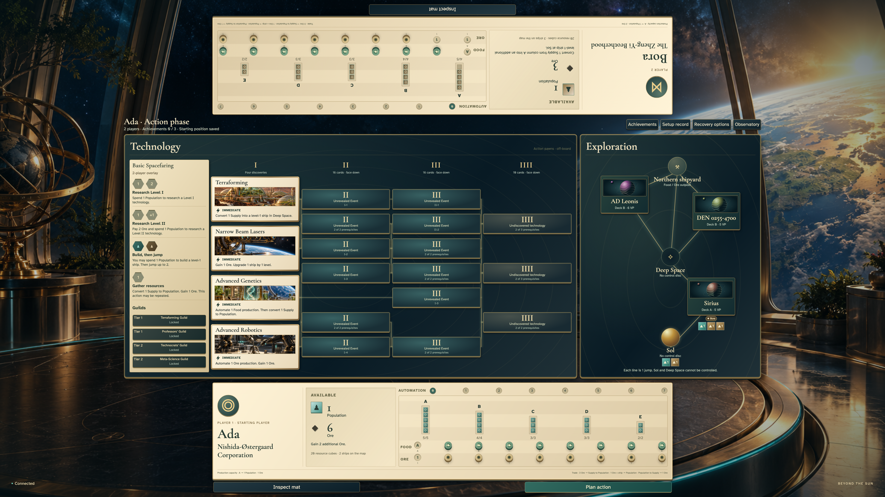](../../screenshots/return-an-outpost-during-rival-trade-and-retain-automation-at-two-shared-cardinal-seats/034-offturn-bora-handoff-tabletop-4k-darwin.png)

- [x] Bora chooses ordinary Ore production and hands off
- [x] Actual canonical effects and acknowledgement settle.
- [x] Public topology retains physical separation.
- [x] The viewport fits without page scrolling.

## 36. Ada opens the real Action instrument

Viewpoint: **Ada · South · one shared controller**.

| desktop · 1440 × 1000 |
| --- |
|  |

tabletop-4k · 3840 × 2160

[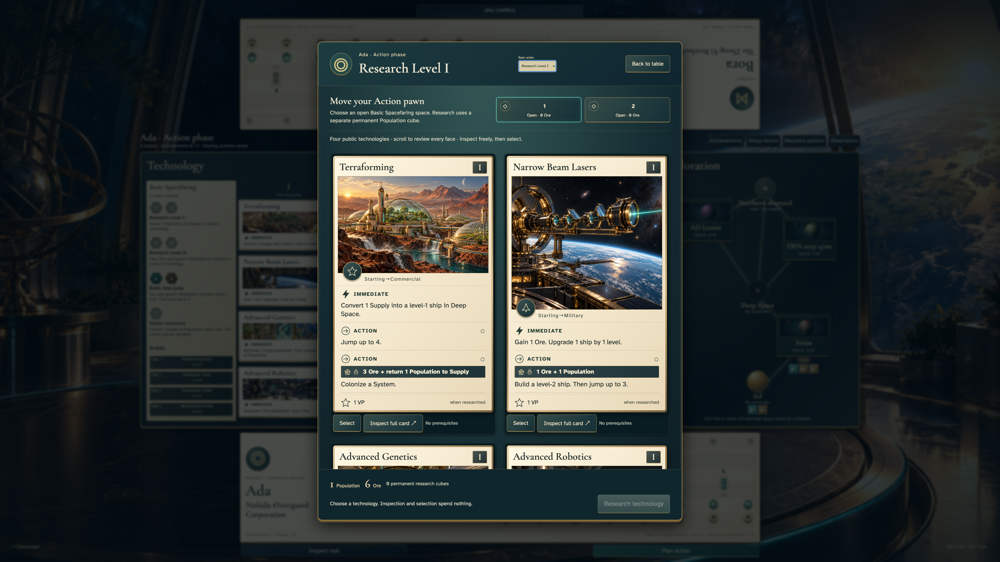](../../screenshots/return-an-outpost-during-rival-trade-and-retain-automation-at-two-shared-cardinal-seats/035-offturn-research-open-tabletop-4k-darwin.png)

- [x] Ada opens the real Action instrument
- [x] Actual canonical effects and acknowledgement settle.
- [x] Public topology retains physical separation.
- [x] The viewport fits without page scrolling.

## 37. Ada chooses Research Level I

Viewpoint: **Ada · South · one shared controller**.

| desktop · 1440 × 1000 |
| --- |
| [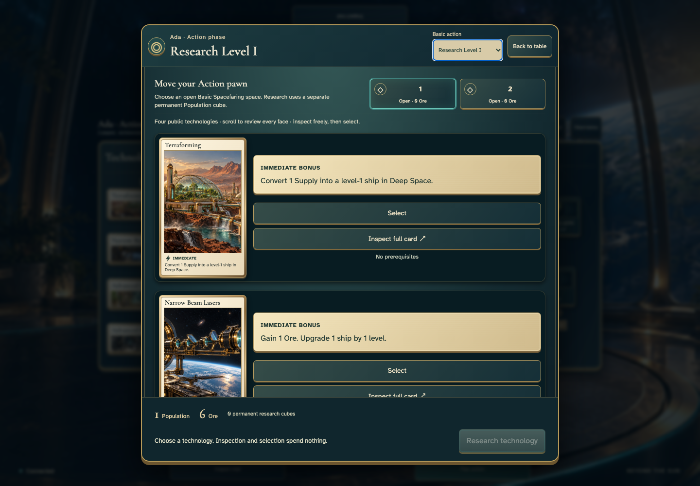](../../screenshots/return-an-outpost-during-rival-trade-and-retain-automation-at-two-shared-cardinal-seats/036-offturn-research-kind-desktop-darwin.png) |

tabletop-4k · 3840 × 2160

- [x] Ada chooses Research Level I
- [x] Actual canonical effects and acknowledgement settle.
- [x] Public topology retains physical separation.
- [x] The viewport fits without page scrolling.

## 38. Choose the real unoccupied research space

Viewpoint: **Ada · South · one shared controller**.

| desktop · 1440 × 1000 |
| --- |
| [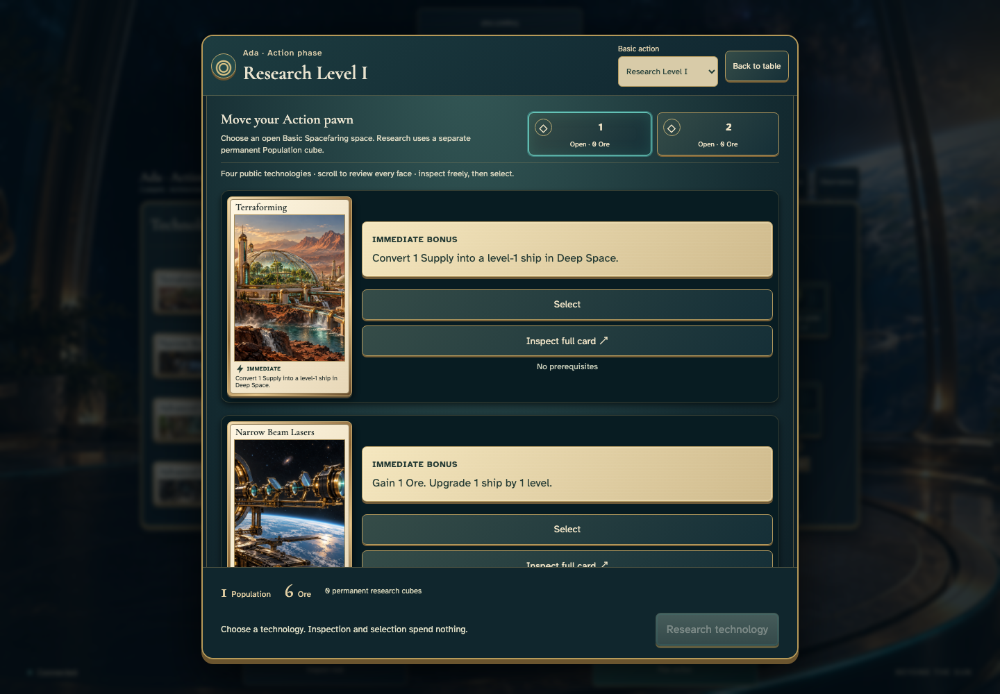](../../screenshots/return-an-outpost-during-rival-trade-and-retain-automation-at-two-shared-cardinal-seats/037-offturn-research-space-desktop-darwin.png) |

tabletop-4k · 3840 × 2160

- [x] Choose the real unoccupied research space
- [x] Actual canonical effects and acknowledgement settle.
- [x] Public topology retains physical separation.
- [x] The viewport fits without page scrolling.

## 39. Inspect the printed permanent automation bonus

Viewpoint: **Ada · South · one shared controller**.

| desktop · 1440 × 1000 |
| --- |
| [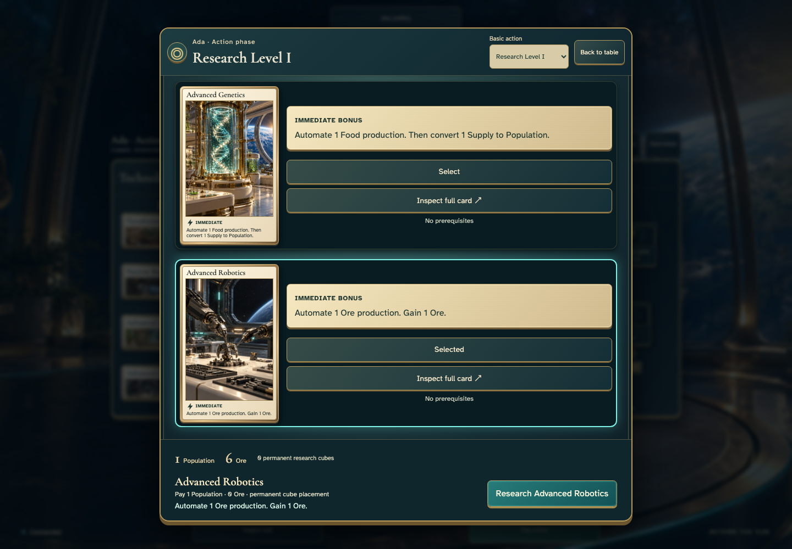](../../screenshots/return-an-outpost-during-rival-trade-and-retain-automation-at-two-shared-cardinal-seats/038-offturn-robotics-face-desktop-darwin.png) |

tabletop-4k · 3840 × 2160

[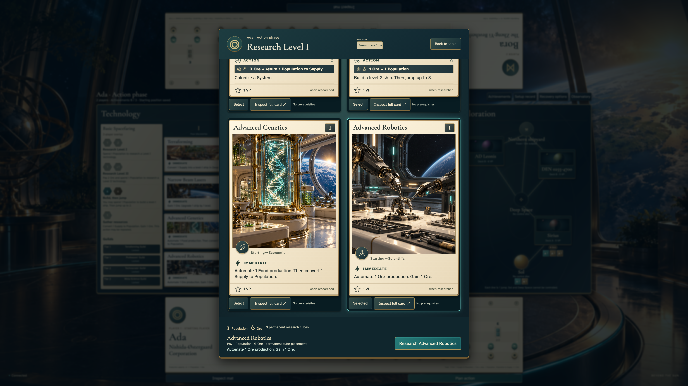](../../screenshots/return-an-outpost-during-rival-trade-and-retain-automation-at-two-shared-cardinal-seats/038-offturn-robotics-face-tabletop-4k-darwin.png)

- [x] Inspect the printed permanent automation bonus
- [x] Actual canonical effects and acknowledgement settle.
- [x] Public topology retains physical separation.
- [x] The viewport fits without page scrolling.

## 40. Research and resolve permanent Ore automation before Production

Viewpoint: **Ada · South · one shared controller**.

| desktop · 1440 × 1000 |
| --- |
| [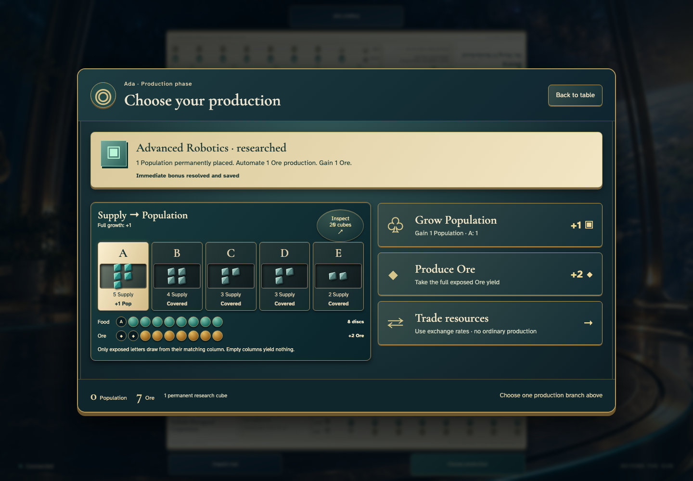](../../screenshots/return-an-outpost-during-rival-trade-and-retain-automation-at-two-shared-cardinal-seats/039-offturn-automation-desktop-darwin.png) |

tabletop-4k · 3840 × 2160

- [x] Research and resolve permanent Ore automation before Production
- [x] Actual canonical effects and acknowledgement settle.
- [x] Public topology retains physical separation.
- [x] The viewport fits without page scrolling.

## 41. Choose Trade to preserve a clear no-production boundary

Viewpoint: **Ada · South · one shared controller**.

| desktop · 1440 × 1000 |
| --- |
| [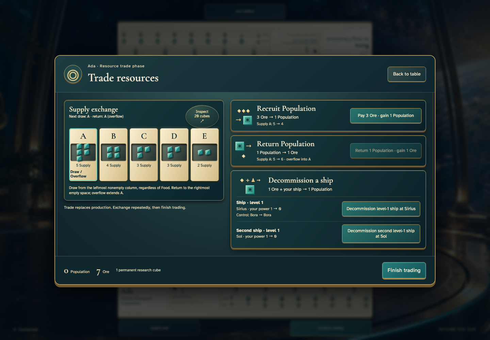](../../screenshots/return-an-outpost-during-rival-trade-and-retain-automation-at-two-shared-cardinal-seats/040-offturn-ada-trade-desktop-darwin.png) |

tabletop-4k · 3840 × 2160

[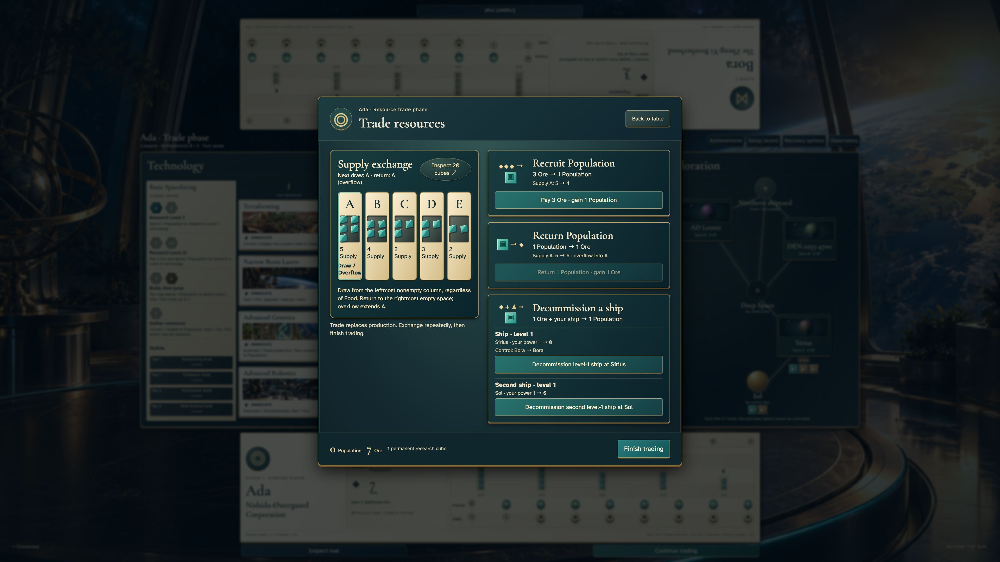](../../screenshots/return-an-outpost-during-rival-trade-and-retain-automation-at-two-shared-cardinal-seats/040-offturn-ada-trade-tabletop-4k-darwin.png)

- [x] Choose Trade to preserve a clear no-production boundary
- [x] Actual canonical effects and acknowledgement settle.
- [x] Public topology retains physical separation.
- [x] The viewport fits without page scrolling.

## 42. Hand off without a regular Production payout

Viewpoint: **Ada · South · one shared controller**.

| desktop · 1440 × 1000 |
| --- |
|  |

tabletop-4k · 3840 × 2160

- [x] Hand off without a regular Production payout
- [x] Actual canonical effects and acknowledgement settle.
- [x] Public topology retains physical separation.
- [x] The viewport fits without page scrolling.

## 43. Bora opens the real Action instrument

Viewpoint: **Bora · North · one shared controller**.

| desktop · 1440 × 1000 |
| --- |
| [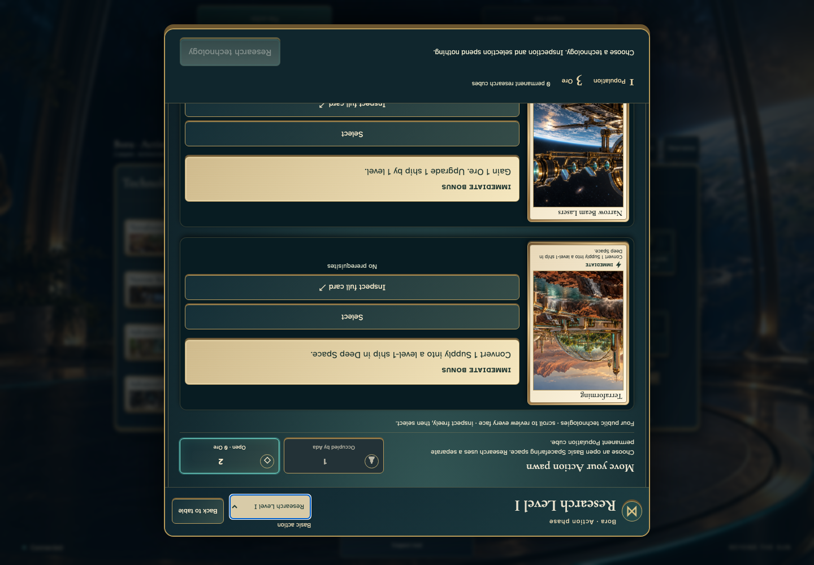](../../screenshots/return-an-outpost-during-rival-trade-and-retain-automation-at-two-shared-cardinal-seats/042-offturn-bora-gather-open-desktop-darwin.png) |

tabletop-4k · 3840 × 2160

[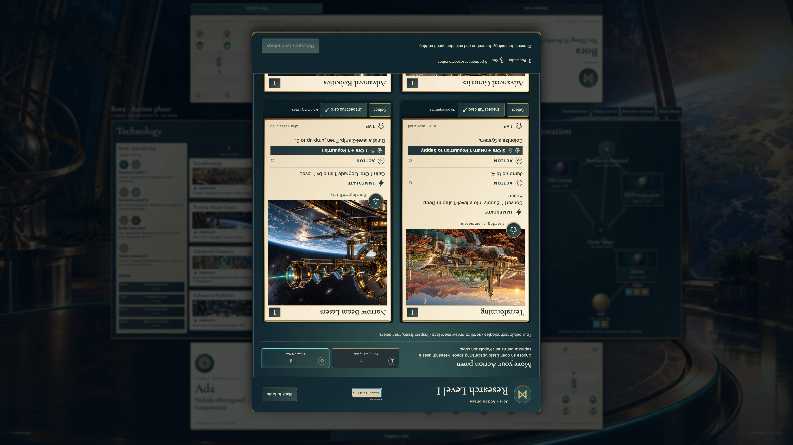](../../screenshots/return-an-outpost-during-rival-trade-and-retain-automation-at-two-shared-cardinal-seats/042-offturn-bora-gather-open-tabletop-4k-darwin.png)

- [x] Bora opens the real Action instrument
- [x] Actual canonical effects and acknowledgement settle.
- [x] Public topology retains physical separation.
- [x] The viewport fits without page scrolling.

## 44. Bora chooses Gather

Viewpoint: **Bora · North · one shared controller**.

| desktop · 1440 × 1000 |
| --- |
| [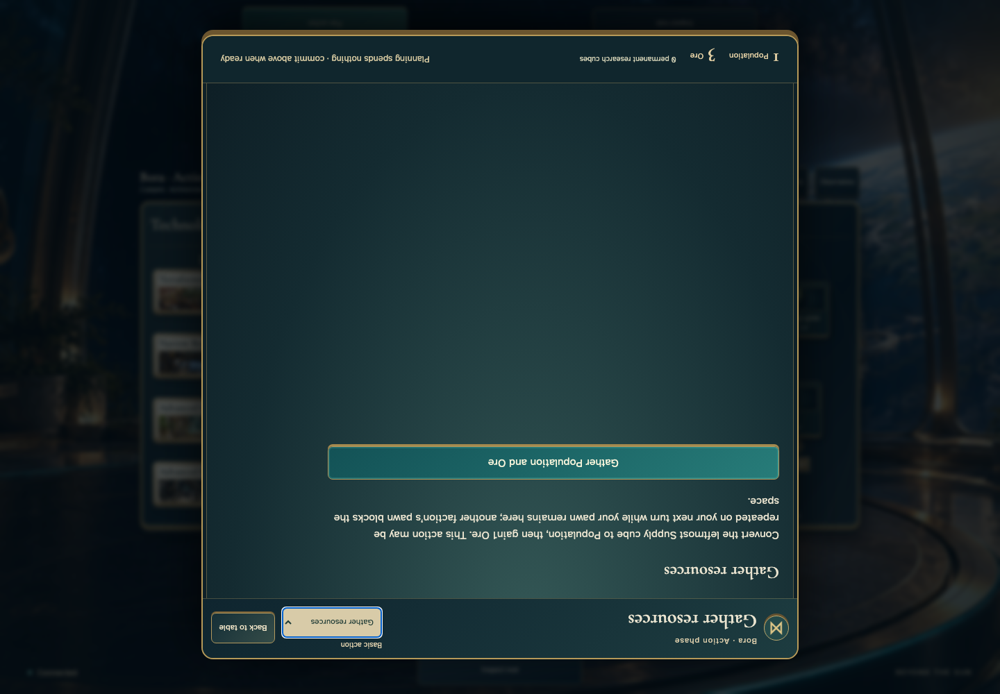](../../screenshots/return-an-outpost-during-rival-trade-and-retain-automation-at-two-shared-cardinal-seats/043-offturn-bora-gather-kind-desktop-darwin.png) |

tabletop-4k · 3840 × 2160

[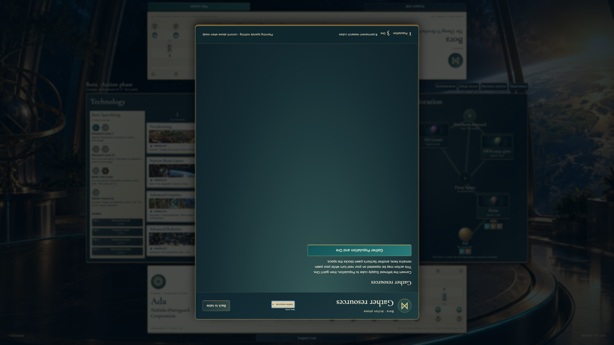](../../screenshots/return-an-outpost-during-rival-trade-and-retain-automation-at-two-shared-cardinal-seats/043-offturn-bora-gather-kind-tabletop-4k-darwin.png)

- [x] Bora chooses Gather
- [x] Actual canonical effects and acknowledgement settle.
- [x] Public topology retains physical separation.
- [x] The viewport fits without page scrolling.

## 45. Gather through the actual next actor’s turn

Viewpoint: **Bora · North · one shared controller**.

| desktop · 1440 × 1000 |
| --- |
| [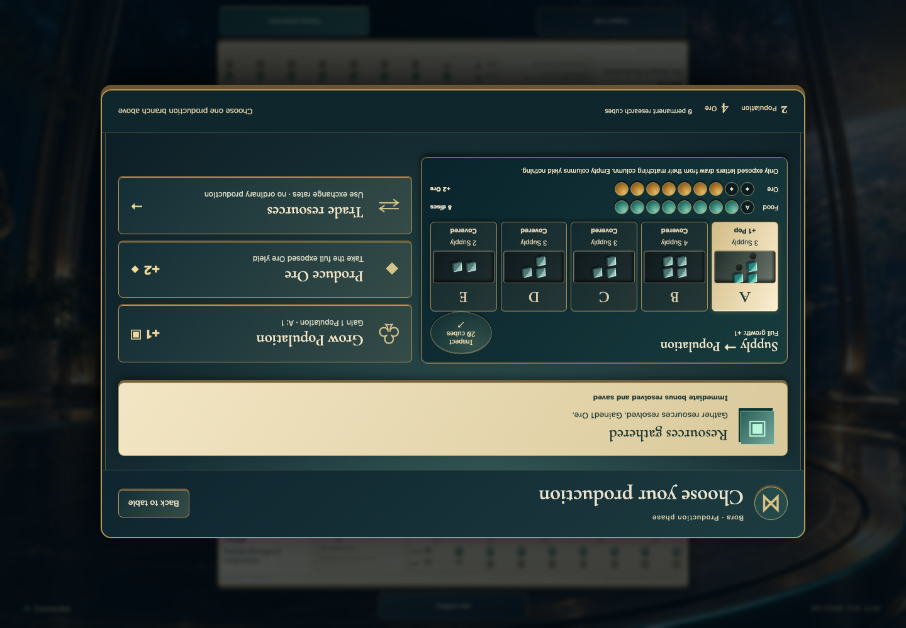](../../screenshots/return-an-outpost-during-rival-trade-and-retain-automation-at-two-shared-cardinal-seats/044-offturn-bora-gathered-desktop-darwin.png) |

tabletop-4k · 3840 × 2160

[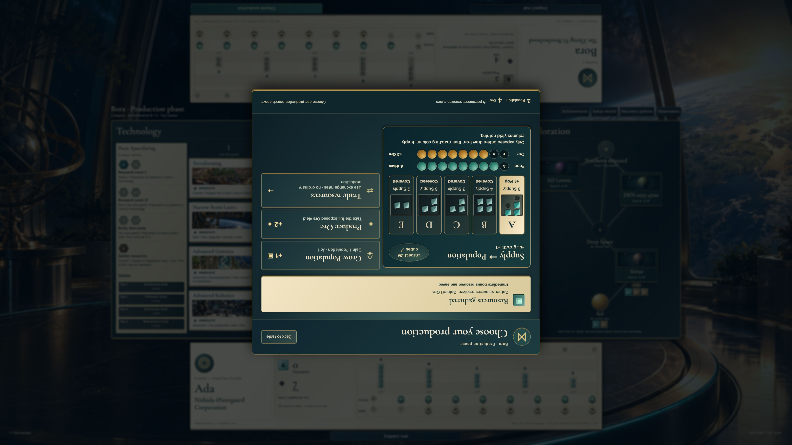](../../screenshots/return-an-outpost-during-rival-trade-and-retain-automation-at-two-shared-cardinal-seats/044-offturn-bora-gathered-tabletop-4k-darwin.png)

- [x] Gather through the actual next actor’s turn
- [x] Actual canonical effects and acknowledgement settle.
- [x] Public topology retains physical separation.
- [x] The viewport fits without page scrolling.

## 46. Bora chooses paid decommission exchanges instead of ordinary Production

Viewpoint: **Bora · North · one shared controller**.

| desktop · 1440 × 1000 |
| --- |
| [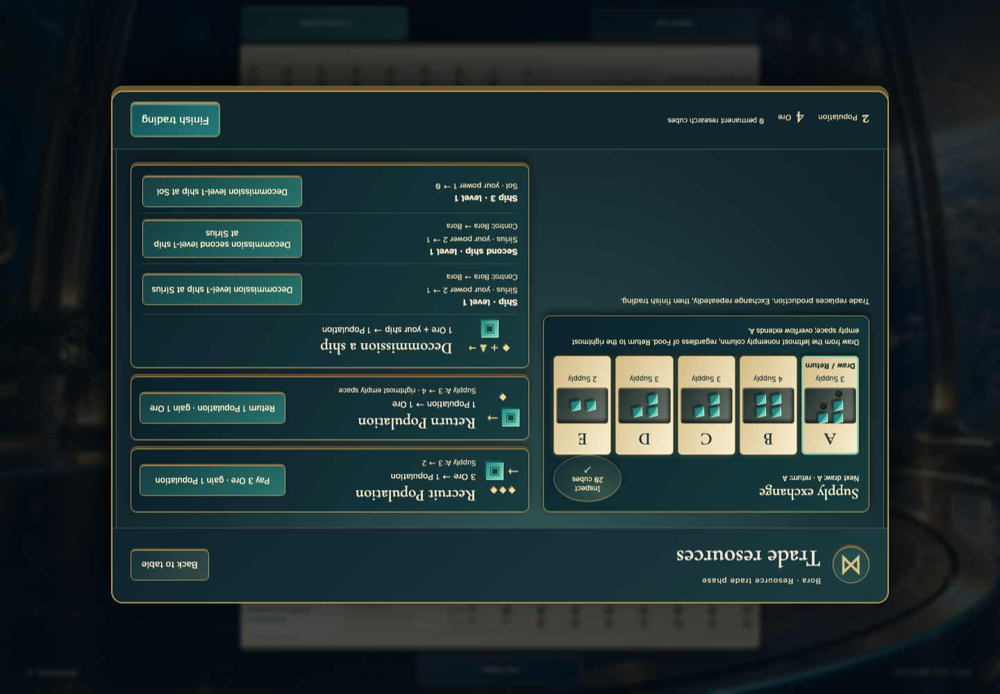](../../screenshots/return-an-outpost-during-rival-trade-and-retain-automation-at-two-shared-cardinal-seats/045-offturn-bora-trade-desktop-darwin.png) |

tabletop-4k · 3840 × 2160

- [x] Bora chooses paid decommission exchanges instead of ordinary Production
- [x] Actual canonical effects and acknowledgement settle.
- [x] Public topology retains physical separation.
- [x] The viewport fits without page scrolling.

## 47. Review the printed ship-decommission exchange in this interface

Viewpoint: **Bora · North · one shared controller**.

| desktop · 1440 × 1000 |
| --- |
|  |

tabletop-4k · 3840 × 2160

[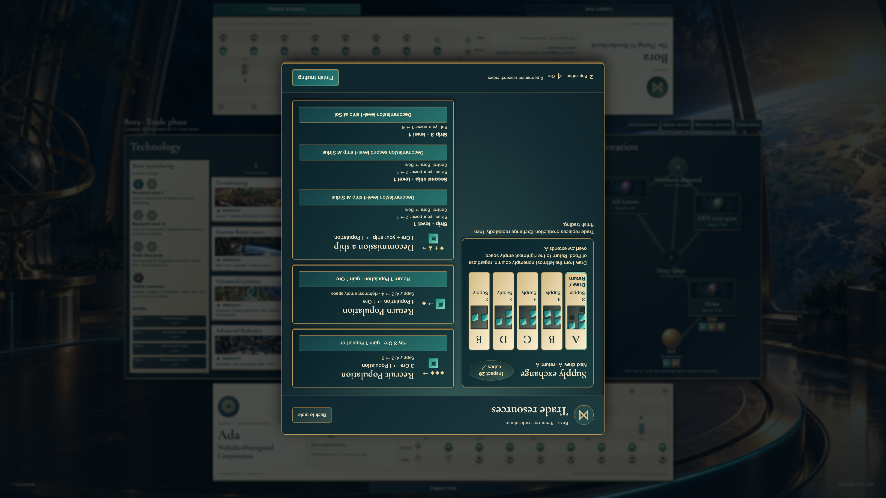](../../screenshots/return-an-outpost-during-rival-trade-and-retain-automation-at-two-shared-cardinal-seats/046-offturn-first-return-exchange-tabletop-4k-darwin.png)

- [x] Review the printed ship-decommission exchange in this interface
- [x] Actual canonical effects and acknowledgement settle.
- [x] Public topology retains physical separation.
- [x] The viewport fits without page scrolling.

## 48. Review the owned ship and its control consequence before paying

Viewpoint: **Bora · North · one shared controller**.

| desktop · 1440 × 1000 |
| --- |
|  |

tabletop-4k · 3840 × 2160

- [x] Review the owned ship and its control consequence before paying
- [x] Actual canonical effects and acknowledgement settle.
- [x] Public topology retains physical separation.
- [x] The viewport fits without page scrolling.

## 49. Bora withdraws into a highest-power tie and keeps the outpost

Viewpoint: **Bora · North · one shared controller**.

| desktop · 1440 × 1000 |
| --- |
|  |

tabletop-4k · 3840 × 2160

- [x] Bora withdraws into a highest-power tie and keeps the outpost
- [x] Actual canonical effects and acknowledgement settle.
- [x] Public topology retains physical separation.
- [x] The viewport fits without page scrolling.

## 50. Inspect public control during Bora’s trading turn

Viewpoint: **Bora · North · one shared controller**.

| desktop · 1440 × 1000 |
| --- |
|  |

tabletop-4k · 3840 × 2160

- [x] Inspect public control during Bora’s trading turn
- [x] Actual canonical effects and acknowledgement settle.
- [x] Public topology retains physical separation.
- [x] The viewport fits without page scrolling.

## 51. Ada inspects the actual production discs

Viewpoint: **Ada · South · one shared controller**.

| desktop · 1440 × 1000 |
| --- |
| [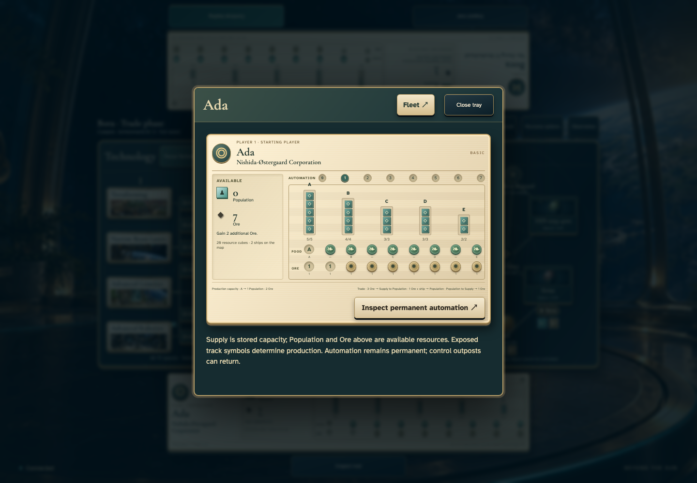](../../screenshots/return-an-outpost-during-rival-trade-and-retain-automation-at-two-shared-cardinal-seats/050-offturn-incumbent-tie-mat-desktop-darwin.png) |

tabletop-4k · 3840 × 2160

[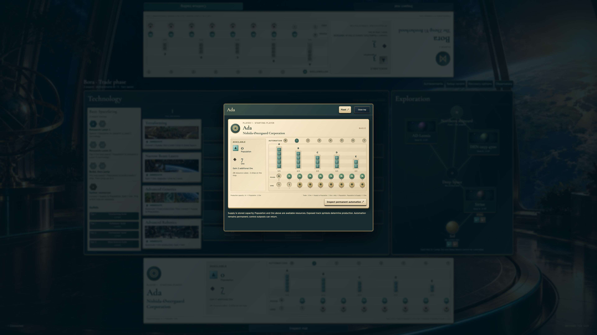](../../screenshots/return-an-outpost-during-rival-trade-and-retain-automation-at-two-shared-cardinal-seats/050-offturn-incumbent-tie-mat-tabletop-4k-darwin.png)

- [x] Ada inspects the actual production discs
- [x] Actual canonical effects and acknowledgement settle.
- [x] Public topology retains physical separation.
- [x] The viewport fits without page scrolling.

## 52. Open the reusable public fleet inspection

Viewpoint: **Ada · South · one shared controller**.

| desktop · 1440 × 1000 |
| --- |
|  |

tabletop-4k · 3840 × 2160

- [x] Open the reusable public fleet inspection
- [x] Actual canonical effects and acknowledgement settle.
- [x] Public topology retains physical separation.
- [x] The viewport fits without page scrolling.

## 53. Read saved disc ownership separately from current summed fleet power

Viewpoint: **Ada · South · one shared controller**.

| desktop · 1440 × 1000 |
| --- |
|  |

tabletop-4k · 3840 × 2160

- [x] Read saved disc ownership separately from current summed fleet power
- [x] Actual canonical effects and acknowledgement settle.
- [x] Public topology retains physical separation.
- [x] The viewport fits without page scrolling.

## 54. Inspect every faction’s actual level sum and the incumbent’s disc

Viewpoint: **Ada · South · one shared controller**.

| desktop · 1440 × 1000 |
| --- |
|  |

tabletop-4k · 3840 × 2160

- [x] Inspect every faction’s actual level sum and the incumbent’s disc
- [x] Actual canonical effects and acknowledgement settle.
- [x] Public topology retains physical separation.
- [x] The viewport fits without page scrolling.

## 55. Keyboard scroll reaches production, printed bonus and the inspection boundary

Viewpoint: **Ada · South · one shared controller**.

| desktop · 1440 × 1000 |
| --- |
| [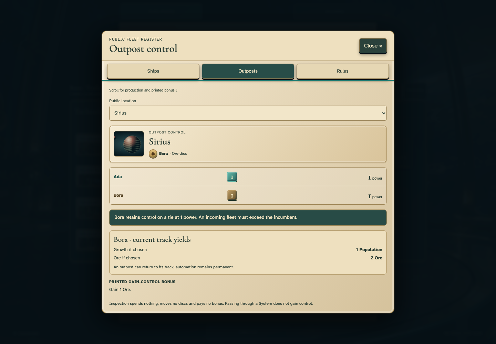](../../screenshots/return-an-outpost-during-rival-trade-and-retain-automation-at-two-shared-cardinal-seats/054-offturn-incumbent-tie-scroll-desktop-darwin.png) |

tabletop-4k · 3840 × 2160

[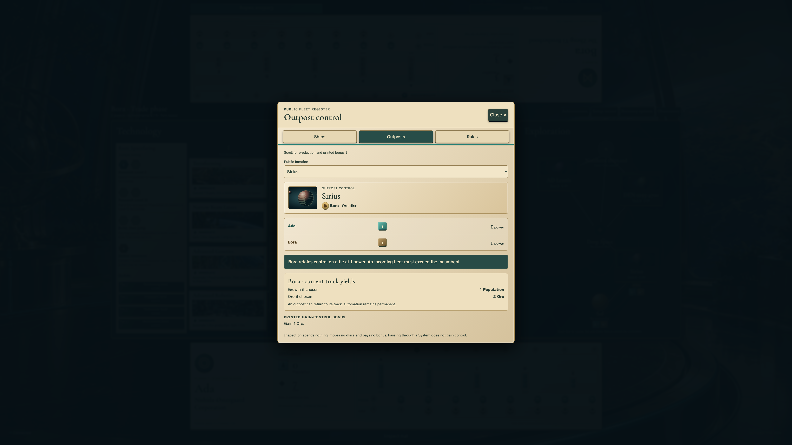](../../screenshots/return-an-outpost-during-rival-trade-and-retain-automation-at-two-shared-cardinal-seats/054-offturn-incumbent-tie-scroll-tabletop-4k-darwin.png)

- [x] Keyboard scroll reaches production, printed bonus and the inspection boundary
- [x] Actual canonical effects and acknowledgement settle.
- [x] Public topology retains physical separation.
- [x] The viewport fits without page scrolling.

## 56. Open the complete reusable fleet rules through semantic navigation

Viewpoint: **Ada · South · one shared controller**.

| desktop · 1440 × 1000 |
| --- |
|  |

tabletop-4k · 3840 × 2160

- [x] Open the complete reusable fleet rules through semantic navigation
- [x] Actual canonical effects and acknowledgement settle.
- [x] Public topology retains physical separation.
- [x] The viewport fits without page scrolling.

## 57. Return to the real ship register without taking a turn

Viewpoint: **Ada · South · one shared controller**.

| desktop · 1440 × 1000 |
| --- |
| [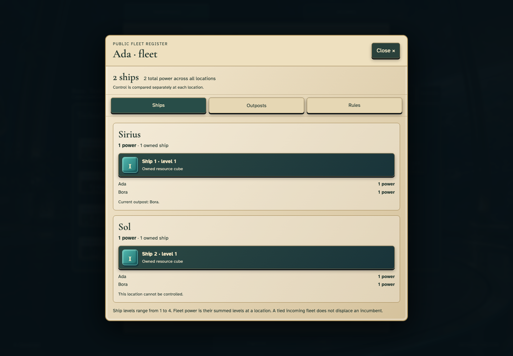](../../screenshots/return-an-outpost-during-rival-trade-and-retain-automation-at-two-shared-cardinal-seats/056-offturn-incumbent-tie-fleet-ships-desktop-darwin.png) |

tabletop-4k · 3840 × 2160

[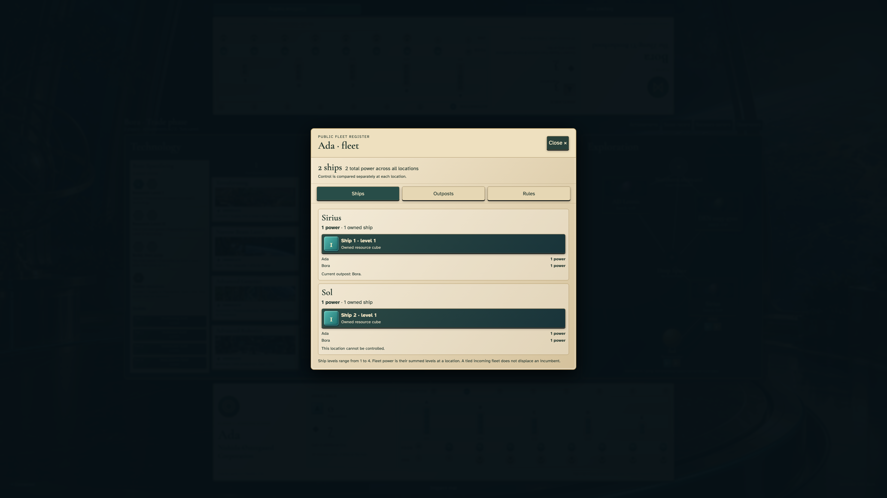](../../screenshots/return-an-outpost-during-rival-trade-and-retain-automation-at-two-shared-cardinal-seats/056-offturn-incumbent-tie-fleet-ships-tabletop-4k-darwin.png)

- [x] Return to the real ship register without taking a turn
- [x] Actual canonical effects and acknowledgement settle.
- [x] Public topology retains physical separation.
- [x] The viewport fits without page scrolling.

## 58. Escape restores the exact fleet opener without taking a turn

Viewpoint: **Ada · South · one shared controller**.

| desktop · 1440 × 1000 |
| --- |
|  |

tabletop-4k · 3840 × 2160

- [x] Escape restores the exact fleet opener without taking a turn
- [x] Actual canonical effects and acknowledgement settle.
- [x] Public topology retains physical separation.
- [x] The viewport fits without page scrolling.

## 59. Close the mat and restore its own opener

Viewpoint: **Ada · South · one shared controller**.

| desktop · 1440 × 1000 |
| --- |
| [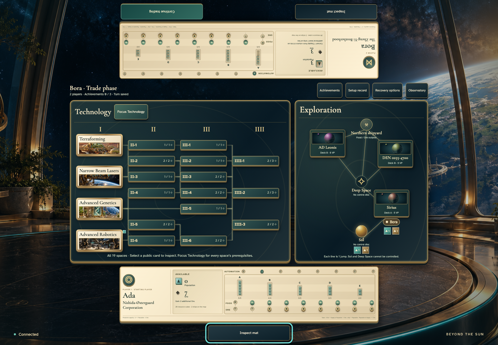](../../screenshots/return-an-outpost-during-rival-trade-and-retain-automation-at-two-shared-cardinal-seats/058-offturn-incumbent-tie-mat-return-desktop-darwin.png) |

tabletop-4k · 3840 × 2160

[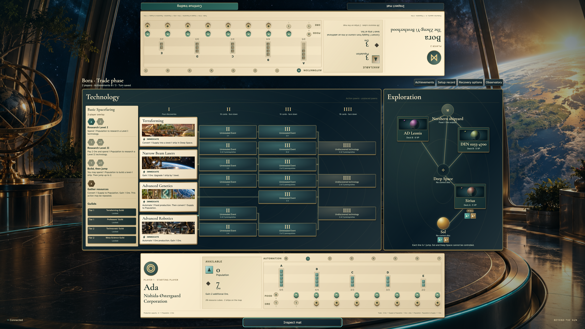](../../screenshots/return-an-outpost-during-rival-trade-and-retain-automation-at-two-shared-cardinal-seats/058-offturn-incumbent-tie-mat-return-tabletop-4k-darwin.png)

- [x] Close the mat and restore its own opener
- [x] Actual canonical effects and acknowledgement settle.
- [x] Public topology retains physical separation.
- [x] The viewport fits without page scrolling.

## 60. Return to the same actor and paid trade

Viewpoint: **Bora · North · one shared controller**.

| desktop · 1440 × 1000 |
| --- |
|  |

tabletop-4k · 3840 × 2160

- [x] Return to the same actor and paid trade
- [x] Actual canonical effects and acknowledgement settle.
- [x] Public topology retains physical separation.
- [x] The viewport fits without page scrolling.

## 61. Review the printed ship-decommission exchange in this interface

Viewpoint: **Bora · North · one shared controller**.

| desktop · 1440 × 1000 |
| --- |
| [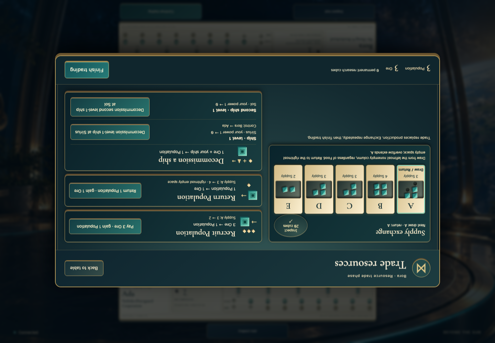](../../screenshots/return-an-outpost-during-rival-trade-and-retain-automation-at-two-shared-cardinal-seats/060-offturn-second-return-exchange-desktop-darwin.png) |

tabletop-4k · 3840 × 2160

- [x] Review the printed ship-decommission exchange in this interface
- [x] Actual canonical effects and acknowledgement settle.
- [x] Public topology retains physical separation.
- [x] The viewport fits without page scrolling.

## 62. Review the owned ship and its control consequence before paying

Viewpoint: **Bora · North · one shared controller**.

| desktop · 1440 × 1000 |
| --- |
|  |

tabletop-4k · 3840 × 2160

[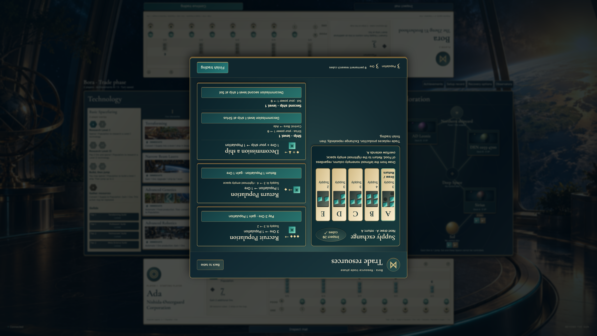](../../screenshots/return-an-outpost-during-rival-trade-and-retain-automation-at-two-shared-cardinal-seats/061-offturn-second-return-selected-tabletop-4k-darwin.png)

- [x] Review the owned ship and its control consequence before paying
- [x] Actual canonical effects and acknowledgement settle.
- [x] Public topology retains physical separation.
- [x] The viewport fits without page scrolling.

## 63. The stronger remaining opponent gains control during Bora’s turn

Viewpoint: **Bora · North · one shared controller**.

| desktop · 1440 × 1000 |
| --- |
| [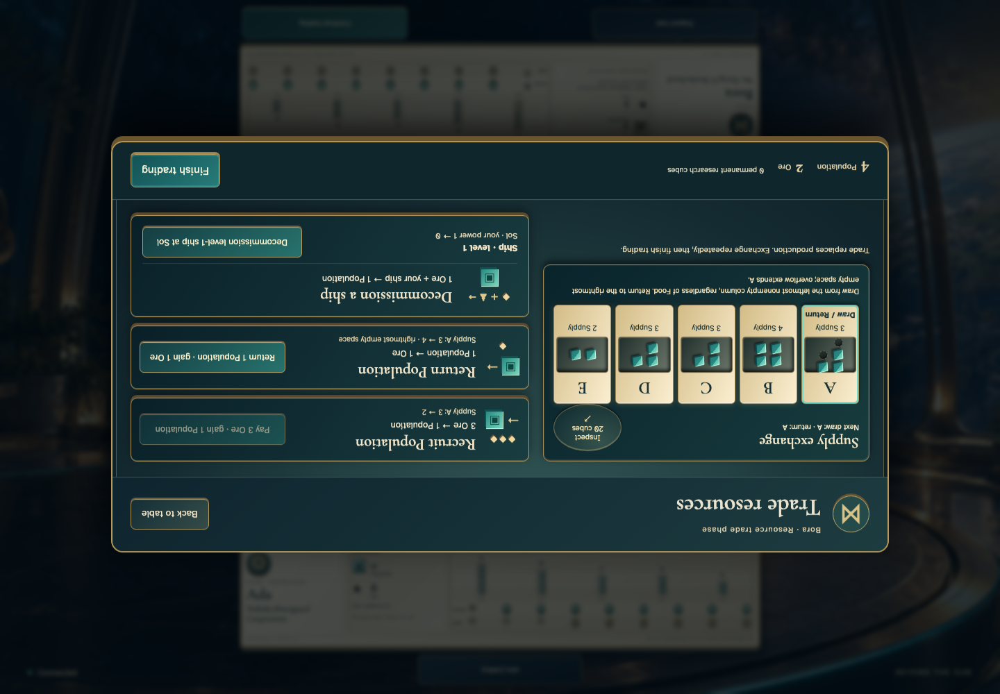](../../screenshots/return-an-outpost-during-rival-trade-and-retain-automation-at-two-shared-cardinal-seats/062-offturn-control-returned-desktop-darwin.png) |

tabletop-4k · 3840 × 2160

- [x] The stronger remaining opponent gains control during Bora’s turn
- [x] Actual canonical effects and acknowledgement settle.
- [x] Public topology retains physical separation.
- [x] The viewport fits without page scrolling.

## 64. The trading continuation resumes after control transfer

Viewpoint: **Bora · North · one shared controller**.

| desktop · 1440 × 1000 |
| --- |
|  |

tabletop-4k · 3840 × 2160

- [x] The trading continuation resumes after control transfer
- [x] Actual canonical effects and acknowledgement settle.
- [x] Public topology retains physical separation.
- [x] The viewport fits without page scrolling.

## 65. Ada inspects the actual production discs

Viewpoint: **Ada · South · one shared controller**.

| desktop · 1440 × 1000 |
| --- |
|  |

tabletop-4k · 3840 × 2160

- [x] Ada inspects the actual production discs
- [x] Actual canonical effects and acknowledgement settle.
- [x] Public topology retains physical separation.
- [x] The viewport fits without page scrolling.

## 66. Open the reusable public fleet inspection

Viewpoint: **Ada · South · one shared controller**.

| desktop · 1440 × 1000 |
| --- |
|  |

tabletop-4k · 3840 × 2160

- [x] Open the reusable public fleet inspection
- [x] Actual canonical effects and acknowledgement settle.
- [x] Public topology retains physical separation.
- [x] The viewport fits without page scrolling.

## 67. Read saved disc ownership separately from current summed fleet power

Viewpoint: **Ada · South · one shared controller**.

| desktop · 1440 × 1000 |
| --- |
|  |

tabletop-4k · 3840 × 2160

- [x] Read saved disc ownership separately from current summed fleet power
- [x] Actual canonical effects and acknowledgement settle.
- [x] Public topology retains physical separation.
- [x] The viewport fits without page scrolling.

## 68. Inspect every faction’s actual level sum and the incumbent’s disc

Viewpoint: **Ada · South · one shared controller**.

| desktop · 1440 × 1000 |
| --- |
|  |

tabletop-4k · 3840 × 2160

- [x] Inspect every faction’s actual level sum and the incumbent’s disc
- [x] Actual canonical effects and acknowledgement settle.
- [x] Public topology retains physical separation.
- [x] The viewport fits without page scrolling.

## 69. Keyboard scroll reaches production, printed bonus and the inspection boundary

Viewpoint: **Ada · South · one shared controller**.

| desktop · 1440 × 1000 |
| --- |
|  |

tabletop-4k · 3840 × 2160

- [x] Keyboard scroll reaches production, printed bonus and the inspection boundary
- [x] Actual canonical effects and acknowledgement settle.
- [x] Public topology retains physical separation.
- [x] The viewport fits without page scrolling.

## 70. Open the complete reusable fleet rules through semantic navigation

Viewpoint: **Ada · South · one shared controller**.

| desktop · 1440 × 1000 |
| --- |
|  |

tabletop-4k · 3840 × 2160

- [x] Open the complete reusable fleet rules through semantic navigation
- [x] Actual canonical effects and acknowledgement settle.
- [x] Public topology retains physical separation.
- [x] The viewport fits without page scrolling.

## 71. Return to the real ship register without taking a turn

Viewpoint: **Ada · South · one shared controller**.

| desktop · 1440 × 1000 |
| --- |
|  |

tabletop-4k · 3840 × 2160

- [x] Return to the real ship register without taking a turn
- [x] Actual canonical effects and acknowledgement settle.
- [x] Public topology retains physical separation.
- [x] The viewport fits without page scrolling.

## 72. Escape restores the exact fleet opener without taking a turn

Viewpoint: **Ada · South · one shared controller**.

| desktop · 1440 × 1000 |
| --- |
|  |

tabletop-4k · 3840 × 2160

- [x] Escape restores the exact fleet opener without taking a turn
- [x] Actual canonical effects and acknowledgement settle.
- [x] Public topology retains physical separation.
- [x] The viewport fits without page scrolling.

## 73. Close the mat and restore its own opener

Viewpoint: **Ada · South · one shared controller**.

| desktop · 1440 × 1000 |
| --- |
|  |

tabletop-4k · 3840 × 2160

- [x] Close the mat and restore its own opener
- [x] Actual canonical effects and acknowledgement settle.
- [x] Public topology retains physical separation.
- [x] The viewport fits without page scrolling.

## 74. Bora inspects the actual production discs

Viewpoint: **Bora · North · one shared controller**.

| desktop · 1440 × 1000 |
| --- |
|  |

tabletop-4k · 3840 × 2160

- [x] Bora inspects the actual production discs
- [x] Actual canonical effects and acknowledgement settle.
- [x] Public topology retains physical separation.
- [x] The viewport fits without page scrolling.

## 75. Open the reusable public fleet inspection

Viewpoint: **Bora · North · one shared controller**.

| desktop · 1440 × 1000 |
| --- |
|  |

tabletop-4k · 3840 × 2160

- [x] Open the reusable public fleet inspection
- [x] Actual canonical effects and acknowledgement settle.
- [x] Public topology retains physical separation.
- [x] The viewport fits without page scrolling.

## 76. Read saved disc ownership separately from current summed fleet power

Viewpoint: **Bora · North · one shared controller**.

| desktop · 1440 × 1000 |
| --- |
|  |

tabletop-4k · 3840 × 2160

- [x] Read saved disc ownership separately from current summed fleet power
- [x] Actual canonical effects and acknowledgement settle.
- [x] Public topology retains physical separation.
- [x] The viewport fits without page scrolling.

## 77. Inspect every faction’s actual level sum and the incumbent’s disc

Viewpoint: **Bora · North · one shared controller**.

| desktop · 1440 × 1000 |
| --- |
|  |

tabletop-4k · 3840 × 2160

- [x] Inspect every faction’s actual level sum and the incumbent’s disc
- [x] Actual canonical effects and acknowledgement settle.
- [x] Public topology retains physical separation.
- [x] The viewport fits without page scrolling.

## 78. Read the current conditional yields; an outpost does not pay regular production automatically

Viewpoint: **Bora · North · one shared controller**.

| desktop · 1440 × 1000 |
| --- |
|  |

tabletop-4k · 3840 × 2160

- [x] Read the current conditional yields; an outpost does not pay regular production automatically
- [x] Actual canonical effects and acknowledgement settle.
- [x] Public topology retains physical separation.
- [x] The viewport fits without page scrolling.

## 79. Read the complete control rule and actual printed gain-control bonus

Viewpoint: **Bora · North · one shared controller**.

| desktop · 1440 × 1000 |
| --- |
|  |

tabletop-4k · 3840 × 2160

- [x] Read the complete control rule and actual printed gain-control bonus
- [x] Actual canonical effects and acknowledgement settle.
- [x] Public topology retains physical separation.
- [x] The viewport fits without page scrolling.

## 80. Open the complete reusable fleet rules through semantic navigation

Viewpoint: **Bora · North · one shared controller**.

| desktop · 1440 × 1000 |
| --- |
|  |

tabletop-4k · 3840 × 2160

- [x] Open the complete reusable fleet rules through semantic navigation
- [x] Actual canonical effects and acknowledgement settle.
- [x] Public topology retains physical separation.
- [x] The viewport fits without page scrolling.

## 81. Return to the real ship register without taking a turn

Viewpoint: **Bora · North · one shared controller**.

| desktop · 1440 × 1000 |
| --- |
|  |

tabletop-4k · 3840 × 2160

- [x] Return to the real ship register without taking a turn
- [x] Actual canonical effects and acknowledgement settle.
- [x] Public topology retains physical separation.
- [x] The viewport fits without page scrolling.

## 82. Escape restores the exact fleet opener without taking a turn

Viewpoint: **Bora · North · one shared controller**.

| desktop · 1440 × 1000 |
| --- |
|  |

tabletop-4k · 3840 × 2160

- [x] Escape restores the exact fleet opener without taking a turn
- [x] Actual canonical effects and acknowledgement settle.
- [x] Public topology retains physical separation.
- [x] The viewport fits without page scrolling.

## 83. Close the mat and restore its own opener

Viewpoint: **Bora · North · one shared controller**.

| desktop · 1440 × 1000 |
| --- |
|  |

tabletop-4k · 3840 × 2160

- [x] Close the mat and restore its own opener
- [x] Actual canonical effects and acknowledgement settle.
- [x] Public topology retains physical separation.
- [x] The viewport fits without page scrolling.

## 84. Reload retains Bora’s trade after the other player gained control

Viewpoint: **Bora · North · one shared controller**.

| desktop · 1440 × 1000 |
| --- |
|  |

tabletop-4k · 3840 × 2160

- [x] Reload retains Bora’s trade after the other player gained control
- [x] Actual canonical effects and acknowledgement settle.
- [x] Public topology retains physical separation.
- [x] The viewport fits without page scrolling.

## 85. Paid exchanges remain exact after reload

Viewpoint: **Bora · North · one shared controller**.

| desktop · 1440 × 1000 |
| --- |
|  |

tabletop-4k · 3840 × 2160

- [x] Paid exchanges remain exact after reload
- [x] Actual canonical effects and acknowledgement settle.
- [x] Public topology retains physical separation.
- [x] The viewport fits without page scrolling.

## 86. Only Finish trading hands control to Ada

Viewpoint: **Bora · North · one shared controller**.

| desktop · 1440 × 1000 |
| --- |
|  |

tabletop-4k · 3840 × 2160

- [x] Only Finish trading hands control to Ada
- [x] Actual canonical effects and acknowledgement settle.
- [x] Public topology retains physical separation.
- [x] The viewport fits without page scrolling.
