# Establish a mixed-disc colony at 2 shared cardinal seats

One normal shared controller joins every physical seat with legal unique Basic factions. Predeclared setup seed002 Sirius or006 Wolf359 only at Begin. Real preparatory turns; no companion device, identity injection, seeded game state or future deck read. Two-player Sirius includes legal upgrade/overpay; four-player retains exact settlement.

## 1. Arrive through the actual production interface

Viewpoint: **Ada · South · one shared controller**.

| desktop · 1440 × 1000 |
| --- |
|  |

tabletop-4k · 3840 × 2160

- [x] Arrive through the actual production interface
- [x] Actual canonical effects and acknowledgement settle.
- [x] Public topology retains physical separation.
- [x] The viewport fits without page scrolling.

## 2. Choose physical tabletop or separate-controller remote play

Viewpoint: **Ada · South · one shared controller**.

| desktop · 1440 × 1000 |
| --- |
|  |

tabletop-4k · 3840 × 2160

- [x] Choose physical tabletop or separate-controller remote play
- [x] Actual canonical effects and acknowledgement settle.
- [x] Public topology retains physical separation.
- [x] The viewport fits without page scrolling.

## 3. One shared controller opens the physical seats

Viewpoint: **Ada · South · one shared controller**.

| desktop · 1440 × 1000 |
| --- |
|  |

tabletop-4k · 3840 × 2160

- [x] One shared controller opens the physical seats
- [x] Actual canonical effects and acknowledgement settle.
- [x] Public topology retains physical separation.
- [x] The viewport fits without page scrolling.

## 4. Join directly at South

Viewpoint: **Ada · South · one shared controller**.

| desktop · 1440 × 1000 |
| --- |
|  |

tabletop-4k · 3840 × 2160

- [x] Join directly at South
- [x] Actual canonical effects and acknowledgement settle.
- [x] Public topology retains physical separation.
- [x] The viewport fits without page scrolling.

## 5. Name this physical seat Ada

Viewpoint: **Ada · South · one shared controller**.

| desktop · 1440 × 1000 |
| --- |
|  |

tabletop-4k · 3840 × 2160

- [x] Name this physical seat Ada
- [x] Actual canonical effects and acknowledgement settle.
- [x] Public topology retains physical separation.
- [x] The viewport fits without page scrolling.

## 6. Persist the named seat on the same display

Viewpoint: **Ada · South · one shared controller**.

| desktop · 1440 × 1000 |
| --- |
|  |

tabletop-4k · 3840 × 2160

[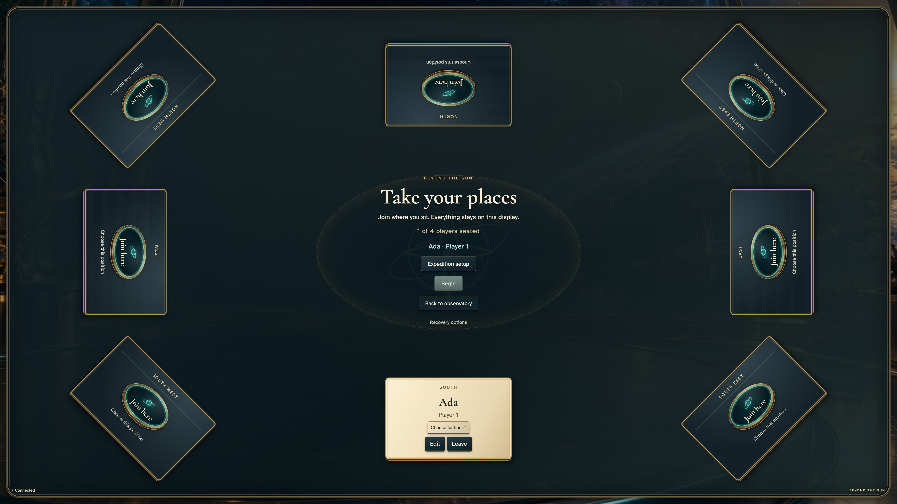](../../screenshots/establish-a-mixed-disc-colony-at-2-shared-cardinal-seats/005-seat-0-joined-tabletop-4k-darwin.png)

- [x] Persist the named seat on the same display
- [x] Actual canonical effects and acknowledgement settle.
- [x] Public topology retains physical separation.
- [x] The viewport fits without page scrolling.

## 7. Join directly at North

Viewpoint: **Bora · North · one shared controller**.

| desktop · 1440 × 1000 |
| --- |
|  |

tabletop-4k · 3840 × 2160

- [x] Join directly at North
- [x] Actual canonical effects and acknowledgement settle.
- [x] Public topology retains physical separation.
- [x] The viewport fits without page scrolling.

## 8. Name this physical seat Bora

Viewpoint: **Bora · North · one shared controller**.

| desktop · 1440 × 1000 |
| --- |
|  |

tabletop-4k · 3840 × 2160

- [x] Name this physical seat Bora
- [x] Actual canonical effects and acknowledgement settle.
- [x] Public topology retains physical separation.
- [x] The viewport fits without page scrolling.

## 9. Persist the named seat on the same display

Viewpoint: **Bora · North · one shared controller**.

| desktop · 1440 × 1000 |
| --- |
|  |

tabletop-4k · 3840 × 2160

- [x] Persist the named seat on the same display
- [x] Actual canonical effects and acknowledgement settle.
- [x] Public topology retains physical separation.
- [x] The viewport fits without page scrolling.

## 10. Choose a legal unique Basic faction

Viewpoint: **Ada · South · one shared controller**.

| desktop · 1440 × 1000 |
| --- |
|  |

tabletop-4k · 3840 × 2160

[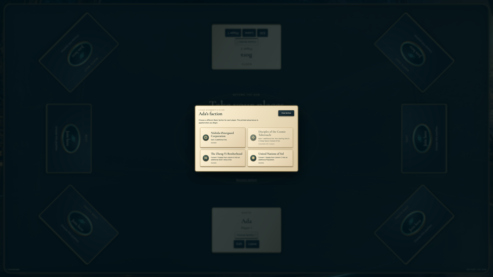](../../screenshots/establish-a-mixed-disc-colony-at-2-shared-cardinal-seats/009-faction-0-open-tabletop-4k-darwin.png)

- [x] Choose a legal unique Basic faction
- [x] Actual canonical effects and acknowledgement settle.
- [x] Public topology retains physical separation.
- [x] The viewport fits without page scrolling.

## 11. Ada chooses The Zheng-Yi Brotherhood

Viewpoint: **Ada · South · one shared controller**.

| desktop · 1440 × 1000 |
| --- |
| [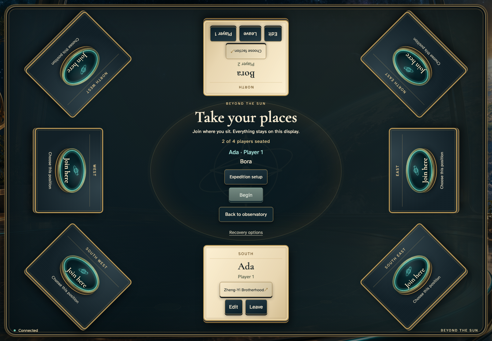](../../screenshots/establish-a-mixed-disc-colony-at-2-shared-cardinal-seats/010-faction-0-selected-desktop-darwin.png) |

tabletop-4k · 3840 × 2160

- [x] Ada chooses The Zheng-Yi Brotherhood
- [x] Actual canonical effects and acknowledgement settle.
- [x] Public topology retains physical separation.
- [x] The viewport fits without page scrolling.

## 12. Choose a legal unique Basic faction

Viewpoint: **Bora · North · one shared controller**.

| desktop · 1440 × 1000 |
| --- |
|  |

tabletop-4k · 3840 × 2160

[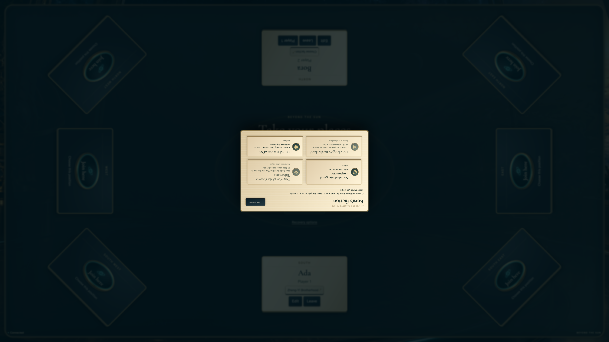](../../screenshots/establish-a-mixed-disc-colony-at-2-shared-cardinal-seats/011-faction-1-open-tabletop-4k-darwin.png)

- [x] Choose a legal unique Basic faction
- [x] Actual canonical effects and acknowledgement settle.
- [x] Public topology retains physical separation.
- [x] The viewport fits without page scrolling.

## 13. Bora chooses Nishida-Østergaard Corporation

Viewpoint: **Bora · North · one shared controller**.

| desktop · 1440 × 1000 |
| --- |
| [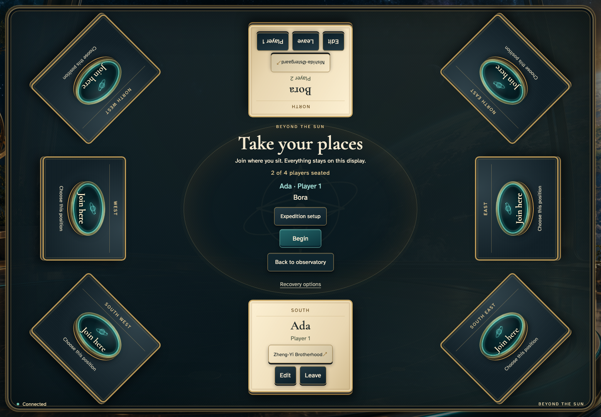](../../screenshots/establish-a-mixed-disc-colony-at-2-shared-cardinal-seats/012-faction-1-selected-desktop-darwin.png) |

tabletop-4k · 3840 × 2160

[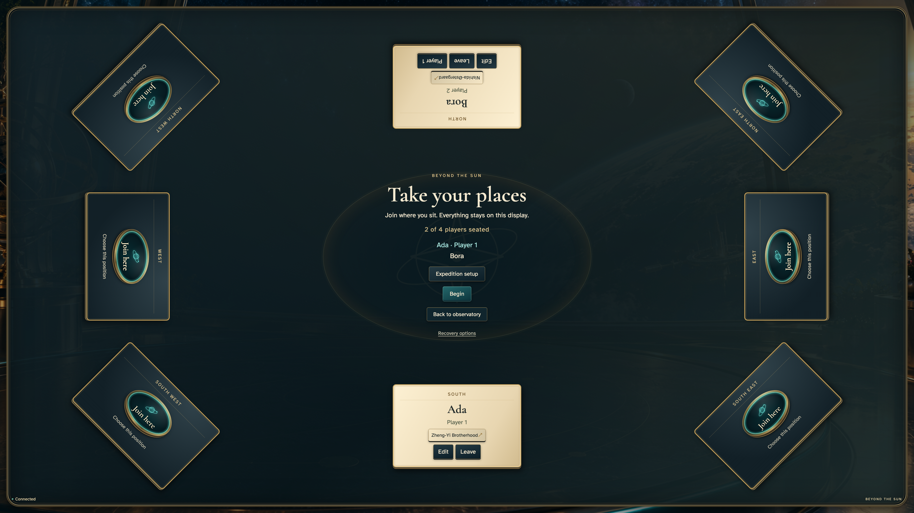](../../screenshots/establish-a-mixed-disc-colony-at-2-shared-cardinal-seats/012-faction-1-selected-tabletop-4k-darwin.png)

- [x] Bora chooses Nishida-Østergaard Corporation
- [x] Actual canonical effects and acknowledgement settle.
- [x] Public topology retains physical separation.
- [x] The viewport fits without page scrolling.

## 14. Begin the immutable Basic game through normal UI

Viewpoint: **Ada · South · one shared controller**.

| desktop · 1440 × 1000 |
| --- |
|  |

tabletop-4k · 3840 × 2160

- [x] Begin the immutable Basic game through normal UI
- [x] Actual canonical effects and acknowledgement settle.
- [x] Public topology retains physical separation.
- [x] The viewport fits without page scrolling.

## 15. Open Ada’s real Action instrument

Viewpoint: **Ada · South · one shared controller**.

| desktop · 1440 × 1000 |
| --- |
|  |

tabletop-4k · 3840 × 2160

- [x] Open Ada’s real Action instrument
- [x] Actual canonical effects and acknowledgement settle.
- [x] Public topology retains physical separation.
- [x] The viewport fits without page scrolling.

## 16. Choose Research Level I

Viewpoint: **Ada · South · one shared controller**.

| desktop · 1440 × 1000 |
| --- |
|  |

tabletop-4k · 3840 × 2160

- [x] Choose Research Level I
- [x] Actual canonical effects and acknowledgement settle.
- [x] Public topology retains physical separation.
- [x] The viewport fits without page scrolling.

## 17. Choose a legal unoccupied research space

Viewpoint: **Ada · South · one shared controller**.

| desktop · 1440 × 1000 |
| --- |
| [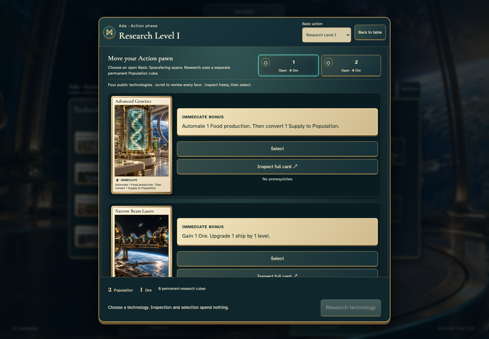](../../screenshots/establish-a-mixed-disc-colony-at-2-shared-cardinal-seats/016-terraforming-space-desktop-darwin.png) |

tabletop-4k · 3840 × 2160

[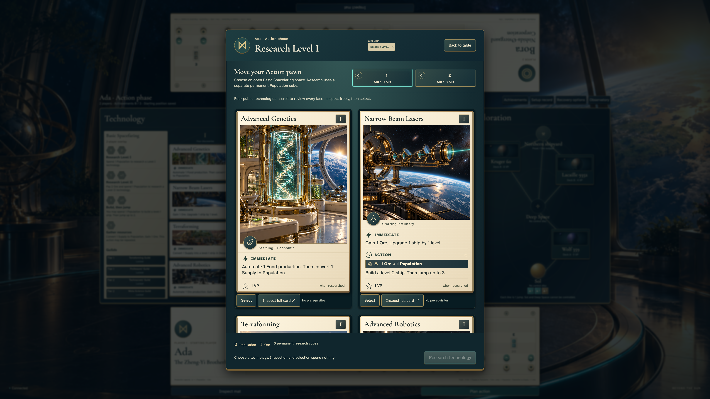](../../screenshots/establish-a-mixed-disc-colony-at-2-shared-cardinal-seats/016-terraforming-space-tabletop-4k-darwin.png)

- [x] Choose a legal unoccupied research space
- [x] Actual canonical effects and acknowledgement settle.
- [x] Public topology retains physical separation.
- [x] The viewport fits without page scrolling.

## 18. Select Terraforming without paying yet

Viewpoint: **Ada · South · one shared controller**.

| desktop · 1440 × 1000 |
| --- |
| [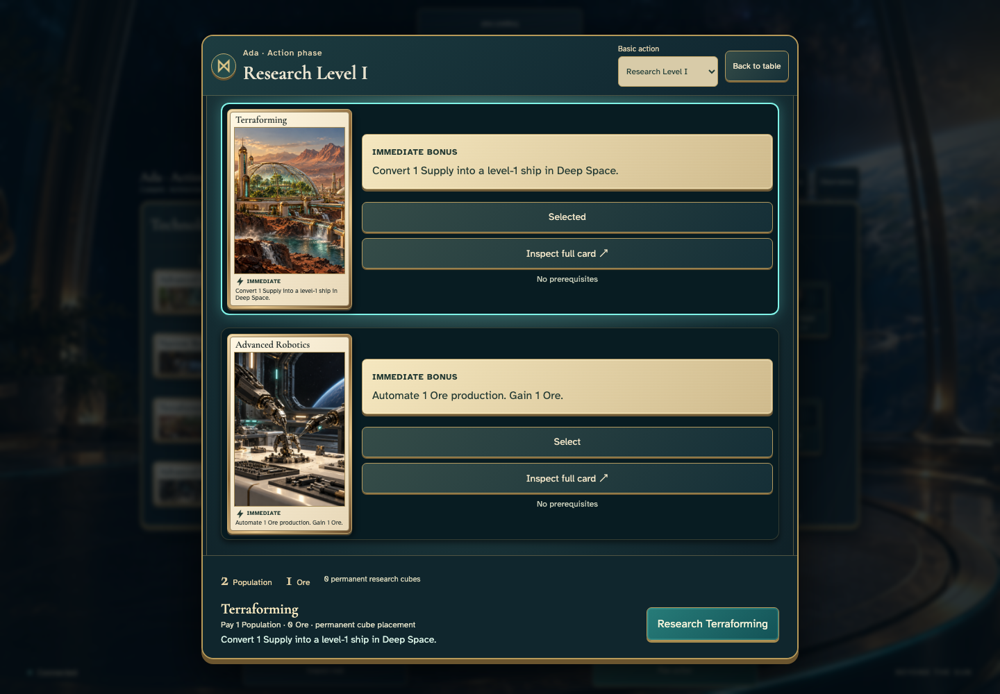](../../screenshots/establish-a-mixed-disc-colony-at-2-shared-cardinal-seats/017-terraforming-selected-desktop-darwin.png) |

tabletop-4k · 3840 × 2160

[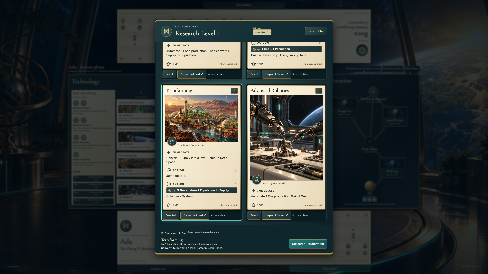](../../screenshots/establish-a-mixed-disc-colony-at-2-shared-cardinal-seats/017-terraforming-selected-tabletop-4k-darwin.png)

- [x] Select Terraforming without paying yet
- [x] Actual canonical effects and acknowledgement settle.
- [x] Public topology retains physical separation.
- [x] The viewport fits without page scrolling.

## 19. Pay the permanent research cube and resolve the once-only printed bonus

Viewpoint: **Ada · South · one shared controller**.

| desktop · 1440 × 1000 |
| --- |
|  |

tabletop-4k · 3840 × 2160

- [x] Pay the permanent research cube and resolve the once-only printed bonus
- [x] Actual canonical effects and acknowledgement settle.
- [x] Public topology retains physical separation.
- [x] The viewport fits without page scrolling.

## 20. Choose ordinary growth and hand off automatically

Viewpoint: **Ada · South · one shared controller**.

| desktop · 1440 × 1000 |
| --- |
| [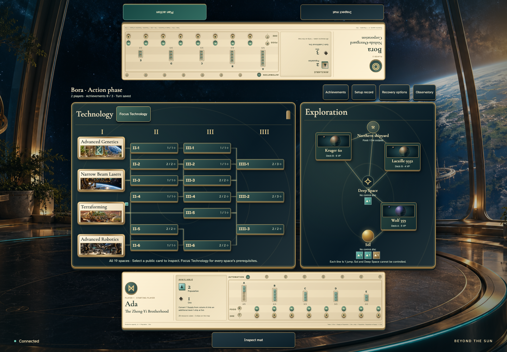](../../screenshots/establish-a-mixed-disc-colony-at-2-shared-cardinal-seats/019-terraforming-handoff-desktop-darwin.png) |

tabletop-4k · 3840 × 2160

[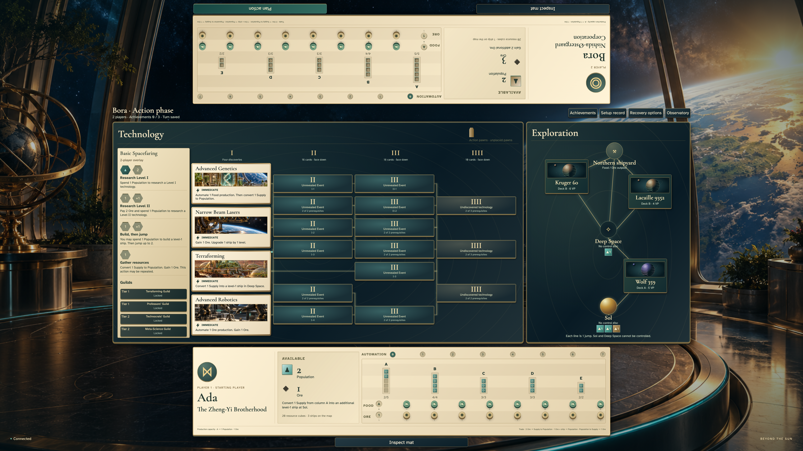](../../screenshots/establish-a-mixed-disc-colony-at-2-shared-cardinal-seats/019-terraforming-handoff-tabletop-4k-darwin.png)

- [x] Choose ordinary growth and hand off automatically
- [x] Actual canonical effects and acknowledgement settle.
- [x] Public topology retains physical separation.
- [x] The viewport fits without page scrolling.

## 21. Open Bora’s real Action instrument

Viewpoint: **Bora · North · one shared controller**.

| desktop · 1440 × 1000 |
| --- |
| [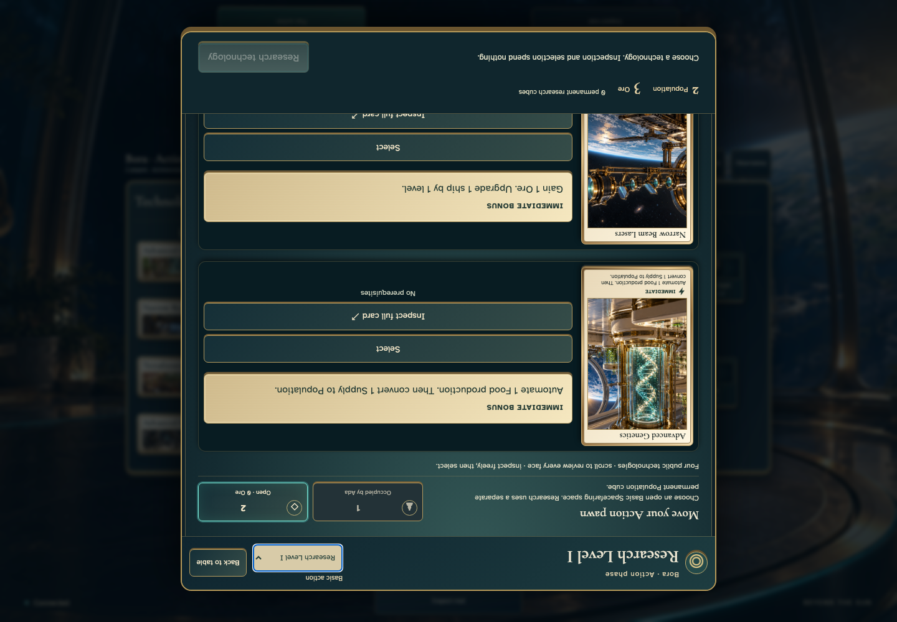](../../screenshots/establish-a-mixed-disc-colony-at-2-shared-cardinal-seats/020-bora-gather-open-desktop-darwin.png) |

tabletop-4k · 3840 × 2160

[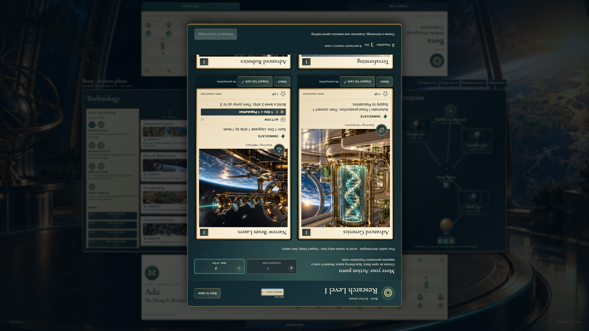](../../screenshots/establish-a-mixed-disc-colony-at-2-shared-cardinal-seats/020-bora-gather-open-tabletop-4k-darwin.png)

- [x] Open Bora’s real Action instrument
- [x] Actual canonical effects and acknowledgement settle.
- [x] Public topology retains physical separation.
- [x] The viewport fits without page scrolling.

## 22. Choose Gather

Viewpoint: **Bora · North · one shared controller**.

| desktop · 1440 × 1000 |
| --- |
| [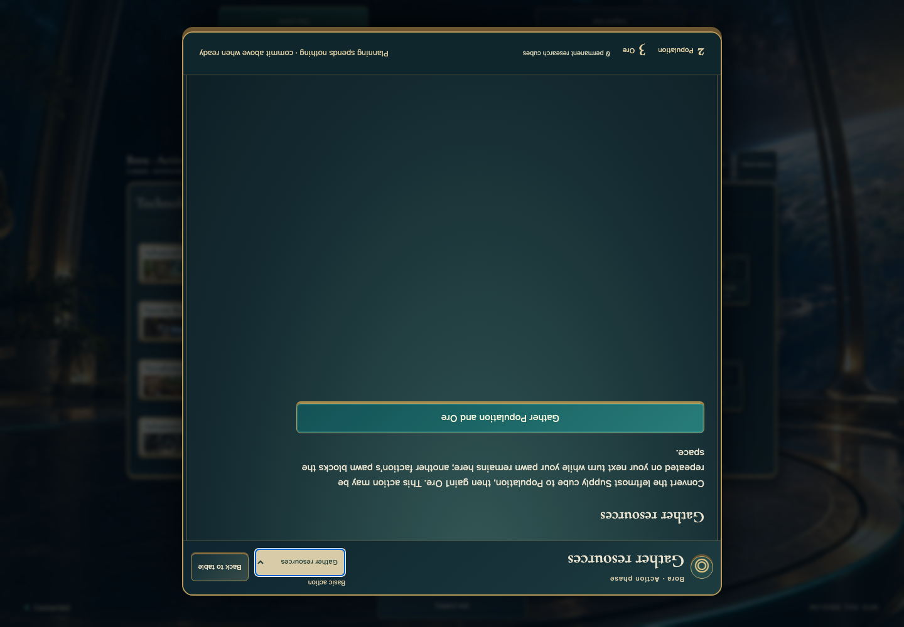](../../screenshots/establish-a-mixed-disc-colony-at-2-shared-cardinal-seats/021-bora-gather-kind-desktop-darwin.png) |

tabletop-4k · 3840 × 2160

[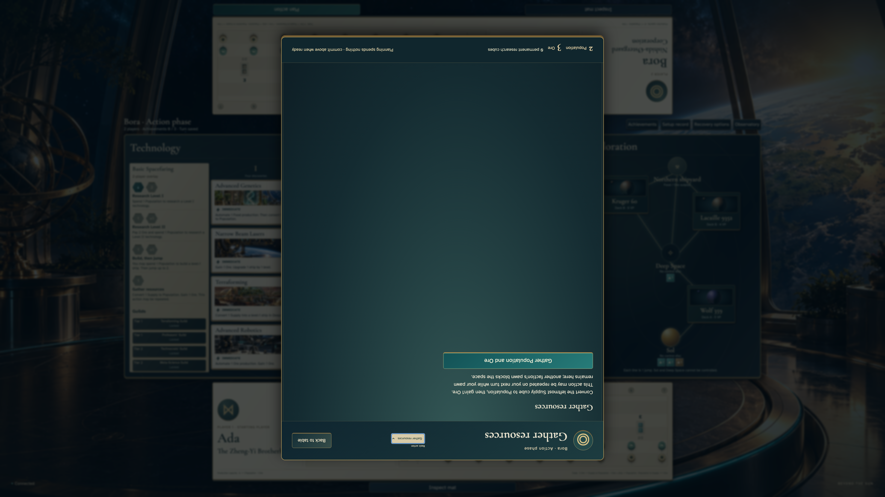](../../screenshots/establish-a-mixed-disc-colony-at-2-shared-cardinal-seats/021-bora-gather-kind-tabletop-4k-darwin.png)

- [x] Choose Gather
- [x] Actual canonical effects and acknowledgement settle.
- [x] Public topology retains physical separation.
- [x] The viewport fits without page scrolling.

## 23. Gather from actual leftmost Supply and gain the printed Ore

Viewpoint: **Bora · North · one shared controller**.

| desktop · 1440 × 1000 |
| --- |
|  |

tabletop-4k · 3840 × 2160

[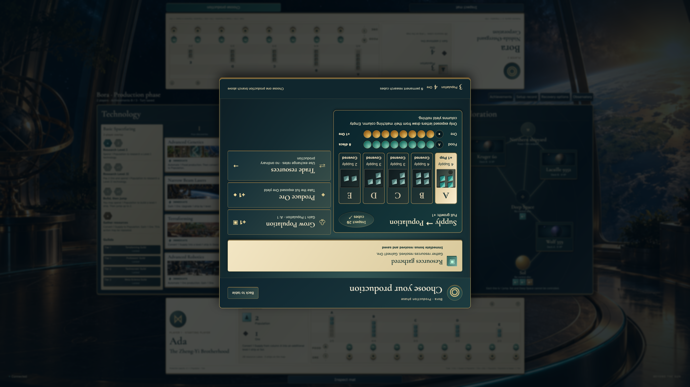](../../screenshots/establish-a-mixed-disc-colony-at-2-shared-cardinal-seats/022-bora-gather-paid-tabletop-4k-darwin.png)

- [x] Gather from actual leftmost Supply and gain the printed Ore
- [x] Actual canonical effects and acknowledgement settle.
- [x] Public topology retains physical separation.
- [x] The viewport fits without page scrolling.

## 24. Choose ordinary Ore production and hand off automatically

Viewpoint: **Bora · North · one shared controller**.

| desktop · 1440 × 1000 |
| --- |
|  |

tabletop-4k · 3840 × 2160

- [x] Choose ordinary Ore production and hand off automatically
- [x] Actual canonical effects and acknowledgement settle.
- [x] Public topology retains physical separation.
- [x] The viewport fits without page scrolling.

## 25. Open Ada’s real Action instrument

Viewpoint: **Ada · South · one shared controller**.

| desktop · 1440 × 1000 |
| --- |
| [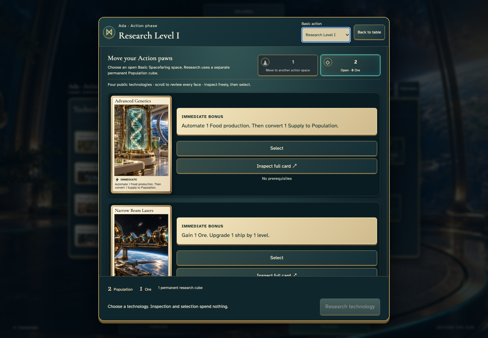](../../screenshots/establish-a-mixed-disc-colony-at-2-shared-cardinal-seats/024-terraforming-movement-open-desktop-darwin.png) |

tabletop-4k · 3840 × 2160

[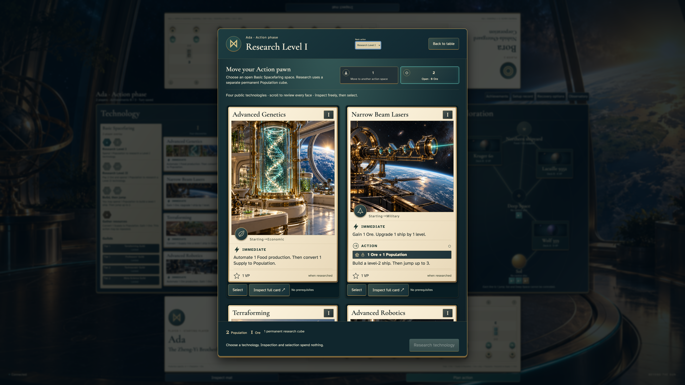](../../screenshots/establish-a-mixed-disc-colony-at-2-shared-cardinal-seats/024-terraforming-movement-open-tabletop-4k-darwin.png)

- [x] Open Ada’s real Action instrument
- [x] Actual canonical effects and acknowledgement settle.
- [x] Public topology retains physical separation.
- [x] The viewport fits without page scrolling.

## 26. Choose a researched printed Action

Viewpoint: **Ada · South · one shared controller**.

| desktop · 1440 × 1000 |
| --- |
| [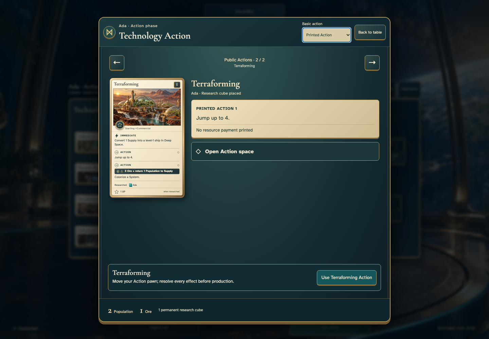](../../screenshots/establish-a-mixed-disc-colony-at-2-shared-cardinal-seats/025-terraforming-movement-kind-desktop-darwin.png) |

tabletop-4k · 3840 × 2160

[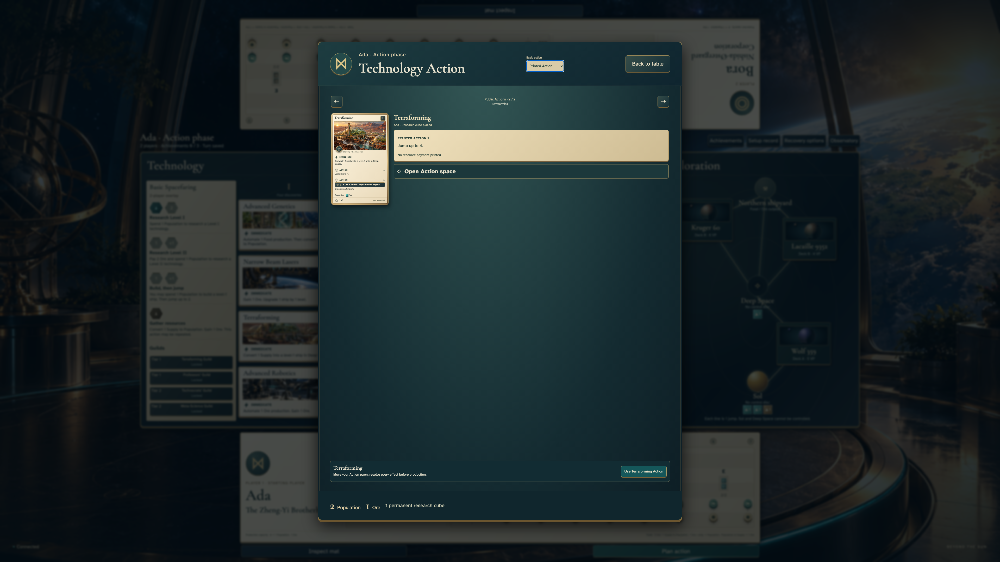](../../screenshots/establish-a-mixed-disc-colony-at-2-shared-cardinal-seats/025-terraforming-movement-kind-tabletop-4k-darwin.png)

- [x] Choose a researched printed Action
- [x] Actual canonical effects and acknowledgement settle.
- [x] Public topology retains physical separation.
- [x] The viewport fits without page scrolling.

## 27. Commit the real printed four-jump Action before planning endpoints

Viewpoint: **Ada · South · one shared controller**.

| desktop · 1440 × 1000 |
| --- |
|  |

tabletop-4k · 3840 × 2160

- [x] Commit the real printed four-jump Action before planning endpoints
- [x] Actual canonical effects and acknowledgement settle.
- [x] Public topology retains physical separation.
- [x] The viewport fits without page scrolling.

## 28. Read actual connected destinations for the unpaid route

Viewpoint: **Ada · South · one shared controller**.

| desktop · 1440 × 1000 |
| --- |
|  |

tabletop-4k · 3840 × 2160

- [x] Read actual connected destinations for the unpaid route
- [x] Actual canonical effects and acknowledgement settle.
- [x] Public topology retains physical separation.
- [x] The viewport fits without page scrolling.

## 29. Choose owned Ship 1 for movement

Viewpoint: **Ada · South · one shared controller**.

| desktop · 1440 × 1000 |
| --- |
| [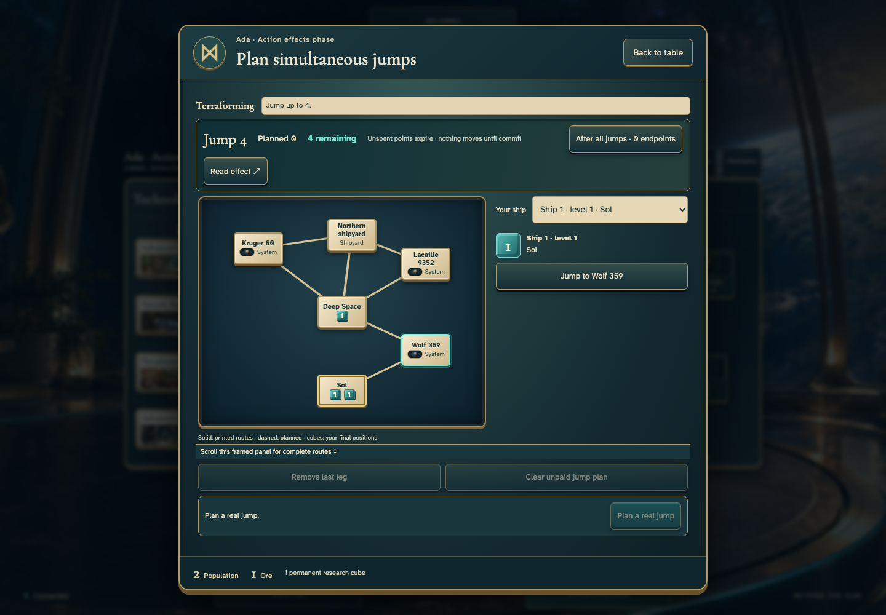](../../screenshots/establish-a-mixed-disc-colony-at-2-shared-cardinal-seats/028-settler-route-0-ship-desktop-darwin.png) |

tabletop-4k · 3840 × 2160

- [x] Choose owned Ship 1 for movement
- [x] Actual canonical effects and acknowledgement settle.
- [x] Public topology retains physical separation.
- [x] The viewport fits without page scrolling.

## 30. Plan the connected Wolf 359 endpoint without moving a cube

Viewpoint: **Ada · South · one shared controller**.

| desktop · 1440 × 1000 |
| --- |
| [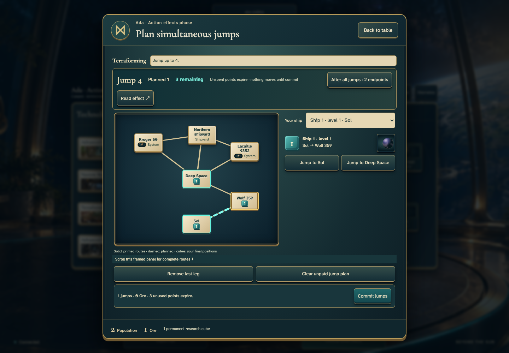](../../screenshots/establish-a-mixed-disc-colony-at-2-shared-cardinal-seats/029-settler-route-0-endpoint-desktop-darwin.png) |

tabletop-4k · 3840 × 2160

- [x] Plan the connected Wolf 359 endpoint without moving a cube
- [x] Actual canonical effects and acknowledgement settle.
- [x] Public topology retains physical separation.
- [x] The viewport fits without page scrolling.

## 31. Read actual connected destinations for the unpaid route

Viewpoint: **Ada · South · one shared controller**.

| desktop · 1440 × 1000 |
| --- |
|  |

tabletop-4k · 3840 × 2160

- [x] Read actual connected destinations for the unpaid route
- [x] Actual canonical effects and acknowledgement settle.
- [x] Public topology retains physical separation.
- [x] The viewport fits without page scrolling.

## 32. Choose owned Ship 2 for movement

Viewpoint: **Ada · South · one shared controller**.

| desktop · 1440 × 1000 |
| --- |
| [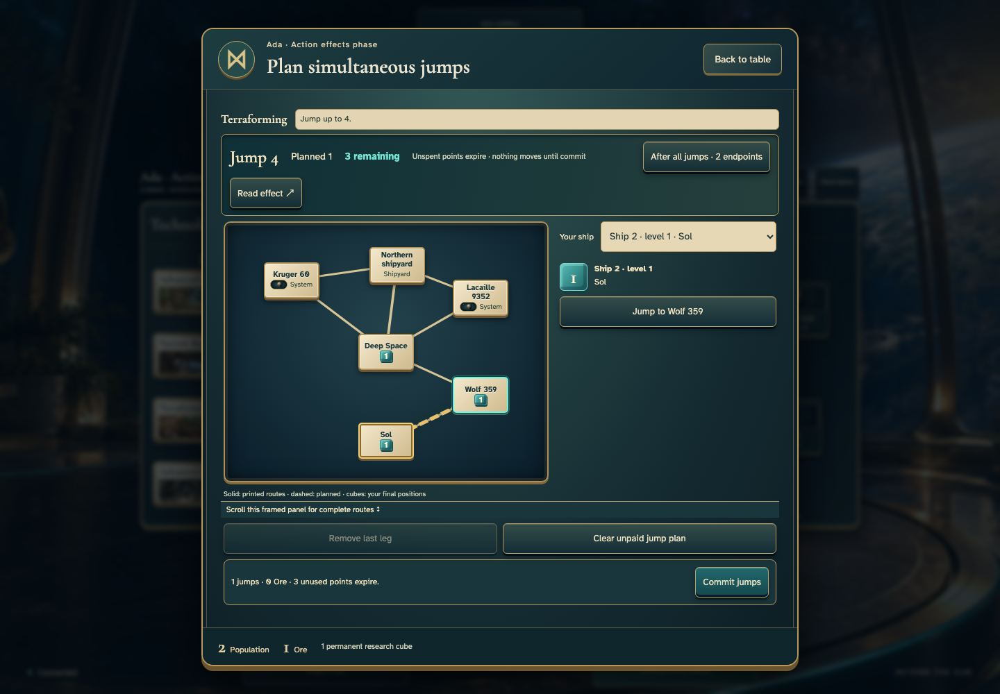](../../screenshots/establish-a-mixed-disc-colony-at-2-shared-cardinal-seats/031-settler-route-1-ship-desktop-darwin.png) |

tabletop-4k · 3840 × 2160

[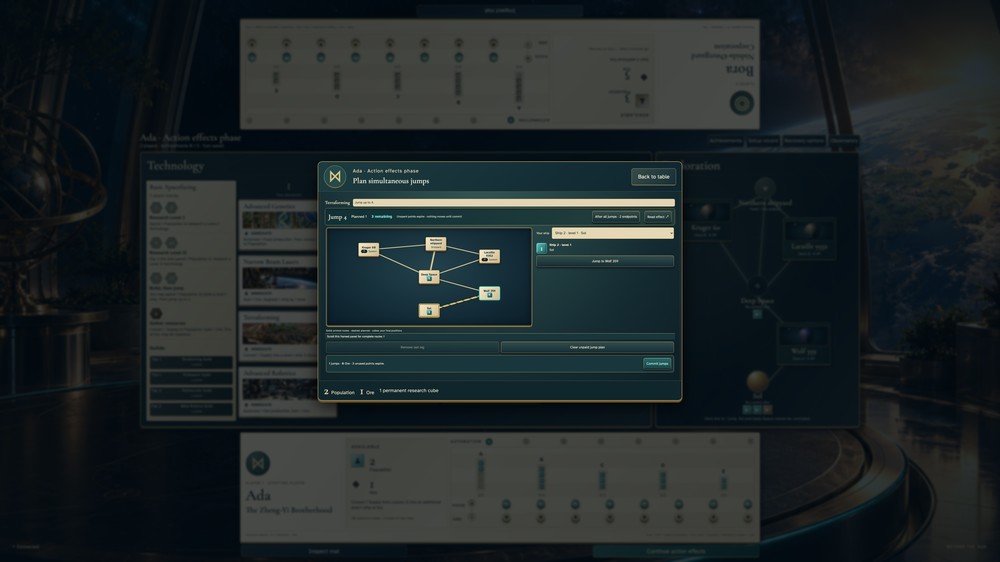](../../screenshots/establish-a-mixed-disc-colony-at-2-shared-cardinal-seats/031-settler-route-1-ship-tabletop-4k-darwin.png)

- [x] Choose owned Ship 2 for movement
- [x] Actual canonical effects and acknowledgement settle.
- [x] Public topology retains physical separation.
- [x] The viewport fits without page scrolling.

## 33. Plan the connected Wolf 359 endpoint without moving a cube

Viewpoint: **Ada · South · one shared controller**.

| desktop · 1440 × 1000 |
| --- |
|  |

tabletop-4k · 3840 × 2160

- [x] Plan the connected Wolf 359 endpoint without moving a cube
- [x] Actual canonical effects and acknowledgement settle.
- [x] Public topology retains physical separation.
- [x] The viewport fits without page scrolling.

## 34. Read actual connected destinations for the unpaid route

Viewpoint: **Ada · South · one shared controller**.

| desktop · 1440 × 1000 |
| --- |
|  |

tabletop-4k · 3840 × 2160

- [x] Read actual connected destinations for the unpaid route
- [x] Actual canonical effects and acknowledgement settle.
- [x] Public topology retains physical separation.
- [x] The viewport fits without page scrolling.

## 35. Choose owned Ship 3 for movement

Viewpoint: **Ada · South · one shared controller**.

| desktop · 1440 × 1000 |
| --- |
| [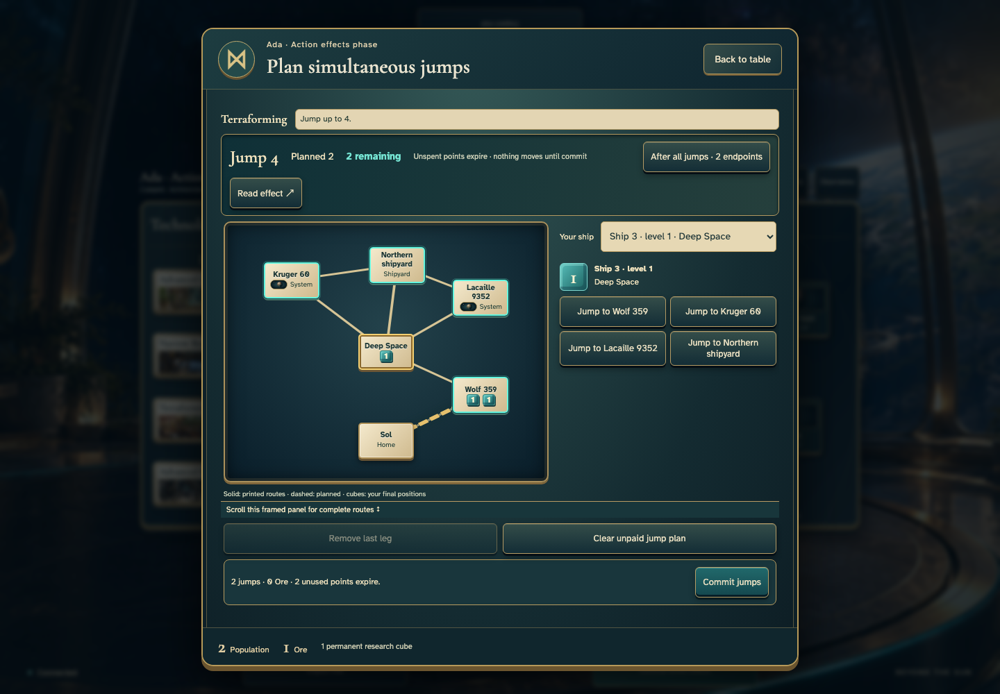](../../screenshots/establish-a-mixed-disc-colony-at-2-shared-cardinal-seats/034-settler-route-2-ship-desktop-darwin.png) |

tabletop-4k · 3840 × 2160

[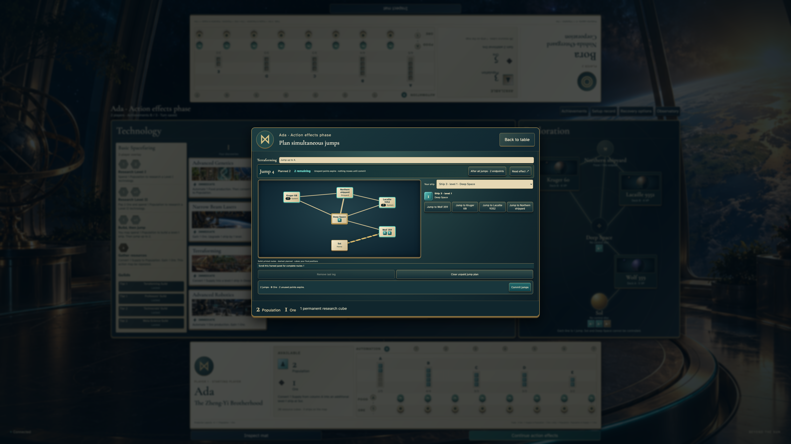](../../screenshots/establish-a-mixed-disc-colony-at-2-shared-cardinal-seats/034-settler-route-2-ship-tabletop-4k-darwin.png)

- [x] Choose owned Ship 3 for movement
- [x] Actual canonical effects and acknowledgement settle.
- [x] Public topology retains physical separation.
- [x] The viewport fits without page scrolling.

## 36. Plan the connected Wolf 359 endpoint without moving a cube

Viewpoint: **Ada · South · one shared controller**.

| desktop · 1440 × 1000 |
| --- |
| [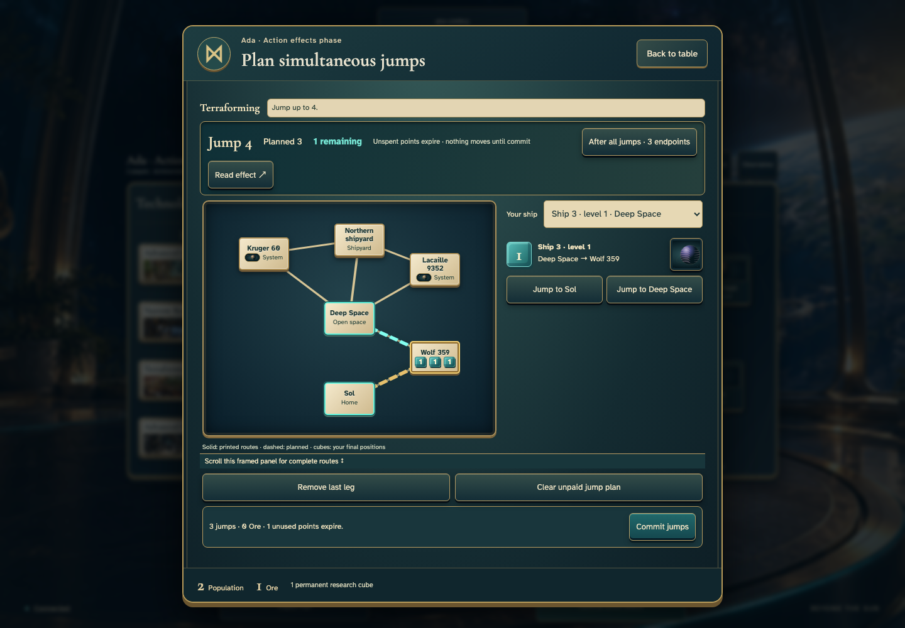](../../screenshots/establish-a-mixed-disc-colony-at-2-shared-cardinal-seats/035-settler-route-2-endpoint-desktop-darwin.png) |

tabletop-4k · 3840 × 2160

- [x] Plan the connected Wolf 359 endpoint without moving a cube
- [x] Actual canonical effects and acknowledgement settle.
- [x] Public topology retains physical separation.
- [x] The viewport fits without page scrolling.

## 37. Choose the actual gained multi-specialty outpost before its colony turn

Viewpoint: **Ada · South · one shared controller**.

| desktop · 1440 × 1000 |
| --- |
| [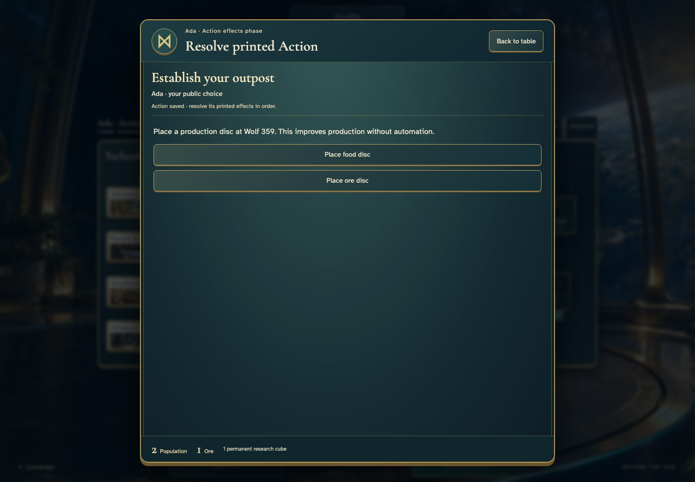](../../screenshots/establish-a-mixed-disc-colony-at-2-shared-cardinal-seats/036-initial-control-choice-desktop-darwin.png) |

tabletop-4k · 3840 × 2160

[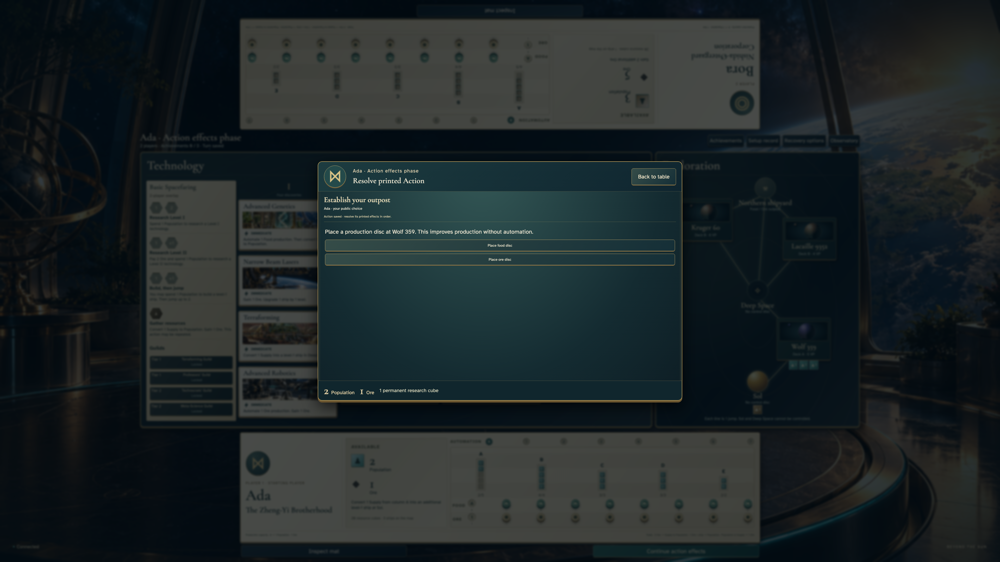](../../screenshots/establish-a-mixed-disc-colony-at-2-shared-cardinal-seats/036-initial-control-choice-tabletop-4k-darwin.png)

- [x] Choose the actual gained multi-specialty outpost before its colony turn
- [x] Actual canonical effects and acknowledgement settle.
- [x] Public topology retains physical separation.
- [x] The viewport fits without page scrolling.

## 38. All three endpoints settle; the actual outpost is gained once

Viewpoint: **Ada · South · one shared controller**.

| desktop · 1440 × 1000 |
| --- |
| [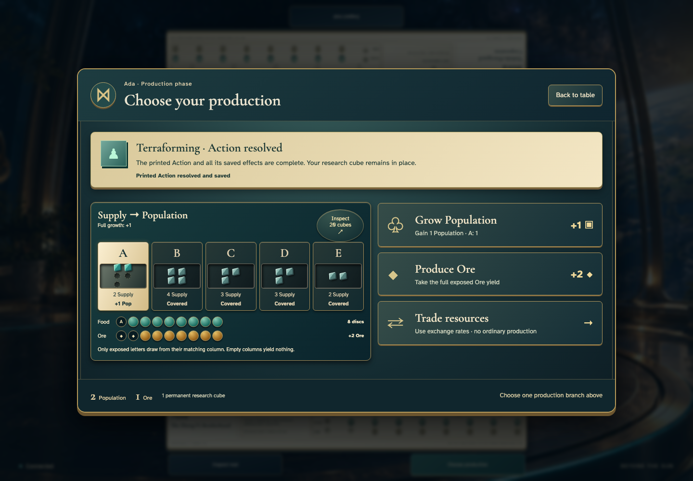](../../screenshots/establish-a-mixed-disc-colony-at-2-shared-cardinal-seats/037-world-controlled-desktop-darwin.png) |

tabletop-4k · 3840 × 2160

[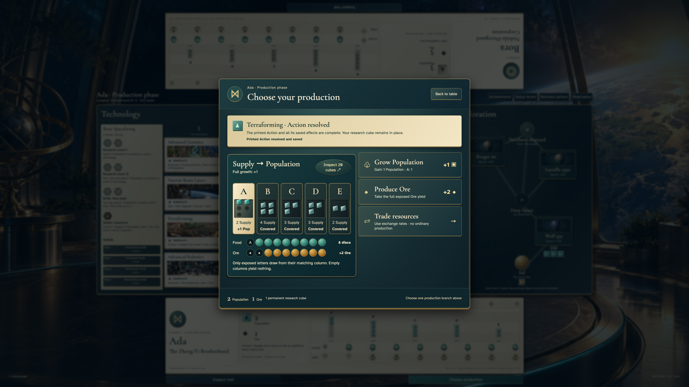](../../screenshots/establish-a-mixed-disc-colony-at-2-shared-cardinal-seats/037-world-controlled-tabletop-4k-darwin.png)

- [x] All three endpoints settle; the actual outpost is gained once
- [x] Actual canonical effects and acknowledgement settle.
- [x] Public topology retains physical separation.
- [x] The viewport fits without page scrolling.

## 39. Choose ordinary Ore production and hand off automatically

Viewpoint: **Ada · South · one shared controller**.

| desktop · 1440 × 1000 |
| --- |
| [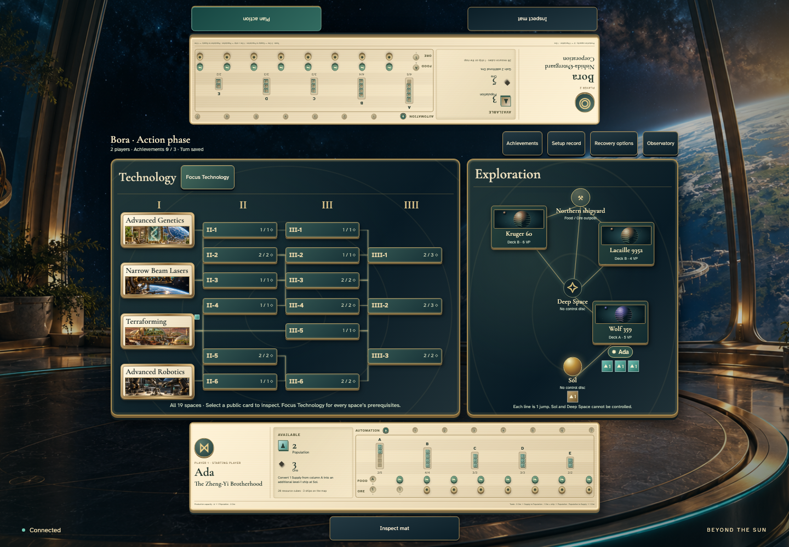](../../screenshots/establish-a-mixed-disc-colony-at-2-shared-cardinal-seats/038-world-controlled-handoff-desktop-darwin.png) |

tabletop-4k · 3840 × 2160

- [x] Choose ordinary Ore production and hand off automatically
- [x] Actual canonical effects and acknowledgement settle.
- [x] Public topology retains physical separation.
- [x] The viewport fits without page scrolling.

## 40. Open Bora’s real Action instrument

Viewpoint: **Bora · North · one shared controller**.

| desktop · 1440 × 1000 |
| --- |
| [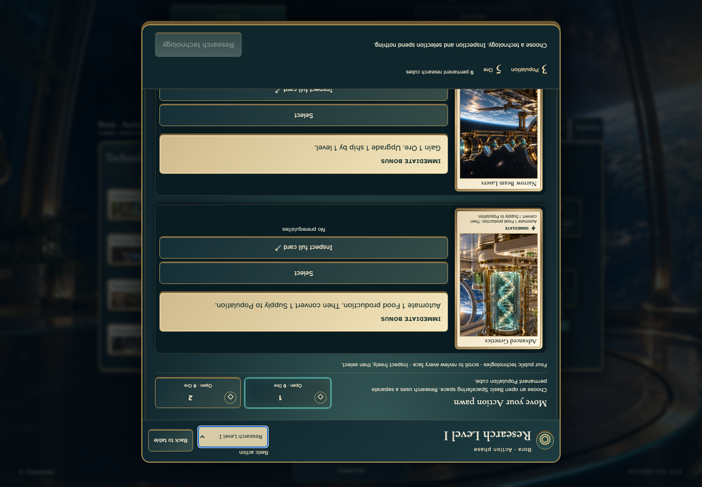](../../screenshots/establish-a-mixed-disc-colony-at-2-shared-cardinal-seats/039-rival-arrival-open-desktop-darwin.png) |

tabletop-4k · 3840 × 2160

[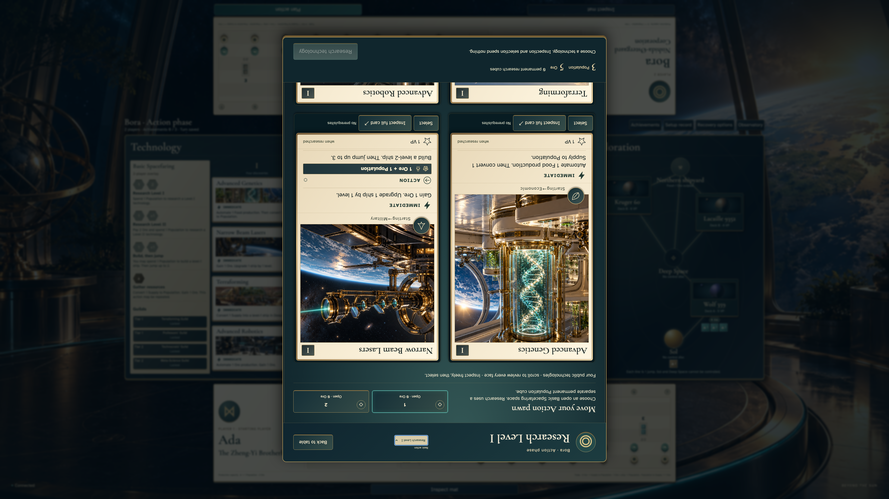](../../screenshots/establish-a-mixed-disc-colony-at-2-shared-cardinal-seats/039-rival-arrival-open-tabletop-4k-darwin.png)

- [x] Open Bora’s real Action instrument
- [x] Actual canonical effects and acknowledgement settle.
- [x] Public topology retains physical separation.
- [x] The viewport fits without page scrolling.

## 41. Choose Basic build and jump

Viewpoint: **Bora · North · one shared controller**.

| desktop · 1440 × 1000 |
| --- |
| [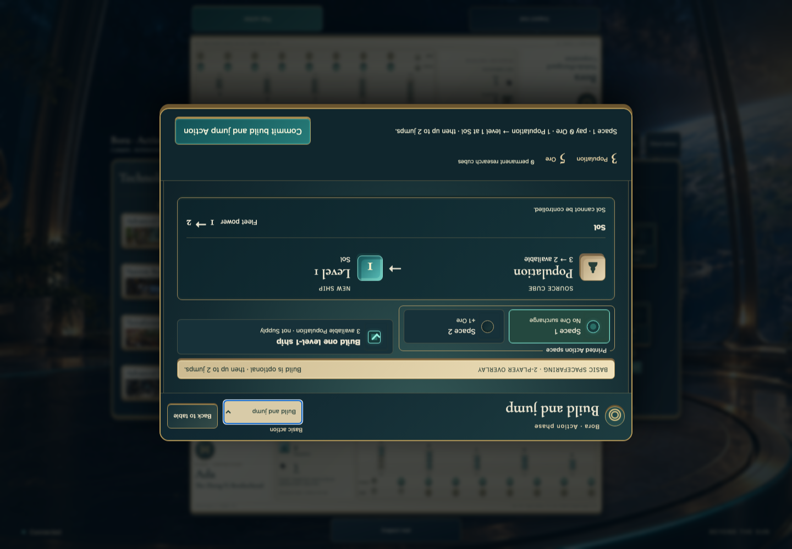](../../screenshots/establish-a-mixed-disc-colony-at-2-shared-cardinal-seats/040-rival-arrival-kind-desktop-darwin.png) |

tabletop-4k · 3840 × 2160

[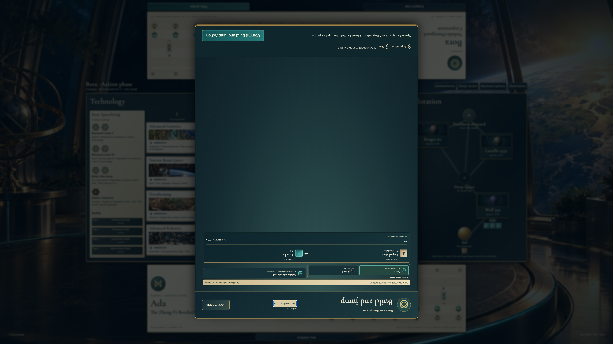](../../screenshots/establish-a-mixed-disc-colony-at-2-shared-cardinal-seats/040-rival-arrival-kind-tabletop-4k-darwin.png)

- [x] Choose Basic build and jump
- [x] Actual canonical effects and acknowledgement settle.
- [x] Public topology retains physical separation.
- [x] The viewport fits without page scrolling.

## 42. The rival pays for a real new ship before its optional jumps

Viewpoint: **Bora · North · one shared controller**.

| desktop · 1440 × 1000 |
| --- |
| [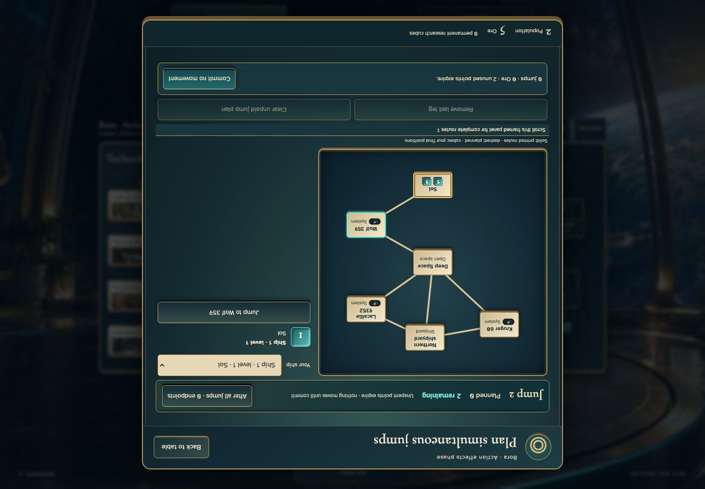](../../screenshots/establish-a-mixed-disc-colony-at-2-shared-cardinal-seats/041-rival-built-desktop-darwin.png) |

tabletop-4k · 3840 × 2160

- [x] The rival pays for a real new ship before its optional jumps
- [x] Actual canonical effects and acknowledgement settle.
- [x] Public topology retains physical separation.
- [x] The viewport fits without page scrolling.

## 43. Read actual connected destinations for the unpaid route

Viewpoint: **Bora · North · one shared controller**.

| desktop · 1440 × 1000 |
| --- |
|  |

tabletop-4k · 3840 × 2160

- [x] Read actual connected destinations for the unpaid route
- [x] Actual canonical effects and acknowledgement settle.
- [x] Public topology retains physical separation.
- [x] The viewport fits without page scrolling.

## 44. Choose owned Ship 1 for movement

Viewpoint: **Bora · North · one shared controller**.

| desktop · 1440 × 1000 |
| --- |
|  |

tabletop-4k · 3840 × 2160

- [x] Choose owned Ship 1 for movement
- [x] Actual canonical effects and acknowledgement settle.
- [x] Public topology retains physical separation.
- [x] The viewport fits without page scrolling.

## 45. Plan the connected Wolf 359 endpoint without moving a cube

Viewpoint: **Bora · North · one shared controller**.

| desktop · 1440 × 1000 |
| --- |
| [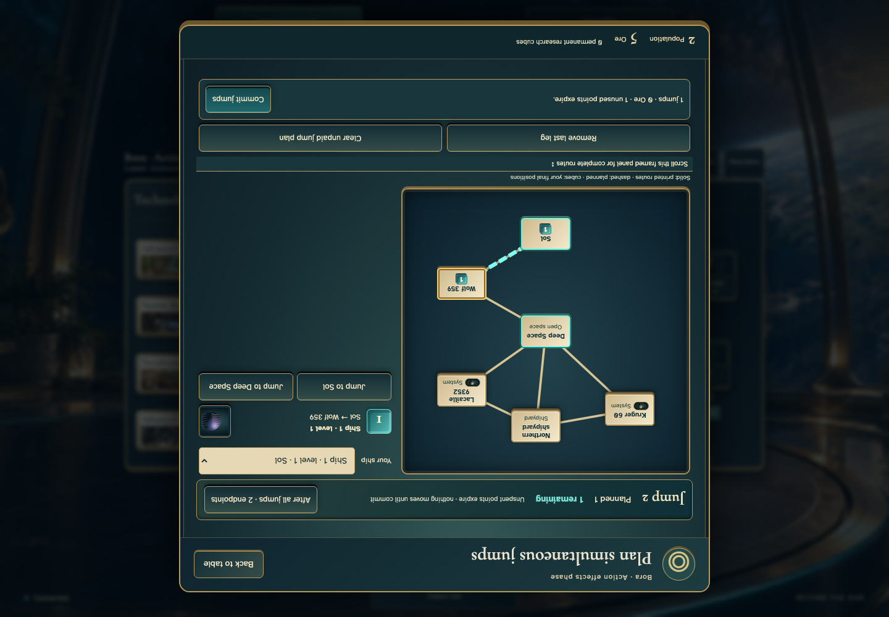](../../screenshots/establish-a-mixed-disc-colony-at-2-shared-cardinal-seats/044-rival-route-endpoint-desktop-darwin.png) |

tabletop-4k · 3840 × 2160

[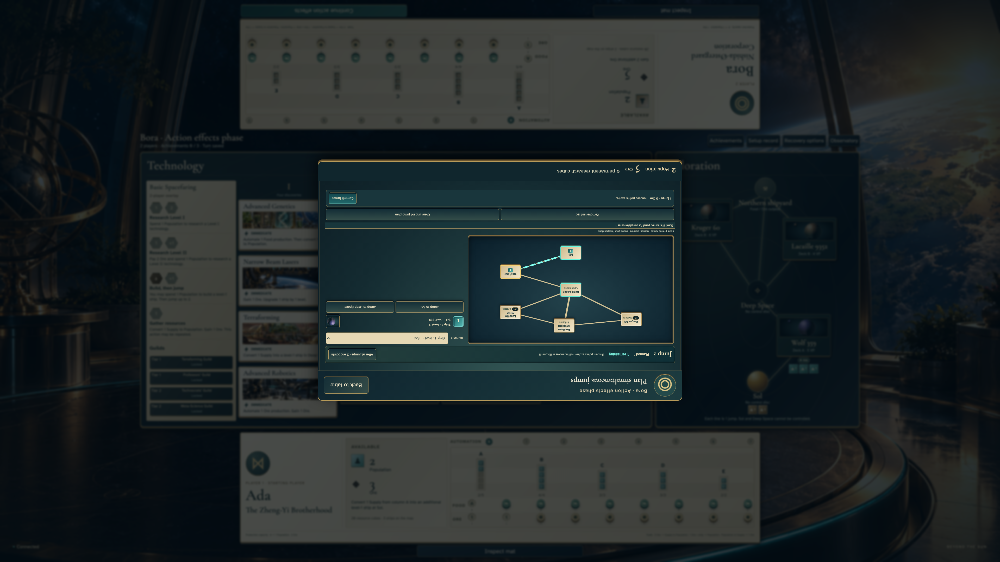](../../screenshots/establish-a-mixed-disc-colony-at-2-shared-cardinal-seats/044-rival-route-endpoint-tabletop-4k-darwin.png)

- [x] Plan the connected Wolf 359 endpoint without moving a cube
- [x] Actual canonical effects and acknowledgement settle.
- [x] Public topology retains physical separation.
- [x] The viewport fits without page scrolling.

## 46. A weaker rival fleet arrives without taking the incumbent’s outpost

Viewpoint: **Bora · North · one shared controller**.

| desktop · 1440 × 1000 |
| --- |
| [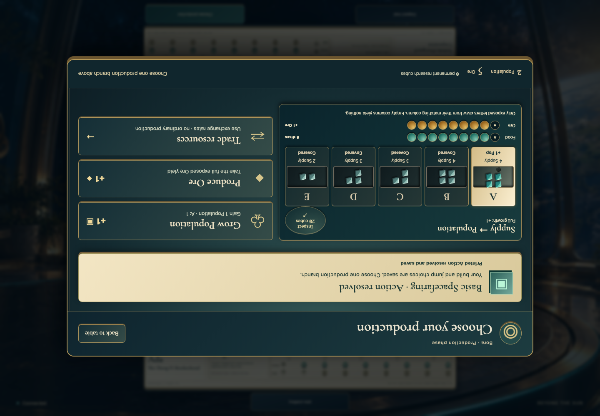](../../screenshots/establish-a-mixed-disc-colony-at-2-shared-cardinal-seats/045-rival-arrived-desktop-darwin.png) |

tabletop-4k · 3840 × 2160

[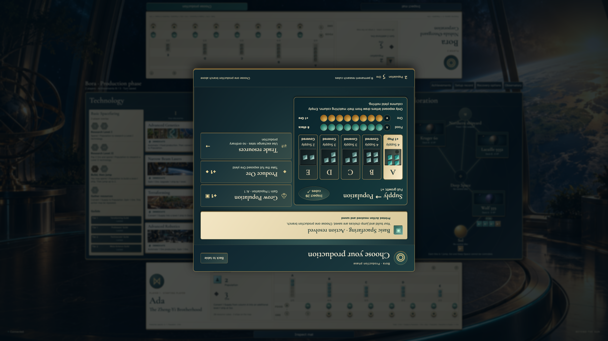](../../screenshots/establish-a-mixed-disc-colony-at-2-shared-cardinal-seats/045-rival-arrived-tabletop-4k-darwin.png)

- [x] A weaker rival fleet arrives without taking the incumbent’s outpost
- [x] Actual canonical effects and acknowledgement settle.
- [x] Public topology retains physical separation.
- [x] The viewport fits without page scrolling.

## 47. Choose ordinary Ore production and hand off automatically

Viewpoint: **Bora · North · one shared controller**.

| desktop · 1440 × 1000 |
| --- |
| [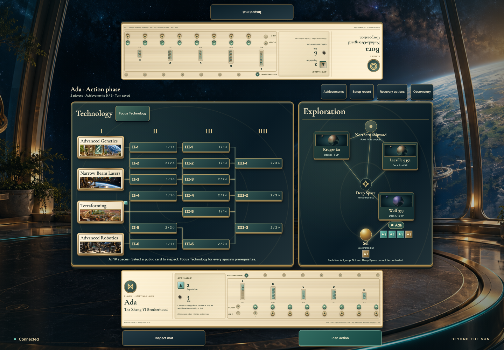](../../screenshots/establish-a-mixed-disc-colony-at-2-shared-cardinal-seats/046-rival-arrived-handoff-desktop-darwin.png) |

tabletop-4k · 3840 × 2160

[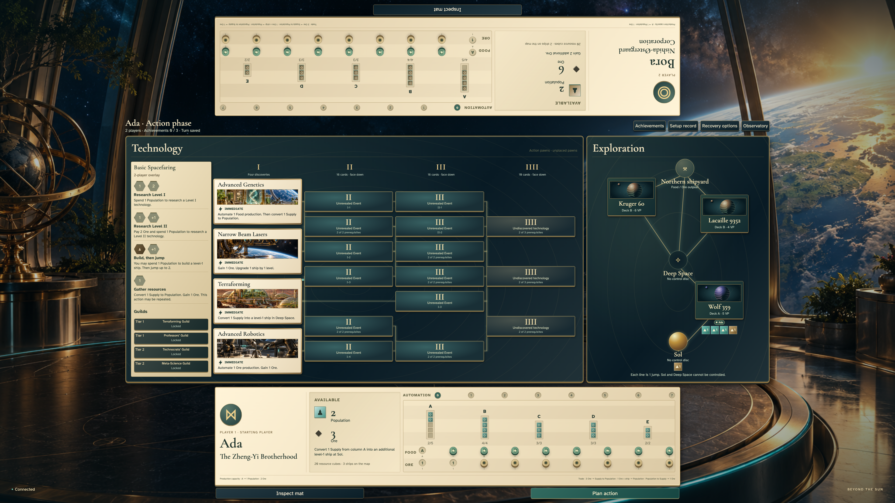](../../screenshots/establish-a-mixed-disc-colony-at-2-shared-cardinal-seats/046-rival-arrived-handoff-tabletop-4k-darwin.png)

- [x] Choose ordinary Ore production and hand off automatically
- [x] Actual canonical effects and acknowledgement settle.
- [x] Public topology retains physical separation.
- [x] The viewport fits without page scrolling.

## 48. Open Ada’s real Action instrument

Viewpoint: **Ada · South · one shared controller**.

| desktop · 1440 × 1000 |
| --- |
|  |

tabletop-4k · 3840 × 2160

- [x] Open Ada’s real Action instrument
- [x] Actual canonical effects and acknowledgement settle.
- [x] Public topology retains physical separation.
- [x] The viewport fits without page scrolling.

## 49. Choose the printed colony Action

Viewpoint: **Ada · South · one shared controller**.

| desktop · 1440 × 1000 |
| --- |
|  |

tabletop-4k · 3840 × 2160

- [x] Choose the printed colony Action
- [x] Actual canonical effects and acknowledgement settle.
- [x] Public topology retains physical separation.
- [x] The viewport fits without page scrolling.

## 50. Read the system settlement view

Viewpoint: **Ada · South · one shared controller**.

| desktop · 1440 × 1000 |
| --- |
| [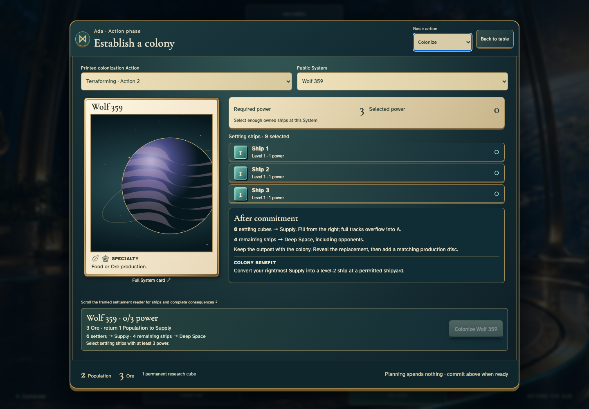](../../screenshots/establish-a-mixed-disc-colony-at-2-shared-cardinal-seats/049-colony-world-desktop-darwin.png) |

tabletop-4k · 3840 × 2160

- [x] Read the system settlement view
- [x] Actual canonical effects and acknowledgement settle.
- [x] Public topology retains physical separation.
- [x] The viewport fits without page scrolling.

## 51. Read the complete printed System before committing

Viewpoint: **Ada · South · one shared controller**.

| desktop · 1440 × 1000 |
| --- |
| [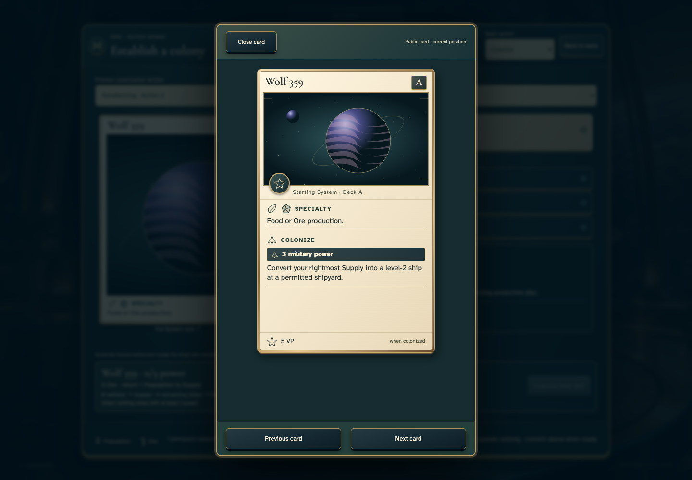](../../screenshots/establish-a-mixed-disc-colony-at-2-shared-cardinal-seats/050-full-system-desktop-darwin.png) |

tabletop-4k · 3840 × 2160

[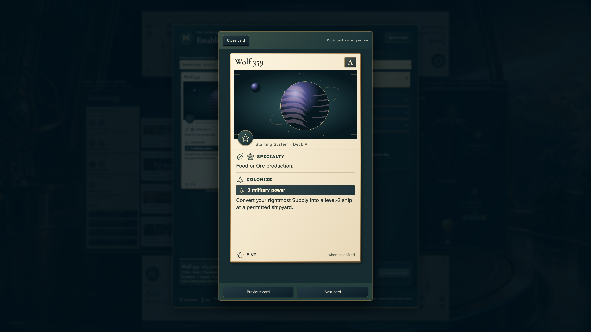](../../screenshots/establish-a-mixed-disc-colony-at-2-shared-cardinal-seats/050-full-system-tabletop-4k-darwin.png)

- [x] Read the complete printed System before committing
- [x] Actual canonical effects and acknowledgement settle.
- [x] Public topology retains physical separation.
- [x] The viewport fits without page scrolling.

## 52. Escape restores the exact System inspection opener

Viewpoint: **Ada · South · one shared controller**.

| desktop · 1440 × 1000 |
| --- |
|  |

tabletop-4k · 3840 × 2160

- [x] Escape restores the exact System inspection opener
- [x] Actual canonical effects and acknowledgement settle.
- [x] Public topology retains physical separation.
- [x] The viewport fits without page scrolling.

## 53. Read the settlers settlement view

Viewpoint: **Ada · South · one shared controller**.

| desktop · 1440 × 1000 |
| --- |
|  |

tabletop-4k · 3840 × 2160

- [x] Read the settlers settlement view
- [x] Actual canonical effects and acknowledgement settle.
- [x] Public topology retains physical separation.
- [x] The viewport fits without page scrolling.

## 54. Select owned settling Ship 1 without spending resources

Viewpoint: **Ada · South · one shared controller**.

| desktop · 1440 × 1000 |
| --- |
|  |

tabletop-4k · 3840 × 2160

[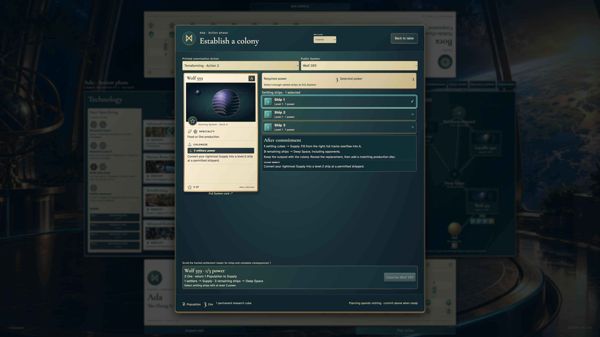](../../screenshots/establish-a-mixed-disc-colony-at-2-shared-cardinal-seats/053-settler-0-tabletop-4k-darwin.png)

- [x] Select owned settling Ship 1 without spending resources
- [x] Actual canonical effects and acknowledgement settle.
- [x] Public topology retains physical separation.
- [x] The viewport fits without page scrolling.

## 55. Select owned settling Ship 2 without spending resources

Viewpoint: **Ada · South · one shared controller**.

| desktop · 1440 × 1000 |
| --- |
| [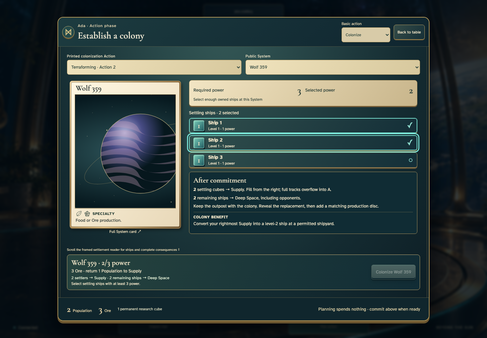](../../screenshots/establish-a-mixed-disc-colony-at-2-shared-cardinal-seats/054-settler-1-desktop-darwin.png) |

tabletop-4k · 3840 × 2160

- [x] Select owned settling Ship 2 without spending resources
- [x] Actual canonical effects and acknowledgement settle.
- [x] Public topology retains physical separation.
- [x] The viewport fits without page scrolling.

## 56. Select owned settling Ship 3 without spending resources

Viewpoint: **Ada · South · one shared controller**.

| desktop · 1440 × 1000 |
| --- |
|  |

tabletop-4k · 3840 × 2160

- [x] Select owned settling Ship 3 without spending resources
- [x] Actual canonical effects and acknowledgement settle.
- [x] Public topology retains physical separation.
- [x] The viewport fits without page scrolling.

## 57. Three own cubes meet the printed three-power requirement; the rival is exiled after commitment

Viewpoint: **Ada · South · one shared controller**.

| desktop · 1440 × 1000 |
| --- |
|  |

tabletop-4k · 3840 × 2160

- [x] Three own cubes meet the printed three-power requirement; the rival is exiled after commitment
- [x] Actual canonical effects and acknowledgement settle.
- [x] Public topology retains physical separation.
- [x] The viewport fits without page scrolling.

## 58. Read the outcome settlement view

Viewpoint: **Ada · South · one shared controller**.

| desktop · 1440 × 1000 |
| --- |
| [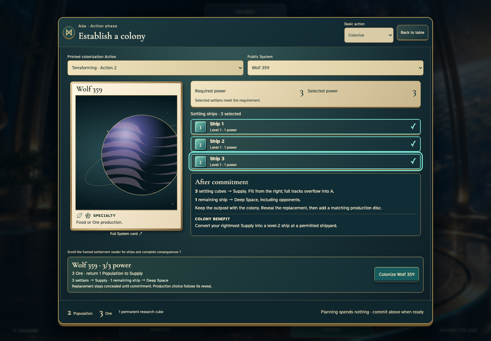](../../screenshots/establish-a-mixed-disc-colony-at-2-shared-cardinal-seats/057-settlement-order-desktop-darwin.png) |

tabletop-4k · 3840 × 2160

- [x] Read the outcome settlement view
- [x] Actual canonical effects and acknowledgement settle.
- [x] Public topology retains physical separation.
- [x] The viewport fits without page scrolling.

## 59. Keyboard scrolling reaches every return/exile/replacement/disc/printed-benefit statement

Viewpoint: **Ada · South · one shared controller**.

| desktop · 1440 × 1000 |
| --- |
|  |

tabletop-4k · 3840 × 2160

- [x] Keyboard scrolling reaches every return/exile/replacement/disc/printed-benefit statement
- [x] Actual canonical effects and acknowledgement settle.
- [x] Public topology retains physical separation.
- [x] The viewport fits without page scrolling.

## 60. Payment, settlers and rival exile are saved; the replacement is public before the extra disc choice

Viewpoint: **Ada · South · one shared controller**.

| desktop · 1440 × 1000 |
| --- |
|  |

tabletop-4k · 3840 × 2160

- [x] Payment, settlers and rival exile are saved; the replacement is public before the extra disc choice
- [x] Actual canonical effects and acknowledgement settle.
- [x] Public topology retains physical separation.
- [x] The viewport fits without page scrolling.

## 61. Inspect the actual already-revealed replacement through its complete semantic card

Viewpoint: **Ada · South · one shared controller**.

| desktop · 1440 × 1000 |
| --- |
|  |

tabletop-4k · 3840 × 2160

- [x] Inspect the actual already-revealed replacement through its complete semantic card
- [x] Actual canonical effects and acknowledgement settle.
- [x] Public topology retains physical separation.
- [x] The viewport fits without page scrolling.

## 62. Return to the exact replacement opener without answering the pending disc choice

Viewpoint: **Ada · South · one shared controller**.

| desktop · 1440 × 1000 |
| --- |
|  |

tabletop-4k · 3840 × 2160

- [x] Return to the exact replacement opener without answering the pending disc choice
- [x] Actual canonical effects and acknowledgement settle.
- [x] Public topology retains physical separation.
- [x] The viewport fits without page scrolling.

## 63. Reload preserves the paid colony and unfinished owner response

Viewpoint: **Ada · South · one shared controller**.

| desktop · 1440 × 1000 |
| --- |
|  |

tabletop-4k · 3840 × 2160

- [x] Reload preserves the paid colony and unfinished owner response
- [x] Actual canonical effects and acknowledgement settle.
- [x] Public topology retains physical separation.
- [x] The viewport fits without page scrolling.

## 64. Resume the same extra-disc choice without replaying payment

Viewpoint: **Ada · South · one shared controller**.

| desktop · 1440 × 1000 |
| --- |
|  |

tabletop-4k · 3840 × 2160

- [x] Resume the same extra-disc choice without replaying payment
- [x] Actual canonical effects and acknowledgement settle.
- [x] Public topology retains physical separation.
- [x] The viewport fits without page scrolling.

## 65. Keyboard focus reaches the actual Food choice

Viewpoint: **Ada · South · one shared controller**.

| desktop · 1440 × 1000 |
| --- |
|  |

tabletop-4k · 3840 × 2160

- [x] Keyboard focus reaches the actual Food choice
- [x] Actual canonical effects and acknowledgement settle.
- [x] Public topology retains physical separation.
- [x] The viewport fits without page scrolling.

## 66. The additional disc and actual available printed benefit finish before ordinary Production

Viewpoint: **Ada · South · one shared controller**.

| desktop · 1440 × 1000 |
| --- |
|  |

tabletop-4k · 3840 × 2160

- [x] The additional disc and actual available printed benefit finish before ordinary Production
- [x] Actual canonical effects and acknowledgement settle.
- [x] Public topology retains physical separation.
- [x] The viewport fits without page scrolling.

## 67. Reload retains the permanent colony and pending Production

Viewpoint: **Ada · South · one shared controller**.

| desktop · 1440 × 1000 |
| --- |
|  |

tabletop-4k · 3840 × 2160

- [x] Reload retains the permanent colony and pending Production
- [x] Actual canonical effects and acknowledgement settle.
- [x] Public topology retains physical separation.
- [x] The viewport fits without page scrolling.

## 68. Reopening the saved Production never repeats the payment or colony benefit

Viewpoint: **Ada · South · one shared controller**.

| desktop · 1440 × 1000 |
| --- |
|  |

tabletop-4k · 3840 × 2160

- [x] Reopening the saved Production never repeats the payment or colony benefit
- [x] Actual canonical effects and acknowledgement settle.
- [x] Public topology retains physical separation.
- [x] The viewport fits without page scrolling.

## 69. The public table shows its newly revealed System and the saved colony

Viewpoint: **Ada · South · one shared controller**.

| desktop · 1440 × 1000 |
| --- |
|  |

tabletop-4k · 3840 × 2160

- [x] The public table shows its newly revealed System and the saved colony
- [x] Actual canonical effects and acknowledgement settle.
- [x] Public topology retains physical separation.
- [x] The viewport fits without page scrolling.

## 70. Read the saved rival exile and newly refilled public map after settlement

Viewpoint: **Ada · South · one shared controller**.

| desktop · 1440 × 1000 |
| --- |
|  |

tabletop-4k · 3840 × 2160

- [x] Read the saved rival exile and newly refilled public map after settlement
- [x] Actual canonical effects and acknowledgement settle.
- [x] Public topology retains physical separation.
- [x] The viewport fits without page scrolling.

## 71. Inspect actual production discs and permanent automation separately

Viewpoint: **Ada · South · one shared controller**.

| desktop · 1440 × 1000 |
| --- |
|  |

tabletop-4k · 3840 × 2160

- [x] Inspect actual production discs and permanent automation separately
- [x] Actual canonical effects and acknowledgement settle.
- [x] Public topology retains physical separation.
- [x] The viewport fits without page scrolling.

## 72. Inspect the actual surviving fleet after settlement and printed benefit

Viewpoint: **Ada · South · one shared controller**.

| desktop · 1440 × 1000 |
| --- |
|  |

tabletop-4k · 3840 × 2160

- [x] Inspect the actual surviving fleet after settlement and printed benefit
- [x] Actual canonical effects and acknowledgement settle.
- [x] Public topology retains physical separation.
- [x] The viewport fits without page scrolling.

## 73. The permanent register retains both actual discs and printed System identity

Viewpoint: **Ada · South · one shared controller**.

| desktop · 1440 × 1000 |
| --- |
|  |

tabletop-4k · 3840 × 2160

- [x] The permanent register retains both actual discs and printed System identity
- [x] Actual canonical effects and acknowledgement settle.
- [x] Public topology retains physical separation.
- [x] The viewport fits without page scrolling.

## 74. Inspect the complete acquired card through the reusable production renderer

Viewpoint: **Ada · South · one shared controller**.

| desktop · 1440 × 1000 |
| --- |
|  |

tabletop-4k · 3840 × 2160

- [x] Inspect the complete acquired card through the reusable production renderer
- [x] Actual canonical effects and acknowledgement settle.
- [x] Public topology retains physical separation.
- [x] The viewport fits without page scrolling.

## 75. Escape returns to the exact acquired-card opener

Viewpoint: **Ada · South · one shared controller**.

| desktop · 1440 × 1000 |
| --- |
|  |

tabletop-4k · 3840 × 2160

- [x] Escape returns to the exact acquired-card opener
- [x] Actual canonical effects and acknowledgement settle.
- [x] Public topology retains physical separation.
- [x] The viewport fits without page scrolling.

## 76. Closing Fleet restores the exact Fleet opener

Viewpoint: **Ada · South · one shared controller**.

| desktop · 1440 × 1000 |
| --- |
|  |

tabletop-4k · 3840 × 2160

- [x] Closing Fleet restores the exact Fleet opener
- [x] Actual canonical effects and acknowledgement settle.
- [x] Public topology retains physical separation.
- [x] The viewport fits without page scrolling.

## 77. Closing the mat restores its exact opener without consuming Production

Viewpoint: **Ada · South · one shared controller**.

| desktop · 1440 × 1000 |
| --- |
|  |

tabletop-4k · 3840 × 2160

- [x] Closing the mat restores its exact opener without consuming Production
- [x] Actual canonical effects and acknowledgement settle.
- [x] Public topology retains physical separation.
- [x] The viewport fits without page scrolling.

## 78. Return to the same retained Production after inspection

Viewpoint: **Ada · South · one shared controller**.

| desktop · 1440 × 1000 |
| --- |
|  |

tabletop-4k · 3840 × 2160

- [x] Return to the same retained Production after inspection
- [x] Actual canonical effects and acknowledgement settle.
- [x] Public topology retains physical separation.
- [x] The viewport fits without page scrolling.

## 79. Choose ordinary Ore production and hand off automatically

Viewpoint: **Ada · South · one shared controller**.

| desktop · 1440 × 1000 |
| --- |
|  |

tabletop-4k · 3840 × 2160

- [x] Choose ordinary Ore production and hand off automatically
- [x] Actual canonical effects and acknowledgement settle.
- [x] Public topology retains physical separation.
- [x] The viewport fits without page scrolling.
