# Overpay a Sirius colony with a legally upgraded settling fleet with separate remote controllers

Ordinary invitation, distinct Auth controllers, unique Basic factions, Ready and Begin. Predeclared setup seed002 Sirius or006 Wolf359 only at Begin. Every research, movement, control, settlement and response uses production UI. No injected game state or future deck read; unsupported benefits remain blocked.

## 1. Arrive through the actual production interface

Viewpoint: **Ada · separate host controller**.

| phone · 393 × 852 | desktop · 1440 × 1000 |
| --- | --- |
|  |  |

- [x] Arrive through the actual production interface
- [x] Actual canonical effects and acknowledgement settle.
- [x] Public topology retains physical separation.
- [x] The viewport fits without page scrolling.

## 2. Choose physical tabletop or separate-controller remote play

Viewpoint: **Ada · separate host controller**.

| phone · 393 × 852 | desktop · 1440 × 1000 |
| --- | --- |
|  |  |

- [x] Choose physical tabletop or separate-controller remote play
- [x] Actual canonical effects and acknowledgement settle.
- [x] Public topology retains physical separation.
- [x] The viewport fits without page scrolling.

## 3. Open the ordinary remote host form

Viewpoint: **Ada · separate host controller**.

| phone · 393 × 852 | desktop · 1440 × 1000 |
| --- | --- |
|  |  |

- [x] Open the ordinary remote host form
- [x] Actual canonical effects and acknowledgement settle.
- [x] Public topology retains physical separation.
- [x] The viewport fits without page scrolling.

## 4. Enter Ada’s host name

Viewpoint: **Ada · separate host controller**.

| phone · 393 × 852 | desktop · 1440 × 1000 |
| --- | --- |
|  |  |

- [x] Enter Ada’s host name
- [x] Actual canonical effects and acknowledgement settle.
- [x] Public topology retains physical separation.
- [x] The viewport fits without page scrolling.

## 5. The host receives the real public invitation

Viewpoint: **Ada · separate host controller**.

| phone · 393 × 852 | desktop · 1440 × 1000 |
| --- | --- |
| [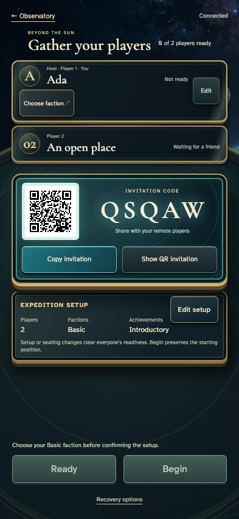](../../screenshots/overpay-a-sirius-colony-with-a-legally-upgraded-settling-fleet-with-separate-remote-controllers/004-host-room-phone-darwin.png) | [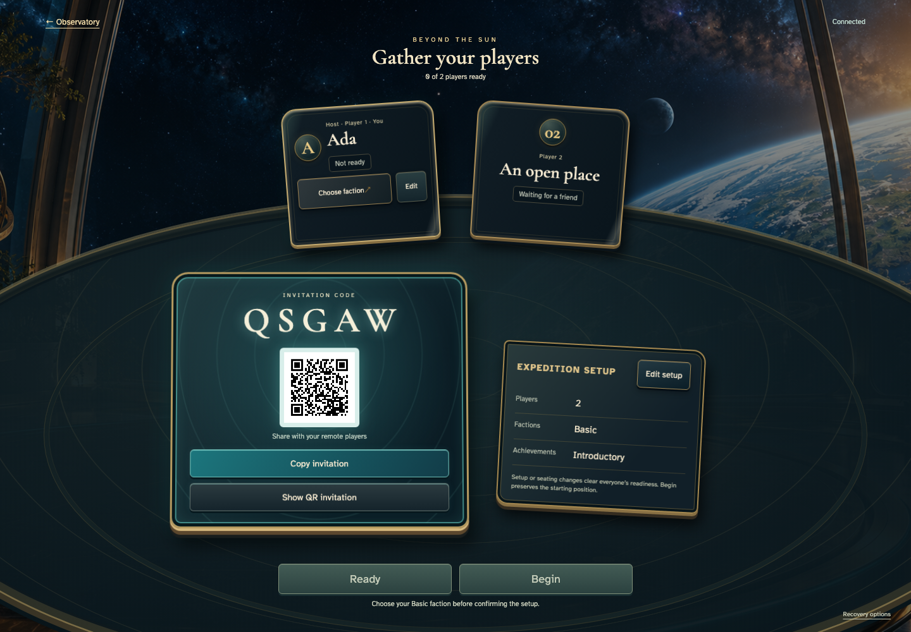](../../screenshots/overpay-a-sirius-colony-with-a-legally-upgraded-settling-fleet-with-separate-remote-controllers/004-host-room-desktop-darwin.png) |

- [x] The host receives the real public invitation
- [x] Actual canonical effects and acknowledgement settle.
- [x] Public topology retains physical separation.
- [x] The viewport fits without page scrolling.

## 6. An independent controller previews the invitation

Viewpoint: **Bora · separate guest controller**.

| phone · 1440 × 1000 | desktop · 393 × 852 |
| --- | --- |
| [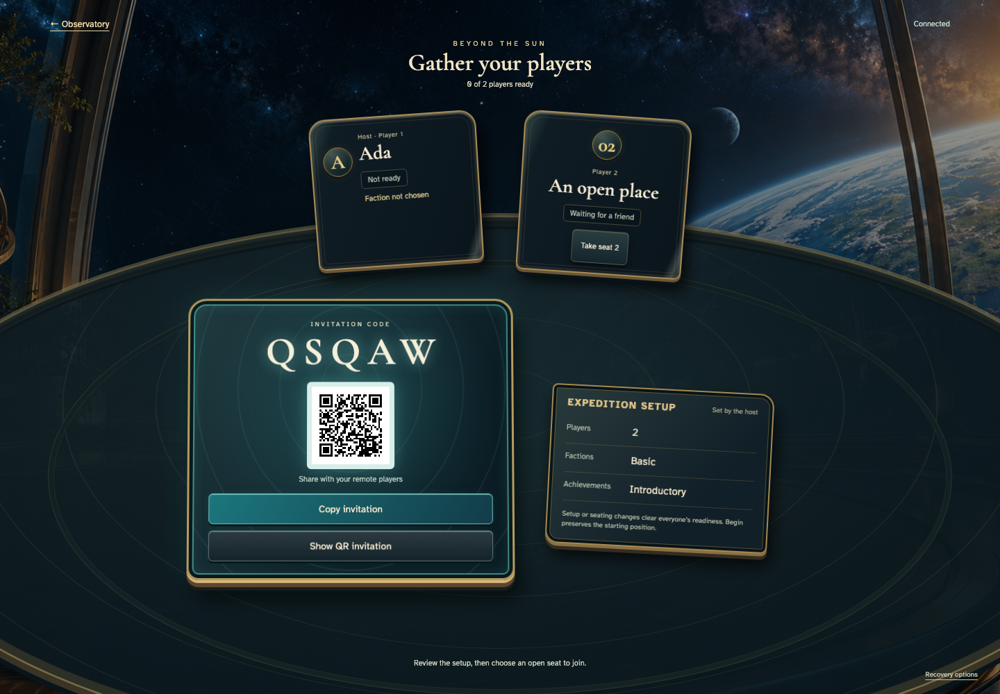](../../screenshots/overpay-a-sirius-colony-with-a-legally-upgraded-settling-fleet-with-separate-remote-controllers/005-guest-1-preview-phone-darwin.png) | [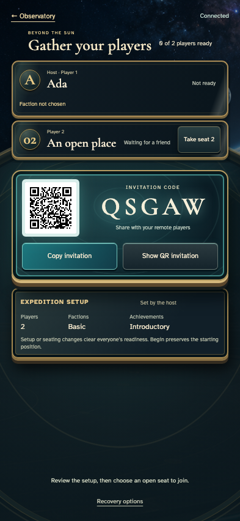](../../screenshots/overpay-a-sirius-colony-with-a-legally-upgraded-settling-fleet-with-separate-remote-controllers/005-guest-1-preview-desktop-darwin.png) |

- [x] An independent controller previews the invitation
- [x] Actual canonical effects and acknowledgement settle.
- [x] Public topology retains physical separation.
- [x] The viewport fits without page scrolling.

## 7. Claim an open remote seat through its own dialog

Viewpoint: **Bora · separate guest controller**.

| phone · 1440 × 1000 | desktop · 393 × 852 |
| --- | --- |
| [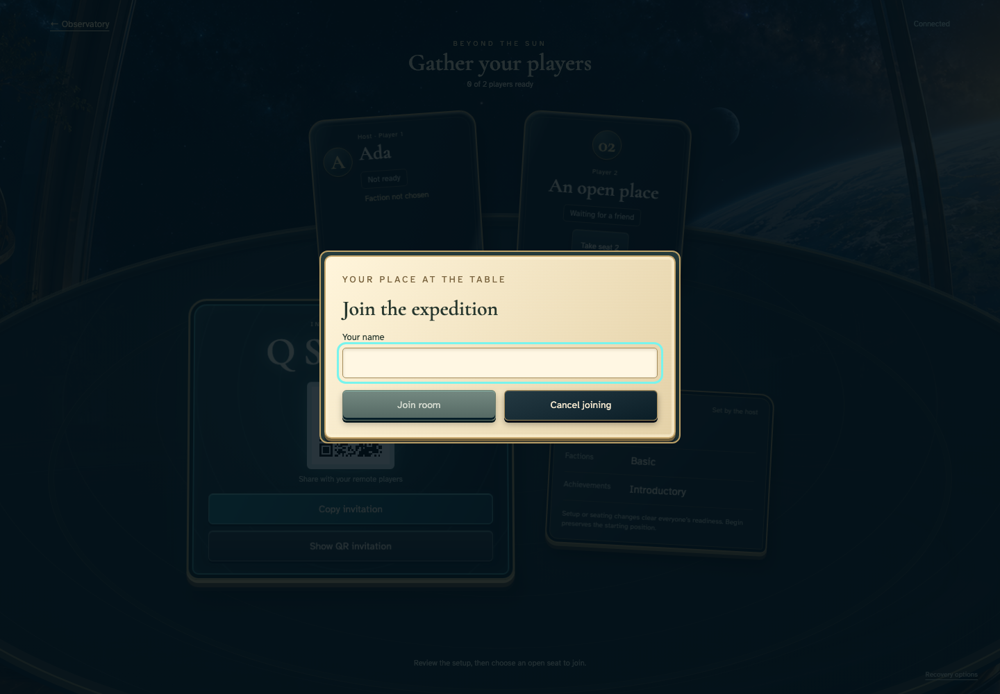](../../screenshots/overpay-a-sirius-colony-with-a-legally-upgraded-settling-fleet-with-separate-remote-controllers/006-guest-1-name-form-phone-darwin.png) |  |

- [x] Claim an open remote seat through its own dialog
- [x] Actual canonical effects and acknowledgement settle.
- [x] Public topology retains physical separation.
- [x] The viewport fits without page scrolling.

## 8. Enter the guest name

Viewpoint: **Bora · separate guest controller**.

| phone · 1440 × 1000 | desktop · 393 × 852 |
| --- | --- |
| [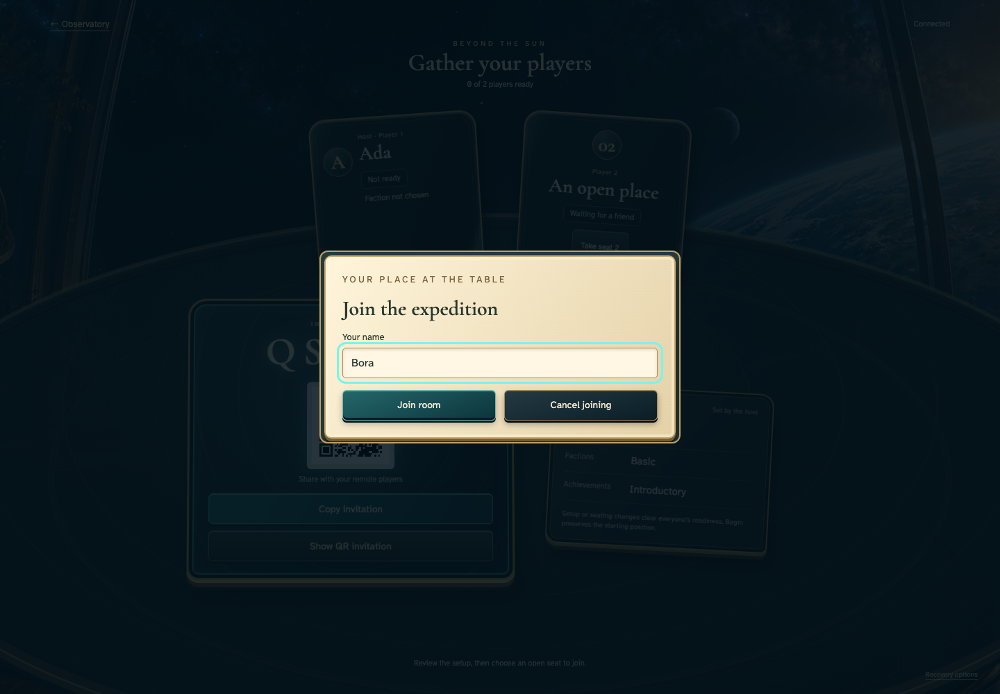](../../screenshots/overpay-a-sirius-colony-with-a-legally-upgraded-settling-fleet-with-separate-remote-controllers/007-guest-1-name-phone-darwin.png) |  |

- [x] Enter the guest name
- [x] Actual canonical effects and acknowledgement settle.
- [x] Public topology retains physical separation.
- [x] The viewport fits without page scrolling.

## 9. Persist this controller’s own seat

Viewpoint: **Bora · separate guest controller**.

| phone · 1440 × 1000 | desktop · 393 × 852 |
| --- | --- |
| [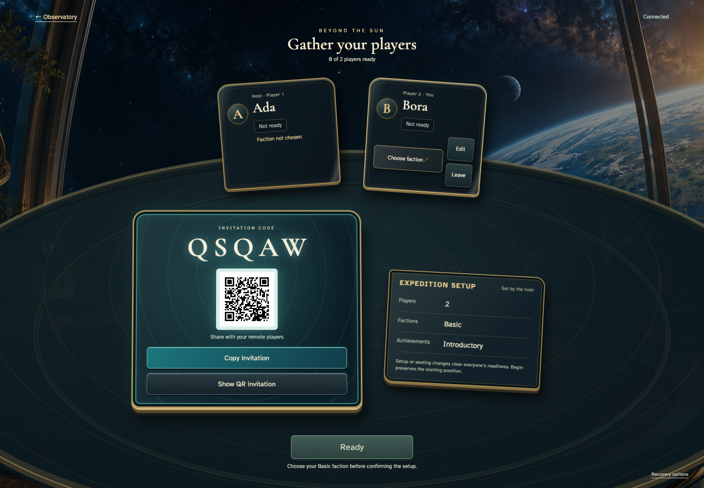](../../screenshots/overpay-a-sirius-colony-with-a-legally-upgraded-settling-fleet-with-separate-remote-controllers/008-guest-1-joined-phone-darwin.png) | [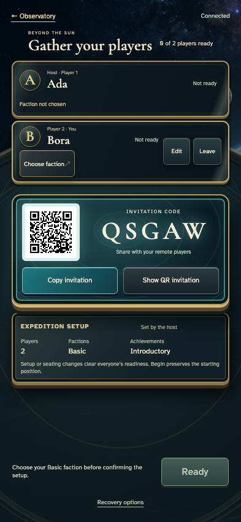](../../screenshots/overpay-a-sirius-colony-with-a-legally-upgraded-settling-fleet-with-separate-remote-controllers/008-guest-1-joined-desktop-darwin.png) |

- [x] Persist this controller’s own seat
- [x] Actual canonical effects and acknowledgement settle.
- [x] Public topology retains physical separation.
- [x] The viewport fits without page scrolling.

## 10. Choose a legal unique Basic faction

Viewpoint: **Ada · separate host controller**.

| phone · 393 × 852 | desktop · 1440 × 1000 |
| --- | --- |
|  |  |

- [x] Choose a legal unique Basic faction
- [x] Actual canonical effects and acknowledgement settle.
- [x] Public topology retains physical separation.
- [x] The viewport fits without page scrolling.

## 11. Ada chooses The Zheng-Yi Brotherhood

Viewpoint: **Ada · separate host controller**.

| phone · 393 × 852 | desktop · 1440 × 1000 |
| --- | --- |
| [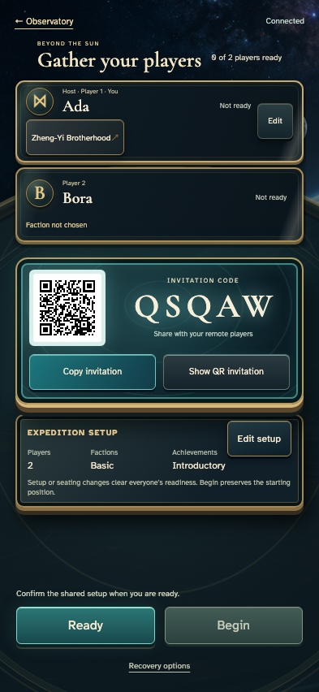](../../screenshots/overpay-a-sirius-colony-with-a-legally-upgraded-settling-fleet-with-separate-remote-controllers/010-faction-0-selected-phone-darwin.png) | [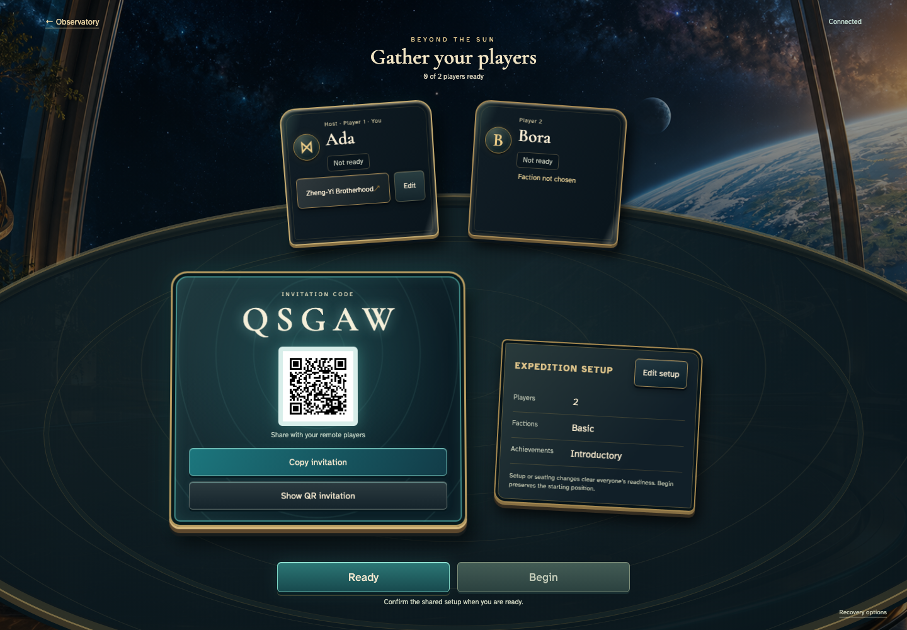](../../screenshots/overpay-a-sirius-colony-with-a-legally-upgraded-settling-fleet-with-separate-remote-controllers/010-faction-0-selected-desktop-darwin.png) |

- [x] Ada chooses The Zheng-Yi Brotherhood
- [x] Actual canonical effects and acknowledgement settle.
- [x] Public topology retains physical separation.
- [x] The viewport fits without page scrolling.

## 12. Choose a legal unique Basic faction

Viewpoint: **Bora · separate guest controller**.

| phone · 1440 × 1000 | desktop · 393 × 852 |
| --- | --- |
|  | [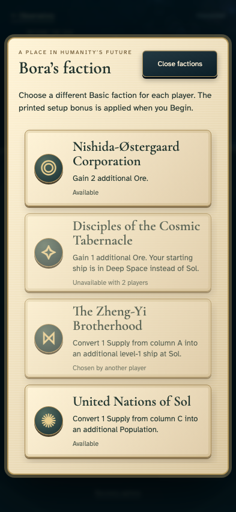](../../screenshots/overpay-a-sirius-colony-with-a-legally-upgraded-settling-fleet-with-separate-remote-controllers/011-faction-1-open-desktop-darwin.png) |

- [x] Choose a legal unique Basic faction
- [x] Actual canonical effects and acknowledgement settle.
- [x] Public topology retains physical separation.
- [x] The viewport fits without page scrolling.

## 13. Bora chooses Nishida-Østergaard Corporation

Viewpoint: **Bora · separate guest controller**.

| phone · 1440 × 1000 | desktop · 393 × 852 |
| --- | --- |
|  | [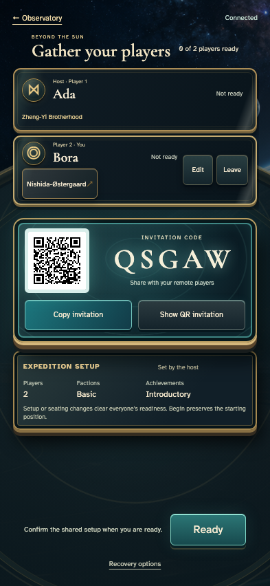](../../screenshots/overpay-a-sirius-colony-with-a-legally-upgraded-settling-fleet-with-separate-remote-controllers/012-faction-1-selected-desktop-darwin.png) |

- [x] Bora chooses Nishida-Østergaard Corporation
- [x] Actual canonical effects and acknowledgement settle.
- [x] Public topology retains physical separation.
- [x] The viewport fits without page scrolling.

## 14. Ada acknowledges the current shared configuration

Viewpoint: **Ada · separate host controller**.

| phone · 393 × 852 | desktop · 1440 × 1000 |
| --- | --- |
| [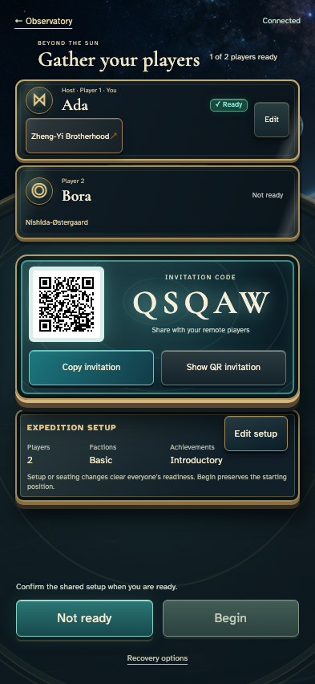](../../screenshots/overpay-a-sirius-colony-with-a-legally-upgraded-settling-fleet-with-separate-remote-controllers/013-ready-0-phone-darwin.png) |  |

- [x] Ada acknowledges the current shared configuration
- [x] Actual canonical effects and acknowledgement settle.
- [x] Public topology retains physical separation.
- [x] The viewport fits without page scrolling.

## 15. Bora acknowledges the current shared configuration

Viewpoint: **Bora · separate guest controller**.

| phone · 1440 × 1000 | desktop · 393 × 852 |
| --- | --- |
| [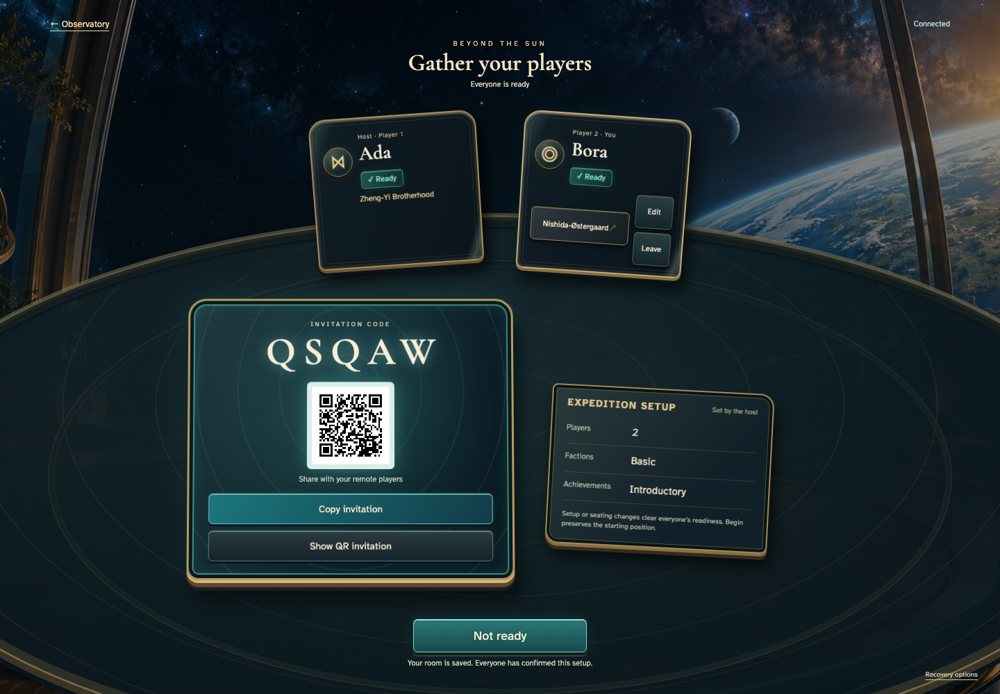](../../screenshots/overpay-a-sirius-colony-with-a-legally-upgraded-settling-fleet-with-separate-remote-controllers/014-ready-1-phone-darwin.png) | [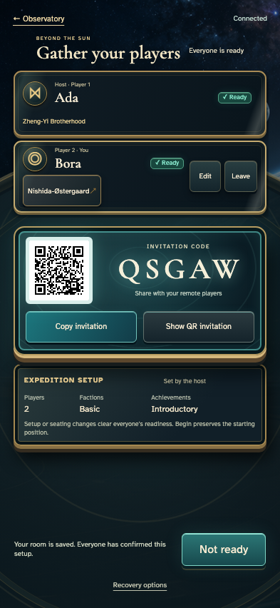](../../screenshots/overpay-a-sirius-colony-with-a-legally-upgraded-settling-fleet-with-separate-remote-controllers/014-ready-1-desktop-darwin.png) |

- [x] Bora acknowledges the current shared configuration
- [x] Actual canonical effects and acknowledgement settle.
- [x] Public topology retains physical separation.
- [x] The viewport fits without page scrolling.

## 16. Begin the immutable Basic game through normal UI

Viewpoint: **Ada · separate host controller**.

| phone · 393 × 852 | desktop · 1440 × 1000 |
| --- | --- |
| [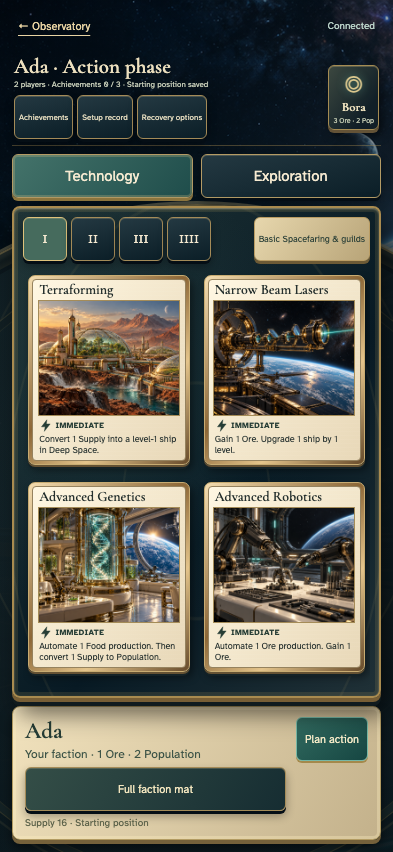](../../screenshots/overpay-a-sirius-colony-with-a-legally-upgraded-settling-fleet-with-separate-remote-controllers/015-begun-phone-darwin.png) | [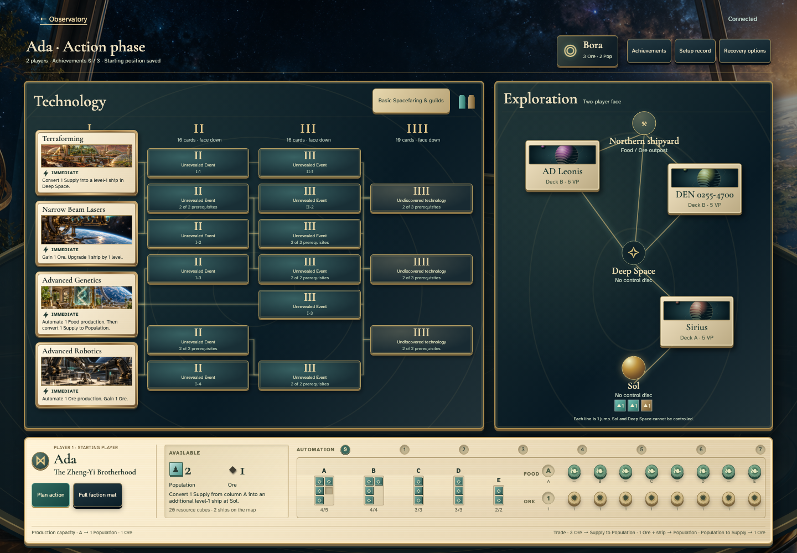](../../screenshots/overpay-a-sirius-colony-with-a-legally-upgraded-settling-fleet-with-separate-remote-controllers/015-begun-desktop-darwin.png) |

- [x] Begin the immutable Basic game through normal UI
- [x] Actual canonical effects and acknowledgement settle.
- [x] Public topology retains physical separation.
- [x] The viewport fits without page scrolling.

## 17. Open Ada’s real Action instrument

Viewpoint: **Ada · separate host controller**.

| phone · 393 × 852 | desktop · 1440 × 1000 |
| --- | --- |
|  |  |

- [x] Open Ada’s real Action instrument
- [x] Actual canonical effects and acknowledgement settle.
- [x] Public topology retains physical separation.
- [x] The viewport fits without page scrolling.

## 18. Choose Research Level I

Viewpoint: **Ada · separate host controller**.

| phone · 393 × 852 | desktop · 1440 × 1000 |
| --- | --- |
|  |  |

- [x] Choose Research Level I
- [x] Actual canonical effects and acknowledgement settle.
- [x] Public topology retains physical separation.
- [x] The viewport fits without page scrolling.

## 19. Choose a legal unoccupied research space

Viewpoint: **Ada · separate host controller**.

| phone · 393 × 852 | desktop · 1440 × 1000 |
| --- | --- |
|  |  |

- [x] Choose a legal unoccupied research space
- [x] Actual canonical effects and acknowledgement settle.
- [x] Public topology retains physical separation.
- [x] The viewport fits without page scrolling.

## 20. Select Terraforming without paying yet

Viewpoint: **Ada · separate host controller**.

| phone · 393 × 852 | desktop · 1440 × 1000 |
| --- | --- |
| [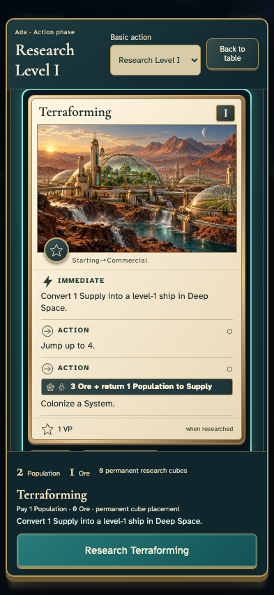](../../screenshots/overpay-a-sirius-colony-with-a-legally-upgraded-settling-fleet-with-separate-remote-controllers/019-terraforming-selected-phone-darwin.png) | [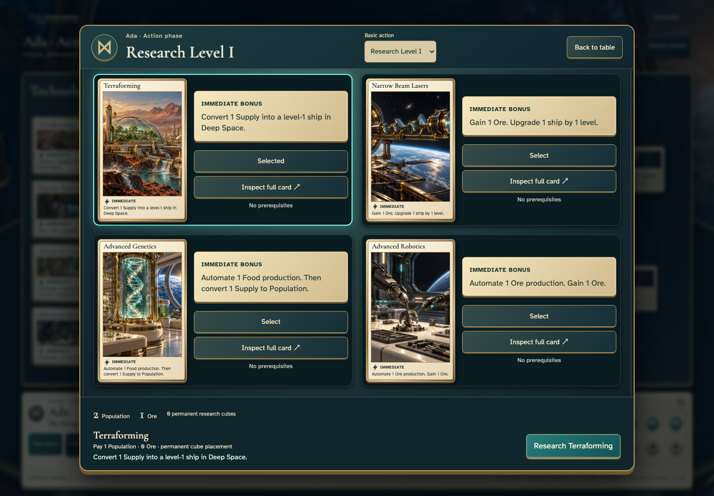](../../screenshots/overpay-a-sirius-colony-with-a-legally-upgraded-settling-fleet-with-separate-remote-controllers/019-terraforming-selected-desktop-darwin.png) |

- [x] Select Terraforming without paying yet
- [x] Actual canonical effects and acknowledgement settle.
- [x] Public topology retains physical separation.
- [x] The viewport fits without page scrolling.

## 21. Pay the permanent research cube and resolve the once-only printed bonus

Viewpoint: **Ada · separate host controller**.

| phone · 393 × 852 | desktop · 1440 × 1000 |
| --- | --- |
|  |  |

- [x] Pay the permanent research cube and resolve the once-only printed bonus
- [x] Actual canonical effects and acknowledgement settle.
- [x] Public topology retains physical separation.
- [x] The viewport fits without page scrolling.

## 22. Choose ordinary growth and hand off automatically

Viewpoint: **Ada · separate host controller**.

| phone · 393 × 852 | desktop · 1440 × 1000 |
| --- | --- |
|  | [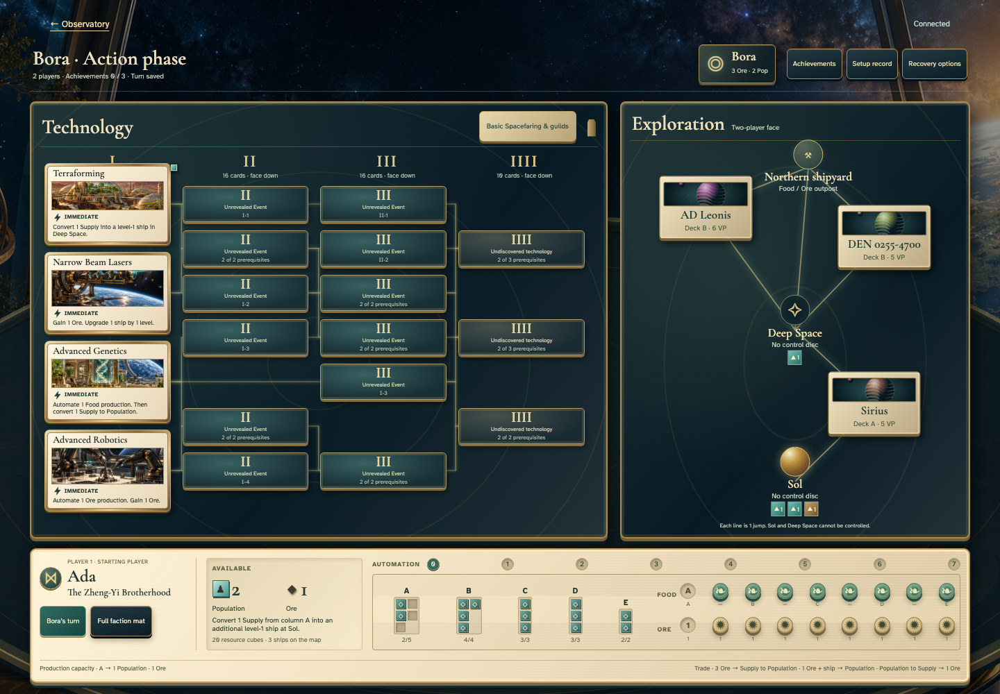](../../screenshots/overpay-a-sirius-colony-with-a-legally-upgraded-settling-fleet-with-separate-remote-controllers/021-terraforming-handoff-desktop-darwin.png) |

- [x] Choose ordinary growth and hand off automatically
- [x] Actual canonical effects and acknowledgement settle.
- [x] Public topology retains physical separation.
- [x] The viewport fits without page scrolling.

## 23. The next separate controller receives its saved turn

Viewpoint: **Bora · separate guest controller**.

| phone · 1440 × 1000 | desktop · 393 × 852 |
| --- | --- |
|  | [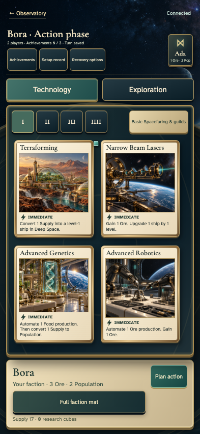](../../screenshots/overpay-a-sirius-colony-with-a-legally-upgraded-settling-fleet-with-separate-remote-controllers/022-terraforming-next-desktop-darwin.png) |

- [x] The next separate controller receives its saved turn
- [x] Actual canonical effects and acknowledgement settle.
- [x] Public topology retains physical separation.
- [x] The viewport fits without page scrolling.

## 24. Open Bora’s real Action instrument

Viewpoint: **Bora · separate guest controller**.

| phone · 1440 × 1000 | desktop · 393 × 852 |
| --- | --- |
|  | [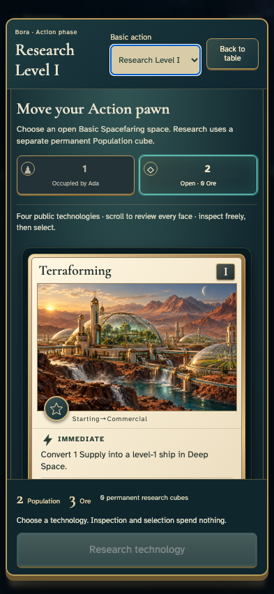](../../screenshots/overpay-a-sirius-colony-with-a-legally-upgraded-settling-fleet-with-separate-remote-controllers/023-bora-gather-open-desktop-darwin.png) |

- [x] Open Bora’s real Action instrument
- [x] Actual canonical effects and acknowledgement settle.
- [x] Public topology retains physical separation.
- [x] The viewport fits without page scrolling.

## 25. Choose Gather

Viewpoint: **Bora · separate guest controller**.

| phone · 1440 × 1000 | desktop · 393 × 852 |
| --- | --- |
| [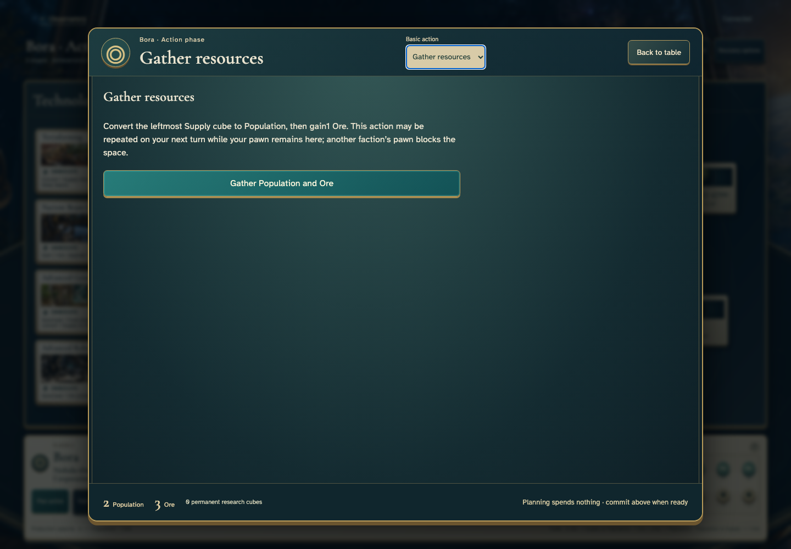](../../screenshots/overpay-a-sirius-colony-with-a-legally-upgraded-settling-fleet-with-separate-remote-controllers/024-bora-gather-kind-phone-darwin.png) |  |

- [x] Choose Gather
- [x] Actual canonical effects and acknowledgement settle.
- [x] Public topology retains physical separation.
- [x] The viewport fits without page scrolling.

## 26. Gather from actual leftmost Supply and gain the printed Ore

Viewpoint: **Bora · separate guest controller**.

| phone · 1440 × 1000 | desktop · 393 × 852 |
| --- | --- |
|  |  |

- [x] Gather from actual leftmost Supply and gain the printed Ore
- [x] Actual canonical effects and acknowledgement settle.
- [x] Public topology retains physical separation.
- [x] The viewport fits without page scrolling.

## 27. Choose ordinary Ore production and hand off automatically

Viewpoint: **Bora · separate guest controller**.

| phone · 1440 × 1000 | desktop · 393 × 852 |
| --- | --- |
|  |  |

- [x] Choose ordinary Ore production and hand off automatically
- [x] Actual canonical effects and acknowledgement settle.
- [x] Public topology retains physical separation.
- [x] The viewport fits without page scrolling.

## 28. The next separate controller receives its saved turn

Viewpoint: **Ada · separate host controller**.

| phone · 393 × 852 | desktop · 1440 × 1000 |
| --- | --- |
|  | [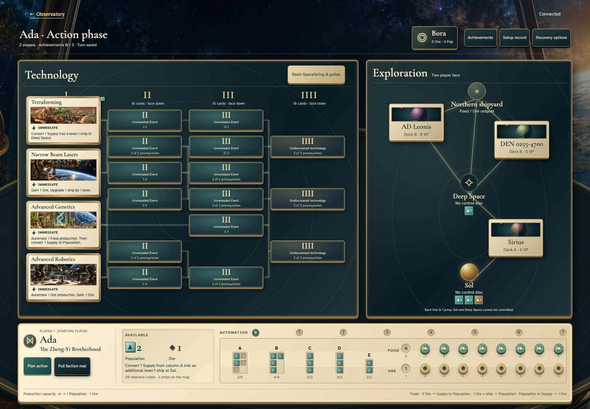](../../screenshots/overpay-a-sirius-colony-with-a-legally-upgraded-settling-fleet-with-separate-remote-controllers/027-bora-gather-next-desktop-darwin.png) |

- [x] The next separate controller receives its saved turn
- [x] Actual canonical effects and acknowledgement settle.
- [x] Public topology retains physical separation.
- [x] The viewport fits without page scrolling.

## 29. Open Ada’s real Action instrument

Viewpoint: **Ada · separate host controller**.

| phone · 393 × 852 | desktop · 1440 × 1000 |
| --- | --- |
|  |  |

- [x] Open Ada’s real Action instrument
- [x] Actual canonical effects and acknowledgement settle.
- [x] Public topology retains physical separation.
- [x] The viewport fits without page scrolling.

## 30. Choose a researched printed Action

Viewpoint: **Ada · separate host controller**.

| phone · 393 × 852 | desktop · 1440 × 1000 |
| --- | --- |
|  | [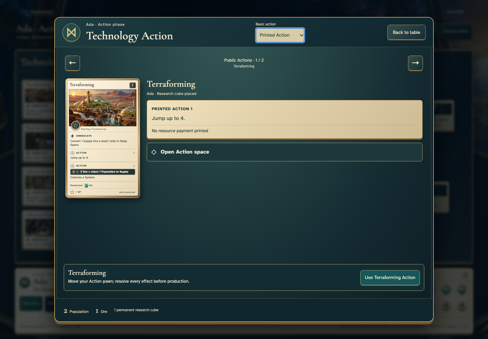](../../screenshots/overpay-a-sirius-colony-with-a-legally-upgraded-settling-fleet-with-separate-remote-controllers/029-terraforming-movement-kind-desktop-darwin.png) |

- [x] Choose a researched printed Action
- [x] Actual canonical effects and acknowledgement settle.
- [x] Public topology retains physical separation.
- [x] The viewport fits without page scrolling.

## 31. Commit the real printed four-jump Action before planning endpoints

Viewpoint: **Ada · separate host controller**.

| phone · 393 × 852 | desktop · 1440 × 1000 |
| --- | --- |
|  |  |

- [x] Commit the real printed four-jump Action before planning endpoints
- [x] Actual canonical effects and acknowledgement settle.
- [x] Public topology retains physical separation.
- [x] The viewport fits without page scrolling.

## 32. Read actual connected destinations for the unpaid route

Viewpoint: **Ada · separate host controller**.

| phone · 393 × 852 | desktop · 1440 × 1000 |
| --- | --- |
|  | [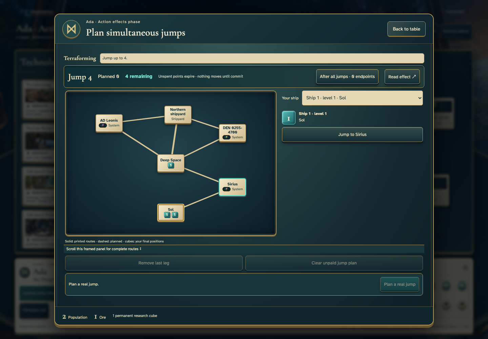](../../screenshots/overpay-a-sirius-colony-with-a-legally-upgraded-settling-fleet-with-separate-remote-controllers/031-settler-route-0-editor-desktop-darwin.png) |

- [x] Read actual connected destinations for the unpaid route
- [x] Actual canonical effects and acknowledgement settle.
- [x] Public topology retains physical separation.
- [x] The viewport fits without page scrolling.

## 33. Choose owned Ship 1 for movement

Viewpoint: **Ada · separate host controller**.

| phone · 393 × 852 | desktop · 1440 × 1000 |
| --- | --- |
| [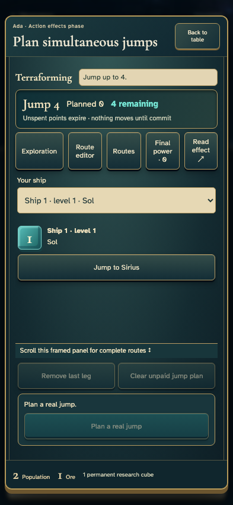](../../screenshots/overpay-a-sirius-colony-with-a-legally-upgraded-settling-fleet-with-separate-remote-controllers/032-settler-route-0-ship-phone-darwin.png) |  |

- [x] Choose owned Ship 1 for movement
- [x] Actual canonical effects and acknowledgement settle.
- [x] Public topology retains physical separation.
- [x] The viewport fits without page scrolling.

## 34. Plan the connected Sirius endpoint without moving a cube

Viewpoint: **Ada · separate host controller**.

| phone · 393 × 852 | desktop · 1440 × 1000 |
| --- | --- |
| [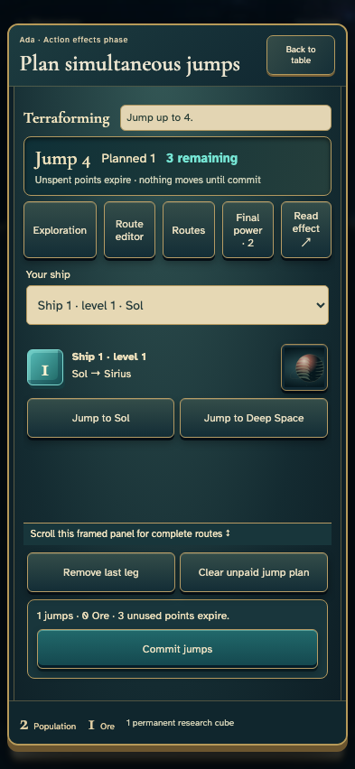](../../screenshots/overpay-a-sirius-colony-with-a-legally-upgraded-settling-fleet-with-separate-remote-controllers/033-settler-route-0-endpoint-phone-darwin.png) |  |

- [x] Plan the connected Sirius endpoint without moving a cube
- [x] Actual canonical effects and acknowledgement settle.
- [x] Public topology retains physical separation.
- [x] The viewport fits without page scrolling.

## 35. Read actual connected destinations for the unpaid route

Viewpoint: **Ada · separate host controller**.

| phone · 393 × 852 | desktop · 1440 × 1000 |
| --- | --- |
|  |  |

- [x] Read actual connected destinations for the unpaid route
- [x] Actual canonical effects and acknowledgement settle.
- [x] Public topology retains physical separation.
- [x] The viewport fits without page scrolling.

## 36. Choose owned Ship 2 for movement

Viewpoint: **Ada · separate host controller**.

| phone · 393 × 852 | desktop · 1440 × 1000 |
| --- | --- |
| [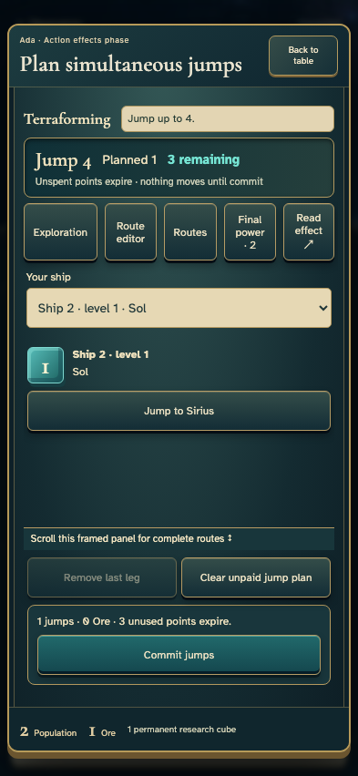](../../screenshots/overpay-a-sirius-colony-with-a-legally-upgraded-settling-fleet-with-separate-remote-controllers/035-settler-route-1-ship-phone-darwin.png) | [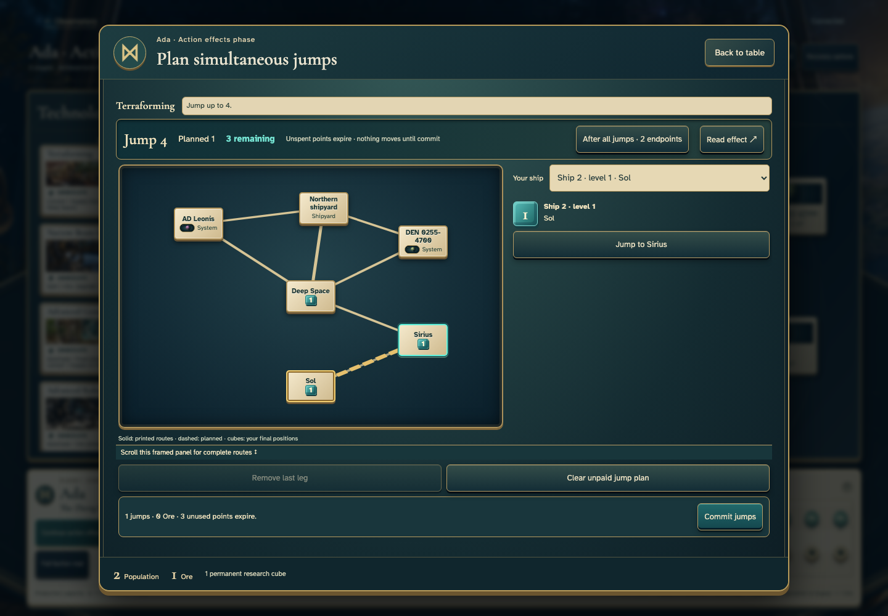](../../screenshots/overpay-a-sirius-colony-with-a-legally-upgraded-settling-fleet-with-separate-remote-controllers/035-settler-route-1-ship-desktop-darwin.png) |

- [x] Choose owned Ship 2 for movement
- [x] Actual canonical effects and acknowledgement settle.
- [x] Public topology retains physical separation.
- [x] The viewport fits without page scrolling.

## 37. Plan the connected Sirius endpoint without moving a cube

Viewpoint: **Ada · separate host controller**.

| phone · 393 × 852 | desktop · 1440 × 1000 |
| --- | --- |
| [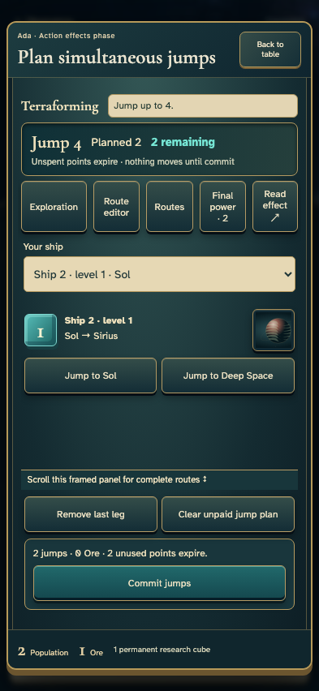](../../screenshots/overpay-a-sirius-colony-with-a-legally-upgraded-settling-fleet-with-separate-remote-controllers/036-settler-route-1-endpoint-phone-darwin.png) |  |

- [x] Plan the connected Sirius endpoint without moving a cube
- [x] Actual canonical effects and acknowledgement settle.
- [x] Public topology retains physical separation.
- [x] The viewport fits without page scrolling.

## 38. Read actual connected destinations for the unpaid route

Viewpoint: **Ada · separate host controller**.

| phone · 393 × 852 | desktop · 1440 × 1000 |
| --- | --- |
|  |  |

- [x] Read actual connected destinations for the unpaid route
- [x] Actual canonical effects and acknowledgement settle.
- [x] Public topology retains physical separation.
- [x] The viewport fits without page scrolling.

## 39. Choose owned Ship 3 for movement

Viewpoint: **Ada · separate host controller**.

| phone · 393 × 852 | desktop · 1440 × 1000 |
| --- | --- |
| [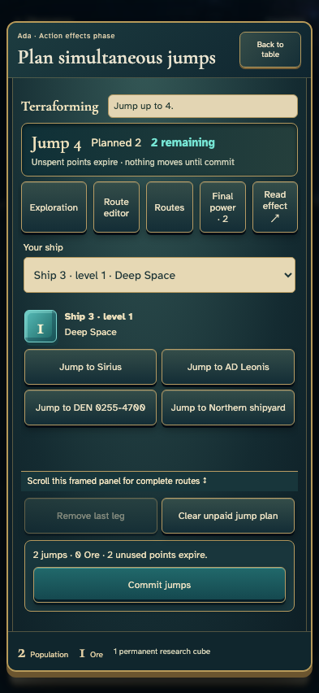](../../screenshots/overpay-a-sirius-colony-with-a-legally-upgraded-settling-fleet-with-separate-remote-controllers/038-settler-route-2-ship-phone-darwin.png) | [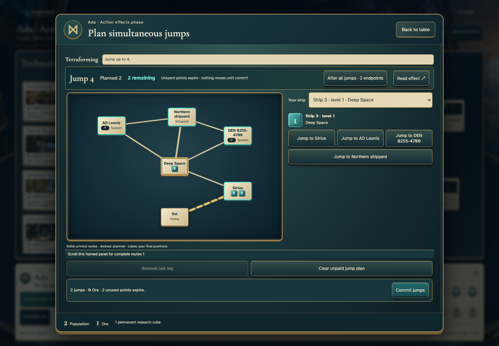](../../screenshots/overpay-a-sirius-colony-with-a-legally-upgraded-settling-fleet-with-separate-remote-controllers/038-settler-route-2-ship-desktop-darwin.png) |

- [x] Choose owned Ship 3 for movement
- [x] Actual canonical effects and acknowledgement settle.
- [x] Public topology retains physical separation.
- [x] The viewport fits without page scrolling.

## 40. Plan the connected Sirius endpoint without moving a cube

Viewpoint: **Ada · separate host controller**.

| phone · 393 × 852 | desktop · 1440 × 1000 |
| --- | --- |
|  | [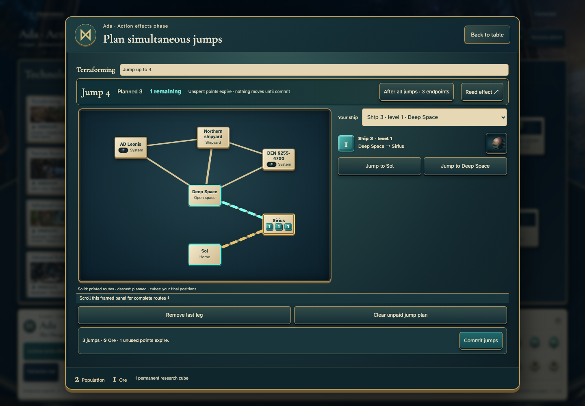](../../screenshots/overpay-a-sirius-colony-with-a-legally-upgraded-settling-fleet-with-separate-remote-controllers/039-settler-route-2-endpoint-desktop-darwin.png) |

- [x] Plan the connected Sirius endpoint without moving a cube
- [x] Actual canonical effects and acknowledgement settle.
- [x] Public topology retains physical separation.
- [x] The viewport fits without page scrolling.

## 41. All three endpoints settle; the actual outpost is gained once

Viewpoint: **Ada · separate host controller**.

| phone · 393 × 852 | desktop · 1440 × 1000 |
| --- | --- |
|  |  |

- [x] All three endpoints settle; the actual outpost is gained once
- [x] Actual canonical effects and acknowledgement settle.
- [x] Public topology retains physical separation.
- [x] The viewport fits without page scrolling.

## 42. Choose ordinary Ore production and hand off automatically

Viewpoint: **Ada · separate host controller**.

| phone · 393 × 852 | desktop · 1440 × 1000 |
| --- | --- |
|  |  |

- [x] Choose ordinary Ore production and hand off automatically
- [x] Actual canonical effects and acknowledgement settle.
- [x] Public topology retains physical separation.
- [x] The viewport fits without page scrolling.

## 43. The next separate controller receives its saved turn

Viewpoint: **Bora · separate guest controller**.

| phone · 1440 × 1000 | desktop · 393 × 852 |
| --- | --- |
|  |  |

- [x] The next separate controller receives its saved turn
- [x] Actual canonical effects and acknowledgement settle.
- [x] Public topology retains physical separation.
- [x] The viewport fits without page scrolling.

## 44. Open Bora’s real Action instrument

Viewpoint: **Bora · separate guest controller**.

| phone · 1440 × 1000 | desktop · 393 × 852 |
| --- | --- |
|  | [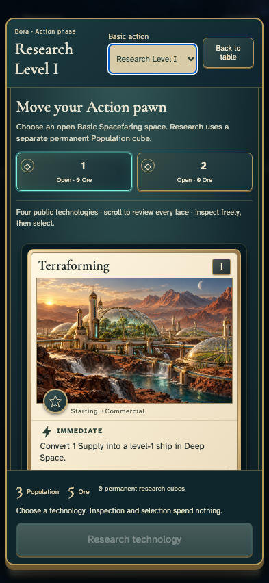](../../screenshots/overpay-a-sirius-colony-with-a-legally-upgraded-settling-fleet-with-separate-remote-controllers/043-rival-arrival-open-desktop-darwin.png) |

- [x] Open Bora’s real Action instrument
- [x] Actual canonical effects and acknowledgement settle.
- [x] Public topology retains physical separation.
- [x] The viewport fits without page scrolling.

## 45. Choose Basic build and jump

Viewpoint: **Bora · separate guest controller**.

| phone · 1440 × 1000 | desktop · 393 × 852 |
| --- | --- |
| [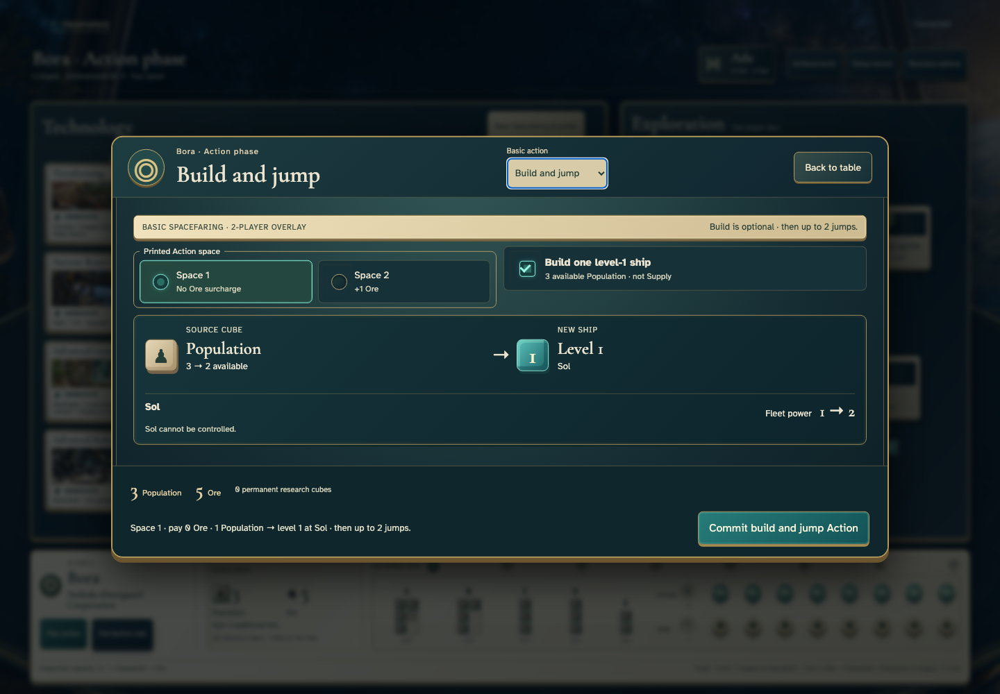](../../screenshots/overpay-a-sirius-colony-with-a-legally-upgraded-settling-fleet-with-separate-remote-controllers/044-rival-arrival-kind-phone-darwin.png) | [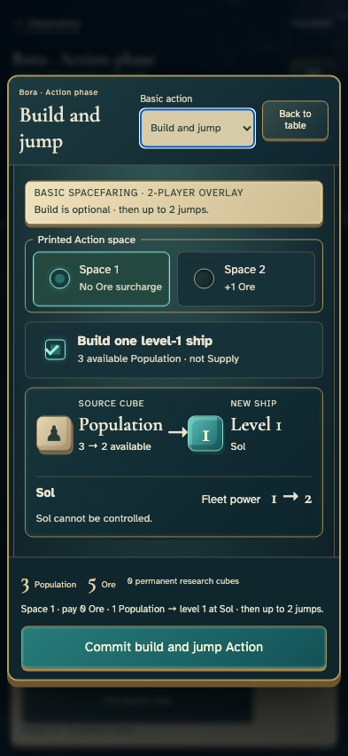](../../screenshots/overpay-a-sirius-colony-with-a-legally-upgraded-settling-fleet-with-separate-remote-controllers/044-rival-arrival-kind-desktop-darwin.png) |

- [x] Choose Basic build and jump
- [x] Actual canonical effects and acknowledgement settle.
- [x] Public topology retains physical separation.
- [x] The viewport fits without page scrolling.

## 46. The rival pays for a real new ship before its optional jumps

Viewpoint: **Bora · separate guest controller**.

| phone · 1440 × 1000 | desktop · 393 × 852 |
| --- | --- |
|  | [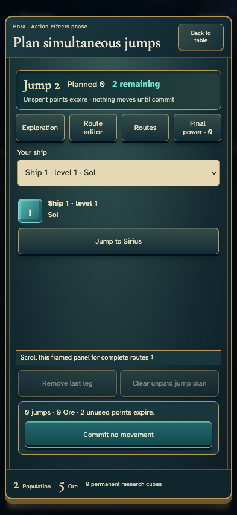](../../screenshots/overpay-a-sirius-colony-with-a-legally-upgraded-settling-fleet-with-separate-remote-controllers/045-rival-built-desktop-darwin.png) |

- [x] The rival pays for a real new ship before its optional jumps
- [x] Actual canonical effects and acknowledgement settle.
- [x] Public topology retains physical separation.
- [x] The viewport fits without page scrolling.

## 47. Read actual connected destinations for the unpaid route

Viewpoint: **Bora · separate guest controller**.

| phone · 1440 × 1000 | desktop · 393 × 852 |
| --- | --- |
|  |  |

- [x] Read actual connected destinations for the unpaid route
- [x] Actual canonical effects and acknowledgement settle.
- [x] Public topology retains physical separation.
- [x] The viewport fits without page scrolling.

## 48. Choose owned Ship 1 for movement

Viewpoint: **Bora · separate guest controller**.

| phone · 1440 × 1000 | desktop · 393 × 852 |
| --- | --- |
| [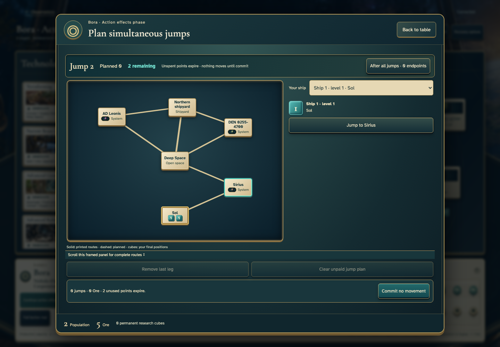](../../screenshots/overpay-a-sirius-colony-with-a-legally-upgraded-settling-fleet-with-separate-remote-controllers/047-rival-route-ship-phone-darwin.png) |  |

- [x] Choose owned Ship 1 for movement
- [x] Actual canonical effects and acknowledgement settle.
- [x] Public topology retains physical separation.
- [x] The viewport fits without page scrolling.

## 49. Plan the connected Sirius endpoint without moving a cube

Viewpoint: **Bora · separate guest controller**.

| phone · 1440 × 1000 | desktop · 393 × 852 |
| --- | --- |
| [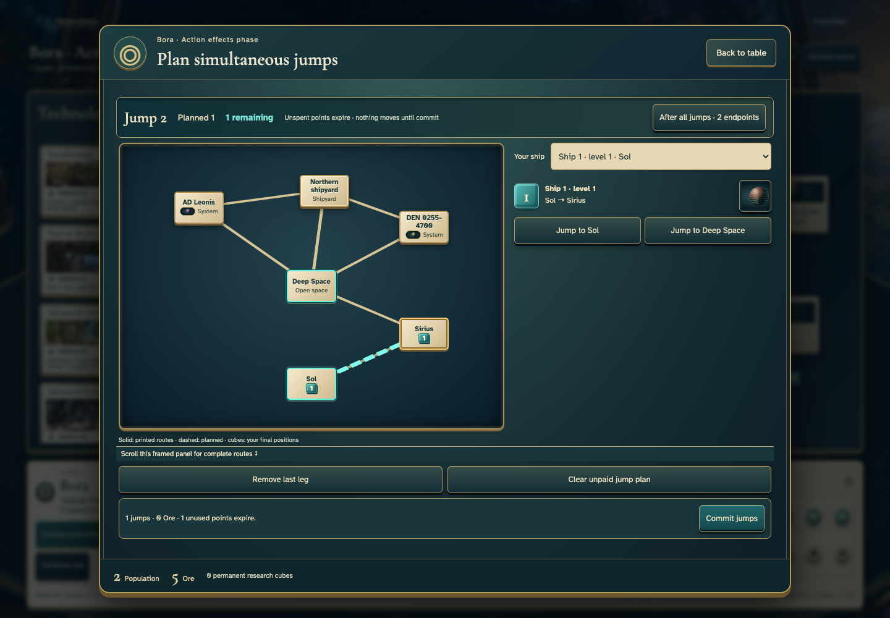](../../screenshots/overpay-a-sirius-colony-with-a-legally-upgraded-settling-fleet-with-separate-remote-controllers/048-rival-route-endpoint-phone-darwin.png) | [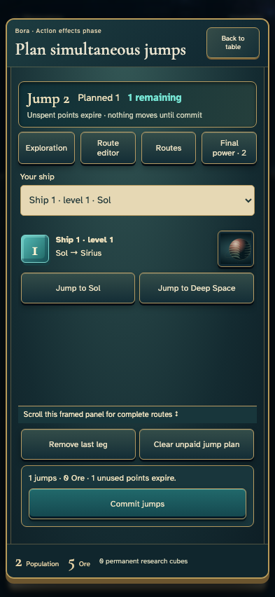](../../screenshots/overpay-a-sirius-colony-with-a-legally-upgraded-settling-fleet-with-separate-remote-controllers/048-rival-route-endpoint-desktop-darwin.png) |

- [x] Plan the connected Sirius endpoint without moving a cube
- [x] Actual canonical effects and acknowledgement settle.
- [x] Public topology retains physical separation.
- [x] The viewport fits without page scrolling.

## 50. A weaker rival fleet arrives without taking the incumbent’s outpost

Viewpoint: **Bora · separate guest controller**.

| phone · 1440 × 1000 | desktop · 393 × 852 |
| --- | --- |
| [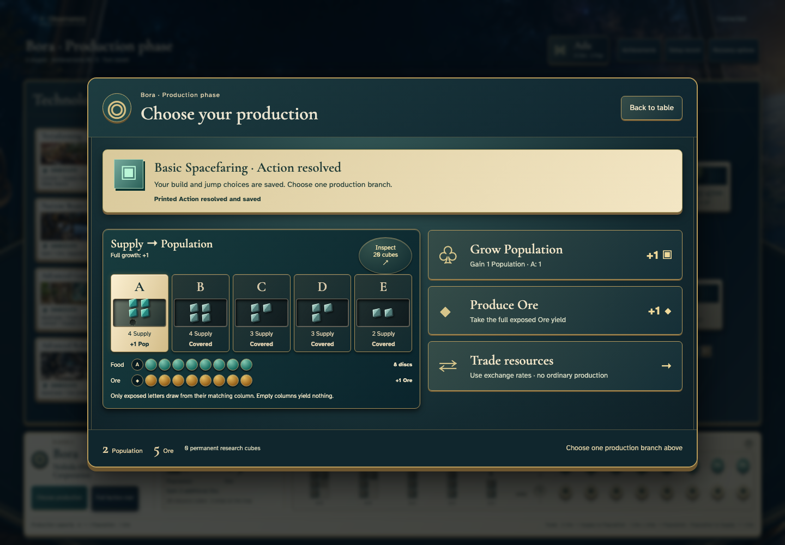](../../screenshots/overpay-a-sirius-colony-with-a-legally-upgraded-settling-fleet-with-separate-remote-controllers/049-rival-arrived-phone-darwin.png) | [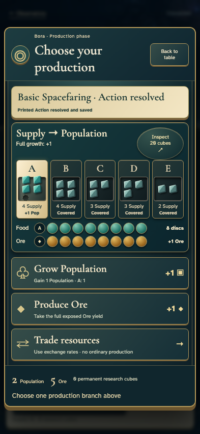](../../screenshots/overpay-a-sirius-colony-with-a-legally-upgraded-settling-fleet-with-separate-remote-controllers/049-rival-arrived-desktop-darwin.png) |

- [x] A weaker rival fleet arrives without taking the incumbent’s outpost
- [x] Actual canonical effects and acknowledgement settle.
- [x] Public topology retains physical separation.
- [x] The viewport fits without page scrolling.

## 51. Choose ordinary Ore production and hand off automatically

Viewpoint: **Bora · separate guest controller**.

| phone · 1440 × 1000 | desktop · 393 × 852 |
| --- | --- |
|  | [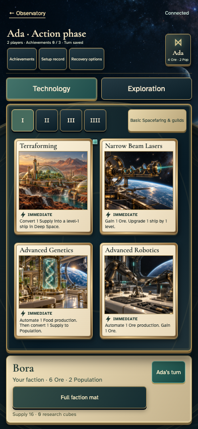](../../screenshots/overpay-a-sirius-colony-with-a-legally-upgraded-settling-fleet-with-separate-remote-controllers/050-rival-arrived-handoff-desktop-darwin.png) |

- [x] Choose ordinary Ore production and hand off automatically
- [x] Actual canonical effects and acknowledgement settle.
- [x] Public topology retains physical separation.
- [x] The viewport fits without page scrolling.

## 52. The next separate controller receives its saved turn

Viewpoint: **Ada · separate host controller**.

| phone · 393 × 852 | desktop · 1440 × 1000 |
| --- | --- |
| [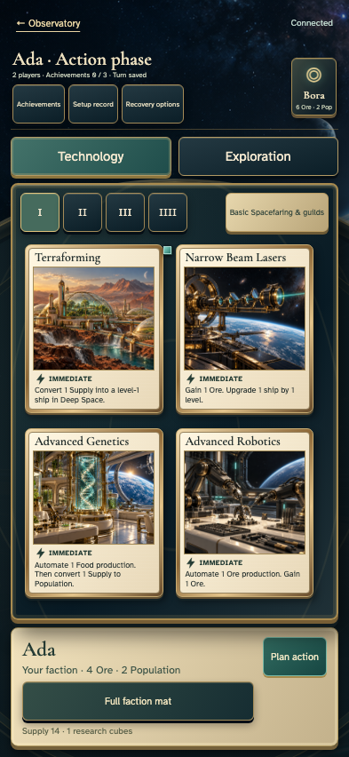](../../screenshots/overpay-a-sirius-colony-with-a-legally-upgraded-settling-fleet-with-separate-remote-controllers/051-rival-arrived-next-phone-darwin.png) | [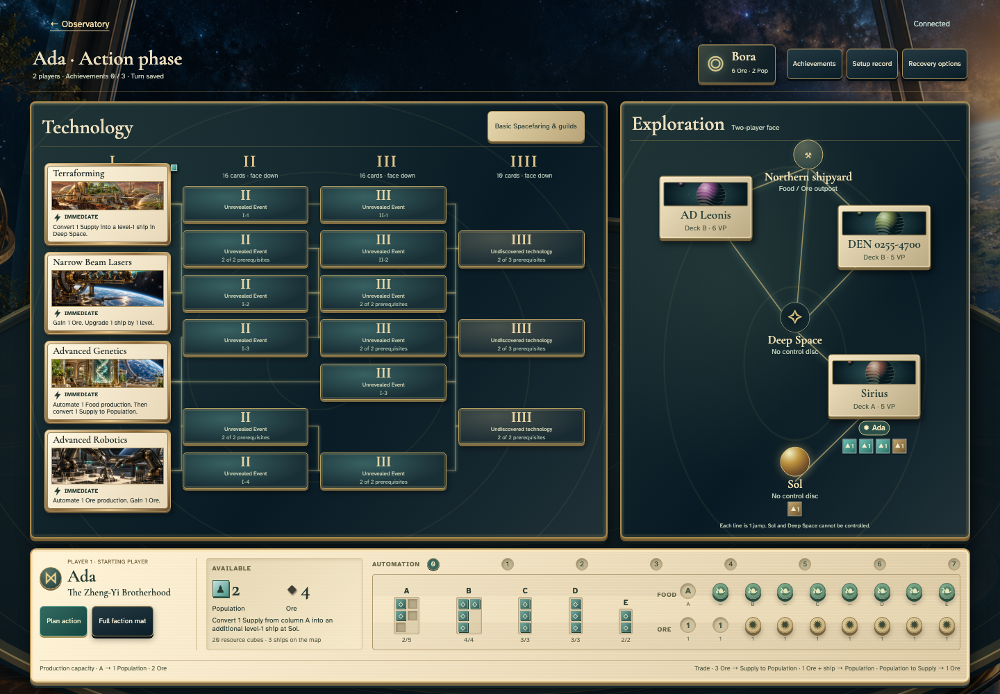](../../screenshots/overpay-a-sirius-colony-with-a-legally-upgraded-settling-fleet-with-separate-remote-controllers/051-rival-arrived-next-desktop-darwin.png) |

- [x] The next separate controller receives its saved turn
- [x] Actual canonical effects and acknowledgement settle.
- [x] Public topology retains physical separation.
- [x] The viewport fits without page scrolling.

## 53. Open Ada’s real Action instrument

Viewpoint: **Ada · separate host controller**.

| phone · 393 × 852 | desktop · 1440 × 1000 |
| --- | --- |
|  |  |

- [x] Open Ada’s real Action instrument
- [x] Actual canonical effects and acknowledgement settle.
- [x] Public topology retains physical separation.
- [x] The viewport fits without page scrolling.

## 54. Choose the printed colony Action

Viewpoint: **Ada · separate host controller**.

| phone · 393 × 852 | desktop · 1440 × 1000 |
| --- | --- |
|  |  |

- [x] Choose the printed colony Action
- [x] Actual canonical effects and acknowledgement settle.
- [x] Public topology retains physical separation.
- [x] The viewport fits without page scrolling.

## 55. Read the system settlement view

Viewpoint: **Ada · separate host controller**.

| phone · 393 × 852 | desktop · 1440 × 1000 |
| --- | --- |
|  |  |

- [x] Read the system settlement view
- [x] Actual canonical effects and acknowledgement settle.
- [x] Public topology retains physical separation.
- [x] The viewport fits without page scrolling.

## 56. Read the complete printed System before committing

Viewpoint: **Ada · separate host controller**.

| phone · 393 × 852 | desktop · 1440 × 1000 |
| --- | --- |
| [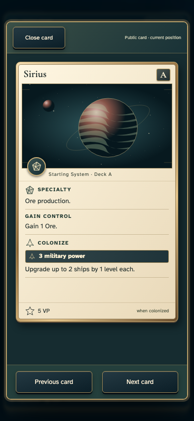](../../screenshots/overpay-a-sirius-colony-with-a-legally-upgraded-settling-fleet-with-separate-remote-controllers/055-full-system-phone-darwin.png) | [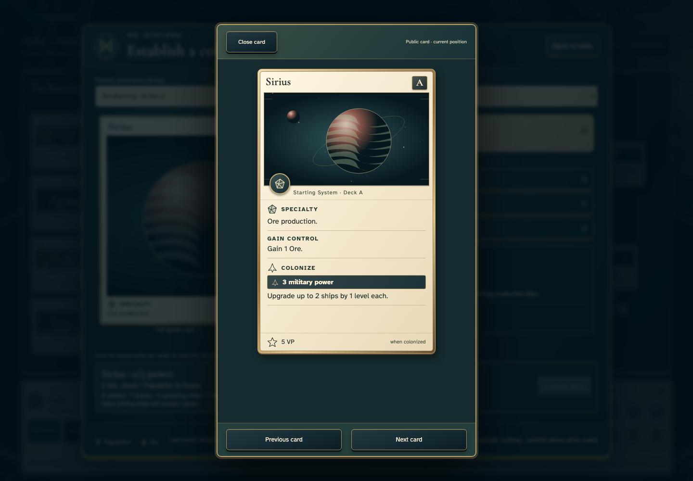](../../screenshots/overpay-a-sirius-colony-with-a-legally-upgraded-settling-fleet-with-separate-remote-controllers/055-full-system-desktop-darwin.png) |

- [x] Read the complete printed System before committing
- [x] Actual canonical effects and acknowledgement settle.
- [x] Public topology retains physical separation.
- [x] The viewport fits without page scrolling.

## 57. Escape restores the exact System inspection opener

Viewpoint: **Ada · separate host controller**.

| phone · 393 × 852 | desktop · 1440 × 1000 |
| --- | --- |
|  | [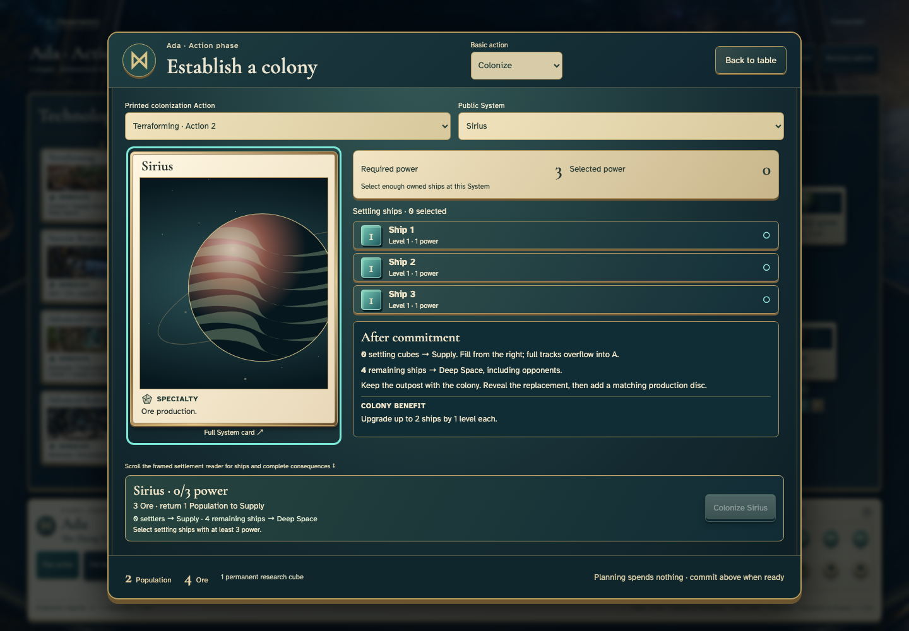](../../screenshots/overpay-a-sirius-colony-with-a-legally-upgraded-settling-fleet-with-separate-remote-controllers/056-system-focus-return-desktop-darwin.png) |

- [x] Escape restores the exact System inspection opener
- [x] Actual canonical effects and acknowledgement settle.
- [x] Public topology retains physical separation.
- [x] The viewport fits without page scrolling.

## 58. Read the settlers settlement view

Viewpoint: **Ada · separate host controller**.

| phone · 393 × 852 | desktop · 1440 × 1000 |
| --- | --- |
| [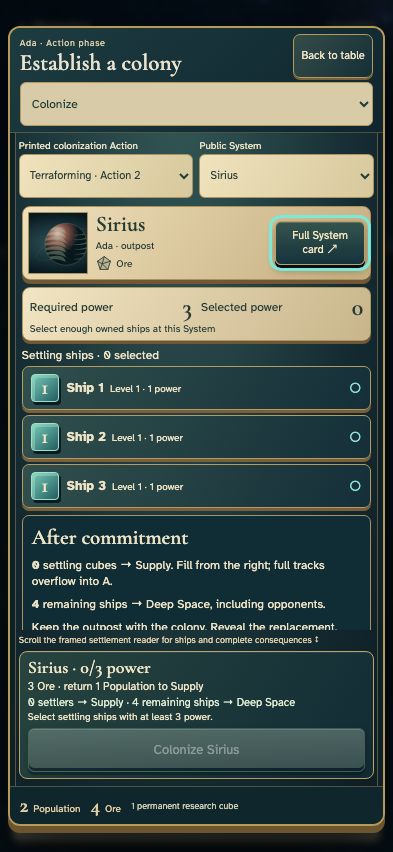](../../screenshots/overpay-a-sirius-colony-with-a-legally-upgraded-settling-fleet-with-separate-remote-controllers/057-colony-settlers-phone-darwin.png) |  |

- [x] Read the settlers settlement view
- [x] Actual canonical effects and acknowledgement settle.
- [x] Public topology retains physical separation.
- [x] The viewport fits without page scrolling.

## 59. Select owned settling Ship 1 without spending resources

Viewpoint: **Ada · separate host controller**.

| phone · 393 × 852 | desktop · 1440 × 1000 |
| --- | --- |
|  |  |

- [x] Select owned settling Ship 1 without spending resources
- [x] Actual canonical effects and acknowledgement settle.
- [x] Public topology retains physical separation.
- [x] The viewport fits without page scrolling.

## 60. Select owned settling Ship 2 without spending resources

Viewpoint: **Ada · separate host controller**.

| phone · 393 × 852 | desktop · 1440 × 1000 |
| --- | --- |
|  |  |

- [x] Select owned settling Ship 2 without spending resources
- [x] Actual canonical effects and acknowledgement settle.
- [x] Public topology retains physical separation.
- [x] The viewport fits without page scrolling.

## 61. Select owned settling Ship 3 without spending resources

Viewpoint: **Ada · separate host controller**.

| phone · 393 × 852 | desktop · 1440 × 1000 |
| --- | --- |
|  |  |

- [x] Select owned settling Ship 3 without spending resources
- [x] Actual canonical effects and acknowledgement settle.
- [x] Public topology retains physical separation.
- [x] The viewport fits without page scrolling.

## 62. Three own cubes meet the printed three-power requirement; the rival is exiled after commitment

Viewpoint: **Ada · separate host controller**.

| phone · 393 × 852 | desktop · 1440 × 1000 |
| --- | --- |
|  |  |

- [x] Three own cubes meet the printed three-power requirement; the rival is exiled after commitment
- [x] Actual canonical effects and acknowledgement settle.
- [x] Public topology retains physical separation.
- [x] The viewport fits without page scrolling.

## 63. Cancel the unpaid settlement without moving or returning any cube

Viewpoint: **Ada · separate host controller**.

| phone · 393 × 852 | desktop · 1440 × 1000 |
| --- | --- |
|  |  |

- [x] Cancel the unpaid settlement without moving or returning any cube
- [x] Actual canonical effects and acknowledgement settle.
- [x] Public topology retains physical separation.
- [x] The viewport fits without page scrolling.

## 64. Open Ada’s real Action instrument

Viewpoint: **Ada · separate host controller**.

| phone · 393 × 852 | desktop · 1440 × 1000 |
| --- | --- |
|  |  |

- [x] Open Ada’s real Action instrument
- [x] Actual canonical effects and acknowledgement settle.
- [x] Public topology retains physical separation.
- [x] The viewport fits without page scrolling.

## 65. Choose Research Level I

Viewpoint: **Ada · separate host controller**.

| phone · 393 × 852 | desktop · 1440 × 1000 |
| --- | --- |
|  |  |

- [x] Choose Research Level I
- [x] Actual canonical effects and acknowledgement settle.
- [x] Public topology retains physical separation.
- [x] The viewport fits without page scrolling.

## 66. Choose a legal unoccupied research space

Viewpoint: **Ada · separate host controller**.

| phone · 393 × 852 | desktop · 1440 × 1000 |
| --- | --- |
|  |  |

- [x] Choose a legal unoccupied research space
- [x] Actual canonical effects and acknowledgement settle.
- [x] Public topology retains physical separation.
- [x] The viewport fits without page scrolling.

## 67. Select Narrow Beam Lasers without paying yet

Viewpoint: **Ada · separate host controller**.

| phone · 393 × 852 | desktop · 1440 × 1000 |
| --- | --- |
|  |  |

- [x] Select Narrow Beam Lasers without paying yet
- [x] Actual canonical effects and acknowledgement settle.
- [x] Public topology retains physical separation.
- [x] The viewport fits without page scrolling.

## 68. Choose an actual local ship for the mandatory level1 to2 upgrade

Viewpoint: **Ada · separate host controller**.

| phone · 393 × 852 | desktop · 1440 × 1000 |
| --- | --- |
|  |  |

- [x] Choose an actual local ship for the mandatory level1 to2 upgrade
- [x] Actual canonical effects and acknowledgement settle.
- [x] Public topology retains physical separation.
- [x] The viewport fits without page scrolling.

## 69. Pay the permanent research cube and resolve the once-only printed bonus

Viewpoint: **Ada · separate host controller**.

| phone · 393 × 852 | desktop · 1440 × 1000 |
| --- | --- |
|  |  |

- [x] Pay the permanent research cube and resolve the once-only printed bonus
- [x] Actual canonical effects and acknowledgement settle.
- [x] Public topology retains physical separation.
- [x] The viewport fits without page scrolling.

## 70. Choose ordinary Ore production and hand off automatically

Viewpoint: **Ada · separate host controller**.

| phone · 393 × 852 | desktop · 1440 × 1000 |
| --- | --- |
|  |  |

- [x] Choose ordinary Ore production and hand off automatically
- [x] Actual canonical effects and acknowledgement settle.
- [x] Public topology retains physical separation.
- [x] The viewport fits without page scrolling.

## 71. The next separate controller receives its saved turn

Viewpoint: **Bora · separate guest controller**.

| phone · 1440 × 1000 | desktop · 393 × 852 |
| --- | --- |
|  |  |

- [x] The next separate controller receives its saved turn
- [x] Actual canonical effects and acknowledgement settle.
- [x] Public topology retains physical separation.
- [x] The viewport fits without page scrolling.

## 72. Open Bora’s real Action instrument

Viewpoint: **Bora · separate guest controller**.

| phone · 1440 × 1000 | desktop · 393 × 852 |
| --- | --- |
|  |  |

- [x] Open Bora’s real Action instrument
- [x] Actual canonical effects and acknowledgement settle.
- [x] Public topology retains physical separation.
- [x] The viewport fits without page scrolling.

## 73. Choose Gather

Viewpoint: **Bora · separate guest controller**.

| phone · 1440 × 1000 | desktop · 393 × 852 |
| --- | --- |
|  |  |

- [x] Choose Gather
- [x] Actual canonical effects and acknowledgement settle.
- [x] Public topology retains physical separation.
- [x] The viewport fits without page scrolling.

## 74. The rival vacates its build space through an ordinary Gather

Viewpoint: **Bora · separate guest controller**.

| phone · 1440 × 1000 | desktop · 393 × 852 |
| --- | --- |
|  |  |

- [x] The rival vacates its build space through an ordinary Gather
- [x] Actual canonical effects and acknowledgement settle.
- [x] Public topology retains physical separation.
- [x] The viewport fits without page scrolling.

## 75. Choose ordinary Ore production and hand off automatically

Viewpoint: **Bora · separate guest controller**.

| phone · 1440 × 1000 | desktop · 393 × 852 |
| --- | --- |
|  |  |

- [x] Choose ordinary Ore production and hand off automatically
- [x] Actual canonical effects and acknowledgement settle.
- [x] Public topology retains physical separation.
- [x] The viewport fits without page scrolling.

## 76. The next separate controller receives its saved turn

Viewpoint: **Ada · separate host controller**.

| phone · 393 × 852 | desktop · 1440 × 1000 |
| --- | --- |
|  |  |

- [x] The next separate controller receives its saved turn
- [x] Actual canonical effects and acknowledgement settle.
- [x] Public topology retains physical separation.
- [x] The viewport fits without page scrolling.

## 77. Open Ada’s real Action instrument

Viewpoint: **Ada · separate host controller**.

| phone · 393 × 852 | desktop · 1440 × 1000 |
| --- | --- |
|  |  |

- [x] Open Ada’s real Action instrument
- [x] Actual canonical effects and acknowledgement settle.
- [x] Public topology retains physical separation.
- [x] The viewport fits without page scrolling.

## 78. Choose the printed colony Action

Viewpoint: **Ada · separate host controller**.

| phone · 393 × 852 | desktop · 1440 × 1000 |
| --- | --- |
|  |  |

- [x] Choose the printed colony Action
- [x] Actual canonical effects and acknowledgement settle.
- [x] Public topology retains physical separation.
- [x] The viewport fits without page scrolling.

## 79. Read the settlers settlement view

Viewpoint: **Ada · separate host controller**.

| phone · 393 × 852 | desktop · 1440 × 1000 |
| --- | --- |
|  |  |

- [x] Read the settlers settlement view
- [x] Actual canonical effects and acknowledgement settle.
- [x] Public topology retains physical separation.
- [x] The viewport fits without page scrolling.

## 80. Select owned settling Ship 1 without spending resources

Viewpoint: **Ada · separate host controller**.

| phone · 393 × 852 | desktop · 1440 × 1000 |
| --- | --- |
|  |  |

- [x] Select owned settling Ship 1 without spending resources
- [x] Actual canonical effects and acknowledgement settle.
- [x] Public topology retains physical separation.
- [x] The viewport fits without page scrolling.

## 81. Select owned settling Ship 2 without spending resources

Viewpoint: **Ada · separate host controller**.

| phone · 393 × 852 | desktop · 1440 × 1000 |
| --- | --- |
|  |  |

- [x] Select owned settling Ship 2 without spending resources
- [x] Actual canonical effects and acknowledgement settle.
- [x] Public topology retains physical separation.
- [x] The viewport fits without page scrolling.

## 82. Select owned settling Ship 3 without spending resources

Viewpoint: **Ada · separate host controller**.

| phone · 393 × 852 | desktop · 1440 × 1000 |
| --- | --- |
|  |  |

- [x] Select owned settling Ship 3 without spending resources
- [x] Actual canonical effects and acknowledgement settle.
- [x] Public topology retains physical separation.
- [x] The viewport fits without page scrolling.

## 83. A legally upgraded level2 cube creates four selected power for a three-power colony; no change is returned

Viewpoint: **Ada · separate host controller**.

| phone · 393 × 852 | desktop · 1440 × 1000 |
| --- | --- |
|  |  |

- [x] A legally upgraded level2 cube creates four selected power for a three-power colony; no change is returned
- [x] Actual canonical effects and acknowledgement settle.
- [x] Public topology retains physical separation.
- [x] The viewport fits without page scrolling.

## 84. Read the outcome settlement view

Viewpoint: **Ada · separate host controller**.

| phone · 393 × 852 | desktop · 1440 × 1000 |
| --- | --- |
|  |  |

- [x] Read the outcome settlement view
- [x] Actual canonical effects and acknowledgement settle.
- [x] Public topology retains physical separation.
- [x] The viewport fits without page scrolling.

## 85. Keyboard scrolling reaches every return/exile/replacement/disc/printed-benefit statement

Viewpoint: **Ada · separate host controller**.

| phone · 393 × 852 | desktop · 1440 × 1000 |
| --- | --- |
|  |  |

- [x] Keyboard scrolling reaches every return/exile/replacement/disc/printed-benefit statement
- [x] Actual canonical effects and acknowledgement settle.
- [x] Public topology retains physical separation.
- [x] The viewport fits without page scrolling.

## 86. The additional disc and actual available printed benefit finish before ordinary Production

Viewpoint: **Ada · separate host controller**.

| phone · 393 × 852 | desktop · 1440 × 1000 |
| --- | --- |
|  |  |

- [x] The additional disc and actual available printed benefit finish before ordinary Production
- [x] Actual canonical effects and acknowledgement settle.
- [x] Public topology retains physical separation.
- [x] The viewport fits without page scrolling.

## 87. Reload retains the permanent colony and pending Production

Viewpoint: **Ada · separate host controller**.

| phone · 393 × 852 | desktop · 1440 × 1000 |
| --- | --- |
|  |  |

- [x] Reload retains the permanent colony and pending Production
- [x] Actual canonical effects and acknowledgement settle.
- [x] Public topology retains physical separation.
- [x] The viewport fits without page scrolling.

## 88. Reopening the saved Production never repeats the payment or colony benefit

Viewpoint: **Ada · separate host controller**.

| phone · 393 × 852 | desktop · 1440 × 1000 |
| --- | --- |
|  |  |

- [x] Reopening the saved Production never repeats the payment or colony benefit
- [x] Actual canonical effects and acknowledgement settle.
- [x] Public topology retains physical separation.
- [x] The viewport fits without page scrolling.

## 89. The public table shows its newly revealed System and the saved colony

Viewpoint: **Ada · separate host controller**.

| phone · 393 × 852 | desktop · 1440 × 1000 |
| --- | --- |
|  |  |

- [x] The public table shows its newly revealed System and the saved colony
- [x] Actual canonical effects and acknowledgement settle.
- [x] Public topology retains physical separation.
- [x] The viewport fits without page scrolling.

## 90. Read the saved rival exile and newly refilled public map after settlement

Viewpoint: **Ada · separate host controller**.

| phone · 393 × 852 | desktop · 1440 × 1000 |
| --- | --- |
|  |  |

- [x] Read the saved rival exile and newly refilled public map after settlement
- [x] Actual canonical effects and acknowledgement settle.
- [x] Public topology retains physical separation.
- [x] The viewport fits without page scrolling.

## 91. Inspect actual production discs and permanent automation separately

Viewpoint: **Ada · separate host controller**.

| phone · 393 × 852 | desktop · 1440 × 1000 |
| --- | --- |
|  |  |

- [x] Inspect actual production discs and permanent automation separately
- [x] Actual canonical effects and acknowledgement settle.
- [x] Public topology retains physical separation.
- [x] The viewport fits without page scrolling.

## 92. Inspect the actual surviving fleet after settlement and printed benefit

Viewpoint: **Ada · separate host controller**.

| phone · 393 × 852 | desktop · 1440 × 1000 |
| --- | --- |
|  |  |

- [x] Inspect the actual surviving fleet after settlement and printed benefit
- [x] Actual canonical effects and acknowledgement settle.
- [x] Public topology retains physical separation.
- [x] The viewport fits without page scrolling.

## 93. The permanent register retains both actual discs and printed System identity

Viewpoint: **Ada · separate host controller**.

| phone · 393 × 852 | desktop · 1440 × 1000 |
| --- | --- |
|  |  |

- [x] The permanent register retains both actual discs and printed System identity
- [x] Actual canonical effects and acknowledgement settle.
- [x] Public topology retains physical separation.
- [x] The viewport fits without page scrolling.

## 94. Inspect the complete acquired card through the reusable production renderer

Viewpoint: **Ada · separate host controller**.

| phone · 393 × 852 | desktop · 1440 × 1000 |
| --- | --- |
|  |  |

- [x] Inspect the complete acquired card through the reusable production renderer
- [x] Actual canonical effects and acknowledgement settle.
- [x] Public topology retains physical separation.
- [x] The viewport fits without page scrolling.

## 95. Escape returns to the exact acquired-card opener

Viewpoint: **Ada · separate host controller**.

| phone · 393 × 852 | desktop · 1440 × 1000 |
| --- | --- |
|  |  |

- [x] Escape returns to the exact acquired-card opener
- [x] Actual canonical effects and acknowledgement settle.
- [x] Public topology retains physical separation.
- [x] The viewport fits without page scrolling.

## 96. Closing Fleet restores the exact Fleet opener

Viewpoint: **Ada · separate host controller**.

| phone · 393 × 852 | desktop · 1440 × 1000 |
| --- | --- |
|  |  |

- [x] Closing Fleet restores the exact Fleet opener
- [x] Actual canonical effects and acknowledgement settle.
- [x] Public topology retains physical separation.
- [x] The viewport fits without page scrolling.

## 97. Closing the mat restores its exact opener without consuming Production

Viewpoint: **Ada · separate host controller**.

| phone · 393 × 852 | desktop · 1440 × 1000 |
| --- | --- |
|  |  |

- [x] Closing the mat restores its exact opener without consuming Production
- [x] Actual canonical effects and acknowledgement settle.
- [x] Public topology retains physical separation.
- [x] The viewport fits without page scrolling.

## 98. Return to the same retained Production after inspection

Viewpoint: **Ada · separate host controller**.

| phone · 393 × 852 | desktop · 1440 × 1000 |
| --- | --- |
|  |  |

- [x] Return to the same retained Production after inspection
- [x] Actual canonical effects and acknowledgement settle.
- [x] Public topology retains physical separation.
- [x] The viewport fits without page scrolling.

## 99. Choose ordinary Ore production and hand off automatically

Viewpoint: **Ada · separate host controller**.

| phone · 393 × 852 | desktop · 1440 × 1000 |
| --- | --- |
|  |  |

- [x] Choose ordinary Ore production and hand off automatically
- [x] Actual canonical effects and acknowledgement settle.
- [x] Public topology retains physical separation.
- [x] The viewport fits without page scrolling.

## 100. The next separate controller receives its saved turn

Viewpoint: **Bora · separate guest controller**.

| phone · 1440 × 1000 | desktop · 393 × 852 |
| --- | --- |
|  |  |

- [x] The next separate controller receives its saved turn
- [x] Actual canonical effects and acknowledgement settle.
- [x] Public topology retains physical separation.
- [x] The viewport fits without page scrolling.
