# Settle and exile a rival fleet at 4 shared corner seats

One normal shared controller joins every physical seat with legal unique Basic factions. Predeclared setup seed002 Sirius or006 Wolf359 only at Begin. Real preparatory turns; no companion device, identity injection, seeded game state or future deck read. Two-player Sirius includes legal upgrade/overpay; four-player retains exact settlement.

## 1. Arrive through the actual production interface

Viewpoint: **Ada · South West · one shared controller**.

| desktop · 1440 × 1000 |
| --- |
|  |

tabletop-4k · 3840 × 2160

- [x] Arrive through the actual production interface
- [x] Actual canonical effects and acknowledgement settle.
- [x] Public topology retains physical separation.
- [x] The viewport fits without page scrolling.

## 2. Choose physical tabletop or separate-controller remote play

Viewpoint: **Ada · South West · one shared controller**.

| desktop · 1440 × 1000 |
| --- |
|  |

tabletop-4k · 3840 × 2160

- [x] Choose physical tabletop or separate-controller remote play
- [x] Actual canonical effects and acknowledgement settle.
- [x] Public topology retains physical separation.
- [x] The viewport fits without page scrolling.

## 3. One shared controller opens the physical seats

Viewpoint: **Ada · South West · one shared controller**.

| desktop · 1440 × 1000 |
| --- |
|  |

tabletop-4k · 3840 × 2160

- [x] One shared controller opens the physical seats
- [x] Actual canonical effects and acknowledgement settle.
- [x] Public topology retains physical separation.
- [x] The viewport fits without page scrolling.

## 4. Join directly at South West

Viewpoint: **Ada · South West · one shared controller**.

| desktop · 1440 × 1000 |
| --- |
|  |

tabletop-4k · 3840 × 2160

- [x] Join directly at South West
- [x] Actual canonical effects and acknowledgement settle.
- [x] Public topology retains physical separation.
- [x] The viewport fits without page scrolling.

## 5. Name this physical seat Ada

Viewpoint: **Ada · South West · one shared controller**.

| desktop · 1440 × 1000 |
| --- |
|  |

tabletop-4k · 3840 × 2160

- [x] Name this physical seat Ada
- [x] Actual canonical effects and acknowledgement settle.
- [x] Public topology retains physical separation.
- [x] The viewport fits without page scrolling.

## 6. Persist the named seat on the same display

Viewpoint: **Ada · South West · one shared controller**.

| desktop · 1440 × 1000 |
| --- |
|  |

tabletop-4k · 3840 × 2160

- [x] Persist the named seat on the same display
- [x] Actual canonical effects and acknowledgement settle.
- [x] Public topology retains physical separation.
- [x] The viewport fits without page scrolling.

## 7. Join directly at North West

Viewpoint: **Bora · North West · one shared controller**.

| desktop · 1440 × 1000 |
| --- |
|  |

tabletop-4k · 3840 × 2160

- [x] Join directly at North West
- [x] Actual canonical effects and acknowledgement settle.
- [x] Public topology retains physical separation.
- [x] The viewport fits without page scrolling.

## 8. Name this physical seat Bora

Viewpoint: **Bora · North West · one shared controller**.

| desktop · 1440 × 1000 |
| --- |
|  |

tabletop-4k · 3840 × 2160

- [x] Name this physical seat Bora
- [x] Actual canonical effects and acknowledgement settle.
- [x] Public topology retains physical separation.
- [x] The viewport fits without page scrolling.

## 9. Persist the named seat on the same display

Viewpoint: **Bora · North West · one shared controller**.

| desktop · 1440 × 1000 |
| --- |
| [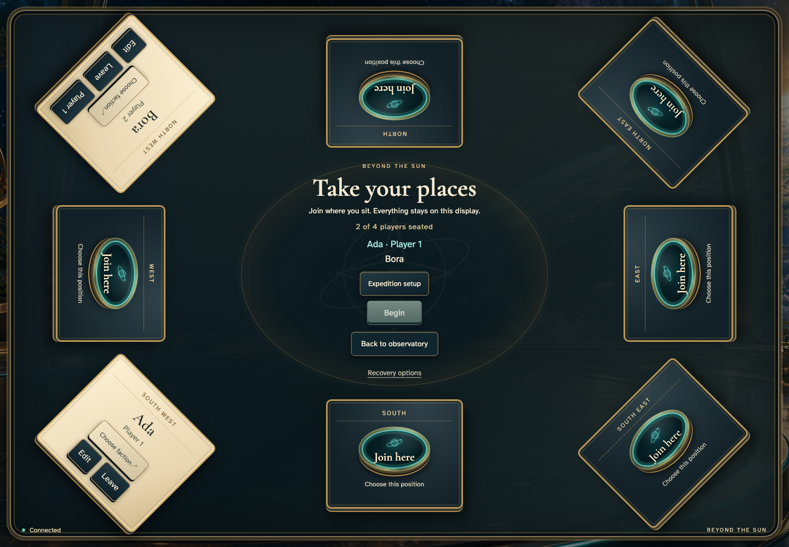](../../screenshots/settle-and-exile-a-rival-fleet-at-4-shared-corner-seats/008-seat-1-joined-desktop-darwin.png) |

tabletop-4k · 3840 × 2160

- [x] Persist the named seat on the same display
- [x] Actual canonical effects and acknowledgement settle.
- [x] Public topology retains physical separation.
- [x] The viewport fits without page scrolling.

## 10. Join directly at North East

Viewpoint: **Cleo · North East · one shared controller**.

| desktop · 1440 × 1000 |
| --- |
|  |

tabletop-4k · 3840 × 2160

- [x] Join directly at North East
- [x] Actual canonical effects and acknowledgement settle.
- [x] Public topology retains physical separation.
- [x] The viewport fits without page scrolling.

## 11. Name this physical seat Cleo

Viewpoint: **Cleo · North East · one shared controller**.

| desktop · 1440 × 1000 |
| --- |
|  |

tabletop-4k · 3840 × 2160

[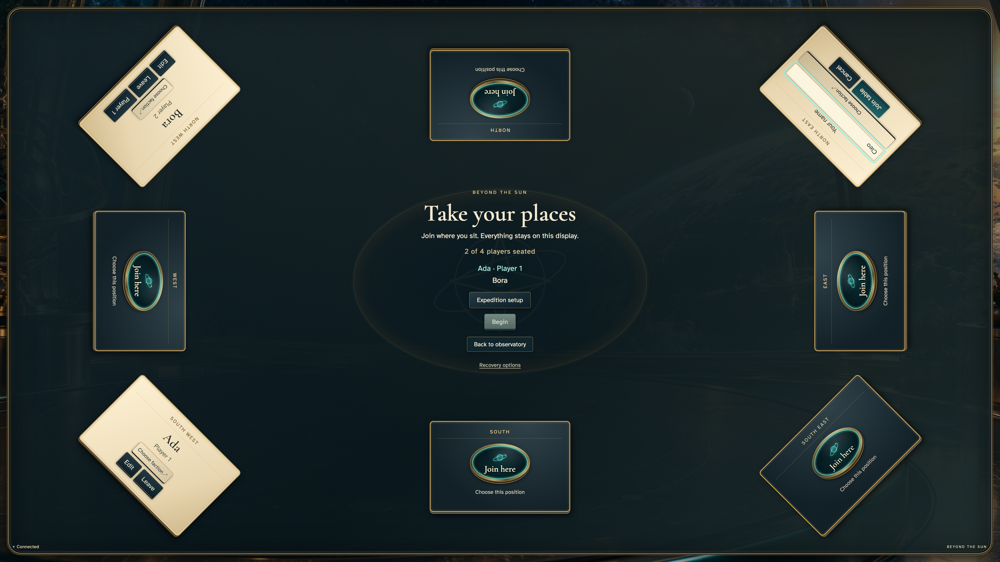](../../screenshots/settle-and-exile-a-rival-fleet-at-4-shared-corner-seats/010-seat-2-name-tabletop-4k-darwin.png)

- [x] Name this physical seat Cleo
- [x] Actual canonical effects and acknowledgement settle.
- [x] Public topology retains physical separation.
- [x] The viewport fits without page scrolling.

## 12. Persist the named seat on the same display

Viewpoint: **Cleo · North East · one shared controller**.

| desktop · 1440 × 1000 |
| --- |
|  |

tabletop-4k · 3840 × 2160

- [x] Persist the named seat on the same display
- [x] Actual canonical effects and acknowledgement settle.
- [x] Public topology retains physical separation.
- [x] The viewport fits without page scrolling.

## 13. Join directly at South East

Viewpoint: **Dara · South East · one shared controller**.

| desktop · 1440 × 1000 |
| --- |
| [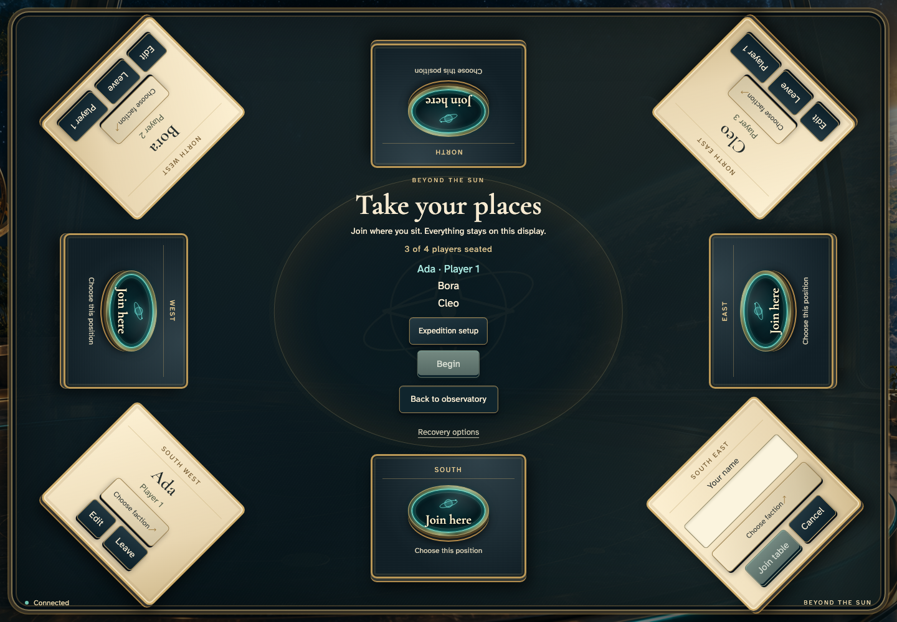](../../screenshots/settle-and-exile-a-rival-fleet-at-4-shared-corner-seats/012-seat-3-editor-desktop-darwin.png) |

tabletop-4k · 3840 × 2160

[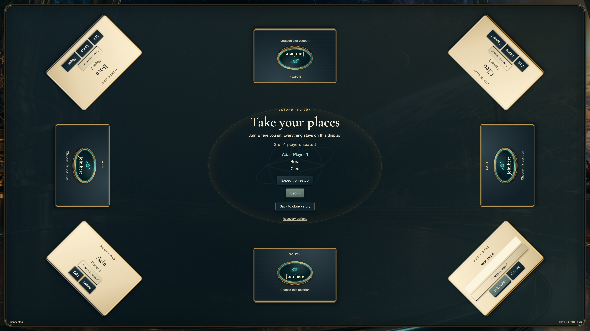](../../screenshots/settle-and-exile-a-rival-fleet-at-4-shared-corner-seats/012-seat-3-editor-tabletop-4k-darwin.png)

- [x] Join directly at South East
- [x] Actual canonical effects and acknowledgement settle.
- [x] Public topology retains physical separation.
- [x] The viewport fits without page scrolling.

## 14. Name this physical seat Dara

Viewpoint: **Dara · South East · one shared controller**.

| desktop · 1440 × 1000 |
| --- |
|  |

tabletop-4k · 3840 × 2160

- [x] Name this physical seat Dara
- [x] Actual canonical effects and acknowledgement settle.
- [x] Public topology retains physical separation.
- [x] The viewport fits without page scrolling.

## 15. Persist the named seat on the same display

Viewpoint: **Dara · South East · one shared controller**.

| desktop · 1440 × 1000 |
| --- |
|  |

tabletop-4k · 3840 × 2160

- [x] Persist the named seat on the same display
- [x] Actual canonical effects and acknowledgement settle.
- [x] Public topology retains physical separation.
- [x] The viewport fits without page scrolling.

## 16. Choose a legal unique Basic faction

Viewpoint: **Ada · South West · one shared controller**.

| desktop · 1440 × 1000 |
| --- |
| [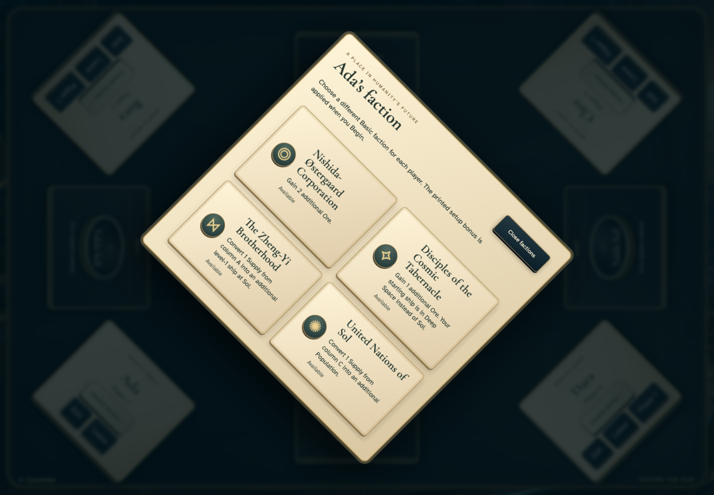](../../screenshots/settle-and-exile-a-rival-fleet-at-4-shared-corner-seats/015-faction-0-open-desktop-darwin.png) |

tabletop-4k · 3840 × 2160

- [x] Choose a legal unique Basic faction
- [x] Actual canonical effects and acknowledgement settle.
- [x] Public topology retains physical separation.
- [x] The viewport fits without page scrolling.

## 17. Ada chooses The Zheng-Yi Brotherhood

Viewpoint: **Ada · South West · one shared controller**.

| desktop · 1440 × 1000 |
| --- |
|  |

tabletop-4k · 3840 × 2160

- [x] Ada chooses The Zheng-Yi Brotherhood
- [x] Actual canonical effects and acknowledgement settle.
- [x] Public topology retains physical separation.
- [x] The viewport fits without page scrolling.

## 18. Choose a legal unique Basic faction

Viewpoint: **Bora · North West · one shared controller**.

| desktop · 1440 × 1000 |
| --- |
|  |

tabletop-4k · 3840 × 2160

- [x] Choose a legal unique Basic faction
- [x] Actual canonical effects and acknowledgement settle.
- [x] Public topology retains physical separation.
- [x] The viewport fits without page scrolling.

## 19. Bora chooses Nishida-Østergaard Corporation

Viewpoint: **Bora · North West · one shared controller**.

| desktop · 1440 × 1000 |
| --- |
|  |

tabletop-4k · 3840 × 2160

[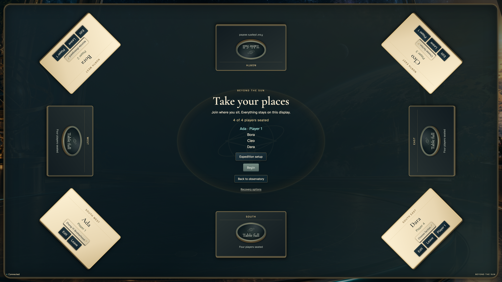](../../screenshots/settle-and-exile-a-rival-fleet-at-4-shared-corner-seats/018-faction-1-selected-tabletop-4k-darwin.png)

- [x] Bora chooses Nishida-Østergaard Corporation
- [x] Actual canonical effects and acknowledgement settle.
- [x] Public topology retains physical separation.
- [x] The viewport fits without page scrolling.

## 20. Choose a legal unique Basic faction

Viewpoint: **Cleo · North East · one shared controller**.

| desktop · 1440 × 1000 |
| --- |
| [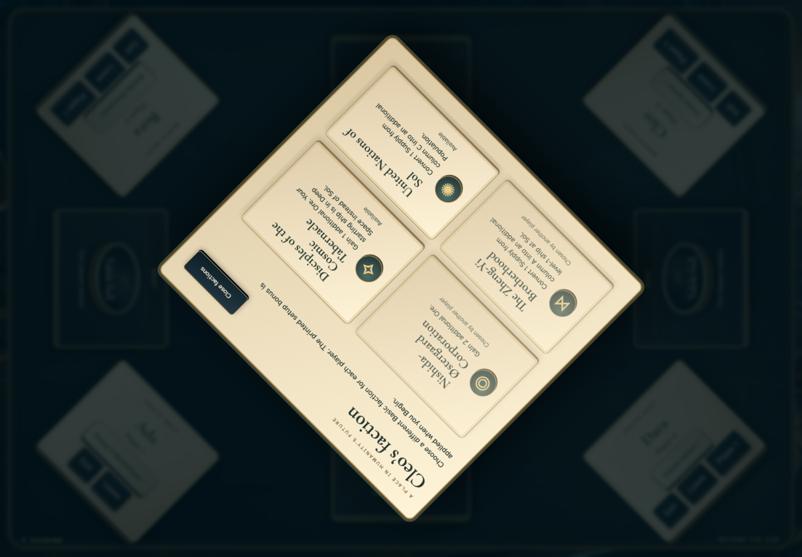](../../screenshots/settle-and-exile-a-rival-fleet-at-4-shared-corner-seats/019-faction-2-open-desktop-darwin.png) |

tabletop-4k · 3840 × 2160

[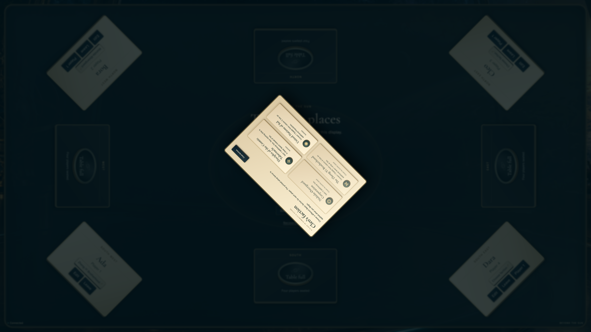](../../screenshots/settle-and-exile-a-rival-fleet-at-4-shared-corner-seats/019-faction-2-open-tabletop-4k-darwin.png)

- [x] Choose a legal unique Basic faction
- [x] Actual canonical effects and acknowledgement settle.
- [x] Public topology retains physical separation.
- [x] The viewport fits without page scrolling.

## 21. Cleo chooses United Nations of Sol

Viewpoint: **Cleo · North East · one shared controller**.

| desktop · 1440 × 1000 |
| --- |
| [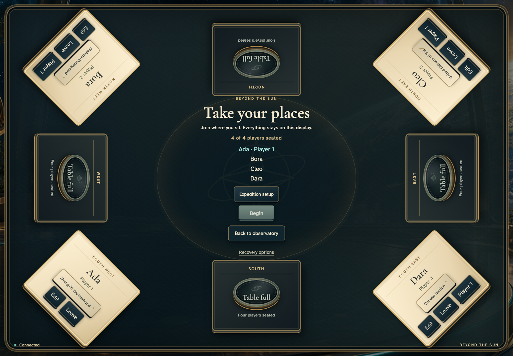](../../screenshots/settle-and-exile-a-rival-fleet-at-4-shared-corner-seats/020-faction-2-selected-desktop-darwin.png) |

tabletop-4k · 3840 × 2160

- [x] Cleo chooses United Nations of Sol
- [x] Actual canonical effects and acknowledgement settle.
- [x] Public topology retains physical separation.
- [x] The viewport fits without page scrolling.

## 22. Choose a legal unique Basic faction

Viewpoint: **Dara · South East · one shared controller**.

| desktop · 1440 × 1000 |
| --- |
| [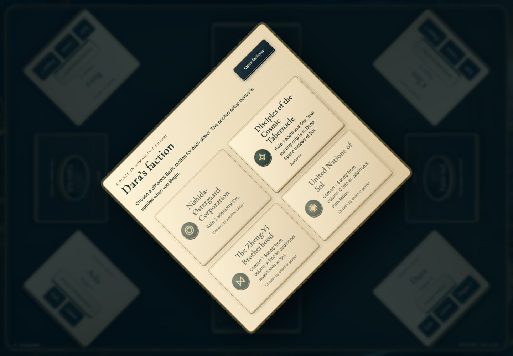](../../screenshots/settle-and-exile-a-rival-fleet-at-4-shared-corner-seats/021-faction-3-open-desktop-darwin.png) |

tabletop-4k · 3840 × 2160

[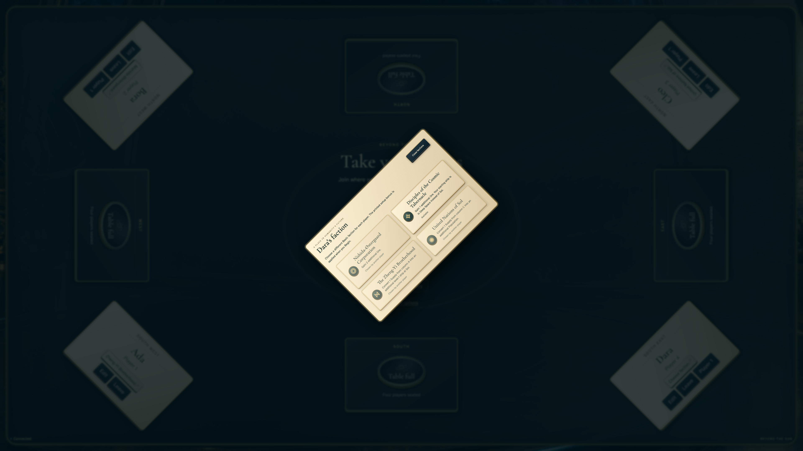](../../screenshots/settle-and-exile-a-rival-fleet-at-4-shared-corner-seats/021-faction-3-open-tabletop-4k-darwin.png)

- [x] Choose a legal unique Basic faction
- [x] Actual canonical effects and acknowledgement settle.
- [x] Public topology retains physical separation.
- [x] The viewport fits without page scrolling.

## 23. Dara chooses Disciples of the Cosmic Tabernacle

Viewpoint: **Dara · South East · one shared controller**.

| desktop · 1440 × 1000 |
| --- |
| [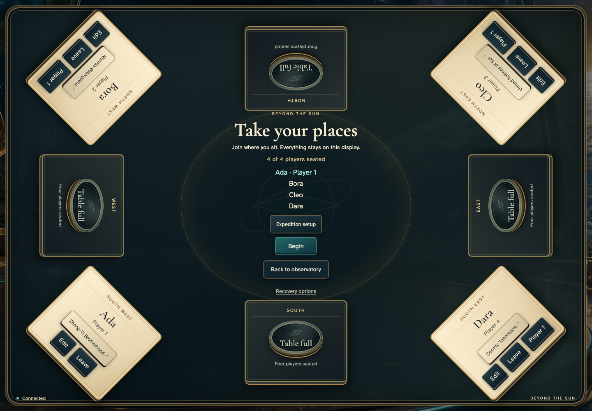](../../screenshots/settle-and-exile-a-rival-fleet-at-4-shared-corner-seats/022-faction-3-selected-desktop-darwin.png) |

tabletop-4k · 3840 × 2160

- [x] Dara chooses Disciples of the Cosmic Tabernacle
- [x] Actual canonical effects and acknowledgement settle.
- [x] Public topology retains physical separation.
- [x] The viewport fits without page scrolling.

## 24. Begin the immutable Basic game through normal UI

Viewpoint: **Ada · South West · one shared controller**.

| desktop · 1440 × 1000 |
| --- |
| [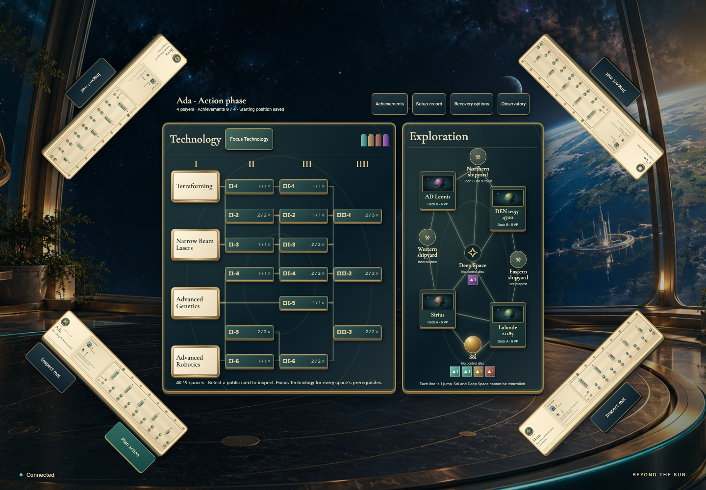](../../screenshots/settle-and-exile-a-rival-fleet-at-4-shared-corner-seats/023-begun-desktop-darwin.png) |

tabletop-4k · 3840 × 2160

- [x] Begin the immutable Basic game through normal UI
- [x] Actual canonical effects and acknowledgement settle.
- [x] Public topology retains physical separation.
- [x] The viewport fits without page scrolling.

## 25. Open Ada’s real Action instrument

Viewpoint: **Ada · South West · one shared controller**.

| desktop · 1440 × 1000 |
| --- |
|  |

tabletop-4k · 3840 × 2160

- [x] Open Ada’s real Action instrument
- [x] Actual canonical effects and acknowledgement settle.
- [x] Public topology retains physical separation.
- [x] The viewport fits without page scrolling.

## 26. Choose Research Level I

Viewpoint: **Ada · South West · one shared controller**.

| desktop · 1440 × 1000 |
| --- |
| [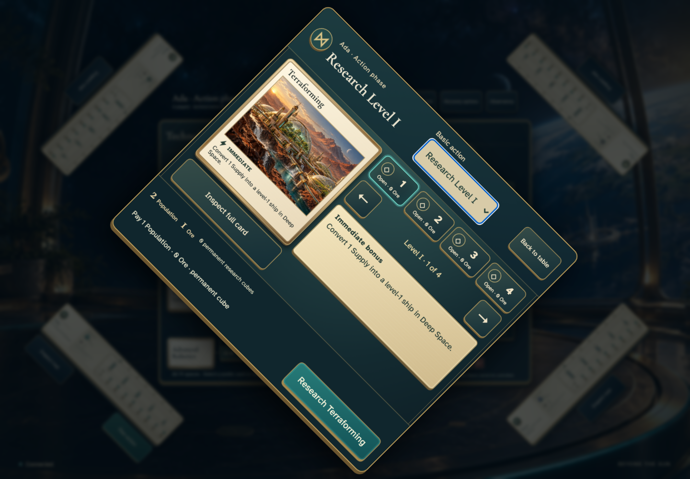](../../screenshots/settle-and-exile-a-rival-fleet-at-4-shared-corner-seats/025-terraforming-kind-desktop-darwin.png) |

tabletop-4k · 3840 × 2160

- [x] Choose Research Level I
- [x] Actual canonical effects and acknowledgement settle.
- [x] Public topology retains physical separation.
- [x] The viewport fits without page scrolling.

## 27. Choose a legal unoccupied research space

Viewpoint: **Ada · South West · one shared controller**.

| desktop · 1440 × 1000 |
| --- |
| [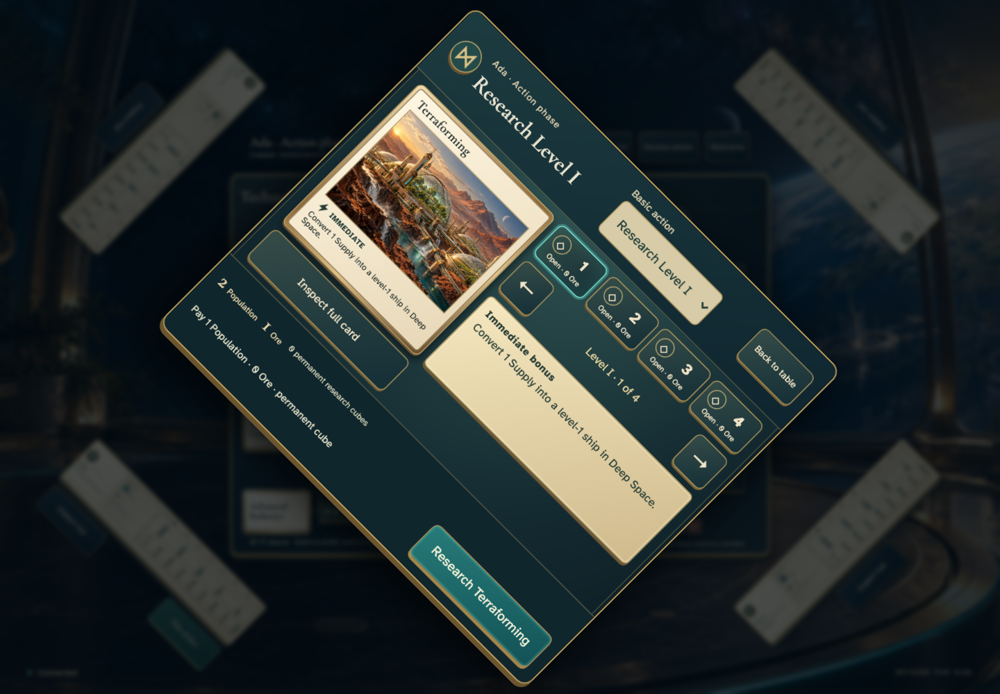](../../screenshots/settle-and-exile-a-rival-fleet-at-4-shared-corner-seats/026-terraforming-space-desktop-darwin.png) |

tabletop-4k · 3840 × 2160

[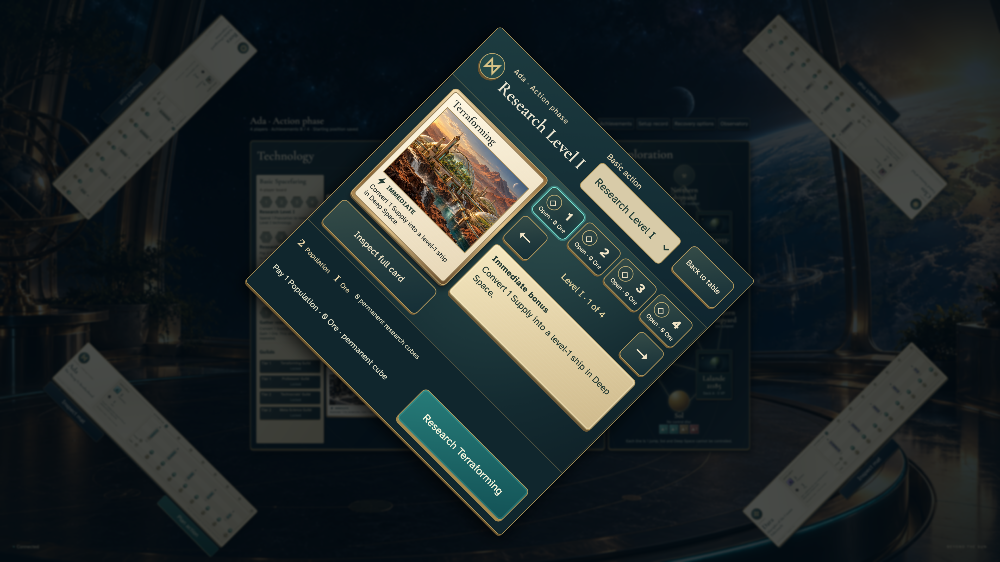](../../screenshots/settle-and-exile-a-rival-fleet-at-4-shared-corner-seats/026-terraforming-space-tabletop-4k-darwin.png)

- [x] Choose a legal unoccupied research space
- [x] Actual canonical effects and acknowledgement settle.
- [x] Public topology retains physical separation.
- [x] The viewport fits without page scrolling.

## 28. Pay the permanent research cube and resolve the once-only printed bonus

Viewpoint: **Ada · South West · one shared controller**.

| desktop · 1440 × 1000 |
| --- |
|  |

tabletop-4k · 3840 × 2160

[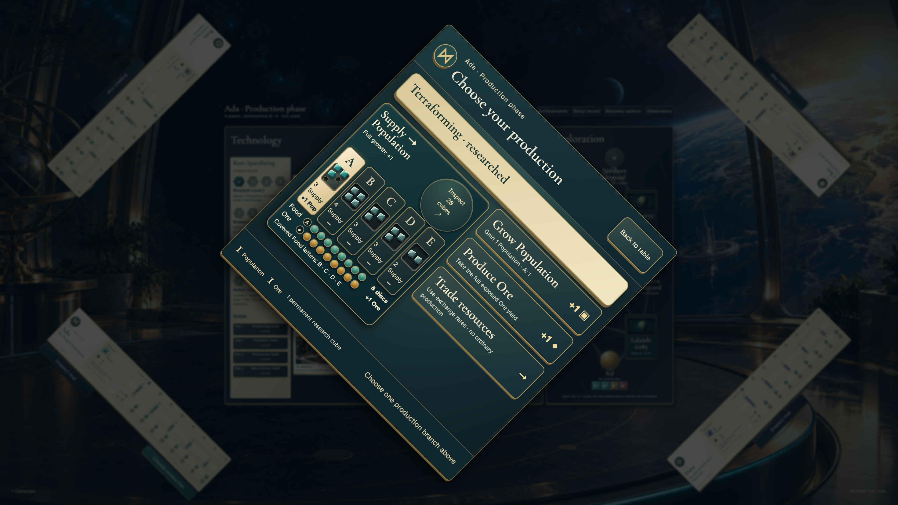](../../screenshots/settle-and-exile-a-rival-fleet-at-4-shared-corner-seats/027-terraforming-researched-tabletop-4k-darwin.png)

- [x] Pay the permanent research cube and resolve the once-only printed bonus
- [x] Actual canonical effects and acknowledgement settle.
- [x] Public topology retains physical separation.
- [x] The viewport fits without page scrolling.

## 29. Choose ordinary growth and hand off automatically

Viewpoint: **Ada · South West · one shared controller**.

| desktop · 1440 × 1000 |
| --- |
|  |

tabletop-4k · 3840 × 2160

- [x] Choose ordinary growth and hand off automatically
- [x] Actual canonical effects and acknowledgement settle.
- [x] Public topology retains physical separation.
- [x] The viewport fits without page scrolling.

## 30. Open Bora’s real Action instrument

Viewpoint: **Bora · North West · one shared controller**.

| desktop · 1440 × 1000 |
| --- |
|  |

tabletop-4k · 3840 × 2160

[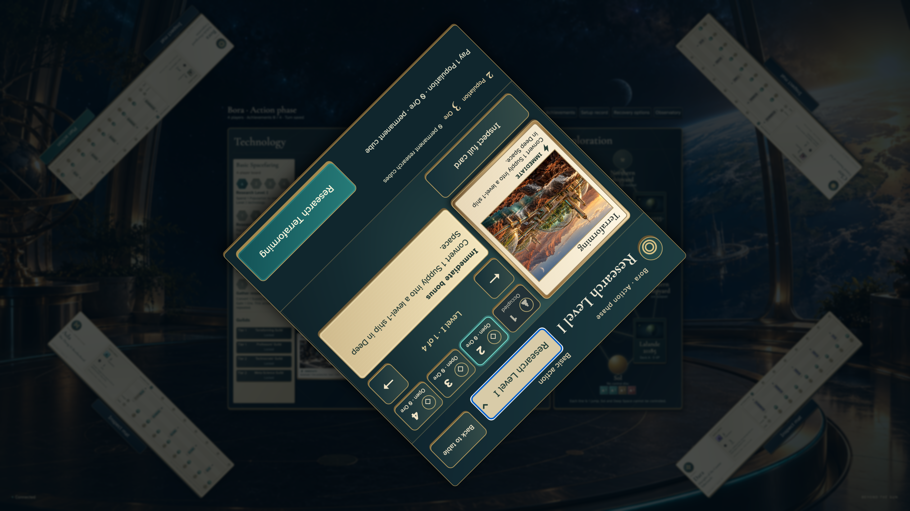](../../screenshots/settle-and-exile-a-rival-fleet-at-4-shared-corner-seats/029-bora-gather-open-tabletop-4k-darwin.png)

- [x] Open Bora’s real Action instrument
- [x] Actual canonical effects and acknowledgement settle.
- [x] Public topology retains physical separation.
- [x] The viewport fits without page scrolling.

## 31. Choose Gather

Viewpoint: **Bora · North West · one shared controller**.

| desktop · 1440 × 1000 |
| --- |
| [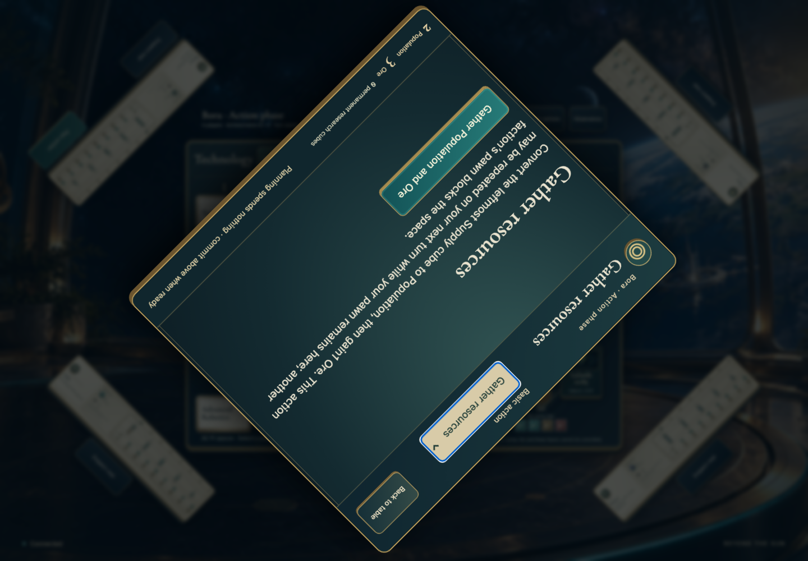](../../screenshots/settle-and-exile-a-rival-fleet-at-4-shared-corner-seats/030-bora-gather-kind-desktop-darwin.png) |

tabletop-4k · 3840 × 2160

[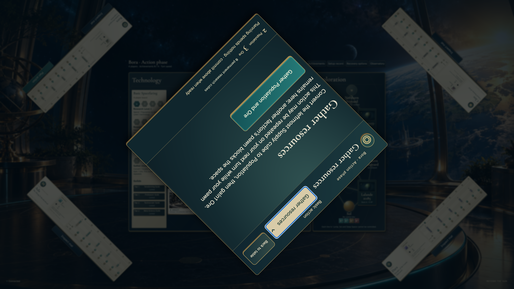](../../screenshots/settle-and-exile-a-rival-fleet-at-4-shared-corner-seats/030-bora-gather-kind-tabletop-4k-darwin.png)

- [x] Choose Gather
- [x] Actual canonical effects and acknowledgement settle.
- [x] Public topology retains physical separation.
- [x] The viewport fits without page scrolling.

## 32. Gather from actual leftmost Supply and gain the printed Ore

Viewpoint: **Bora · North West · one shared controller**.

| desktop · 1440 × 1000 |
| --- |
| [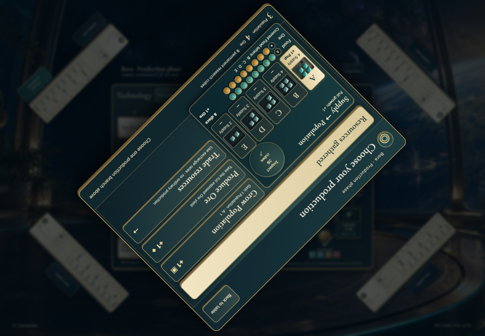](../../screenshots/settle-and-exile-a-rival-fleet-at-4-shared-corner-seats/031-bora-gather-paid-desktop-darwin.png) |

tabletop-4k · 3840 × 2160

[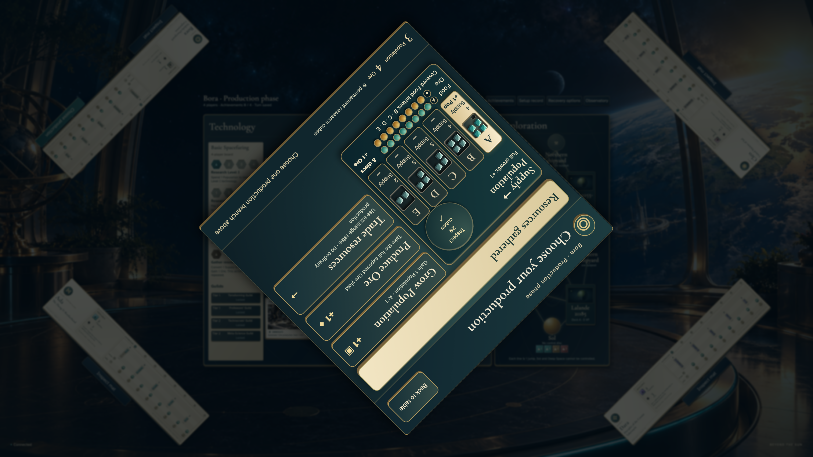](../../screenshots/settle-and-exile-a-rival-fleet-at-4-shared-corner-seats/031-bora-gather-paid-tabletop-4k-darwin.png)

- [x] Gather from actual leftmost Supply and gain the printed Ore
- [x] Actual canonical effects and acknowledgement settle.
- [x] Public topology retains physical separation.
- [x] The viewport fits without page scrolling.

## 33. Choose ordinary Ore production and hand off automatically

Viewpoint: **Bora · North West · one shared controller**.

| desktop · 1440 × 1000 |
| --- |
| [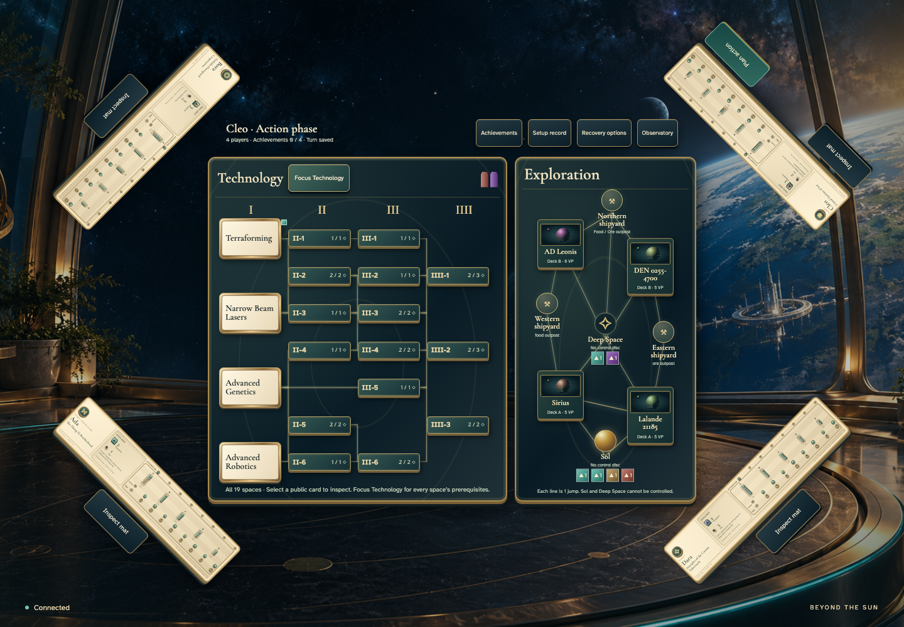](../../screenshots/settle-and-exile-a-rival-fleet-at-4-shared-corner-seats/032-bora-gather-handoff-desktop-darwin.png) |

tabletop-4k · 3840 × 2160

[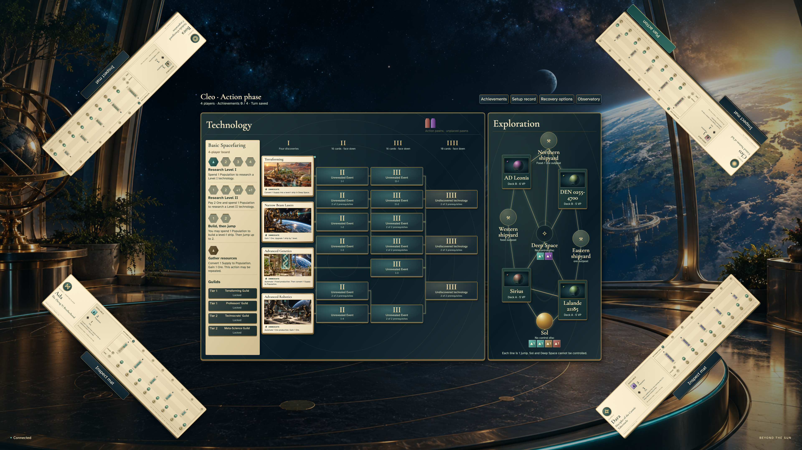](../../screenshots/settle-and-exile-a-rival-fleet-at-4-shared-corner-seats/032-bora-gather-handoff-tabletop-4k-darwin.png)

- [x] Choose ordinary Ore production and hand off automatically
- [x] Actual canonical effects and acknowledgement settle.
- [x] Public topology retains physical separation.
- [x] The viewport fits without page scrolling.

## 34. Open Cleo’s real Action instrument

Viewpoint: **Cleo · North East · one shared controller**.

| desktop · 1440 × 1000 |
| --- |
|  |

tabletop-4k · 3840 × 2160

- [x] Open Cleo’s real Action instrument
- [x] Actual canonical effects and acknowledgement settle.
- [x] Public topology retains physical separation.
- [x] The viewport fits without page scrolling.

## 35. Choose Research Level I

Viewpoint: **Cleo · North East · one shared controller**.

| desktop · 1440 × 1000 |
| --- |
| [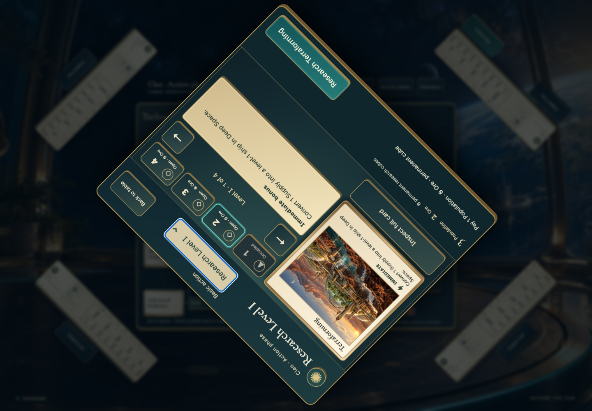](../../screenshots/settle-and-exile-a-rival-fleet-at-4-shared-corner-seats/034-cleo-first-kind-desktop-darwin.png) |

tabletop-4k · 3840 × 2160

- [x] Choose Research Level I
- [x] Actual canonical effects and acknowledgement settle.
- [x] Public topology retains physical separation.
- [x] The viewport fits without page scrolling.

## 36. Choose a legal unoccupied research space

Viewpoint: **Cleo · North East · one shared controller**.

| desktop · 1440 × 1000 |
| --- |
| [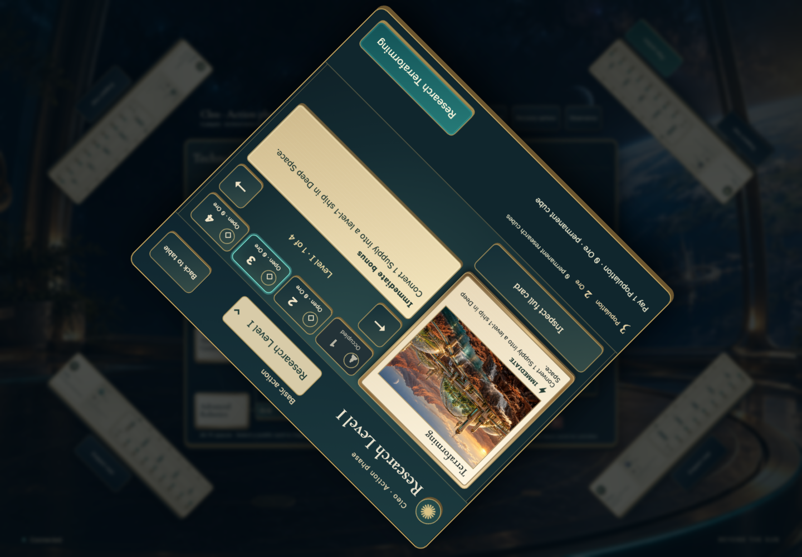](../../screenshots/settle-and-exile-a-rival-fleet-at-4-shared-corner-seats/035-cleo-first-space-desktop-darwin.png) |

tabletop-4k · 3840 × 2160

[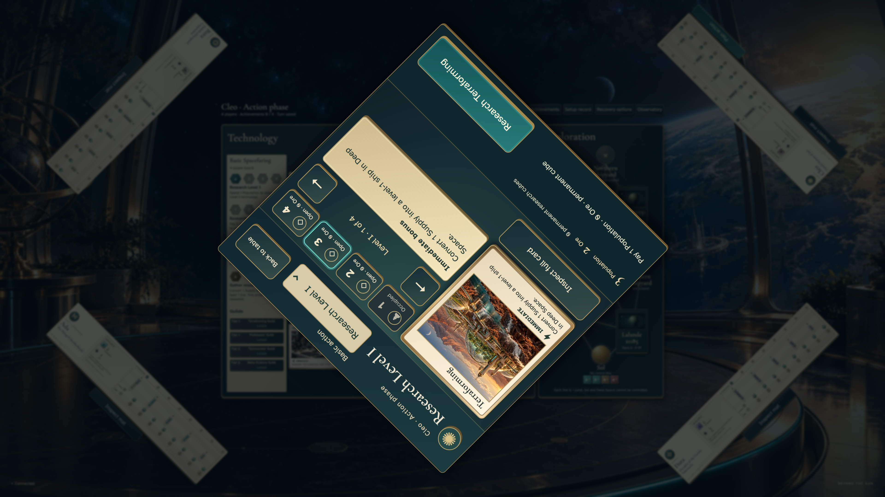](../../screenshots/settle-and-exile-a-rival-fleet-at-4-shared-corner-seats/035-cleo-first-space-tabletop-4k-darwin.png)

- [x] Choose a legal unoccupied research space
- [x] Actual canonical effects and acknowledgement settle.
- [x] Public topology retains physical separation.
- [x] The viewport fits without page scrolling.

## 37. Browse the next complete public Technology

Viewpoint: **Cleo · North East · one shared controller**.

| desktop · 1440 × 1000 |
| --- |
|  |

tabletop-4k · 3840 × 2160

[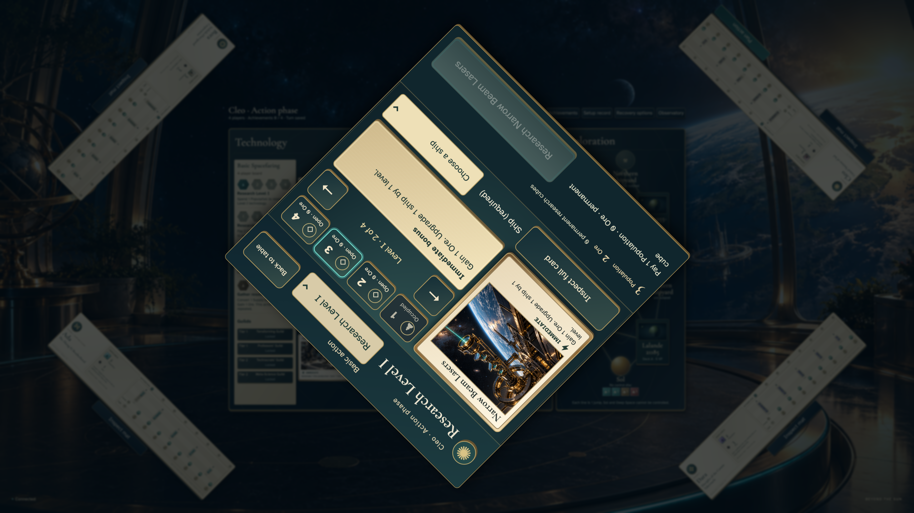](../../screenshots/settle-and-exile-a-rival-fleet-at-4-shared-corner-seats/036-cleo-first-browse-0-tabletop-4k-darwin.png)

- [x] Browse the next complete public Technology
- [x] Actual canonical effects and acknowledgement settle.
- [x] Public topology retains physical separation.
- [x] The viewport fits without page scrolling.

## 38. Browse the next complete public Technology

Viewpoint: **Cleo · North East · one shared controller**.

| desktop · 1440 × 1000 |
| --- |
| [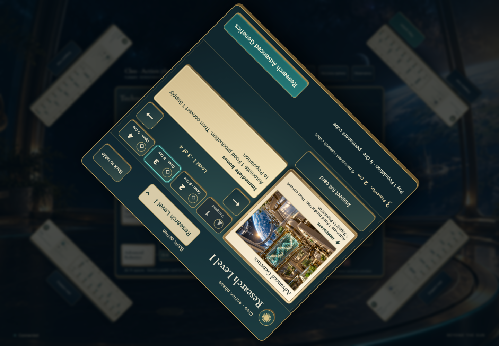](../../screenshots/settle-and-exile-a-rival-fleet-at-4-shared-corner-seats/037-cleo-first-browse-1-desktop-darwin.png) |

tabletop-4k · 3840 × 2160

[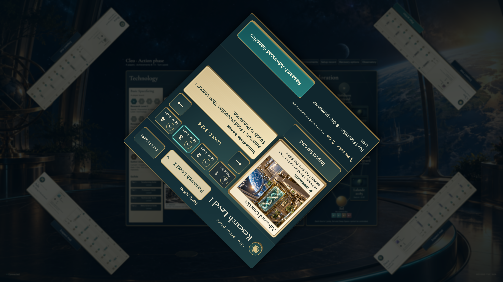](../../screenshots/settle-and-exile-a-rival-fleet-at-4-shared-corner-seats/037-cleo-first-browse-1-tabletop-4k-darwin.png)

- [x] Browse the next complete public Technology
- [x] Actual canonical effects and acknowledgement settle.
- [x] Public topology retains physical separation.
- [x] The viewport fits without page scrolling.

## 39. Browse the next complete public Technology

Viewpoint: **Cleo · North East · one shared controller**.

| desktop · 1440 × 1000 |
| --- |
| [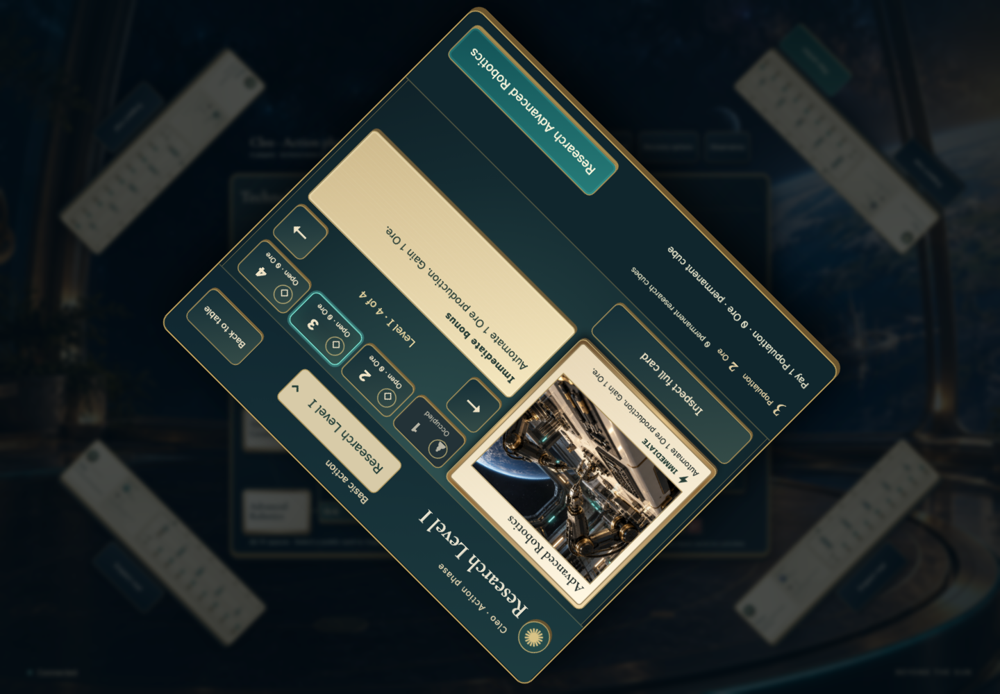](../../screenshots/settle-and-exile-a-rival-fleet-at-4-shared-corner-seats/038-cleo-first-browse-2-desktop-darwin.png) |

tabletop-4k · 3840 × 2160

[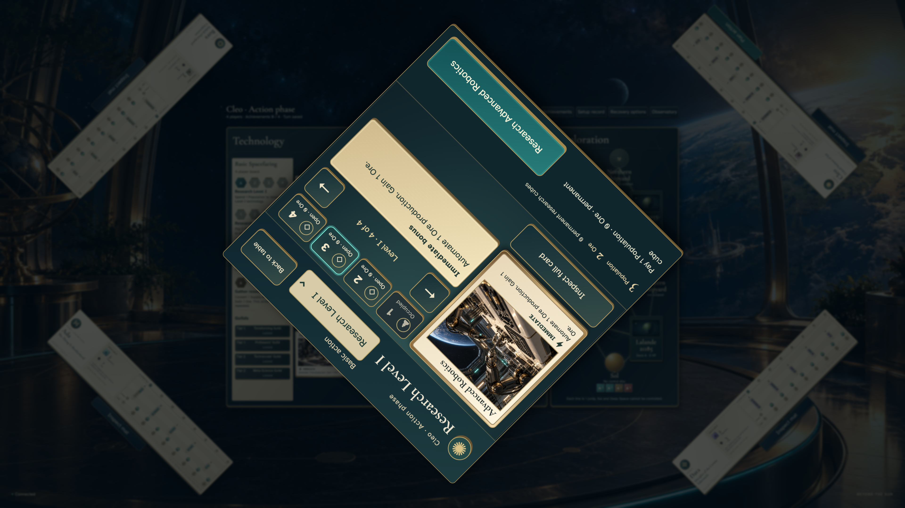](../../screenshots/settle-and-exile-a-rival-fleet-at-4-shared-corner-seats/038-cleo-first-browse-2-tabletop-4k-darwin.png)

- [x] Browse the next complete public Technology
- [x] Actual canonical effects and acknowledgement settle.
- [x] Public topology retains physical separation.
- [x] The viewport fits without page scrolling.

## 40. Pay the permanent research cube and resolve the once-only printed bonus

Viewpoint: **Cleo · North East · one shared controller**.

| desktop · 1440 × 1000 |
| --- |
|  |

tabletop-4k · 3840 × 2160

[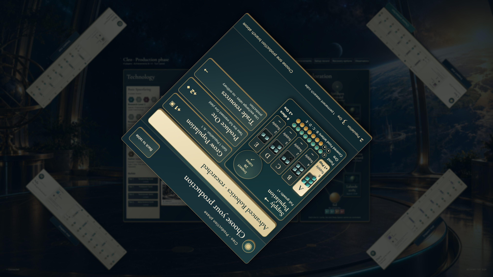](../../screenshots/settle-and-exile-a-rival-fleet-at-4-shared-corner-seats/039-cleo-first-researched-tabletop-4k-darwin.png)

- [x] Pay the permanent research cube and resolve the once-only printed bonus
- [x] Actual canonical effects and acknowledgement settle.
- [x] Public topology retains physical separation.
- [x] The viewport fits without page scrolling.

## 41. Choose ordinary Ore production and hand off automatically

Viewpoint: **Cleo · North East · one shared controller**.

| desktop · 1440 × 1000 |
| --- |
|  |

tabletop-4k · 3840 × 2160

[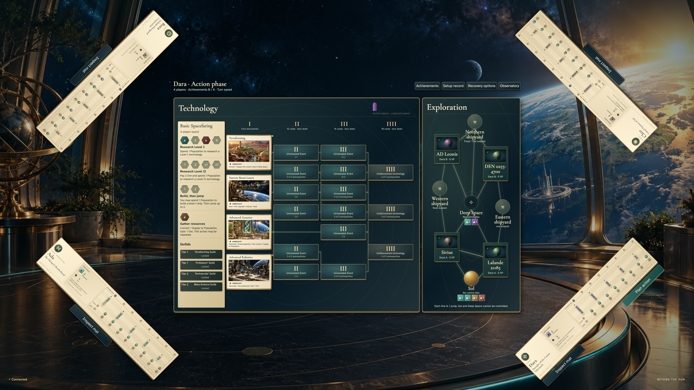](../../screenshots/settle-and-exile-a-rival-fleet-at-4-shared-corner-seats/040-cleo-first-handoff-tabletop-4k-darwin.png)

- [x] Choose ordinary Ore production and hand off automatically
- [x] Actual canonical effects and acknowledgement settle.
- [x] Public topology retains physical separation.
- [x] The viewport fits without page scrolling.

## 42. Open Dara’s real Action instrument

Viewpoint: **Dara · South East · one shared controller**.

| desktop · 1440 × 1000 |
| --- |
|  |

tabletop-4k · 3840 × 2160

- [x] Open Dara’s real Action instrument
- [x] Actual canonical effects and acknowledgement settle.
- [x] Public topology retains physical separation.
- [x] The viewport fits without page scrolling.

## 43. Choose Research Level I

Viewpoint: **Dara · South East · one shared controller**.

| desktop · 1440 × 1000 |
| --- |
| [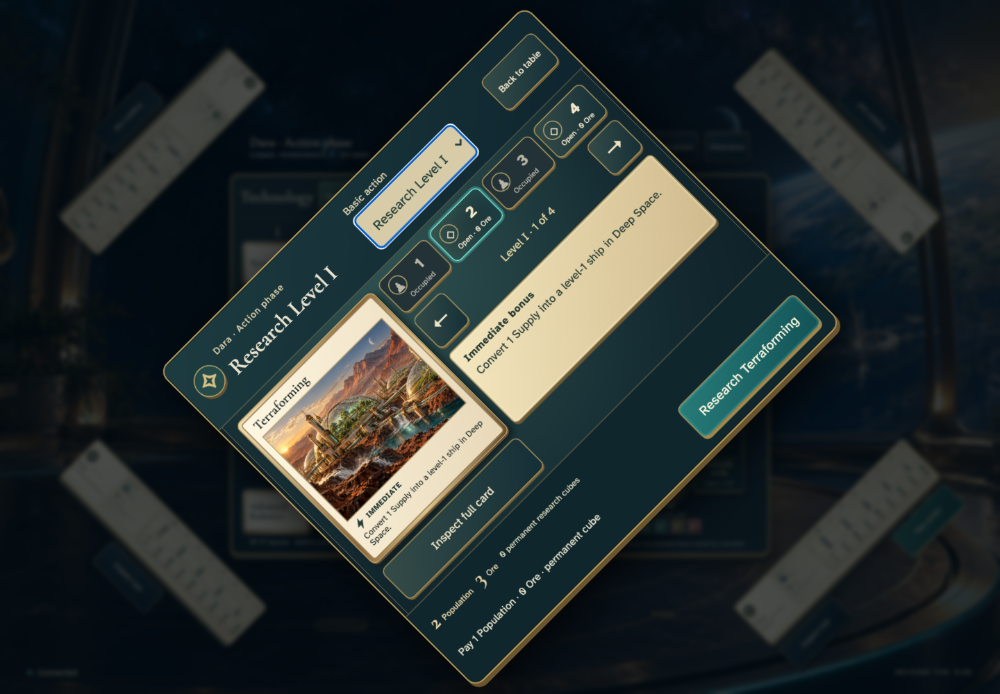](../../screenshots/settle-and-exile-a-rival-fleet-at-4-shared-corner-seats/042-dara-first-kind-desktop-darwin.png) |

tabletop-4k · 3840 × 2160

- [x] Choose Research Level I
- [x] Actual canonical effects and acknowledgement settle.
- [x] Public topology retains physical separation.
- [x] The viewport fits without page scrolling.

## 44. Choose a legal unoccupied research space

Viewpoint: **Dara · South East · one shared controller**.

| desktop · 1440 × 1000 |
| --- |
| [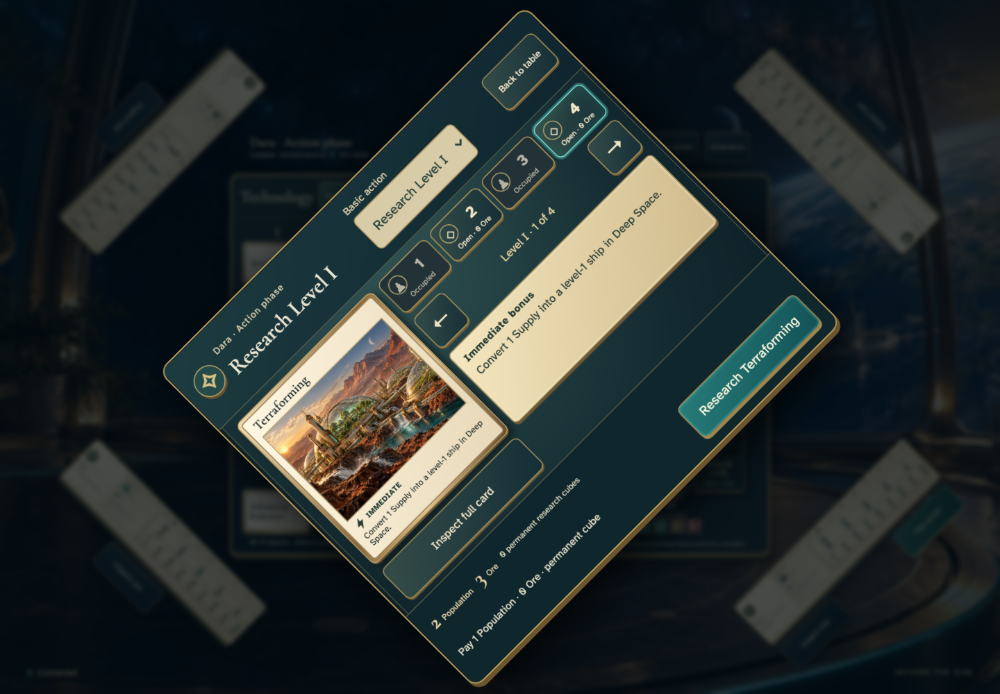](../../screenshots/settle-and-exile-a-rival-fleet-at-4-shared-corner-seats/043-dara-first-space-desktop-darwin.png) |

tabletop-4k · 3840 × 2160

[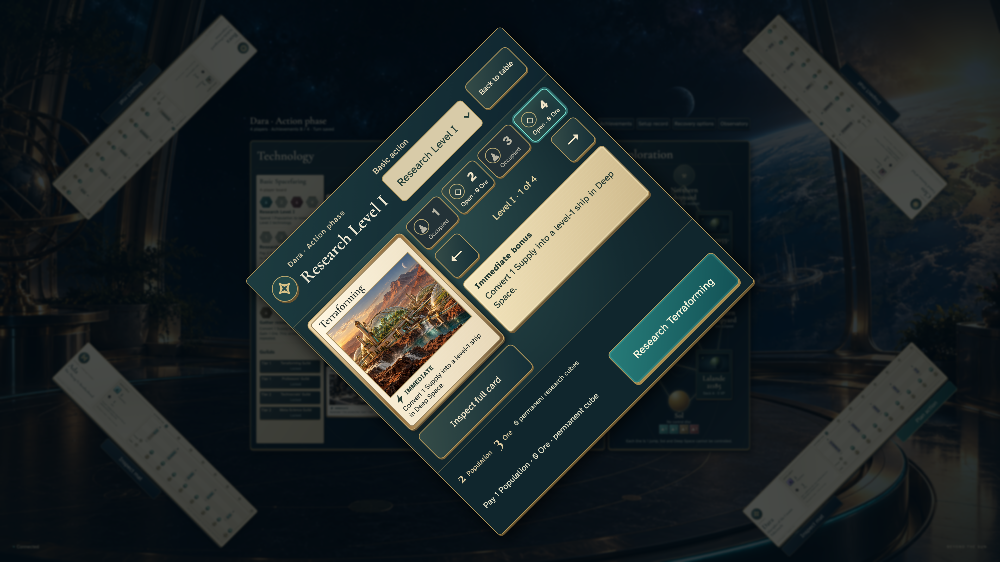](../../screenshots/settle-and-exile-a-rival-fleet-at-4-shared-corner-seats/043-dara-first-space-tabletop-4k-darwin.png)

- [x] Choose a legal unoccupied research space
- [x] Actual canonical effects and acknowledgement settle.
- [x] Public topology retains physical separation.
- [x] The viewport fits without page scrolling.

## 45. Browse the next complete public Technology

Viewpoint: **Dara · South East · one shared controller**.

| desktop · 1440 × 1000 |
| --- |
| [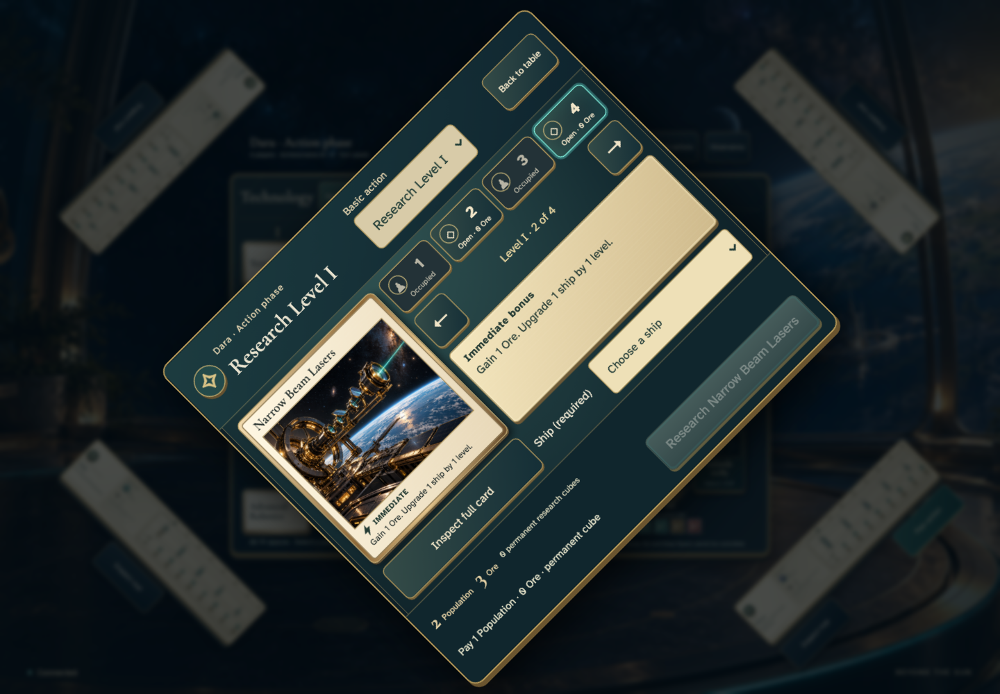](../../screenshots/settle-and-exile-a-rival-fleet-at-4-shared-corner-seats/044-dara-first-browse-0-desktop-darwin.png) |

tabletop-4k · 3840 × 2160

[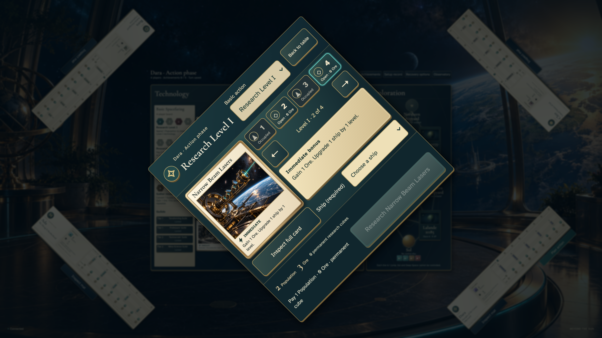](../../screenshots/settle-and-exile-a-rival-fleet-at-4-shared-corner-seats/044-dara-first-browse-0-tabletop-4k-darwin.png)

- [x] Browse the next complete public Technology
- [x] Actual canonical effects and acknowledgement settle.
- [x] Public topology retains physical separation.
- [x] The viewport fits without page scrolling.

## 46. Browse the next complete public Technology

Viewpoint: **Dara · South East · one shared controller**.

| desktop · 1440 × 1000 |
| --- |
| [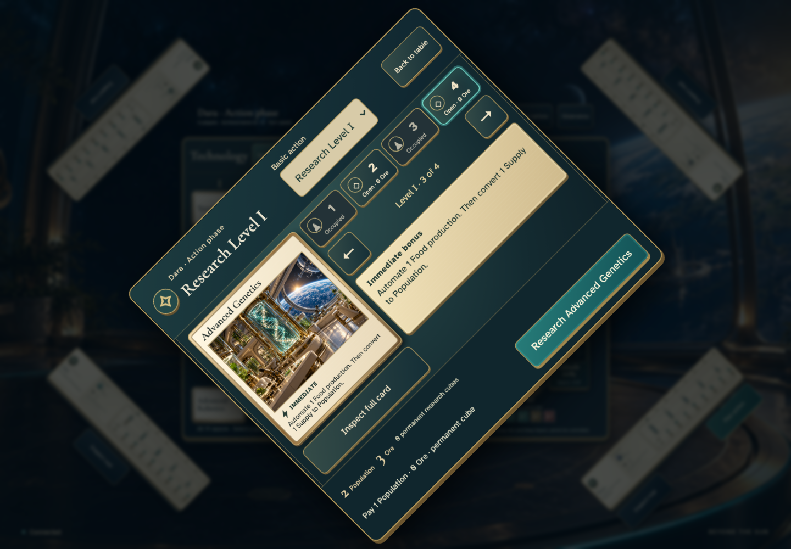](../../screenshots/settle-and-exile-a-rival-fleet-at-4-shared-corner-seats/045-dara-first-browse-1-desktop-darwin.png) |

tabletop-4k · 3840 × 2160

[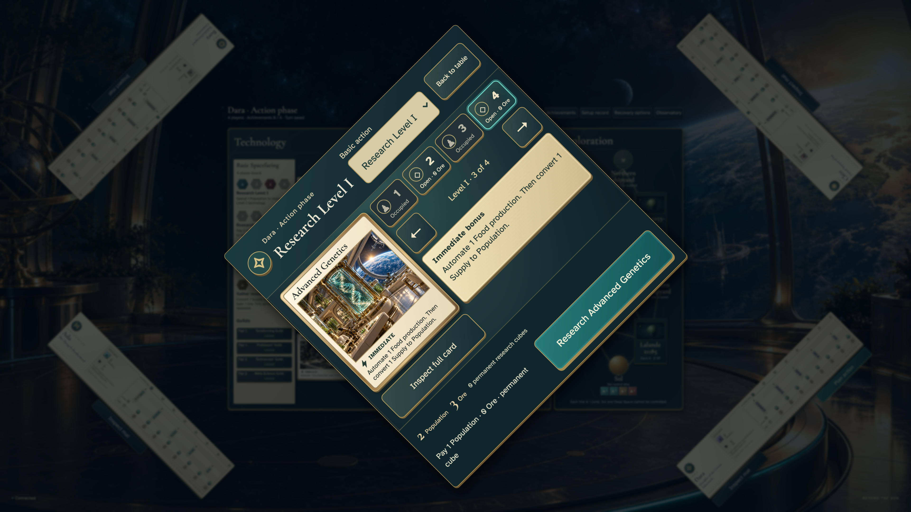](../../screenshots/settle-and-exile-a-rival-fleet-at-4-shared-corner-seats/045-dara-first-browse-1-tabletop-4k-darwin.png)

- [x] Browse the next complete public Technology
- [x] Actual canonical effects and acknowledgement settle.
- [x] Public topology retains physical separation.
- [x] The viewport fits without page scrolling.

## 47. Pay the permanent research cube and resolve the once-only printed bonus

Viewpoint: **Dara · South East · one shared controller**.

| desktop · 1440 × 1000 |
| --- |
| [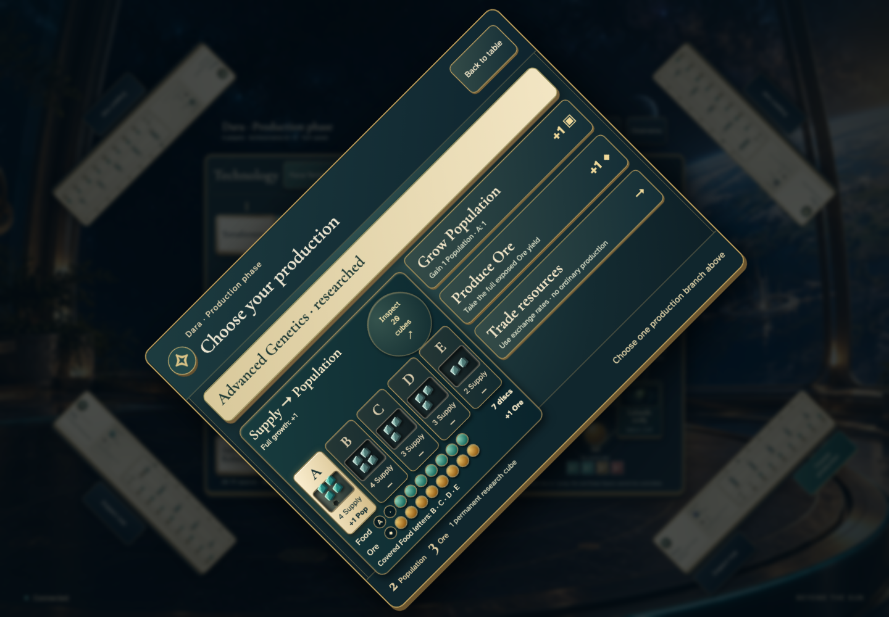](../../screenshots/settle-and-exile-a-rival-fleet-at-4-shared-corner-seats/046-dara-first-researched-desktop-darwin.png) |

tabletop-4k · 3840 × 2160

[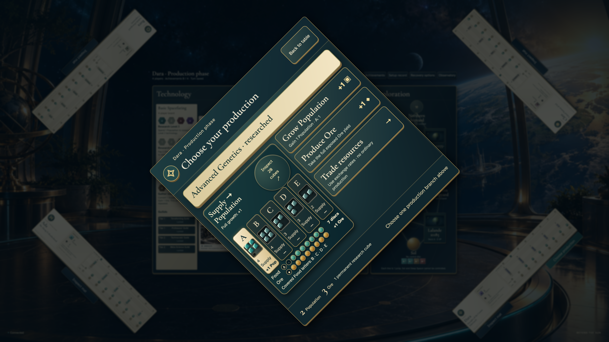](../../screenshots/settle-and-exile-a-rival-fleet-at-4-shared-corner-seats/046-dara-first-researched-tabletop-4k-darwin.png)

- [x] Pay the permanent research cube and resolve the once-only printed bonus
- [x] Actual canonical effects and acknowledgement settle.
- [x] Public topology retains physical separation.
- [x] The viewport fits without page scrolling.

## 48. Choose ordinary Ore production and hand off automatically

Viewpoint: **Dara · South East · one shared controller**.

| desktop · 1440 × 1000 |
| --- |
|  |

tabletop-4k · 3840 × 2160

- [x] Choose ordinary Ore production and hand off automatically
- [x] Actual canonical effects and acknowledgement settle.
- [x] Public topology retains physical separation.
- [x] The viewport fits without page scrolling.

## 49. Open Ada’s real Action instrument

Viewpoint: **Ada · South West · one shared controller**.

| desktop · 1440 × 1000 |
| --- |
| [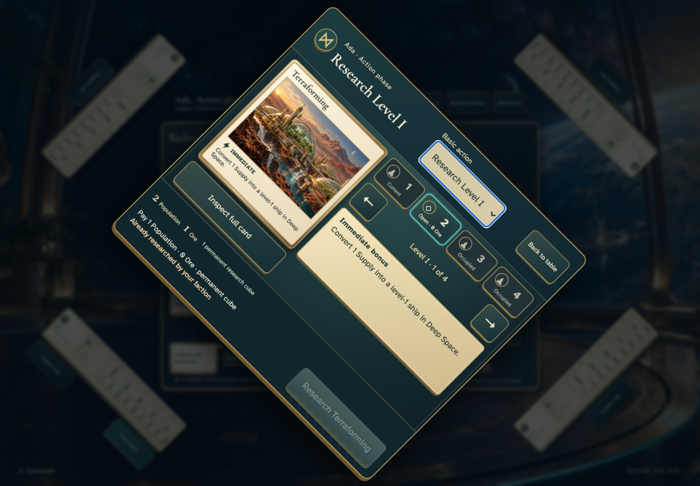](../../screenshots/settle-and-exile-a-rival-fleet-at-4-shared-corner-seats/048-terraforming-movement-open-desktop-darwin.png) |

tabletop-4k · 3840 × 2160

[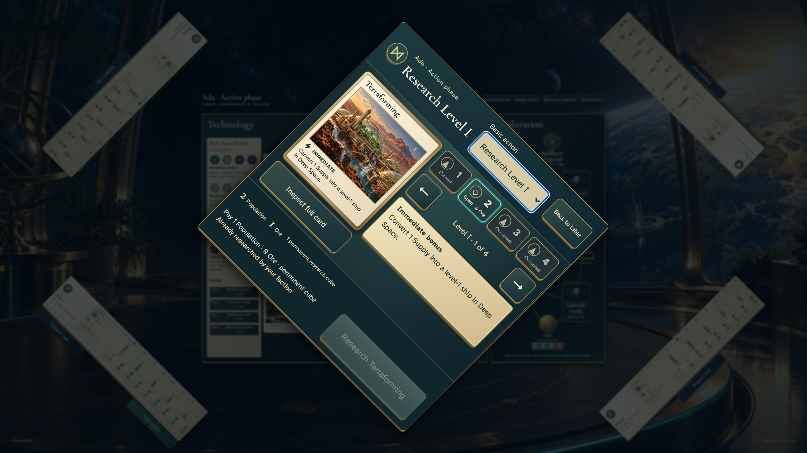](../../screenshots/settle-and-exile-a-rival-fleet-at-4-shared-corner-seats/048-terraforming-movement-open-tabletop-4k-darwin.png)

- [x] Open Ada’s real Action instrument
- [x] Actual canonical effects and acknowledgement settle.
- [x] Public topology retains physical separation.
- [x] The viewport fits without page scrolling.

## 50. Choose a researched printed Action

Viewpoint: **Ada · South West · one shared controller**.

| desktop · 1440 × 1000 |
| --- |
| [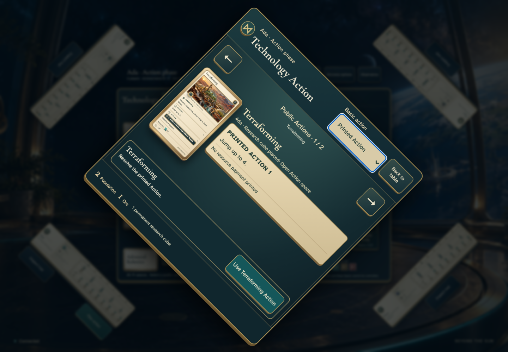](../../screenshots/settle-and-exile-a-rival-fleet-at-4-shared-corner-seats/049-terraforming-movement-kind-desktop-darwin.png) |

tabletop-4k · 3840 × 2160

[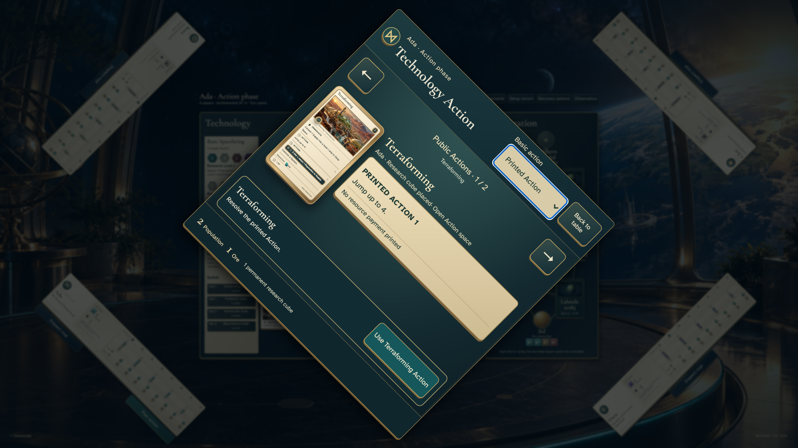](../../screenshots/settle-and-exile-a-rival-fleet-at-4-shared-corner-seats/049-terraforming-movement-kind-tabletop-4k-darwin.png)

- [x] Choose a researched printed Action
- [x] Actual canonical effects and acknowledgement settle.
- [x] Public topology retains physical separation.
- [x] The viewport fits without page scrolling.

## 51. Commit the real printed four-jump Action before planning endpoints

Viewpoint: **Ada · South West · one shared controller**.

| desktop · 1440 × 1000 |
| --- |
|  |

tabletop-4k · 3840 × 2160

- [x] Commit the real printed four-jump Action before planning endpoints
- [x] Actual canonical effects and acknowledgement settle.
- [x] Public topology retains physical separation.
- [x] The viewport fits without page scrolling.

## 52. Read actual connected destinations for the unpaid route

Viewpoint: **Ada · South West · one shared controller**.

| desktop · 1440 × 1000 |
| --- |
|  |

tabletop-4k · 3840 × 2160

- [x] Read actual connected destinations for the unpaid route
- [x] Actual canonical effects and acknowledgement settle.
- [x] Public topology retains physical separation.
- [x] The viewport fits without page scrolling.

## 53. Choose owned Ship 1 for movement

Viewpoint: **Ada · South West · one shared controller**.

| desktop · 1440 × 1000 |
| --- |
| [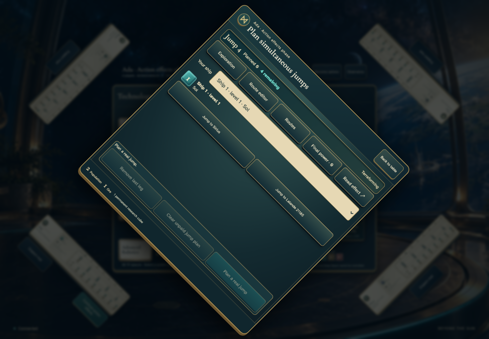](../../screenshots/settle-and-exile-a-rival-fleet-at-4-shared-corner-seats/052-settler-route-0-ship-desktop-darwin.png) |

tabletop-4k · 3840 × 2160

- [x] Choose owned Ship 1 for movement
- [x] Actual canonical effects and acknowledgement settle.
- [x] Public topology retains physical separation.
- [x] The viewport fits without page scrolling.

## 54. Plan the connected Sirius endpoint without moving a cube

Viewpoint: **Ada · South West · one shared controller**.

| desktop · 1440 × 1000 |
| --- |
|  |

tabletop-4k · 3840 × 2160

- [x] Plan the connected Sirius endpoint without moving a cube
- [x] Actual canonical effects and acknowledgement settle.
- [x] Public topology retains physical separation.
- [x] The viewport fits without page scrolling.

## 55. Read actual connected destinations for the unpaid route

Viewpoint: **Ada · South West · one shared controller**.

| desktop · 1440 × 1000 |
| --- |
|  |

tabletop-4k · 3840 × 2160

[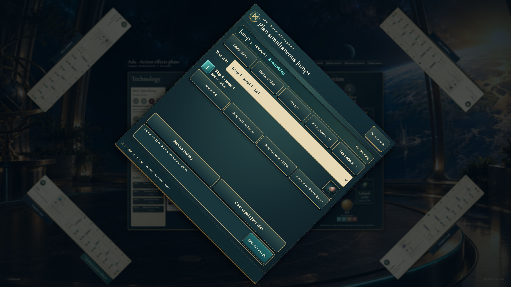](../../screenshots/settle-and-exile-a-rival-fleet-at-4-shared-corner-seats/054-settler-route-1-editor-tabletop-4k-darwin.png)

- [x] Read actual connected destinations for the unpaid route
- [x] Actual canonical effects and acknowledgement settle.
- [x] Public topology retains physical separation.
- [x] The viewport fits without page scrolling.

## 56. Choose owned Ship 2 for movement

Viewpoint: **Ada · South West · one shared controller**.

| desktop · 1440 × 1000 |
| --- |
| [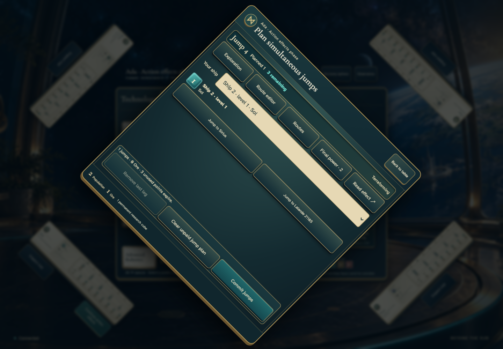](../../screenshots/settle-and-exile-a-rival-fleet-at-4-shared-corner-seats/055-settler-route-1-ship-desktop-darwin.png) |

tabletop-4k · 3840 × 2160

- [x] Choose owned Ship 2 for movement
- [x] Actual canonical effects and acknowledgement settle.
- [x] Public topology retains physical separation.
- [x] The viewport fits without page scrolling.

## 57. Plan the connected Sirius endpoint without moving a cube

Viewpoint: **Ada · South West · one shared controller**.

| desktop · 1440 × 1000 |
| --- |
|  |

tabletop-4k · 3840 × 2160

- [x] Plan the connected Sirius endpoint without moving a cube
- [x] Actual canonical effects and acknowledgement settle.
- [x] Public topology retains physical separation.
- [x] The viewport fits without page scrolling.

## 58. Read actual connected destinations for the unpaid route

Viewpoint: **Ada · South West · one shared controller**.

| desktop · 1440 × 1000 |
| --- |
|  |

tabletop-4k · 3840 × 2160

- [x] Read actual connected destinations for the unpaid route
- [x] Actual canonical effects and acknowledgement settle.
- [x] Public topology retains physical separation.
- [x] The viewport fits without page scrolling.

## 59. Choose owned Ship 3 for movement

Viewpoint: **Ada · South West · one shared controller**.

| desktop · 1440 × 1000 |
| --- |
|  |

tabletop-4k · 3840 × 2160

- [x] Choose owned Ship 3 for movement
- [x] Actual canonical effects and acknowledgement settle.
- [x] Public topology retains physical separation.
- [x] The viewport fits without page scrolling.

## 60. Plan the connected Sirius endpoint without moving a cube

Viewpoint: **Ada · South West · one shared controller**.

| desktop · 1440 × 1000 |
| --- |
|  |

tabletop-4k · 3840 × 2160

- [x] Plan the connected Sirius endpoint without moving a cube
- [x] Actual canonical effects and acknowledgement settle.
- [x] Public topology retains physical separation.
- [x] The viewport fits without page scrolling.

## 61. All three endpoints settle; the actual outpost is gained once

Viewpoint: **Ada · South West · one shared controller**.

| desktop · 1440 × 1000 |
| --- |
|  |

tabletop-4k · 3840 × 2160

- [x] All three endpoints settle; the actual outpost is gained once
- [x] Actual canonical effects and acknowledgement settle.
- [x] Public topology retains physical separation.
- [x] The viewport fits without page scrolling.

## 62. Choose ordinary Ore production and hand off automatically

Viewpoint: **Ada · South West · one shared controller**.

| desktop · 1440 × 1000 |
| --- |
|  |

tabletop-4k · 3840 × 2160

- [x] Choose ordinary Ore production and hand off automatically
- [x] Actual canonical effects and acknowledgement settle.
- [x] Public topology retains physical separation.
- [x] The viewport fits without page scrolling.

## 63. Open Bora’s real Action instrument

Viewpoint: **Bora · North West · one shared controller**.

| desktop · 1440 × 1000 |
| --- |
|  |

tabletop-4k · 3840 × 2160

- [x] Open Bora’s real Action instrument
- [x] Actual canonical effects and acknowledgement settle.
- [x] Public topology retains physical separation.
- [x] The viewport fits without page scrolling.

## 64. Choose Basic build and jump

Viewpoint: **Bora · North West · one shared controller**.

| desktop · 1440 × 1000 |
| --- |
|  |

tabletop-4k · 3840 × 2160

- [x] Choose Basic build and jump
- [x] Actual canonical effects and acknowledgement settle.
- [x] Public topology retains physical separation.
- [x] The viewport fits without page scrolling.

## 65. The rival pays for a real new ship before its optional jumps

Viewpoint: **Bora · North West · one shared controller**.

| desktop · 1440 × 1000 |
| --- |
|  |

tabletop-4k · 3840 × 2160

- [x] The rival pays for a real new ship before its optional jumps
- [x] Actual canonical effects and acknowledgement settle.
- [x] Public topology retains physical separation.
- [x] The viewport fits without page scrolling.

## 66. Read actual connected destinations for the unpaid route

Viewpoint: **Bora · North West · one shared controller**.

| desktop · 1440 × 1000 |
| --- |
|  |

tabletop-4k · 3840 × 2160

- [x] Read actual connected destinations for the unpaid route
- [x] Actual canonical effects and acknowledgement settle.
- [x] Public topology retains physical separation.
- [x] The viewport fits without page scrolling.

## 67. Choose owned Ship 1 for movement

Viewpoint: **Bora · North West · one shared controller**.

| desktop · 1440 × 1000 |
| --- |
|  |

tabletop-4k · 3840 × 2160

- [x] Choose owned Ship 1 for movement
- [x] Actual canonical effects and acknowledgement settle.
- [x] Public topology retains physical separation.
- [x] The viewport fits without page scrolling.

## 68. Plan the connected Sirius endpoint without moving a cube

Viewpoint: **Bora · North West · one shared controller**.

| desktop · 1440 × 1000 |
| --- |
|  |

tabletop-4k · 3840 × 2160

- [x] Plan the connected Sirius endpoint without moving a cube
- [x] Actual canonical effects and acknowledgement settle.
- [x] Public topology retains physical separation.
- [x] The viewport fits without page scrolling.

## 69. A weaker rival fleet arrives without taking the incumbent’s outpost

Viewpoint: **Bora · North West · one shared controller**.

| desktop · 1440 × 1000 |
| --- |
|  |

tabletop-4k · 3840 × 2160

- [x] A weaker rival fleet arrives without taking the incumbent’s outpost
- [x] Actual canonical effects and acknowledgement settle.
- [x] Public topology retains physical separation.
- [x] The viewport fits without page scrolling.

## 70. Choose ordinary Ore production and hand off automatically

Viewpoint: **Bora · North West · one shared controller**.

| desktop · 1440 × 1000 |
| --- |
|  |

tabletop-4k · 3840 × 2160

- [x] Choose ordinary Ore production and hand off automatically
- [x] Actual canonical effects and acknowledgement settle.
- [x] Public topology retains physical separation.
- [x] The viewport fits without page scrolling.

## 71. Open Cleo’s real Action instrument

Viewpoint: **Cleo · North East · one shared controller**.

| desktop · 1440 × 1000 |
| --- |
|  |

tabletop-4k · 3840 × 2160

- [x] Open Cleo’s real Action instrument
- [x] Actual canonical effects and acknowledgement settle.
- [x] Public topology retains physical separation.
- [x] The viewport fits without page scrolling.

## 72. Choose Research Level I

Viewpoint: **Cleo · North East · one shared controller**.

| desktop · 1440 × 1000 |
| --- |
|  |

tabletop-4k · 3840 × 2160

- [x] Choose Research Level I
- [x] Actual canonical effects and acknowledgement settle.
- [x] Public topology retains physical separation.
- [x] The viewport fits without page scrolling.

## 73. Choose a legal unoccupied research space

Viewpoint: **Cleo · North East · one shared controller**.

| desktop · 1440 × 1000 |
| --- |
|  |

tabletop-4k · 3840 × 2160

- [x] Choose a legal unoccupied research space
- [x] Actual canonical effects and acknowledgement settle.
- [x] Public topology retains physical separation.
- [x] The viewport fits without page scrolling.

## 74. Browse the next complete public Technology

Viewpoint: **Cleo · North East · one shared controller**.

| desktop · 1440 × 1000 |
| --- |
|  |

tabletop-4k · 3840 × 2160

- [x] Browse the next complete public Technology
- [x] Actual canonical effects and acknowledgement settle.
- [x] Public topology retains physical separation.
- [x] The viewport fits without page scrolling.

## 75. Browse the next complete public Technology

Viewpoint: **Cleo · North East · one shared controller**.

| desktop · 1440 × 1000 |
| --- |
|  |

tabletop-4k · 3840 × 2160

- [x] Browse the next complete public Technology
- [x] Actual canonical effects and acknowledgement settle.
- [x] Public topology retains physical separation.
- [x] The viewport fits without page scrolling.

## 76. Pay the permanent research cube and resolve the once-only printed bonus

Viewpoint: **Cleo · North East · one shared controller**.

| desktop · 1440 × 1000 |
| --- |
|  |

tabletop-4k · 3840 × 2160

- [x] Pay the permanent research cube and resolve the once-only printed bonus
- [x] Actual canonical effects and acknowledgement settle.
- [x] Public topology retains physical separation.
- [x] The viewport fits without page scrolling.

## 77. Choose ordinary Ore production and hand off automatically

Viewpoint: **Cleo · North East · one shared controller**.

| desktop · 1440 × 1000 |
| --- |
|  |

tabletop-4k · 3840 × 2160

- [x] Choose ordinary Ore production and hand off automatically
- [x] Actual canonical effects and acknowledgement settle.
- [x] Public topology retains physical separation.
- [x] The viewport fits without page scrolling.

## 78. Open Dara’s real Action instrument

Viewpoint: **Dara · South East · one shared controller**.

| desktop · 1440 × 1000 |
| --- |
|  |

tabletop-4k · 3840 × 2160

- [x] Open Dara’s real Action instrument
- [x] Actual canonical effects and acknowledgement settle.
- [x] Public topology retains physical separation.
- [x] The viewport fits without page scrolling.

## 79. Choose Research Level I

Viewpoint: **Dara · South East · one shared controller**.

| desktop · 1440 × 1000 |
| --- |
|  |

tabletop-4k · 3840 × 2160

- [x] Choose Research Level I
- [x] Actual canonical effects and acknowledgement settle.
- [x] Public topology retains physical separation.
- [x] The viewport fits without page scrolling.

## 80. Choose a legal unoccupied research space

Viewpoint: **Dara · South East · one shared controller**.

| desktop · 1440 × 1000 |
| --- |
|  |

tabletop-4k · 3840 × 2160

- [x] Choose a legal unoccupied research space
- [x] Actual canonical effects and acknowledgement settle.
- [x] Public topology retains physical separation.
- [x] The viewport fits without page scrolling.

## 81. Browse the next complete public Technology

Viewpoint: **Dara · South East · one shared controller**.

| desktop · 1440 × 1000 |
| --- |
|  |

tabletop-4k · 3840 × 2160

- [x] Browse the next complete public Technology
- [x] Actual canonical effects and acknowledgement settle.
- [x] Public topology retains physical separation.
- [x] The viewport fits without page scrolling.

## 82. Browse the next complete public Technology

Viewpoint: **Dara · South East · one shared controller**.

| desktop · 1440 × 1000 |
| --- |
|  |

tabletop-4k · 3840 × 2160

- [x] Browse the next complete public Technology
- [x] Actual canonical effects and acknowledgement settle.
- [x] Public topology retains physical separation.
- [x] The viewport fits without page scrolling.

## 83. Browse the next complete public Technology

Viewpoint: **Dara · South East · one shared controller**.

| desktop · 1440 × 1000 |
| --- |
|  |

tabletop-4k · 3840 × 2160

- [x] Browse the next complete public Technology
- [x] Actual canonical effects and acknowledgement settle.
- [x] Public topology retains physical separation.
- [x] The viewport fits without page scrolling.

## 84. Pay the permanent research cube and resolve the once-only printed bonus

Viewpoint: **Dara · South East · one shared controller**.

| desktop · 1440 × 1000 |
| --- |
|  |

tabletop-4k · 3840 × 2160

- [x] Pay the permanent research cube and resolve the once-only printed bonus
- [x] Actual canonical effects and acknowledgement settle.
- [x] Public topology retains physical separation.
- [x] The viewport fits without page scrolling.

## 85. Choose ordinary Ore production and hand off automatically

Viewpoint: **Dara · South East · one shared controller**.

| desktop · 1440 × 1000 |
| --- |
|  |

tabletop-4k · 3840 × 2160

- [x] Choose ordinary Ore production and hand off automatically
- [x] Actual canonical effects and acknowledgement settle.
- [x] Public topology retains physical separation.
- [x] The viewport fits without page scrolling.

## 86. Open Ada’s real Action instrument

Viewpoint: **Ada · South West · one shared controller**.

| desktop · 1440 × 1000 |
| --- |
|  |

tabletop-4k · 3840 × 2160

- [x] Open Ada’s real Action instrument
- [x] Actual canonical effects and acknowledgement settle.
- [x] Public topology retains physical separation.
- [x] The viewport fits without page scrolling.

## 87. Choose the printed colony Action

Viewpoint: **Ada · South West · one shared controller**.

| desktop · 1440 × 1000 |
| --- |
|  |

tabletop-4k · 3840 × 2160

- [x] Choose the printed colony Action
- [x] Actual canonical effects and acknowledgement settle.
- [x] Public topology retains physical separation.
- [x] The viewport fits without page scrolling.

## 88. Read the system settlement view

Viewpoint: **Ada · South West · one shared controller**.

| desktop · 1440 × 1000 |
| --- |
|  |

tabletop-4k · 3840 × 2160

- [x] Read the system settlement view
- [x] Actual canonical effects and acknowledgement settle.
- [x] Public topology retains physical separation.
- [x] The viewport fits without page scrolling.

## 89. Read the complete printed System before committing

Viewpoint: **Ada · South West · one shared controller**.

| desktop · 1440 × 1000 |
| --- |
|  |

tabletop-4k · 3840 × 2160

- [x] Read the complete printed System before committing
- [x] Actual canonical effects and acknowledgement settle.
- [x] Public topology retains physical separation.
- [x] The viewport fits without page scrolling.

## 90. Escape restores the exact System inspection opener

Viewpoint: **Ada · South West · one shared controller**.

| desktop · 1440 × 1000 |
| --- |
|  |

tabletop-4k · 3840 × 2160

- [x] Escape restores the exact System inspection opener
- [x] Actual canonical effects and acknowledgement settle.
- [x] Public topology retains physical separation.
- [x] The viewport fits without page scrolling.

## 91. Read the settlers settlement view

Viewpoint: **Ada · South West · one shared controller**.

| desktop · 1440 × 1000 |
| --- |
|  |

tabletop-4k · 3840 × 2160

- [x] Read the settlers settlement view
- [x] Actual canonical effects and acknowledgement settle.
- [x] Public topology retains physical separation.
- [x] The viewport fits without page scrolling.

## 92. Select owned settling Ship 1 without spending resources

Viewpoint: **Ada · South West · one shared controller**.

| desktop · 1440 × 1000 |
| --- |
|  |

tabletop-4k · 3840 × 2160

- [x] Select owned settling Ship 1 without spending resources
- [x] Actual canonical effects and acknowledgement settle.
- [x] Public topology retains physical separation.
- [x] The viewport fits without page scrolling.

## 93. Read the next real owned settling cube

Viewpoint: **Ada · South West · one shared controller**.

| desktop · 1440 × 1000 |
| --- |
|  |

tabletop-4k · 3840 × 2160

- [x] Read the next real owned settling cube
- [x] Actual canonical effects and acknowledgement settle.
- [x] Public topology retains physical separation.
- [x] The viewport fits without page scrolling.

## 94. Select owned settling Ship 2 without spending resources

Viewpoint: **Ada · South West · one shared controller**.

| desktop · 1440 × 1000 |
| --- |
|  |

tabletop-4k · 3840 × 2160

- [x] Select owned settling Ship 2 without spending resources
- [x] Actual canonical effects and acknowledgement settle.
- [x] Public topology retains physical separation.
- [x] The viewport fits without page scrolling.

## 95. Read the next real owned settling cube

Viewpoint: **Ada · South West · one shared controller**.

| desktop · 1440 × 1000 |
| --- |
|  |

tabletop-4k · 3840 × 2160

- [x] Read the next real owned settling cube
- [x] Actual canonical effects and acknowledgement settle.
- [x] Public topology retains physical separation.
- [x] The viewport fits without page scrolling.

## 96. Select owned settling Ship 3 without spending resources

Viewpoint: **Ada · South West · one shared controller**.

| desktop · 1440 × 1000 |
| --- |
|  |

tabletop-4k · 3840 × 2160

- [x] Select owned settling Ship 3 without spending resources
- [x] Actual canonical effects and acknowledgement settle.
- [x] Public topology retains physical separation.
- [x] The viewport fits without page scrolling.

## 97. Three own cubes meet the printed three-power requirement; the rival is exiled after commitment

Viewpoint: **Ada · South West · one shared controller**.

| desktop · 1440 × 1000 |
| --- |
|  |

tabletop-4k · 3840 × 2160

- [x] Three own cubes meet the printed three-power requirement; the rival is exiled after commitment
- [x] Actual canonical effects and acknowledgement settle.
- [x] Public topology retains physical separation.
- [x] The viewport fits without page scrolling.

## 98. Read the outcome settlement view

Viewpoint: **Ada · South West · one shared controller**.

| desktop · 1440 × 1000 |
| --- |
|  |

tabletop-4k · 3840 × 2160

- [x] Read the outcome settlement view
- [x] Actual canonical effects and acknowledgement settle.
- [x] Public topology retains physical separation.
- [x] The viewport fits without page scrolling.

## 99. Read the ordered returns consequence without revealing a deck card

Viewpoint: **Ada · South West · one shared controller**.

| desktop · 1440 × 1000 |
| --- |
|  |

tabletop-4k · 3840 × 2160

- [x] Read the ordered returns consequence without revealing a deck card
- [x] Actual canonical effects and acknowledgement settle.
- [x] Public topology retains physical separation.
- [x] The viewport fits without page scrolling.

## 100. Read the ordered replacement consequence without revealing a deck card

Viewpoint: **Ada · South West · one shared controller**.

| desktop · 1440 × 1000 |
| --- |
|  |

tabletop-4k · 3840 × 2160

- [x] Read the ordered replacement consequence without revealing a deck card
- [x] Actual canonical effects and acknowledgement settle.
- [x] Public topology retains physical separation.
- [x] The viewport fits without page scrolling.

## 101. Read the ordered disc consequence without revealing a deck card

Viewpoint: **Ada · South West · one shared controller**.

| desktop · 1440 × 1000 |
| --- |
|  |

tabletop-4k · 3840 × 2160

- [x] Read the ordered disc consequence without revealing a deck card
- [x] Actual canonical effects and acknowledgement settle.
- [x] Public topology retains physical separation.
- [x] The viewport fits without page scrolling.

## 102. Read the ordered benefit consequence without revealing a deck card

Viewpoint: **Ada · South West · one shared controller**.

| desktop · 1440 × 1000 |
| --- |
|  |

tabletop-4k · 3840 × 2160

- [x] Read the ordered benefit consequence without revealing a deck card
- [x] Actual canonical effects and acknowledgement settle.
- [x] Public topology retains physical separation.
- [x] The viewport fits without page scrolling.

## 103. The additional disc and actual available printed benefit finish before ordinary Production

Viewpoint: **Ada · South West · one shared controller**.

| desktop · 1440 × 1000 |
| --- |
|  |

tabletop-4k · 3840 × 2160

- [x] The additional disc and actual available printed benefit finish before ordinary Production
- [x] Actual canonical effects and acknowledgement settle.
- [x] Public topology retains physical separation.
- [x] The viewport fits without page scrolling.

## 104. Reload retains the permanent colony and pending Production

Viewpoint: **Ada · South West · one shared controller**.

| desktop · 1440 × 1000 |
| --- |
|  |

tabletop-4k · 3840 × 2160

- [x] Reload retains the permanent colony and pending Production
- [x] Actual canonical effects and acknowledgement settle.
- [x] Public topology retains physical separation.
- [x] The viewport fits without page scrolling.

## 105. Reopening the saved Production never repeats the payment or colony benefit

Viewpoint: **Ada · South West · one shared controller**.

| desktop · 1440 × 1000 |
| --- |
|  |

tabletop-4k · 3840 × 2160

- [x] Reopening the saved Production never repeats the payment or colony benefit
- [x] Actual canonical effects and acknowledgement settle.
- [x] Public topology retains physical separation.
- [x] The viewport fits without page scrolling.

## 106. The public table shows its newly revealed System and the saved colony

Viewpoint: **Ada · South West · one shared controller**.

| desktop · 1440 × 1000 |
| --- |
|  |

tabletop-4k · 3840 × 2160

- [x] The public table shows its newly revealed System and the saved colony
- [x] Actual canonical effects and acknowledgement settle.
- [x] Public topology retains physical separation.
- [x] The viewport fits without page scrolling.

## 107. Read the saved rival exile and newly refilled public map after settlement

Viewpoint: **Ada · South West · one shared controller**.

| desktop · 1440 × 1000 |
| --- |
|  |

tabletop-4k · 3840 × 2160

- [x] Read the saved rival exile and newly refilled public map after settlement
- [x] Actual canonical effects and acknowledgement settle.
- [x] Public topology retains physical separation.
- [x] The viewport fits without page scrolling.

## 108. Inspect actual production discs and permanent automation separately

Viewpoint: **Ada · South West · one shared controller**.

| desktop · 1440 × 1000 |
| --- |
|  |

tabletop-4k · 3840 × 2160

- [x] Inspect actual production discs and permanent automation separately
- [x] Actual canonical effects and acknowledgement settle.
- [x] Public topology retains physical separation.
- [x] The viewport fits without page scrolling.

## 109. Inspect the actual surviving fleet after settlement and printed benefit

Viewpoint: **Ada · South West · one shared controller**.

| desktop · 1440 × 1000 |
| --- |
|  |

tabletop-4k · 3840 × 2160

- [x] Inspect the actual surviving fleet after settlement and printed benefit
- [x] Actual canonical effects and acknowledgement settle.
- [x] Public topology retains physical separation.
- [x] The viewport fits without page scrolling.

## 110. The permanent register retains both actual discs and printed System identity

Viewpoint: **Ada · South West · one shared controller**.

| desktop · 1440 × 1000 |
| --- |
|  |

tabletop-4k · 3840 × 2160

- [x] The permanent register retains both actual discs and printed System identity
- [x] Actual canonical effects and acknowledgement settle.
- [x] Public topology retains physical separation.
- [x] The viewport fits without page scrolling.

## 111. Inspect the complete acquired card through the reusable production renderer

Viewpoint: **Ada · South West · one shared controller**.

| desktop · 1440 × 1000 |
| --- |
|  |

tabletop-4k · 3840 × 2160

- [x] Inspect the complete acquired card through the reusable production renderer
- [x] Actual canonical effects and acknowledgement settle.
- [x] Public topology retains physical separation.
- [x] The viewport fits without page scrolling.

## 112. Escape returns to the exact acquired-card opener

Viewpoint: **Ada · South West · one shared controller**.

| desktop · 1440 × 1000 |
| --- |
|  |

tabletop-4k · 3840 × 2160

- [x] Escape returns to the exact acquired-card opener
- [x] Actual canonical effects and acknowledgement settle.
- [x] Public topology retains physical separation.
- [x] The viewport fits without page scrolling.

## 113. Closing Fleet restores the exact Fleet opener

Viewpoint: **Ada · South West · one shared controller**.

| desktop · 1440 × 1000 |
| --- |
|  |

tabletop-4k · 3840 × 2160

- [x] Closing Fleet restores the exact Fleet opener
- [x] Actual canonical effects and acknowledgement settle.
- [x] Public topology retains physical separation.
- [x] The viewport fits without page scrolling.

## 114. Closing the mat restores its exact opener without consuming Production

Viewpoint: **Ada · South West · one shared controller**.

| desktop · 1440 × 1000 |
| --- |
|  |

tabletop-4k · 3840 × 2160

- [x] Closing the mat restores its exact opener without consuming Production
- [x] Actual canonical effects and acknowledgement settle.
- [x] Public topology retains physical separation.
- [x] The viewport fits without page scrolling.

## 115. Return to the same retained Production after inspection

Viewpoint: **Ada · South West · one shared controller**.

| desktop · 1440 × 1000 |
| --- |
|  |

tabletop-4k · 3840 × 2160

- [x] Return to the same retained Production after inspection
- [x] Actual canonical effects and acknowledgement settle.
- [x] Public topology retains physical separation.
- [x] The viewport fits without page scrolling.

## 116. Choose ordinary Ore production and hand off automatically

Viewpoint: **Ada · South West · one shared controller**.

| desktop · 1440 × 1000 |
| --- |
|  |

tabletop-4k · 3840 × 2160

- [x] Choose ordinary Ore production and hand off automatically
- [x] Actual canonical effects and acknowledgement settle.
- [x] Public topology retains physical separation.
- [x] The viewport fits without page scrolling.
